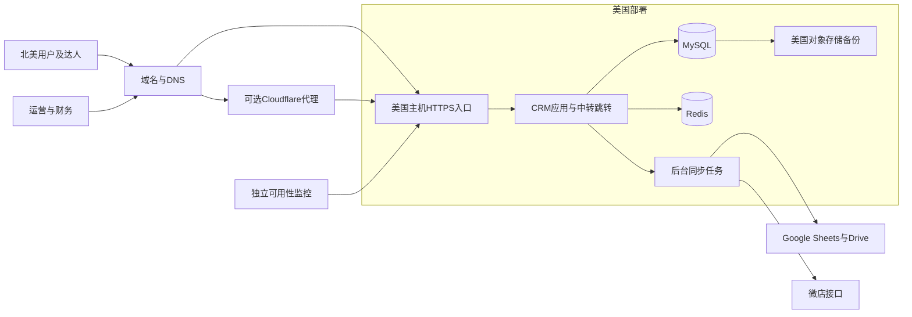

# 海外达人分销CRM美国部署上线与运维方案

核查日期：2026年9月30日。适用交付模式：一名工程师配合AI开发，软件报价目标20,000元，协助客户上线并提供后续运维。

建议一期采用UCloud美国洛杉矶常规轻量主机4核8GB，配合客户名下的域名、自动HTTPS、数据库备份和外部监控。腾讯云轻量、DigitalOcean、AWS Lightsail作为替代。美国节点选择和性能判断需经真实网络验证，不承诺未经测试的延迟、并发和可用率。

建议商业结构为：软件20,000元含首次标准上线；云资源、域名和第三方订阅客户直接支付；持续运维另签，推荐6,000元/年。该服务价格是本项目建议报价，不是市场调研得到的统一运维价格。下述资源按公开正常价格规划，不依赖首购优惠，采购时还要核对库存、税费和续费订单。

## 一 云供应商筛选

### 已核实的美国候选配置

| 供应商及产品 | 美国节点 | 配置及套餐内容 | 公开月费 | 本项目判断 |
|---|---|---|---:|---|
| UCloud ULightHost常规套餐 | 洛杉矶、华盛顿 | 4核8GB，120GB系统盘，30Mbps峰值带宽，4096GB/月流量 | 260元 | 首选；符合现有供应商偏好，成本便于人民币核算 |
| 腾讯云Lighthouse General Linux | 硅谷、弗吉尼亚 | 4核8GB，180GB SSD，35Mbps，5120GB/月 | US$36 | 与UCloud接近，磁盘空间较多；需核对国内站与国际站账户能购套餐 |
| DigitalOcean Basic Regular | 旧金山、纽约等美国区域 | 4 vCPU、8GiB，160GiB SSD，5000GiB/月流量 | US$48 | 替代方案；价格透明，备份另收费，适合接受英文运维和美元付款的客户 |
| AWS Lightsail Linux含公网IPv4 | 俄勒冈、北弗吉尼亚、俄亥俄 | 2 vCPU、8GB，160GB SSD，5TB/月流量 | US$44 | 如客户偏好AWS可选；与上述4核机型不是完全同配，应先验证批处理性能 |

来源：[UCloud常规套餐官方表](https://docs.ucloud.cn/ulhost/buy/price/common)、[腾讯云官方套餐表](https://www.tencentcloud.com/document/product/1103/47794)、[DigitalOcean价格](https://www.digitalocean.com/pricing/droplets)、[DigitalOcean美国区域](https://docs.digitalocean.com/platform/regional-availability/)、[Lightsail套餐](https://docs.aws.amazon.com/lightsail/latest/userguide/amazon-lightsail-bundles.html)、[Lightsail美国区域](https://docs.aws.amazon.com/lightsail/latest/userguide/access-lightsail.html)。

以上vCPU数量不代表相同持续计算性能；套餐流量统计、共享CPU、磁盘性能及超额流量政策均要核对。带宽为峰值时不等于保证持续吞吐。普通虚拟机均需要我们维护系统和应用，购买云主机不会自动包含CRM运维。

### 次级候选及本次未核实的价格

Vultr有洛杉矶、芝加哥、新泽西等美国节点，适合列为备选；本次官方价格页无法完整访问，因此不把二手站点中的US$40或US$48当成已核实报价。可在其官方控制台根据美国节点、IPv4、4核8GB、磁盘及备份生成订单后对比。[Vultr官方节点说明](https://docs.vultr.com/vultr-server-status-json-endpoints)、[官方套餐字段](https://docs.vultr.com/reference/terraform/data-sources/plan)。

Hetzner有美国Ashburn和Hillsboro，但不能套用德国低价套餐。官方公告显示2026年6月15日起美国区域价格调整，公告中的CPX31新月价为US$73.49且不含IPv4，当前可售型号仍要控制台确认。本项目没有充分理由为节约费用优先选它。[美国节点](https://docs.hetzner.com/cloud/general/locations/)、[官方调价公告](https://docs.hetzner.com/general/infrastructure-and-availability/price-adjustment/)。

UCloud UHost适合后续需要更大磁盘、私有网络、独立数据库和弹性扩容的情况，但其公开UHost价格说明以北京机房为例，不能拿北京4核8GB价格当作洛杉矶总价；计算、磁盘、公网IP、带宽和备份须合并询价。[UHost计价说明](https://docs.ucloud.cn/uhost/price)。轻量产品的扩容、快照、私网等能力应按ULightHost确认，不能直接套用UHost能力。

### 选择顺序

1. 优先用客户账户核对UCloud洛杉矶260元套餐的实际可购规格、系统盘类型、续费、超额流量及备份能力，先月付运行。
2. 若UCloud库存、磁盘或后续扩容条件不满足，比较腾讯云硅谷General Linux及DigitalOcean SFO3。
3. 如果客户已有AWS体系，优先沿用Lightsail俄勒冈或北弗吉尼亚；账号熟悉度和后续接管能力比每月少几十元更有价值。
4. 投产前测美国用户的网页及跳转响应、中国运营网络的管理后台、美国主机到微店和Google的访问；不能用单次ping代替应用测试。

## 二 美国区域与初始容量

美国洛杉矶作为起步位置，是兼顾北美用户、可能在中国的运营人员以及微店接口的工程选择。若客群明显集中美东，应同时测华盛顿或其他美东节点，不能仅因做北美电商就认定美西一定最快。各地实际网络路径会改变结果。

建议生产起步4核8GB，数据库和应用部署在同一主机，通过容器分开。120—180GB SSD用于系统、数据库、索引、上传及短期日志，图片优先使用合法稳定的原始资源或单独对象存储；不默认把2万商品图片全部下载到主机。2核4GB可以用于试点，但在Java应用、数据库和批量写表并行时余量较小，不作为默认全量配置。

200万条推广关系本身通常可用关系数据库承载，存储规模取决于URL长度、索引和日志保留；没有点击峰值、订单增速和实际表结构，无法预先保证一台机器容量充足。上线前用完整规模数据测初始化、同步、跳转和查询。服务器只运行编译后的应用，不在生产主机上跑多个AI代理、构建大型前端或部署本地模型。

磁盘达到70%预警、80%处理；持续内存压力、数据库慢查询或同步积压先定位原因，再决定升配。迁移或升配不能默认不停机，需核对产品限制并安排窗口。

## 三 一期部署架构

建议使用熟悉的Docker Compose部署；Nginx或Caddy处理HTTPS和反向代理，MySQL及Redis不发布公网端口。中转与后台先作为同一应用的模块，支持将来独立扩容，不为一期增加Kubernetes及多套服务集群。

可只采购一个域名，通过`crm.example.com`提供CRM，`t.example.com`提供中转；需要时增加`admin.example.com`。接口与前端同域反向代理能减少跨域配置。云供应商、域名注册商和DNS服务商无需一致。

Cloudflare免费版提供DNS、CDN及基础防护能力，可用来缓存公开静态文件；源站证书必须有效，开启代理时选Full strict。登录、私有页面、接口、财务导出以及`t/`跳转明确禁止CDN缓存，否则可能泄露数据或跳过点击采集。是否对后台启用代理，依据真实访问结果决定，不默认直连更可靠。[免费计划](https://www.cloudflare.com/plans/free/)、[Full strict要求](https://developers.cloudflare.com/ssl/origin-configuration/ssl-modes/full-strict/)。

客户若只是要求美国主机，数据库和备份可明确选择美国区域。如果要求所有数据和处理均仅在美国，还要检查Cloudflare边缘、Google表格、邮件、监控日志及海外工程师访问；美国源站不代表全部第三方服务的数据都留在美国。未完成这些确认前，不在合同中承诺全面美国数据驻留。

## 四 域名注册与备案

如果客户已有品牌域名，优先增加子域名，通常没有新增域名注册费。没有域名时，建议普通非溢价`.com`，使用客户真实主体和长期邮箱注册；主账号、付款方式及恢复权由客户持有，我们使用授权账号维护。

| 注册商 | 普通.com首年 | 每年续费 | 说明 |
|---|---:|---:|---|
| Porkbun | US$11.08 | US$11.08 | 官方表包含ICANN等费用，支持隐私保护；可更换DNS名称服务器，推荐候选 |
| Cloudflare Registrar | 本次未核实确切金额 | 本次未核实确切金额 | 官方按注册局和ICANN成本价，不加价；必须使用Cloudflare名称服务器 |
| Namecheap | 页面促销US$11.28加US$0.20 ICANN，共US$11.48 | US$18.48加US$0.20，共US$18.68 | 适合客户已有账户；首年与续费不同 |

来源：[Porkbun价格](https://porkbun.com/products/domains)、[Cloudflare规则](https://developers.cloudflare.com/registrar/faq/)、[Namecheap价格](https://www.namecheap.com/domains/registration/gtld/com/)、[Namecheap ICANN费用](https://www.namecheap.com/legal/domains/icann-fee/)。税费和溢价域名另计，采购前核对结账页。域名是否已经注册尚未查，客户提供品牌名称后再筛选。

域名注册商在海外，不等于需要某种“海外备案”。ICP备案、公安联网备案、注册商身份或邮箱验证是不同事项。当前部署边界为：

- 美国源站且不用中国大陆CDN：按云服务商当前接入规则，通常无需ICP；以后迁入大陆源站或启用大陆CDN，需要重新核对ICP和接入条件。[工信部备案办法](https://www.miit.gov.cn/zcfg/xxtxl/art/2024/art_7e48434c08c24131b4b7eecfca5b2b6c.html)、[接入商流程](https://help.aliyun.com/zh/icp-filing/basic-icp-service/user-guide/icp-filing-application-overview)、[CDN备案要求](https://help.aliyun.com/zh/icp-filing/basic-icp-service/product-overview/use-alibaba-cloud-cdn)。
- 公安联网备案不能仅凭美国主机断定免办。规定涉及境内国际联网的法人及组织；若中国大陆公司实际运营，应以客户主体和使用方式向所在地网安受理机关确认。纯美国主体面向北美业务，也不能仅凭中国可以访问就推定必须办理。[司法部法规原文第2及12条](https://xzfg.moj.gov.cn/law/download?LawID=1198&type=pdf)。
- 无需为了美国CRM先采购大陆服务器或支付ICP备案代办费。确有适用备案时，资料准备、提交和审核单独安排；批准时点不由工程师控制。

HTTPS使用自动申请及续期的免费证书即可，无需购买商业SSL套餐。[Let's Encrypt官方入门](https://letsencrypt.org/getting-started/)。域名邮箱验证、自动续费、MFA、恢复码和续费提醒都要配置；现有域名变更DNS前先保存MX和TXT，避免影响客户邮箱。

详细依据和注册操作步骤见[美国部署域名注册与备案调研](/Users/hh-mini/Public/dev/t-crm/docs/美国部署域名注册与备案调研.md)。

## 五 备份和运维设计

### 数据保护

基准方案每日备份数据库、配置和必要上传文件，压缩加密后送到独立于应用主机的美国存储桶。保留14份每日备份及4份周备份，应用日志先按30日保留，点击明细保存周期由客户确认。上传凭证只允许执行必要操作，客户持有恢复用密钥，备份不要只有生产机上的副本。

上线前在临时环境实际恢复一次，并核对达人、商品、订单、推广关系以及佣金汇总。季度恢复抽查应计入运维服务工时。整机快照辅助恢复环境，不能替代经过验证的一致性数据库备份。

每日备份的设计目标为最多回退约24小时，真实可恢复点还取决于最后成功备份。若客户要求财务修改和人工归因最多丢15分钟，可增加MySQL binlog连续归档并做恢复验证；不能只设置每日备份就承诺15分钟恢复点。微店订单可补拉不代表人工修正和结算操作可自动补回。

单机方案允许故障后重建，正式恢复目标须结合一次演练确定，例如在服务时段内发现故障后4—8小时恢复可作为讨论目标。它不是已验证的合同保证，也不含等待云厂商处理、客户授权或账户解封的不可控时间。

### 监控与运行维护

自动监控不等于全天有人值守。监控项应覆盖公开跳转可用性、CRM入口、服务器磁盘和内存、订单同步延迟、Google同步失败、任务积压、备份年龄、证书及资源到期。备份成功不能只看脚本退出码，要检查上传对象、大小和恢复抽查结果。

监控和告警连续自动运行；基础维护每月人工检查，标准维护增加每周简短告警复核。每月核对授权有效性、系统补丁、资源费用、数据增长及备份记录，提供简短报告。人工频率和耗时受所选套餐工时约束，不能把自动监控等同于无限人工检查。补丁、应用发布和数据库变更安排窗口，保留版本及迁移记录。基础自动安全更新需评估重启影响，不能对生产主机无计划地自动升级全部组件。

客户日常新增达人、修改商品、处理结算应由系统功能完成并经培训，不把运营录入默认为运维人员长期代办。应用本身对官方接口的失败重试和幂等处理属于开发交付，不留到每月人工补数据。

### 故障处理顺序

1. 告警确认影响范围，记录故障开始时间和最近发布。
2. 判断应用、主机、数据库、DNS/TLS或第三方接口问题；先保护数据库和原始证据。
3. 可回滚则回滚；主机故障按部署脚本重建并恢复备份；第三方接口故障暂停相关任务后补偿同步。
4. 恢复后核对订单、归因、佣金及表格状态，避免重试导致重复计佣。
5. 留下故障记录及预防措施；只有已授权的通知渠道才实际发送客户消息。

## 六 成本预算

### UCloud推荐方案的运行费

| 资源 | 月度预算 | 依据及性质 |
|---|---:|---|
| 洛杉矶ULightHost 4核8GB常规套餐 | 260元 | 已核实公开价；年预算按12个月为3,120元，不推算未确认年付折扣 |
| 备份存储及可用快照方案 | 50—100元 | 本项目预留额度，尚未按实际备份体积取得订单，不代表供应商套餐价 |
| Google Workspace一个运营账户 | 约50—120元 | 年度承诺常规价Starter US$7或Standard US$14/用户/月；预算换算并给弹性付款留余量 |
| 普通.com | 年预留100—200元 | Porkbun公开价US$11.08；客户已有域名则可为0 |
| DNS、免费TLS和基础监控 | 0元起 | 使用适合的免费层；超额、付费功能另计 |
| **建议常规运行预算** | **约370—500元/月** | **按年约4,440—6,000元，最终看订阅、税费和账户订单** |

美元仅为便于预算，暂用1美元=7.2元的假设换算；该数值不是本次查询得到的实时汇率。最终按客户实际付款汇率及税费结算。上表不含持续运维服务、流量超额及异常增长；免费邮件或监控也不等于服务责任为零。

Google Starter现在有基础共享云端硬盘能力，不应使用旧资料认定它完全不支持；部分高级共享管理需更高版本。先试验账号与外部共享再选订阅。100个外部达人不应未经验证就按100个付费内部席位采购。[当前价格](https://workspace.google.com/pricing.html)、[官方共享云端硬盘版本说明](https://support.google.com/a/answer/7337469?hl=en-CA)。已有合适Google账户可以减少新增费用，不能默认必须买新订阅。

注册验证和找回密码可先使用合适的事务邮件免费层，例如Resend公开列每月3,000封且每日100封；实际发信峰值及域名认证要验证，不承诺邮件永远免费。[Resend当前价格](https://resend.com/pricing?volume=50000)。

DigitalOcean另一个预算示例：8GB主机US$48/月；每日整机备份为主机价30%，即US$14.40/月，总US$62.40/月，独立数据库备份存储及Google等另算。不能把US$48说成含完整备份运维的总费。[备份价格](https://www.digitalocean.com/pricing/backups)。

### 我们的运维报价选项

| 服务方案 | 建议年费 | 包含人工工时 | 响应及适用范围 |
|---|---:|---:|---|
| 基础维护 | 3,600元 | 12小时/年，按季度统筹 | 月度巡检、备份检查、域名证书续费检查、季度恢复抽查及范围内故障处理；约定服务时段内下一工作日响应 |
| 标准维护 推荐 | 6,000元 | 24小时/年，按季度统筹 | 基础内容、订单及表格同步故障诊断、计划补丁及小版本发布、季度恢复抽查；服务时段内4小时响应 |
| 增强维护 | 12,000元 | 48小时/年，按季度统筹 | 更频繁巡检、更多发布和恢复协助；服务时段内2小时响应；仍需约定值守时段 |

建议服务时段初始设为中国工作日09:00—18:00（Asia/Shanghai），所有响应时间指开始确认并处理，不是保证修复完成。客户美国时区尚未确定，签运维合同前须核对其营业时间；中国白天服务不能描述为覆盖北美白天。确需美国营业时间覆盖，改约重叠班次并核算费用。需要7×24值守及分钟级恢复时，须另配轮值人员和冗余基础设施，不能以一个人包年服务承诺。

上述工时包括巡检、报告、发布、演练和故障处理；季度余额不足前通知客户。基础套餐参考分配为每月30分钟检查及报告共6小时、季度恢复抽查共2—4小时，剩余2—4小时处理发布和故障；如果实际恢复演练更耗时，应重新分配工时或选择标准套餐。标准套餐每月2小时只是年度工时的平均数，不是每月保证有两小时故障处理之外的额外服务。额外工作建议按250元/小时评估，确认后执行；新模块按需求估算，不混入维护工时。任何保修期内的已约定功能缺陷按原合同处理，不重复收维护费。第三方故障虽不可由我们直接修复，但诊断、沟通和恢复同步可以计入已购维护。

### 客户年度总预算

按推荐运维年费6,000元及运行费4,440—6,000元估算：

- 第一年：开发及首次上线20,000元 + 运维6,000元 + 资源4,440—6,000元 = **30,440—32,000元**。
- 后续年度：运维6,000元 + 资源4,440—6,000元 = **10,440—12,000元/年**。
- 如果只买基础维护，第一年为**28,040—29,600元**，但人工覆盖和响应不同。

以上假设运行一年，采用公开正常月价、一个新增Google运营席位、备份预留、常规小规模邮件和基础监控。未包含实际税费变化、流量超额、商业SSL、迁移及新需求；也不预设免费优惠永久存在。资源最好客户直接支付，我们不必代垫一年云费用。建议主机试运行先月付，稳定后再评估年付；运维可年付，或按季度支付基础套餐900元、标准套餐1,500元，每季度服务开始前支付。开发款继续按开发合同的里程碑收取，首次上线不另列重复费用。

如客户希望20,000元包含首年基础维护，可把合同写成总价20,000元，其中开发及上线按16,400元分配、基础维护3,600元分配，云资源仍另付。这是利润让渡选项，不是额外人力自动消失；需要按实际开发及全年服务投入判断能否接受。更容易控制的优惠是赠送上线后1—3个月有限范围维护，期满续签，而不是含糊写“终身免费维护”。

## 七 上线步骤和预计投入

### 准备与早期验证

第1周就确定客户资源主体、美国区域及账号授权，开小规模测试主机验证Google、微店、邮件及真实用户网络，避免最后一周才发现不可用。购买和身份验证由客户完成，主账号MFA和恢复码由客户保管；我们只取得必要的成员权限或API权限。

域名已有时优先增加子域名；新域名注册完成后验证邮箱和续费付款方式。已有品牌域名变更NS时先完整核对现有解析与邮件，不为CRM轻率迁移整站DNS。

### 生产上线工作包

| 工作 | 工程师投入参考 | 完成证据 |
|---|---:|---|
| 客户账号、采购配置、DNS及访问验证 | 0.5日 | 资源区域、账号归属、价格及正式域名清单 |
| 主机初始化、容器部署、安全组和TLS | 0.5—1日 | 生产版本、配置记录、HTTPS及端口检查 |
| 数据初始化、备份监控、恢复验证 | 1—1.5日 | 初始化记录、备份恢复结果、告警测试及容量记录 |
| 切换、回归、操作说明和交接 | 0.5日 | 真实订单闭环、验收清单和客户可接管材料 |
| **完整上线参考** | **2.5—3.5日** | **嵌入项目最后一周，外部等待另计** |

前一版20,000元方案已经包含一次标准部署，不能再次按上表收取同一部署费。若合同新增更严的恢复目标、长期备份保留、美国数据驻留或多节点部署，才按新增工作调整范围。完整监控、恢复演练和客户交接比仅启动容器更耗时，应从原测试上线及缓冲工时中预留；如果预留不足，开工前调整总排期，不能压掉业务测试。

### 实际执行顺序

1. 确认主体、域名、主机区域、月费、续费和授权；最终生成客户可核对的采购清单。
2. 建立生产SSH密钥及独立运维身份，关闭不必要端口；数据库、Redis和管理服务仅开放必要入口。密钥不进源码。
3. 设置正式DNS、TLS、自动续期及到期监控；配置邮件SPF、DKIM、DMARC；验证正式回调地址。
4. 部署固定版本镜像、数据库迁移和持续化目录；记录发布及回滚流程，发布前备份。
5. 配置美国对象存储备份、日志轮转和外部探测，执行一次恢复演练。
6. 在真实业务账户初始化商品和达人，后台任务分批生成表格；抽查之外，对全量数量、唯一性及归属作程序核对。
7. 检查真实下单、退款、归因、佣金、Google回写和达人越权；切换推广链接前确认客户验收和切换窗口。
8. 交付源码、部署脚本、资源与续费清单、备份恢复步骤及运维联系流程。后续云迁移尽量只改DNS和目标地址，保留既有推广URL。

DNS传播、授权审核和适用备案审批都不是工程师投入时间，日历上线日期需同时留出窗口。TLS、备份或公开链接数据隔离验收未通过时，不能仅以首页能打开视为上线完成。

## 八 客户需要明确的事项

1. 美国部署是访问速度偏好，还是数据库、备份及第三方处理均须留在美国？
2. 主办和签约主体是中国公司、美国公司还是个人，国内是否有实际运营及用户？
3. 美国客户主要在哪个区域和时区？需要什么营业时间的故障响应？
4. 是否已有域名、Google账户和云主账号？谁负责付款、续费及MFA恢复？
5. 可接受多长停机和数据回退？每日备份是否足够，是否需要连续归档？
6. 日点击、订单及图片规模和增长预期是什么？能否接受先月付、测试后再年付？
7. 运维选择按年付还是包含首年基础服务？是否要求自动监控以外的7×24人工值守？
8. 额外维护、新需求、美国营业时间覆盖和第三方平台变更如何计费？

在这些答案明确前，以上为可执行的采购与交付建议，不代表已经下单、部署或开通任何客户资源。
