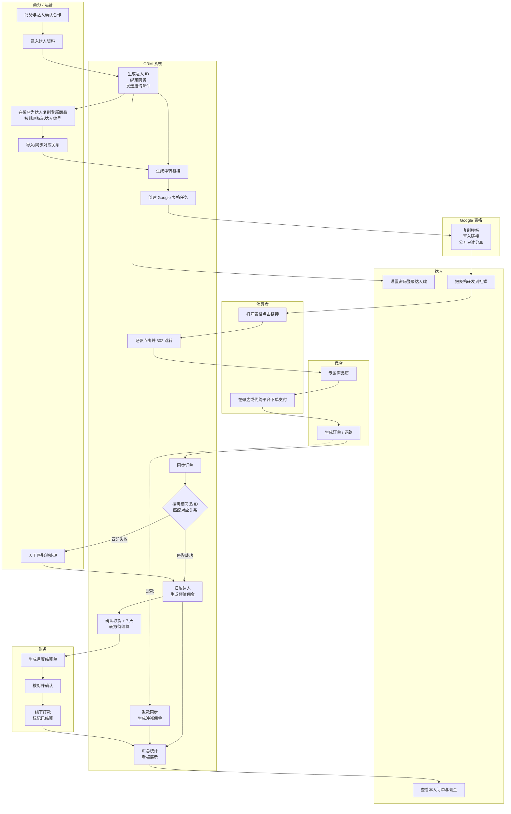
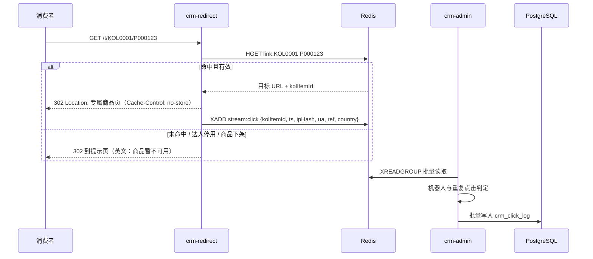
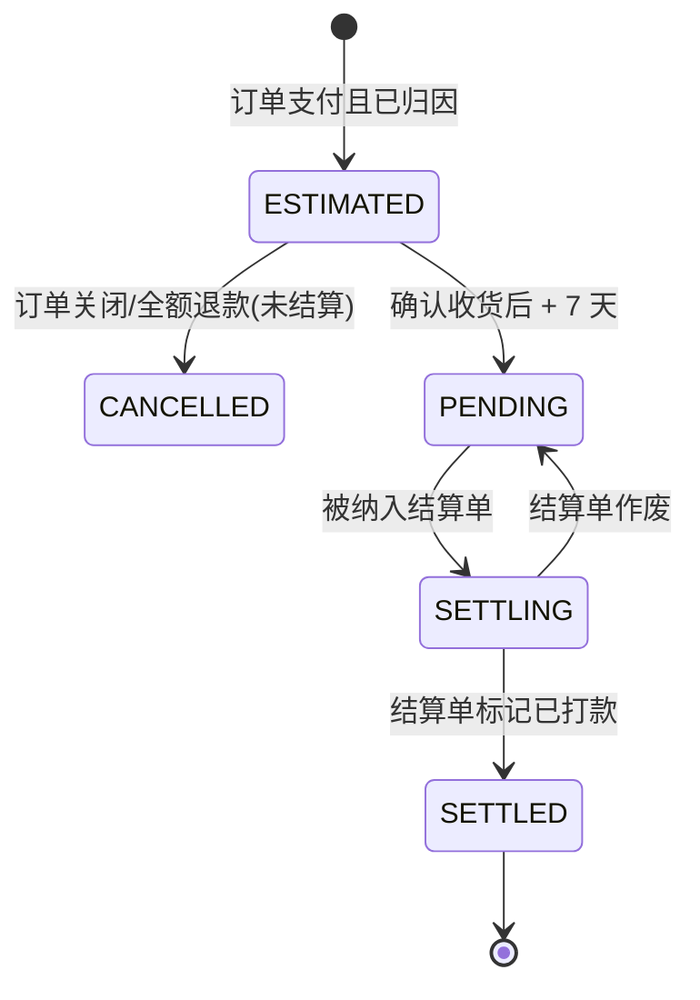
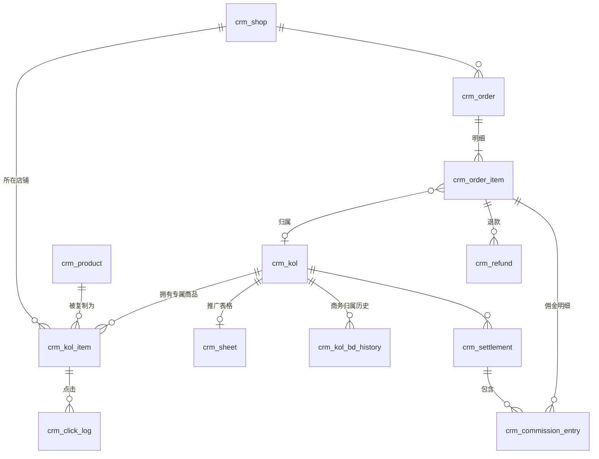

# 海外达人分销 CRM 系统 —— 详细设计说明书

> 版本：V0.1（设计初稿，M0 阶段随《需求确认书》定稿）
> 编制日期：2026-10-04
> 依据：《海外达人分销CRM系统需求说明书(界面版)》《数据看板模块需求说明书》《项目报价与排期方案-1（签约定稿）》《Google与微店API能力调研报告》

---

## 0. 文档说明

### 0.1 设计基线

本设计以签约定稿为准，相对原需求说明书的主要变化：

| 项目 | 原需求 | 本设计采用 |
|---|---|---|
| 达人入驻 | 达人自主注册，运营审核 | 运营/商务录入，系统生成达人 ID，邮件邀请达人设置密码 |
| 专属链接 | 系统调用微店接口生成 | 运营在微店手动复制专属商品，系统导入"专属商品 → 达人 + 原商品"对应关系 |
| 订单归因 | 五级优先级（达人 ID / 优惠码 / track_id / 时间窗口 / 人工） | 按订单商品明细的专属商品 ID 归因；不能识别的进人工匹配池。优惠码不用于归因，时间窗口匹配不做 |
| Google 表格 | 四页签（Links / Orders / Summary / Settlement） | 方案一：公开表格只放商品链接；订单、佣金、结算在达人端查看 |
| 店铺 | 未限定 | 最多 3 个贵方自有微店店铺 |

### 0.2 待决策事项（本稿按"推荐"编写）

| # | 事项 | 本稿采用（推荐） | 备选 | 影响范围 |
|---|---|---|---|---|
| D1 | 后端底座 | **纯自研**：Spring Boot 4.1 + Sa-Token + MyBatis-Plus + Flyway + Redisson（JDK 21）；管理端前端基于 pure-admin-thin | RuoYi-Vue-Plus 6.0（已放弃：优先代码完全可控） | 全局 |
| D2 | 跳转服务 | 独立进程部署 | 合并在后台应用中 | §2、§7.4 |
| D3 | 达人端前端 | 独立的轻量 Vue 3 应用 | 后台内加英文布局 | §2 |
| D4 | 定时任务 | Spring 定时任务 + Redisson 分布式锁 | 独立调度服务 | §9 |
| D5 | Excel 组件 | FastExcel 稳定版 | Apache Fesod（孵化中） | §7 |
| D6 | 计佣基数 | 商品明细实付金额（已分摊优惠，不含运费）− 退款金额 | 客户另定 | §8.3 |
| D7 | 佣金比例优先级 | 商品级比例 > 达人默认比例 | 客户另定 | §8.3 |
| D8 | 结算周期 | 按月；订单确认收货后 7 天可结算 | 客户另定 | §8.4 |
| D9 | 比例变更 | 不追溯，按下单时比例快照 | 追溯 | §8.3 |
| D10 | 统计时区 | 北京时间（UTC+8），销售按支付时间、退款按退款时间计入 | 美国时区 | §8.6 |

客户相关事项（D6～D10）以 M0《需求确认书》为准；技术事项（D1～D5）已确认（2026-10-04）。

### 0.3 术语

| 术语 | 含义 |
|---|---|
| 原商品 | 客户微店中用于推广的商品（2 万个），系统中称"商品"，编号如 P000123 |
| 专属商品 | 运营为某位达人在微店复制的原商品副本，拥有独立的微店商品 ID |
| 对应关系 | 专属商品 ID → 达人 + 原商品 的映射 |
| 中转链接 | 系统生成、写入表格的链接，形如 `https://t.域名/t/KOL0001/P000123`，点击后记录并跳转到专属商品 |
| 订单明细 | 一笔订单中的一个商品行；归因和计佣的最小单位 |
| 有效订单 | 已支付且未关闭的订单（具体状态映射见 §8.1） |
| 人工匹配池 | 无法自动归因的订单明细，等待运营处理 |

---

## 1. 系统概述

### 1.1 目标

把"达人 → 专属链接 → 点击 → 订单 → 佣金 → 看板"串成闭环：每笔订单明细能自动对应到达人，佣金按规则计算、可结算可追溯，各角色只看到自己权限内的数据。

### 1.2 规模假设

| 指标 | 数值 |
|---|---|
| 达人 | 100（设计容量 500） |
| 原商品 | 2 万 |
| 专属商品 / 中转链接 | 最多 200 万 |
| 微店店铺 | ≤ 3 |
| 订单 | 约 2,000 单/天（设计容量 2 万单/天） |
| 点击 | 预估 5 万次/天（设计容量 100 万次/天） |

### 1.3 角色

| 角色 | 说明 |
|---|---|
| 超级管理员 | 全部功能与数据；系统配置、接口参数 |
| 运营 | 达人、商品、对应关系、订单、人工匹配；全部达人数据 |
| 商务 | 运营角色 + 数据权限"仅本人负责的达人" |
| 财务 | 佣金、结算单、冻结/解冻、导出；全部达人数据（只读业务数据） |
| 达人 | 达人端：只看本人数据，不能导出 |

---

## 2. 总体架构

### 2.1 部署架构


| 域名 | 用途 | Cloudflare 代理 |
|---|---|---|
| `t.域名` | 中转跳转 | 开启 |
| `kol.域名` | 达人端 | 开启 |
| `admin.域名` | 管理后台 | 关闭（国内直连） |

### 2.2 应用模块

| 进程 / 工程 | 技术 | 职责 |
|---|---|---|
| `crm-admin` | 自研，Spring Boot 4.1 / JDK 21 | 管理端 API、达人端 API、订单同步、归因、计佣、看板汇总、表格任务、定时任务 |
| `crm-redirect` | Spring Boot（精简，无数据库直连写入） | 解析中转链接、302 跳转、写点击事件到 Redis Stream |
| `admin-ui` | 基于 pure-admin-thin（Vue 3 + TS + Element Plus）+ ECharts | 管理后台，中文；菜单按角色静态配置 |
| `kol-portal` | Vue 3 + TS + Element Plus（英文）+ ECharts | 达人端，适配手机 |

`crm-admin` 根包 `com.tcrm.admin`，直接子包为 `shared`（响应、异常、traceId、通用 Redis 能力）、`security`（登录、令牌、当前用户上下文）、`system`（管理员用户、操作日志、审计写入）及下列业务模块。模块内分为 `controller/service/mapper/model/api`；调用方向为 controller → service → mapper。跨模块只依赖对方的 `api` 包，`shared` 不依赖业务模块。当前用户上下文位于 `security.api`；`system.service.AccountStoreService` 实现 `security.api.AccountStore`，认证服务通过该接口访问账号，避免认证模块直接依赖用户实体或 mapper。业务模块当前保留占位包：

| 包 | 内容 |
|---|---|
| `kol` | 达人、商务归属、邀请 |
| `product` | 原商品、专属商品对应关系、店铺 |
| `link` | 中转链接、Redis 链接索引、点击消费 |
| `sheet` | Google 表格创建、写入、分享 |
| `order` | 订单同步、Excel 导入、归因、人工匹配 |
| `commission` | 佣金明细、结算单、冻结 |
| `stats` | 汇总表、看板查询、预警 |
| `integration` | 微店客户端、Google 客户端、邮件客户端 |
| `task` | 批量任务框架（进度、重试、错误文件） |

现有用户与审计实体为 `system.model.SysUserDO`、`SysOperLogDO`，DO 只用于 model / mapper / service；controller 使用独立请求对象与 `UserVO`、`OperLogVO`，service 使用 Command / DTO。跳转工程按 `controller/service/config` 分层，controller 经 service 查询 Redis、写入点击事件。

| 当前接口 | 声明角色 / 行为 |
|---|---|
| `POST /admin-api/auth/login` | 显式公开；按用户名+IP、IP、用户名三层失败计数与锁定（ADR-008） |
| `POST /admin-api/auth/logout`、`GET /admin-api/auth/me`、`PUT /admin-api/auth/password` | `SUPER_ADMIN` / `OPERATOR` / `FINANCE` 登录态 |
| `GET/POST /admin-api/system/users`、`PUT /admin-api/system/users/{id}`、`PUT /admin-api/system/users/{id}/status`、`PUT /admin-api/system/users/{id}/password` | `SUPER_ADMIN` |
| `GET /admin-api/system/oper-logs` | `SUPER_ADMIN` |

后台统一响应 `{code,msg,data,errorCode,traceId}`，错误码登记在 `shared.ErrorCode`，参数校验失败返回字段级列表；分页 `{items,total,page,size}`，64 位整数（含 ID、total）和金额序列化为字符串，page / size 为整数。过滤器生成 traceId 并写入 MDC、`X-Trace-Id` 和信封，设置 `X-Content-Type-Options: nosniff`、`Referrer-Policy: strict-origin-when-cross-origin`；跨域来源仅取环境变量 `TCRM_CORS_ALLOWED_ORIGINS`，默认为空。跳转服务维持 302 / 纯文本响应。

当前系统表由 `backend/src/main/resources/db/migration/V202610041200__init_system.sql` 创建，使用 PostgreSQL 17、UTC 会话、`TIMESTAMPTZ(3)` 与正值 BIGINT 主键约束。用户逻辑删除列为 `is_deleted BOOLEAN`，Java 属性为 `deleted`；用户名采用 `lower(username)` 唯一索引及参数绑定的大小写不敏感查询。`sys_oper_log` 是只追加表，省略修改与逻辑删除字段，表与全部字段均有注释。本次初始迁移改写仅适用任务 02 的一次性授权。

后台启动时检查启用且未逻辑删除的超级管理员；不存在时必须设置 `TCRM_BOOTSTRAP_ADMIN_USERNAME` 与 `TCRM_BOOTSTRAP_ADMIN_PASSWORD`，缺少任一变量则启动失败并提示变量名，没有默认凭证。已有可用超管时不要求初始化变量，也不重复创建。管理员审计可按规范 06 保存原始 IP，180 天清理任务由后续业务任务实现。

### 2.3 技术栈

| 类别 | 选型 |
|---|---|
| 后端 | Java 21、Spring Boot 4.1、Sa-Token、MyBatis-Plus、Flyway、Redisson |
| 数据库 | PostgreSQL 17（UTF8；见 ADR-005） |
| 缓存/消息 | Redis 7（缓存、Stream、分布式锁、限流） |
| Excel | FastExcel |
| Google | google-api-services-sheets / drive 官方 Java 客户端，服务账号 |
| 微店 | 开放平台 HTTP 接口 + 官方加解密 jar |
| 前端 | Vue 3、TypeScript、Vite、Element Plus、ECharts |
| 测试 | JUnit 5、Testcontainers（PostgreSQL、Redis）、Mockito |
| 部署 | Docker Compose、Nginx、GitHub Actions |

不使用后台管理脚手架；不做动态菜单、动态权限、多租户、工作流。角色固定为 4 个（超管、运营、财务、达人），权限在代码中用注解静态声明。

---

## 3. 权限与数据隔离

### 3.1 功能权限矩阵

| 功能 | 超管 | 运营 | 商务 | 财务 | 达人 |
|---|:-:|:-:|:-:|:-:|:-:|
| 达人录入/编辑/启停 | ✓ | ✓ | ✓（本人负责） | 只读 | — |
| 商品、对应关系导入 | ✓ | ✓ | — | — | — |
| 表格生成/重建 | ✓ | ✓ | — | — | 查看本人表格链接 |
| 订单查看 | ✓ | ✓ | ✓（本人负责） | ✓ | 本人 |
| 订单导入、人工匹配 | ✓ | ✓ | — | — | — |
| 佣金比例设置 | ✓ | ✓ | — | ✓ | — |
| 结算单生成/确认/标记打款 | ✓ | — | — | ✓ | 查看本人 |
| 冻结/解冻 | ✓ | — | — | ✓ | — |
| 总店看板、商品运营看板 | ✓ | ✓ | — | ✓ | — |
| 商务看板 | ✓ | ✓（全部） | ✓（本人负责） | ✓ | — |
| 达人看板 | ✓（代看） | ✓（代看） | ✓（代看本人负责） | ✓（代看） | 本人 |
| 导出 | ✓ | ✓ | ✓（本人负责） | ✓ | ✗ |
| 系统配置、接口参数、日志审计 | ✓ | — | — | — | — |

冻结/解冻、比例设置的具体角色以 M0 确认为准。

### 3.2 数据隔离规则

1. **达人端**：所有达人端接口从登录态取 `kol_id`，不接受前端传入的达人 ID；SQL 层统一追加 `kol_id = 当前达人`。达人端与管理端使用不同的 Sa-Token 账号体系（`StpKolUtil` / `StpUtil`），令牌不互通。
2. **商务**：管理员账号的 `data_scope` 为 `OWN` 时（商务 = 运营角色 + `OWN`），在达人相关查询上追加 `kol.bd_user_id = 当前用户`；订单、佣金、看板查询先取"本人负责的达人 ID 集合"再过滤。
3. **商务历史归属**：商务交接后，交接前的数据归原商务、交接后归新商务（以 `crm_kol_bd_history` 判定，规则待 M0 确认）。
4. **越权测试**：每个需要隔离的接口都有"换一个达人/商务的 ID 访问应被拒绝"的自动化测试。

---

## 4. 核心业务流程

### 4.1 全链路泳道图



### 4.2 达人入驻

1. 运营/商务录入达人（单个或 Excel），必填：姓名、邮箱、国家；可选：社媒账号、粉丝数、默认佣金比例、合作备注。商务录入时 `bd_user_id` 自动为本人；运营录入时选择商务。
2. 系统生成达人编号（§8.2），创建达人登录账号（状态"待激活"），发送英文邀请邮件（含 72 小时有效的设置密码链接）。
3. 达人设置密码 → 账号"已激活"。邀请过期可由运营重发。
4. 达人编号生成后，运营据此在微店复制并标记专属商品（§4.3）。

### 4.3 专属商品与对应关系

**标识规则（M0 二选一定稿）**

| 方式 | 系统读取 |
|---|---|
| 商品分类：每位达人一个分类，名称 = 达人编号 | 调用微店"获取店铺商品列表"按分类拉取 |
| 商家编码：`{原商品编码}-{达人编号}` | 拉取商品列表，解析商家编码 |
| 兜底：运营导出 Excel | 导入模板：店铺、专属商品 ID、达人编号、原商品编码 |

**处理流程**

1. 运营触发"同步对应关系"（指定店铺、达人）或上传 Excel → 创建批量任务。
2. 逐条校验：达人存在且启用；原商品存在；专属商品 ID 在本店未被其他有效映射占用；同一达人同一原商品只能有一个有效映射。
3. 校验通过的写入 `crm_kol_item`（新映射生效，旧映射置失效时间，**不删除**），失败的写入错误文件供下载。
4. 映射变更后：更新 Redis 链接索引；标记该达人表格待刷新。

**原则**：专属商品 ID 一旦用于订单归因，即使映射失效也保留历史记录，历史订单的归属不受后续映射变更影响。

### 4.4 链接生成与表格分发

1. 达人的对应关系导入后，系统按原商品顺序为每个有效映射生成中转链接 `https://t.域名/t/{达人编号}/{原商品编码}`，并生成 `track_id`（§8.2）。
2. 创建"表格初始化"批量任务：
   - 复制 Google 母版到共享云端硬盘（文件名：`{达人编号} - {达人名称}`）；
   - 按母版配置的"链接列"分批写入中转链接（每批 ≤ 2,000 行）；
   - 设置"知道链接的任何人可查看"；
   - 回写表格 ID、URL 到 `crm_sheet`。
3. 任务受全局限流（§7.2），失败自动重试 3 次（指数退避），仍失败标记"失败"，可人工重跑。
4. 表格 URL 在管理端和达人端均可查看。

### 4.5 点击跳转



- 跳转服务只读 Redis；Redis 未命中时调用 `crm-admin` 内部接口回源并回填缓存。
- 机器人判定：UA 匹配常见爬虫及社媒预览（facebookexternalhit、Twitterbot、TikTok 预览等）标记 `is_bot`；同 IP 同链接 10 秒内重复点击标记 `is_dup`。两类点击保留，统计时排除。
- IP 仅存 SHA-256 哈希（加盐），不存明文。

### 4.6 订单同步与归因

```mermaid
flowchart TB
  S[每 5 分钟：按更新时间增量拉取订单<br/>窗口回溯 10 分钟] --> D[逐单获取订单详情]
  X[Excel/CSV 导入] --> N
  D --> N[标准化：订单 + 订单明细]
  N --> U{订单已存在?}
  U -->|是| UP[更新状态/金额/退款<br/>记录变更]
  U -->|否| INS[新增]
  UP --> AT
  INS --> AT[逐条明细归因]
  AT --> M{店铺+商品ID<br/>命中有效映射?}
  M -->|是| OK[归属达人<br/>attribution_type=ITEM_ID]
  M -->|否| P[进入人工匹配池<br/>attribution_type=UNMATCHED]
  P --> MAN[运营指定达人或标记"非达人订单"<br/>必填原因，记审计]
  OK --> CM[生成/更新佣金明细]
  MAN --> CM
  CM --> DIRTY[标记受影响日期待重算]
```

- **幂等**：订单唯一键 `(shop_id, weidian_order_id)`，明细唯一键 `(order_id, sub_order_id)`；接口和 Excel 重复导入只更新不重复。
- **多达人订单**：每条明细独立归因，一笔订单可以归属多位达人。
- **映射时点**：用"下单时有效"的映射归因。
- **已归因明细不自动改归属**；人工修改归属需写原因，若已结算按 §8.4 生成冲减和新增。
- **数据最小化**：不解密、不存储买家姓名、电话、地址；只存买家 ID 的哈希用于去重统计。

### 4.7 退款

1. 订单同步时读取退款状态与金额，写入 `crm_refund`（按明细），更新明细 `refund_amount`。
2. 每笔新退款生成一条负数佣金明细（类型 `REVERSAL`），金额 = −退款金额 × 原佣金比例快照。
3. 原佣金未结算：冲减明细与原明细一起进入同一结算；已结算：冲减明细进入下一期结算（即"扣回"）。
4. 退款日期计入看板的退款统计（口径见 §8.6）。

### 4.8 佣金与结算

佣金明细状态：



- 达人被冻结时，其 `PENDING` 明细不纳入结算单，解冻后下一期纳入。
- 结算单：财务按月生成（选择达人范围与截止日期）→ 汇总 `PENDING` 明细（含负数冲减）→ 上期结转余额 → 本期应付；应付为负时不打款，结转下期。
- 结算单状态：`DRAFT` → `CONFIRMED` → `PAID`（填写打款日期、方式、备注）；`DRAFT` 可作废。
- 结算单导出 Excel：汇总 + 明细。

### 4.9 商品变更

| 场景 | 运营操作 | 系统处理 |
|---|---|---|
| 新增原商品 | 导入原商品 → 在微店为各达人复制 → 导入对应关系 | 生成新链接，表格追加行 |
| 修改商品信息（名称、价格、图片） | 导入更新，或在后台编辑 | 刷新受影响达人的表格对应行 |
| 原商品下架 | 后台标记下架；微店副本由运营处理 | 中转链接跳转到"商品暂不可用"提示页；表格对应行标注下架（或按母版约定删除行，M0 确认） |
| 更换某达人的专属商品 | 导入新对应关系 | 旧映射失效、新映射生效；链接地址不变 |

### 4.10 看板数据

见 §8.6 指标口径、§5.3 汇总表、§9 汇总任务。

---

## 5. 数据设计

### 5.1 实体关系



### 5.2 业务表

通用字段（各表均有，下文省略）：`id BIGINT`（雪花 ID）、`create_by`、`create_time`、`update_by`、`update_time`、`is_deleted`（仅主数据表）。字段类型以规范 04 为准：金额 `NUMERIC(14,2)`，比例 `NUMERIC(6,4)`，时间 `TIMESTAMPTZ(3)`，扩展信息 `JSONB`。

**crm_kol 达人**

| 字段 | 类型 | 说明 |
|---|---|---|
| kol_code | VARCHAR(16) UK | 达人编号 KOL0001，创建后不可修改 |
| name | VARCHAR(64) | 姓名 |
| email | VARCHAR(128) UK | 登录邮箱 |
| country | VARCHAR(8) | ISO 国家码 |
| social_accounts | JSONB | `[{platform, handle, url, followers}]` |
| bd_user_id | BIGINT | 当前负责商务（sys_user.id） |
| default_rate | NUMERIC(6,4) | 默认佣金比例 |
| status | TINYINT | 1 启用 / 0 停用 |
| account_status | TINYINT | 0 待激活 / 1 已激活 |
| password_hash | VARCHAR(100) | BCrypt |
| settle_frozen | TINYINT | 结算冻结 |
| frozen_reason | VARCHAR(255) | |
| remark | VARCHAR(500) | 合作备注 |

**crm_kol_bd_history 商务归属历史**：`kol_id`、`bd_user_id`、`start_time`、`end_time`（当前为空）。

**crm_shop 店铺**（≤ 3）：`shop_name`、`weidian_shop_id` UK、`app_key`、`app_secret`（加密存储）、`access_token`（加密）、`token_expire_time`、`sync_cursor`（上次同步到的更新时间）、`last_sync_time`、`last_sync_status`、`status`。

**crm_product 原商品**

| 字段 | 类型 | 说明 |
|---|---|---|
| product_code | VARCHAR(16) UK | P000123 |
| shop_id | BIGINT | 原商品所在店铺 |
| weidian_item_id | VARCHAR(32) | 原商品微店 ID |
| name / category / image_url | | 商品信息 |
| price | NUMERIC(14,2) | 展示价 |
| rate | NUMERIC(6,4) NULL | 商品级佣金比例，空则用达人默认比例 |
| sheet_row | INT | 在表格中的行序 |
| status | TINYINT | 1 在售 / 0 下架 |

**crm_kol_item 专属商品对应关系（最多 200 万行）**

| 字段 | 类型 | 说明 |
|---|---|---|
| kol_id | BIGINT | |
| product_id | BIGINT | 原商品 |
| shop_id | BIGINT | 专属商品所在店铺 |
| weidian_item_id | VARCHAR(32) | 专属商品微店 ID |
| target_url | VARCHAR(512) | 跳转目标 |
| track_id | VARCHAR(16) UK | 全局追踪码 |
| source | TINYINT | 1 接口 / 2 Excel |
| valid_from / valid_to | TIMESTAMPTZ(3) | 生效区间，valid_to 为空表示当前有效 |

索引：部分唯一索引 `uk_crm_kol_item_shop_item (shop_id, weidian_item_id) WHERE valid_to IS NULL`（同一专属商品同一时间只有一条有效映射）；部分唯一索引 `uk_crm_kol_item_kol_product (kol_id, product_id) WHERE valid_to IS NULL`；普通索引 `idx_crm_kol_item_shop_item_from (shop_id, weidian_item_id, valid_from)`（按下单时间查历史映射）。

**crm_sheet 达人表格**：`kol_id` UK、`spreadsheet_id`、`url`、`template_version`、`status`（0 未创建 / 1 正常 / 2 待刷新 / 9 失败）、`last_sync_time`、`last_error`。

**crm_click_log 点击日志（按月分区）**

| 字段 | 类型 | 说明 |
|---|---|---|
| click_time | TIMESTAMPTZ(3) | 分区键 |
| kol_id / product_id / kol_item_id | BIGINT | |
| ip_hash | CHAR(64) | |
| ua | VARCHAR(512) | |
| referer | VARCHAR(512) | |
| country | VARCHAR(8) | Cloudflare 头 `CF-IPCountry` |
| is_bot / is_dup | TINYINT | 统计时排除 |

按 `click_time` 声明式分区（`PARTITION BY RANGE`，每月一个分区）；主键 `(id, click_time)`；保留 13 个月，按月 `DETACH` 并删除旧分区。

**crm_order 订单**

| 字段 | 类型 | 说明 |
|---|---|---|
| shop_id | BIGINT | |
| weidian_order_id | VARCHAR(32) | UK(shop_id, weidian_order_id) |
| order_status | VARCHAR(16) | 标准化状态（§8.1） |
| raw_status | VARCHAR(32) | 微店原始状态 |
| buyer_hash | CHAR(64) | 买家 ID 哈希 |
| order_time / pay_time / receive_time / close_time | TIMESTAMPTZ(3) | |
| total_amount / pay_amount / freight / discount | NUMERIC(14,2) | |
| source | TINYINT | 1 接口 / 2 导入 |
| import_batch_id | BIGINT NULL | |
| last_sync_time | TIMESTAMPTZ(3) | |

**crm_order_item 订单明细**

| 字段 | 类型 | 说明 |
|---|---|---|
| order_id | BIGINT | |
| sub_order_id | VARCHAR(32) | UK(order_id, sub_order_id) |
| weidian_item_id / sku_id | VARCHAR | |
| item_name / sku_name | VARCHAR | |
| quantity | INT | |
| pay_amount | NUMERIC(14,2) | 分摊优惠后的实付 |
| refund_amount | NUMERIC(14,2) | 累计退款 |
| kol_id / product_id / kol_item_id | BIGINT NULL | 归因结果 |
| attribution_type | TINYINT | 0 未匹配 / 1 商品 ID / 2 人工 / 3 非达人订单 |
| attribution_time | TIMESTAMPTZ(3) | |
| manual_reason | VARCHAR(255) | 人工归因原因 |

索引：`idx_kol_pay (kol_id, order_id)`、`idx_crm_order_item_attribution_type (attribution_type)`。

**crm_refund 退款**：`order_item_id`、`weidian_refund_id` UK、`amount`、`status`、`refund_time`。

**crm_commission_entry 佣金明细（台账，只追加）**

| 字段 | 类型 | 说明 |
|---|---|---|
| kol_id | BIGINT | |
| order_item_id | BIGINT | |
| entry_type | TINYINT | 1 计佣 EARN / 2 退款冲减 REVERSAL / 3 归属调整 ADJUST |
| base_amount | NUMERIC(14,2) | 计佣基数（冲减为负） |
| rate | NUMERIC(6,4) | 比例快照 |
| amount | NUMERIC(14,2) | 佣金金额（可为负） |
| currency | CHAR(3) | 订单币种（CNY） |
| status | TINYINT | ESTIMATED / PENDING / SETTLING / SETTLED / CANCELLED |
| eligible_time | TIMESTAMPTZ(3) | 可结算时间 |
| settlement_id | BIGINT NULL | |
| ref_entry_id | BIGINT NULL | 冲减对应的原明细 |

**crm_settlement 结算单**：`settle_no` UK、`kol_id`、`period_end`、`entry_amount`（明细合计）、`carry_in`（上期结转）、`payable`、`carry_out`、`pay_currency`、`fx_rate`、`pay_amount_fx`、`status`（DRAFT / CONFIRMED / PAID / VOID）、`confirm_by/time`、`paid_by/time`、`pay_method`、`remark`。

**crm_task 批量任务**：`task_type`（KOL_IMPORT / PRODUCT_IMPORT / MAPPING_SYNC / MAPPING_IMPORT / SHEET_INIT / SHEET_REFRESH / ORDER_IMPORT / LINK_INDEX_REBUILD）、`params` JSONB、`status`（WAITING / RUNNING / SUCCESS / PARTIAL / FAILED）、`total`、`done`、`failed`、`error_file_url`、`retry_count`、`started_at`、`finished_at`。

**crm_notification 站内消息**：`user_id`、`type`（HIGH_REFUND / SYNC_FAILED / SHEET_FAILED …）、`title`、`content`、`biz_ref`、`read_flag`。

**crm_biz_audit 业务审计**：`biz_type`、`biz_id`、`action`、`before_json`、`after_json`、`reason`、`operator_id`、`operator_type`（管理员/达人/系统）。`sys_oper_log`（`@AuditLog` 注解写入）记录接口级操作，本表记录业务数据变更（人工归因、比例变更、冻结、结算、映射变更、账号变更）。

**crm_config 业务配置**：佣金结算等待天数、高退预警阈值、统计时区、表格母版 ID、链接列号等。

### 5.3 汇总表

| 表 | 粒度 | 主要字段 | 用途 |
|---|---|---|---|
| agg_kol_daily | 日 × 达人 | orders、sales、refund_amount、refund_orders、net_sales、commission、clicks、valid_clicks | 达人看板、商务看板 |
| agg_product_daily | 日 × 原商品 | orders、sales、refund_orders、refund_amount、net_sales | 商品看板 |
| agg_product_kol_daily | 日 × 原商品 × 达人 | orders、net_sales | 带货达人数、商品下钻达人排行 |
| agg_shop_daily | 日 × 店铺 | order_count、order_users、order_amount、uv、pv、uv_source（接口/导入/推广） | 总店看板 |

跨日期区间的"去重"指标（下单人数、带货达人数、活跃达人数）不能把每日去重数相加：

- 带货达人数、活跃达人数：从 `agg_product_kol_daily` / `agg_kol_daily` 对区间内 `COUNT(DISTINCT kol_id)`；
- 下单人数：从 `crm_order` 按区间 `COUNT(DISTINCT buyer_hash)`（有索引，90 天区间可控）。

---

## 6. 接口设计

### 6.1 约定

- 管理端：`/admin-api/**`，Sa-Token 管理员令牌；达人端：`/kol-api/**`，达人令牌；跳转：`/t/**`（无鉴权）；内部：`/internal/**`（仅容器内网，共享密钥）。
- 返回格式 `R<T>`（`code`、`msg`、`data`）；分页 `PageResult<T>`（`rows`、`total`）；`Long` 型 ID 以字符串返回。
- 金额以字符串返回（避免浮点误差），时间返回 ISO 8601 带时区。
- 导出类接口异步：提交 → 返回任务 ID → 轮询 → 下载。

### 6.2 管理端主要接口

| 模块 | 方法 | 路径 | 说明 |
|---|---|---|---|
| 达人 | GET | /admin-api/kol/list | 列表（数据权限过滤） |
| | POST | /admin-api/kol | 新增（生成编号、发邀请） |
| | PUT | /admin-api/kol/{id} | 编辑（编号不可改） |
| | POST | /admin-api/kol/import | Excel 批量导入（异步任务） |
| | POST | /admin-api/kol/{id}/invite | 重发邀请 |
| | PUT | /admin-api/kol/{id}/status | 启用/停用 |
| | PUT | /admin-api/kol/{id}/bd | 更换负责商务（记历史） |
| | PUT | /admin-api/kol/{id}/freeze | 冻结/解冻结算 |
| 商品 | POST | /admin-api/product/import | 原商品导入 |
| | PUT | /admin-api/product/{id} | 编辑、上下架、商品级比例 |
| 对应关系 | POST | /admin-api/mapping/sync | 按规则从微店同步（店铺、达人范围） |
| | POST | /admin-api/mapping/import | Excel 导入 |
| | GET | /admin-api/mapping/list | 查询（按达人/商品/专属商品 ID） |
| 表格 | POST | /admin-api/sheet/init | 为达人创建表格（批量） |
| | POST | /admin-api/sheet/{kolId}/refresh | 刷新 |
| | POST | /admin-api/sheet/{kolId}/rebuild | 重建（新地址） |
| 订单 | GET | /admin-api/order/list | 订单及明细 |
| | POST | /admin-api/order/import | Excel/CSV 导入 |
| | POST | /admin-api/order/sync | 手动触发同步 |
| | GET | /admin-api/order/unmatched | 人工匹配池 |
| | PUT | /admin-api/order/item/{id}/attribution | 人工指定归属（必填原因） |
| 佣金 | GET | /admin-api/commission/entries | 佣金明细 |
| | POST | /admin-api/settlement/generate | 生成结算单草稿 |
| | PUT | /admin-api/settlement/{id}/confirm | 确认 |
| | PUT | /admin-api/settlement/{id}/paid | 标记已打款 |
| | PUT | /admin-api/settlement/{id}/void | 作废草稿 |
| | GET | /admin-api/settlement/{id}/export | 导出 |
| 看板 | GET | /admin-api/dashboard/shop | 总店看板（range、shopId） |
| | GET | /admin-api/dashboard/team | 商务看板汇总与达人排行 |
| | GET | /admin-api/dashboard/product | 商品排行（筛选、排序、分页） |
| | GET | /admin-api/dashboard/product/{id} | 商品下钻 |
| | GET | /admin-api/dashboard/kol/{kolId} | 代看达人看板 |
| 任务 | GET | /admin-api/task/{id} | 批量任务进度、错误文件 |
| 消息 | GET/PUT | /admin-api/notification/** | 站内消息 |

### 6.3 达人端接口

| 方法 | 路径 | 说明 |
|---|---|---|
| POST | /kol-api/auth/activate | 用邀请令牌设置密码 |
| POST | /kol-api/auth/login | 登录 |
| POST | /kol-api/auth/forgot、/reset | 找回密码 |
| GET | /kol-api/me | 本人资料、表格链接 |
| GET | /kol-api/dashboard | 指标卡、趋势（range） |
| GET | /kol-api/daily | 每日明细 |
| GET | /kol-api/orders | 本人订单明细（只读，脱敏） |
| GET | /kol-api/settlements | 本人结算单 |

达人端没有任何导出接口。

### 6.4 跳转服务

| 方法 | 路径 | 说明 |
|---|---|---|
| GET | /t/{kolCode}/{productCode} | 302 跳转 |
| GET | /healthz | 健康检查 |

---

## 7. 外部集成

### 7.1 微店

| 用途 | 接口 | 频率 |
|---|---|---|
| 订单列表 | vdian.order.list.get | 每 5 分钟，按更新时间增量 |
| 订单详情 | vdian.order.get（2.0 加密版） | 列表中新增/变更的订单 |
| 退款 | open.SellerQueryRefundList / open.sellerQueryRefundDetail | 随订单同步 |
| 商品列表 | vdian.item.list.get、weidian.cate.get.list | 对应关系同步时 |

- **令牌**：每日定时刷新；失败发站内消息并在下次请求前重试。
- **加密字段**：只需要的字段（买家 ID）做哈希；收货人信息不解密、不落库。
- **限流**：单店并发 2，遇到频率限制错误退避重试；具体配额 M0 实测后写入配置。
- **兜底**：接口不可用时运营导入 Excel/CSV，模板与接口字段映射一致；看板显示"数据更新于 xx"。

### 7.2 Google

- 认证：服务账号 + Workspace 共享云端硬盘（服务账号为成员）。
- 写入：`spreadsheets.values.batchUpdate`，每批 ≤ 2,000 行、≤ 2MB。
- 限流：全局令牌桶，**写请求 ≤ 50 次/分钟**（官方单用户 60 次/分钟留余量）；429 指数退避（1s、2s、4s…最长 64s）。
- 母版：配置 `template_spreadsheet_id`、`link_column`、`first_data_row`；母版变更时版本号 +1，可批量刷新。
- 100 张表初始化预计 20～40 分钟（以真实母版实测为准）。

### 7.3 邮件

- Resend（免费额度：3,000 封/月、100 封/天），发件域名配置 SPF / DKIM / DMARC。
- 模板：达人邀请、重置密码（英文）。

### 7.4 跳转服务与 Redis 链接索引

- 结构：`HASH link:{kolCode}`，field = productCode，value 为 JSON：`{"kolItemId":"123","targetUrl":"https://…","status":1}`（`status=1` 为有效；`kolItemId` 为正整数的字符串或数字）。写入方（`link` 模块）只写 JSON，跳转服务对非 JSON 值按未命中处理。
- 200 万条约占 400～600MB 内存，Redis 配置 `maxmemory 1.5gb`、不淘汰该前缀（单独 DB 或 `noeviction`）。
- 映射、商品状态、达人状态变更时增量更新；提供"全量重建索引"任务。
- 点击事件 `STREAM stream:click` 由跳转服务以近似 `MAXLEN ~ N` 写入（`TCRM_CLICK_STREAM_MAXLEN`，默认 1,000,000，约等于设计容量 100 万次/天）；消费端落后超过该长度时最旧的点击会被丢弃，因此消费端必须监控积压长度并在接近上限时告警。

---

## 8. 关键规则

### 8.1 订单状态标准化

| 标准状态 | 含义 | 是否有效订单 |
|---|---|---|
| UNPAID | 待支付 | 否 |
| PAID | 已支付待发货 | 是 |
| SHIPPED | 已发货 | 是 |
| RECEIVED | 已确认收货 | 是 |
| COMPLETED | 交易完成 | 是 |
| CLOSED | 关闭/取消 | 否 |

微店原始状态到标准状态的映射在 M0 用真实订单确定。

### 8.2 编号生成

- **达人编号**：`KOL` + 4 位顺序号（超过 9999 自动扩位）；用数据库序列表 + 行锁保证并发唯一；不复用已删除编号。
- **原商品编码**：导入时如客户已有编码则沿用，否则 `P` + 6 位顺序号。
- **track_id**：`crm_kol_item.id` 的 Base62 编码（8～10 位），全局唯一；作为参数附加在目标 URL 上（不影响微店，仅便于排查）。

### 8.3 计佣

```
佣金比例 = 商品级比例（若设置） 否则 达人默认比例         [D7]
计佣基数 = 明细实付金额（已分摊优惠，不含运费）           [D6]
计佣金额 = round_half_up(计佣基数 × 比例, 2)
退款冲减 = −round_half_up(本次退款金额 × 原比例快照, 2)
```

- 比例在生成计佣明细时快照，之后修改比例不影响已生成明细 [D9]。
- 人工修改归属：原达人生成 `ADJUST` 负数明细，新达人生成 `ADJUST` 正数明细；原明细已结算时，负数明细进入原达人下一期。
- 不重复计佣：`(order_item_id, entry_type=EARN)` 唯一。

### 8.4 结算

- 可结算条件：订单状态 RECEIVED/COMPLETED，且距确认收货 ≥ 7 天 [D8]；无确认收货时间的，按发货后 15 天自动视为收货（M0 确认）。
- 结算单金额 = Σ 本期纳入的明细金额 + 上期结转；结果为负则 payable = 0，负数结转下期。
- 币种：佣金按订单币种（CNY）计算；打款币种与汇率在结算单上由财务填写，系统只做记录。

### 8.5 人工匹配池

| 来源 | 处理选项 |
|---|---|
| 购买了原商品（非专属商品） | 指定达人 / 标记"非达人订单" |
| 专属商品 ID 未登记 | 补导入对应关系后"重新归因"，或直接指定 |
| 映射在下单时已失效 | 指定达人 |

批量操作：按商品 ID 批量重新归因。所有人工操作记录 `crm_biz_audit`。

### 8.6 看板指标口径（初稿，M0 定稿）

| 指标 | 口径 |
|---|---|
| 统计日期 | 北京时间自然日 [D10] |
| 订单数（达人/商品） | 区间内支付的有效订单，按 `order_id` 去重；一笔订单含多位达人商品时，每位达人各计 1 单 |
| 销售额 | 区间内支付的有效明细实付金额之和（退款前） |
| 退款金额 / 退款订单数 | 按退款时间计入区间 |
| 净销售额 | 销售额 − 退款金额 |
| 客单价（达人/商品） | 净销售额 ÷ 订单数 |
| 佣金（看板） | 区间内支付订单产生的佣金明细合计（含冲减） |
| 团队订单数 | 团队范围内按 `order_id` 全局去重（不等于各达人订单数之和） |
| 下单人数（总店） | 按 `buyer_hash` 去重；代购下单时标注"按下单账号统计" |
| 推广链接 UV / PV | 有效点击（排除机器人、重复）；UV 按 ip_hash + UA 日去重 |
| 退款率 | 退款订单数 ÷ 订单数；订单数 < 5 时标注"样本较少" |
| 环比 | 与上一个等长周期比较；上期为 0 时显示"—" |
| 高退预警 | 商品退款率 ≥ 30% 且订单数 ≥ 5（阈值可配置） |

### 8.7 汇总与重算

- 当天：每 5 分钟增量汇总"有变化的达人/商品"。
- 历史：凌晨 02:00 重算前一天；订单退款、人工归属调整、映射修正产生的"脏日期"写入 `crm_agg_dirty`，由汇总任务重算对应日期。

---

## 9. 定时任务

| 任务 | 频率 | 说明 |
|---|---|---|
| 订单增量同步 | 每 5 分钟 | 每店一个锁，防重入 |
| 点击事件消费 | 常驻 | Redis Stream 消费组，批量 500 条/次写库 |
| 当日汇总 | 每 5 分钟 | 订单同步后触发 |
| 脏日期重算 | 每 10 分钟 | |
| 昨日全量重算 | 每日 02:00 | |
| 佣金状态推进 | 每小时 | ESTIMATED → PENDING |
| 高退预警 | 每日 08:00 | 生成站内消息 |
| 微店令牌刷新 | 每日 04:00 | |
| 表格失败重试 | 每 30 分钟 | |
| 点击日志分区维护 | 每月 1 日 | 建下月分区、删除 13 个月前分区 |
| 数据库备份 | 每日 03:00 | pg_dump（自定义格式）压缩上传 R2，保留 7 日 + 4 周 |

所有任务使用 Redis 分布式锁（为将来双机预留），执行记录写日志并在失败时发站内消息。

---

## 10. 非功能设计

| 类别 | 设计 |
|---|---|
| 性能 | 跳转服务端处理 P95 < 50ms；管理端普通接口 < 500ms；看板查询 < 3 秒（90 天区间，走汇总表）；数据库单次查询 < 100ms（慢查询日志阈值 100ms） |
| 安全 | 全站 HTTPS；管理端登录失败锁定、Cloudflare 频率限制；接口参数校验（JSR-380）；MyBatis 参数绑定防注入；前端输出转义防 XSS；密钥与令牌加密存储，配置走环境变量，不进代码仓库 |
| 隐私 | 不存储买家姓名、电话、地址；IP 只存哈希；达人端无导出 |
| 审计 | 接口操作日志 + 业务审计表；人工归因、比例、冻结、结算、映射、账号变更必记 |
| 可用性 | 跳转服务独立进程；健康检查 + UptimeRobot 外部监控；Docker 自动重启 |
| 备份 | 每日全量备份到 R2；上线前完成一次恢复演练 |
| 可观测性 | 结构化日志（JSON）、日志轮转；关键任务失败发站内消息 |
| 内存规划（4 核 8G） | PostgreSQL 2G（shared_buffers 512M）、Redis 1.5G、crm-admin 2G、crm-redirect 512M、Nginx 及系统余量 |

---

## 11. 测试设计

| 层级 | 重点 |
|---|---|
| 单元测试 | 归因规则、计佣与冲减、结算单金额与结转、状态映射、编号生成、指标计算 |
| 集成测试（Testcontainers） | 订单同步幂等、多达人订单、部分/跨月退款、人工改归属后的佣金、汇总重算、数据权限过滤 |
| 接口测试 | 越权访问（达人互查、商务互查）全部拒绝 |
| 外部集成 | 微店、Google 使用模拟服务器测试异常与限流；M0 用真实账号冒烟 |
| 性能测试 | 跳转服务 200 并发、200 万映射下 P95；看板 90 天区间查询 |
| 验收映射 | 报价方案"验收场景"每条对应至少一个自动化或手工用例 |

---

## 12. 部署与配置

- **Compose 服务**：nginx、crm-admin、crm-redirect、postgres、redis。
- **环境**：`dev`（本地）、`test`（测试环境，与生产同机不同端口或独立小机）、`prod`。
- **配置项**（环境变量）：数据库与 Redis 连接、微店 appkey/secret、Google 服务账号密钥路径、共享云端硬盘 ID、母版 ID、邮件 API Key、IP 哈希盐值、域名。
- **发布**：GitHub Actions 构建镜像 → 推送 → 服务器拉取 → 发布前自动备份数据库 → 滚动重启。
- **数据库迁移**：Flyway 管理脚本版本。

---

## 13. 与需求的对应

| 需求章节 | 本设计 |
|---|---|
| 需求说明书 §二 业务流程 | §4.1～§4.9 |
| §三 链接结构 | §4.4、§4.5、§7.4 |
| §四 归因规则 | §4.6、§8.5（按定稿调整） |
| §五 Google 表格 | §4.4、§7.2（方案一） |
| §六 功能模块 | §2.2、§6 |
| §七 第三方接口 | §7 |
| §八 业务规则 | §3.2、§8 |
| 看板需求 §三～§六 | §5.3、§6.2、§8.6、§8.7 |
| 看板需求 §九 数据表 | §5.3（增加 agg_product_kol_daily 解决跨区间去重） |
