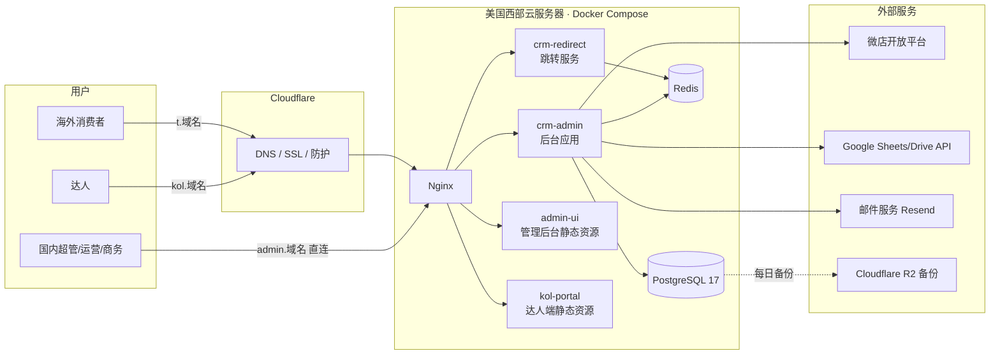
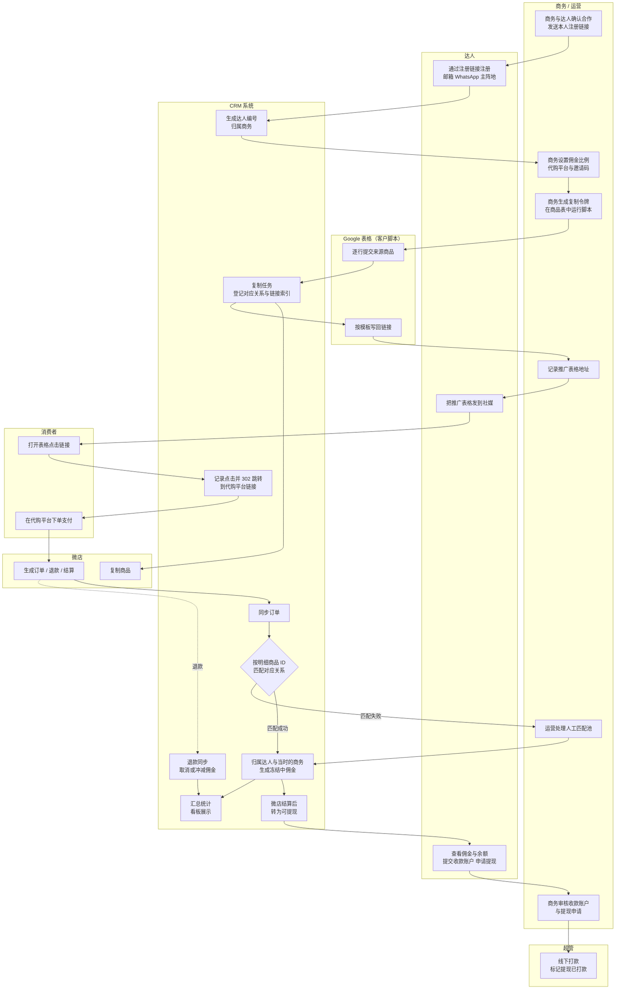
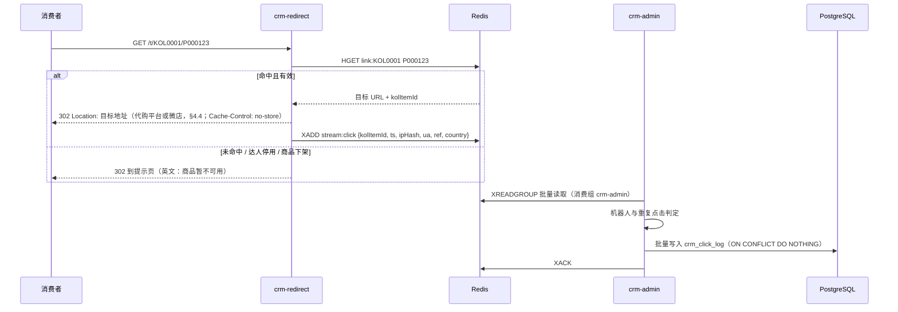
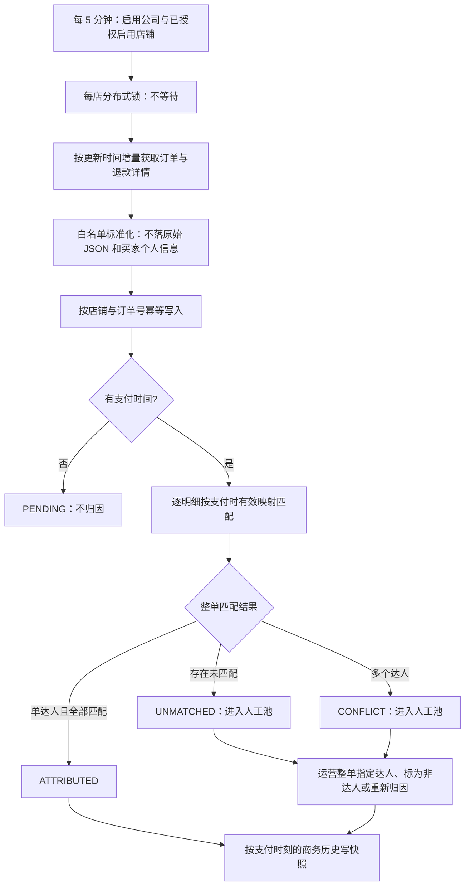
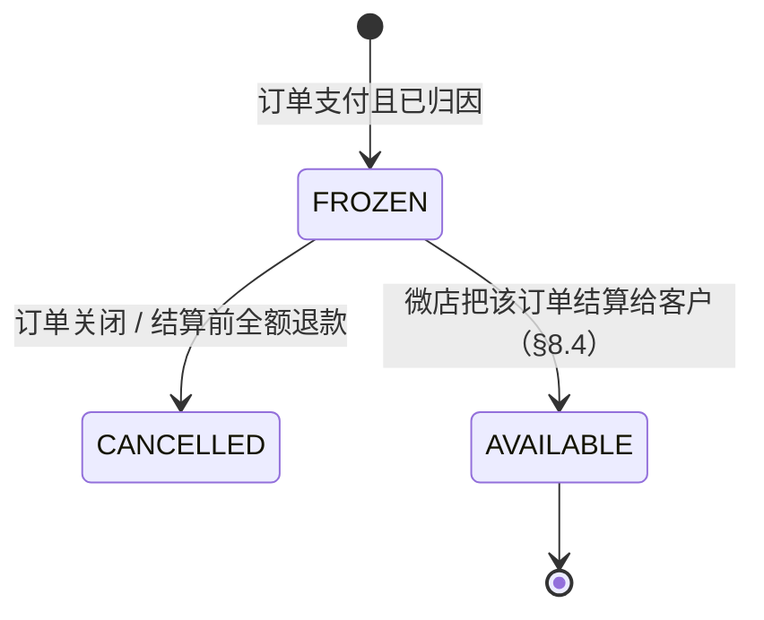
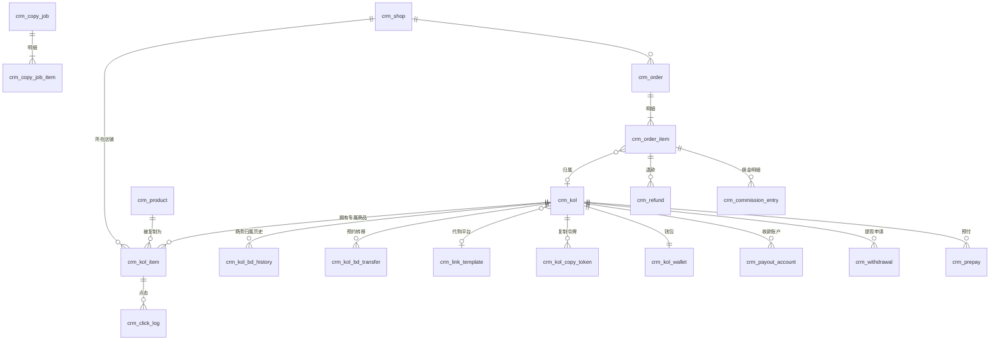

# 海外达人分销 CRM 系统 —— 详细设计说明书

> 版本：V0.1（设计初稿，M0 阶段随《需求确认书》定稿）
> 编制日期：2026-10-04
> 依据：《海外达人分销CRM系统需求说明书(界面版)》《数据看板模块需求说明书》《项目报价与排期方案-1（签约定稿）》《Google与微店API能力调研报告》
> 修订：2026-10-12 增加微店接入（§3.4、§5.2、§6.2、§7.1、§9、§12、[ADR-016](../06-架构决策/ADR-016-微店店铺授权与凭证加密.md)），项目负责人确认；2026-10-12 管理端每次登录需要图形验证码（§2.2 接口表、§3.3、[ADR-017](../06-架构决策/ADR-017-管理端每次登录需要图形验证码.md)），项目负责人确认；2026-10-12 管理端体验 P0：锁屏、当前页批量操作、列表 CSV 过渡导出（§3.3、§6.1；任务 06e §4.12 曾排除锁屏，负责人经调研后改列为必做），项目负责人确认；2026-10-16 按客户 10-14 会议纪要、10-15 需求补充与表格脚本修订：角色改为超管 + 可配置权限子账号（[ADR-018](../06-架构决策/ADR-018-管理端改为超级管理员加可配置权限的子账号.md)）、达人自助注册、兼容客户表格脚本的复制接口与按复制商品 ID 中转（[ADR-019](../06-架构决策/ADR-019-兼容客户表格脚本的商品复制接口.md)）、佣金随微店结算转可提现、收款账户、提现申请、预付、商务转移、参考汇率（§0～§13 多处，变更汇总见 §0.4），项目负责人确认

---

## 0. 文档说明

### 0.1 设计基线

本设计以签约定稿为准，相对原需求说明书的主要变化：

| 项目 | 原需求 | 本设计采用 |
|---|---|---|
| 达人入驻 | 达人自主注册，运营审核 | 达人通过商务的注册链接自助注册（只填邮箱、密码、WhatsApp、主阵地），注册即生效、自动归属该商务，不设审核；商务也可在后台直接录入（2026-10-16 修订，原为"运营/商务录入 + 邮件邀请"） |
| 专属链接 | 系统调用微店接口生成 | 客户的 Google 表格脚本调用本系统的复制接口，系统在微店为达人复制商品并登记对应关系；Excel 导入对应关系保留为兜底（2026-10-16 修订，原为"运营手动复制 + 导入"，ADR-019） |
| 订单归因 | 五级优先级（达人 ID / 优惠码 / track_id / 时间窗口 / 人工） | 按订单商品明细的专属商品 ID 归因；一笔订单只属于一位达人；不能识别的进人工匹配池。优惠码不用于归因，时间窗口匹配不做 |
| Google 表格 | 四页签（Links / Orders / Summary / Settlement） | 公开表格只放商品链接，由客户的表格脚本生成，系统记录表格地址；订单、佣金、提现在达人端查看（2026-10-16 修订，原为"系统调用 Google API 建表"）。以后如需在表格中显示订单与汇总，按 §4.4 第 5 条的两种方式回写，待客户确认（Q5） |
| 结算 | 未细化 | 佣金在微店把订单结算给客户后转为可提现；达人用已审核的收款账户发起提现，商务审核，超管线下打款后标记；系统不做支付（2026-10-16 修订，原为"财务按月出结算单"） |
| 店铺 | 未限定 | 最多 3 个贵方自有微店店铺 |
| 公司 | 未提及 | 一套系统支持客户旗下多家公司，数据完全隔离；当前 1 家（§3.4，2026-10-11 新增） |
| 界面语言 | 管理端中文、达人端英文 | 两端均支持中英文切换（§2.4，2026-10-11 新增） |

### 0.2 待决策事项（本稿按"推荐"编写）

| # | 事项 | 本稿采用（推荐） | 备选 | 影响范围 |
|---|---|---|---|---|
| D1 | 后端底座 | **纯自研**：Spring Boot 4.1 + Sa-Token + MyBatis-Plus + Flyway + Redisson（JDK 21）；管理端前端基于 pure-admin-thin | RuoYi-Vue-Plus 6.0（已放弃：优先代码完全可控） | 全局 |
| D2 | 跳转服务 | 独立进程部署 | 合并在后台应用中 | §2、§7.4 |
| D3 | 达人端前端 | 独立的轻量 Vue 3 应用 | 后台内加英文布局 | §2 |
| D4 | 定时任务 | Spring 定时任务 + Redisson 分布式锁 | 独立调度服务 | §9 |
| D5 | Excel 组件 | FastExcel 稳定版 | Apache Fesod（孵化中） | §7 |
| D6 | 计佣基数 | 按微店结算口径：商品明细实付金额（已分摊优惠，不含运费）− 退款金额；M0 用真实订单与微店结算数据核对 | 客户另定 | §8.3 |
| D7 | 佣金比例优先级 | 商品级比例 > 达人比例；达人比例由商务在推广前设置，可修改 | 客户另定 | §8.3 |
| D8 | 可提现时点 | 微店把订单结算给客户后转为可提现（客户 10-14 确认）；结算信息取不到时按交易完成后 N 天（默认 7，按公司配置） | 客户另定 | §8.4 |
| D9 | 比例变更 | 不追溯，按下单时比例快照 | 追溯 | §8.3 |
| D10 | 统计时区 | 北京时间（UTC+8），销售按支付时间、退款按退款时间计入 | 美国时区 | §8.6 |
| D11 | 币种 | 全部金额按人民币记录与计算；达人端另显示按欧洲央行日汇率折算的美元参考金额，仅供参考（负责人 10-16 确认） | 打款币种入账 | §7.5、§8.4 |

客户相关事项（D6～D11）以 M0《需求确认书》为准；技术事项（D1～D5）已确认（2026-10-04）。

### 0.3 术语

| 术语 | 含义 |
|---|---|
| 原商品 | 客户微店中用于推广的商品（2 万个），系统中称"商品"，编号如 P000123 |
| 专属商品 | 运营为某位达人在微店复制的原商品副本，拥有独立的微店商品 ID |
| 对应关系 | 专属商品 ID → 达人 + 原商品 的映射 |
| 中转链接 | 系统生成、写入表格的链接，形如 `https://t.域名/t/KOL0001/P000123`，点击后记录并跳转到专属商品 |
| 订单明细 | 一笔订单中的一个商品行；归因和计佣的最小单位 |
| 有效订单 | 已支付且未关闭的订单（具体状态映射见 §8.1） |
| 人工匹配池 | 无法自动归因的订单明细，等待运营处理 |
| 代购平台（Agent） | 海外消费者下单使用的代购网站，如 kakobuy、cnfans；客户需求中的"对应 Agent 代理"指它。注意与"所属商务"区分 |
| 邀请码 | 达人在其代购平台上的推广码，写入代购平台链接，如 `affcode=...` |
| 链接模板 | 代购平台商品链接的模板，含 `{PRODUCT_ID}`，可含 `{INVITE_CODE}`（ADR-019） |
| 复制令牌 | 为某位达人签发、供客户表格脚本调用复制接口的令牌；对应旧系统的"Token"（ADR-019） |
| 推广表格 | 每位达人一张 Google 表格，每行一个商品及其链接；由客户脚本生成，系统记录地址 |
| 收款账户 | 达人用于收取佣金的 PayPal 或 USDT 账户，需商务审核 |
| 提现申请 | 达人从可提现余额中申请提取佣金（客户文档称"佣金结算"），商务审核、超管线下打款后标记 |
| 预付 | 商务为名下达人申请提前支付的费用，超管审批，线下支付，可选从后续佣金中抵扣 |

### 0.4 2026-10-16 修订汇总与待确认

依据：客户 2026-10-14 会议纪要、2026-10-15《需求最后补充》、业务流程图（1015）、表格脚本 3.0.5 及样表，均在 `docs/00-需求/客户补充资料-1015/`；负责人 10-16 答复。

| 变化 | 章节 |
|---|---|
| 角色只保留超级管理员（兼财务）、运营、商务；子账号权限可逐项勾选，取消财务角色 | §1.3、§3.1、ADR-018 |
| 达人通过商务的注册链接自助注册，注册即生效，不设审核；商务编辑达人信息 | §4.2 |
| 达人档案新增 WhatsApp、主阵地、代购平台、邀请码、推广表格地址 | §5.2 |
| 客户表格脚本调用本系统的复制接口；新增"T-CRM 中转"模板和按复制商品 ID 的跳转 | §4.3、§4.4、§6.5、§7.4、ADR-019 |
| 跳转目标由微店直链改为达人的代购平台链接 | §4.4、§7.4 |
| 一笔订单只属于一位达人；订单记录支付时的所属商务 | §4.6、§5.2 |
| 佣金改为余额制：冻结中 → 可提现（微店结算后）→ 提现；取消月度结算单 | §4.8、§8.3、§8.4 |
| 新增收款账户（达人填写、商务审核）、提现申请、预付申请（超管审批、线下支付） | §4.11、§4.12、§5.2、§6 |
| 商务转移：超管转移达人，可预设生效时间；商务停用时达人自动归公司 | §4.13 |
| 人民币记账，达人端显示美元参考金额（欧洲央行日汇率） | §7.5 |
| 客户不需要"邀请人"（负责人 10-16），不实现需求补充中的需求 5 及需求 6 的 `inviter_user_id` | — |

**待确认（不阻塞其余部分的设计与开发）**

| # | 事项 | 当前写法 | 影响 |
|---|---|---|---|
| Q1 | 微店复制流程：用哪个应用与接口、目标店铺如何分配、失败如何处理（客户 10-17 确认） | ADR-019 第 4 条：读取商品与详情 → 新增商品 → 保存详情 | §4.3 复制任务 |
| Q2 | 微店结算数据能否按订单取得（接口或导出） | 取不到时按交易完成后 N 天 | §8.4 |
| Q3 | 月薪是否保留（10-14 会议、10-15 文档均未提及） | 本稿不设计月薪 | §4.8 |
| Q4 | 复制时是否加价（旧脚本仅对淘宝 / 1688 来源加价） | 按原价复制，不加价 | §4.3、§8.3 |
| Q5 | 推广表格中是否要显示该达人的订单、汇总与佣金（表格对外公开，会随之公开） | 一期不回写；两种回写方式都保留为后续方案（§4.4 第 5 条） | §4.4、§7.2 |

---

## 1. 系统概述

### 1.1 目标

把"达人 → 专属链接 → 点击 → 订单 → 佣金 → 看板"串成闭环：每笔订单明细能自动对应到达人，佣金按规则计算、可结算可追溯，各角色只看到自己权限内的数据。

### 1.2 规模假设

| 指标 | 数值 |
|---|---|
| 公司 | 当前 1 家；按多家设计，新增公司不改代码与表结构（§3.4） |
| 达人 | 100（设计容量 500） |
| 原商品 | 2 万 |
| 专属商品 / 中转链接 | 最多 200 万 |
| 微店店铺 | 每家公司 ≤ 3 |
| 订单 | 约 2,000 单/天（设计容量 2 万单/天） |
| 点击 | 预估 5 万次/天（设计容量 100 万次/天） |

### 1.3 角色

| 角色 | 说明 |
|---|---|
| 平台管理员 | 只管理公司：新建、改名、启停公司，为公司创建与重置超级管理员；看不到任何业务数据（§3.4） |
| 超级管理员 | 公司主账号：本公司全部功能与数据，兼财务（审批预付、标记提现已打款）；用户与权限、系统配置、接口参数 |
| 运营（子账号岗位） | 默认：商品上架下架、原商品与对应关系、订单与人工匹配；可查看全部达人，不能修改达人 |
| 商务（子账号岗位） | 默认：管理本人名下达人的全部信息（编辑、佣金比例、复制令牌、表格地址）、审核其收款账户与提现申请、为其申请预付；只能看本人名下的达人 |
| 达人 | 达人端：注册、查看本人订单与佣金、提交收款账户、申请提现；只看本人数据，不能导出 |

运营、商务不是固定角色，而是新建子账号时选择的**岗位模板**：模板预先勾选一组权限和数据范围，超级管理员可逐项增减（§3.1，ADR-018）。2026-10-16 起取消财务角色，财务工作由超级管理员完成。除平台管理员外，所有账号都属于且只属于一家公司，只能看到本公司的数据。

---

## 2. 总体架构

### 2.1 部署架构



| 域名 | 用途 | Cloudflare 代理 |
|---|---|---|
| `t.域名` | 中转跳转 | 开启 |
| `kol.域名` | 达人端 | 开启 |
| `admin.域名` | 管理后台 | 关闭（国内直连） |

### 2.2 应用模块

| 进程 / 工程 | 技术 | 职责 |
|---|---|---|
| `crm-admin` | 自研，Spring Boot 4.1 / JDK 21 | 管理端 API、达人端 API、订单同步、归因、计佣、看板汇总、表格任务、定时任务 |
| `crm-redirect` | Spring Boot（精简，无数据库直连写入） | 解析中转链接、302 跳转、写点击事件到 Redis Stream |
| `admin-ui` | 基于 pure-admin-thin（Vue 3 + TS + Element Plus）+ ECharts | 管理后台，中英文切换（默认中文）；菜单随代码静态配置，按权限码显隐（ADR-018） |
| `kol-portal` | Vue 3 + TS + Element Plus + ECharts | 达人端，中英文切换（默认英文），适配手机 |

`crm-admin` 根包 `com.tcrm.admin`，直接子包为 `shared`（响应、异常、traceId、通用 Redis 能力）、`security`（登录、令牌、当前用户上下文）、`system`（公司、管理员用户、操作日志、审计写入）及下列业务模块。模块内分为 `controller/service/mapper/model/api`；调用方向为 controller → service → mapper。跨模块只依赖对方的 `api` 包，`shared` 不依赖业务模块。当前用户上下文位于 `security.api`；`system.service.AccountStoreService` 实现 `security.api.AccountStore`，认证服务通过该接口访问账号，避免认证模块直接依赖用户实体或 mapper。业务模块当前保留占位包：

| 包 | 内容 |
|---|---|
| `kol` | 达人、注册链接与自助注册、商务归属与转移、复制令牌 |
| `product` | 原商品、专属商品对应关系、店铺、商品复制任务与对外复制接口（ADR-019） |
| `link` | 中转链接、链接模板、Redis 链接索引、点击消费 |
| `sheet` | 推广表格地址（一期由客户脚本生成表格，本模块只记录地址；Google API 建表推迟） |
| `order` | 订单同步、Excel 导入、归因、人工匹配 |
| `commission` | 佣金台账、余额、收款账户、提现申请、预付申请、冻结 |
| `stats` | 汇总表、看板查询、预警 |
| `integration` | 微店客户端、Google 客户端、邮件客户端、汇率客户端 |
| `task` | 批量任务框架（进度、重试、错误文件） |

现有用户与审计实体为 `system.model.SysUserDO`、`SysOperLogDO`，DO 只用于 model / mapper / service；controller 使用独立请求对象与 `UserVO`、`OperLogVO`，service 使用 Command / DTO。跳转工程按 `controller/service/config` 分层，controller 经 service 查询 Redis、写入点击事件。

| 当前接口 | 声明角色 / 行为 |
|---|---|
| `POST /admin-api/auth/captchas` | 显式公开；签发一次性图形验证码（3 分钟有效），每个来源 IP 每分钟最多 120 张（`crm.auth.captcha.issue-per-minute`），超出 429 `AUTH_CAPTCHA_RATE_LIMITED`（ADR-017） |
| `POST /admin-api/auth/login` | 显式公开；请求必须带 `captchaId` + `captchaCode`，先校验验证码（错误或过期 400 `AUTH_CAPTCHA_INVALID`，不计入失败次数），再按用户名+IP、IP、用户名三层失败计数与锁定（ADR-008、ADR-017） |
| `POST /admin-api/auth/logout`、`GET /admin-api/auth/me`、`PUT /admin-api/auth/password` | `PLATFORM_ADMIN` / `SUPER_ADMIN` / `STAFF` 登录态。`/me` 含 `tenantId`、`tenantName`（平台管理员均为空）、`postTemplate`、`permissions` |
| `GET/POST /admin-api/system/users`、`PUT /admin-api/system/users/{id}`、`PUT /admin-api/system/users/{id}/status`、`PUT /admin-api/system/users/{id}/password`、`GET/PUT /admin-api/system/users/{id}/permissions`、`GET /admin-api/system/permissions` | `SUPER_ADMIN`。`role` 只接受 `SUPER_ADMIN` 或 `STAFF`；创建或修改为 `PLATFORM_ADMIN` 返回 400。用户列表与 `/me` 的 `UserVO` 含 `postTemplate`、`permissions` |
| `GET /admin-api/system/oper-logs` | `SUPER_ADMIN` |
| `GET/POST /admin-api/platform/tenants`、`PUT /admin-api/platform/tenants/{id}`、`PUT .../status`、`GET/POST .../admins`、`PUT .../admins/{userId}/password` | 仅 `PLATFORM_ADMIN`。详见 §6.2 |

后台统一响应 `{code,msg,data,errorCode,traceId}`，错误码登记在 `shared.ErrorCode`，参数校验失败返回字段级列表；分页 `{items,total,page,size}`，64 位整数（含 ID、total）和金额序列化为字符串，page / size 为整数。过滤器生成 traceId 并写入 MDC、`X-Trace-Id` 和信封，设置 `X-Content-Type-Options: nosniff`、`Referrer-Policy: strict-origin-when-cross-origin`；跨域来源仅取环境变量 `TCRM_CORS_ALLOWED_ORIGINS`，默认为空。跳转服务维持 302 / 纯文本响应。

当前系统表由 `backend/src/main/resources/db/migration/V202610041200__init_system.sql` 创建，使用 PostgreSQL 17、UTC 会话、`TIMESTAMPTZ(3)` 与正值 BIGINT 主键约束。用户逻辑删除列为 `is_deleted BOOLEAN`，Java 属性为 `deleted`；用户名采用 `lower(username)` 唯一索引及参数绑定的大小写不敏感查询。`sys_oper_log` 是只追加表，省略修改与逻辑删除字段，表与全部字段均有注释。本次初始迁移改写仅适用任务 02 的一次性授权。

后台启动时检查启用且未逻辑删除的平台管理员；不存在时必须设置 `TCRM_BOOTSTRAP_ADMIN_USERNAME` 与 `TCRM_BOOTSTRAP_ADMIN_PASSWORD`，缺少任一变量或用户名已被占用则启动失败并提示变量名，没有默认凭证。已有可用平台管理员时不要求初始化变量，也不重复创建。各公司的超级管理员由平台管理员在后台创建（§3.4）。多公司迁移 `V202610111800__add_multi_company.sql` 增加 `sys_tenant`，并为 `sys_user`、`sys_oper_log` 增加可空 `tenant_id`；操作日志另有 `idx_sys_oper_log_tenant_time (tenant_id, oper_time)`，原按时间的索引保留。管理员审计可按规范 06 保存原始 IP，180 天清理任务已实现。

### 2.3 技术栈

| 类别 | 选型 |
|---|---|
| 后端 | Java 21、Spring Boot 4.1、Sa-Token、MyBatis-Plus、Flyway、Redisson |
| 数据库 | PostgreSQL 17（UTF8；见 ADR-005） |
| 缓存/消息 | Redis 7（缓存、Stream、分布式锁、限流） |
| Excel | FastExcel |
| Google | google-api-services-sheets / drive 官方 Java 客户端，服务账号 |
| 微店 | 开放平台 HTTP 接口 + 官方加解密 jar |
| 前端 | Vue 3、TypeScript、Vite、Element Plus、ECharts |
| 测试 | JUnit 5、Testcontainers（PostgreSQL、Redis）、Mockito |
| 部署 | Docker Compose、Nginx、GitHub Actions |

不使用后台管理脚手架；不做动态菜单、工作流。账号类型为平台管理员、超级管理员、子账号与达人；子账号的功能权限由超级管理员按权限码逐项勾选（ADR-018），权限码在代码中集中定义，接口用注解声明所需权限码，菜单随代码发布、按权限码显隐。多公司按"共享数据库 + 公司字段"隔离（§3.4，ADR-014），不做按公司定制菜单或功能。

### 2.4 国际化

管理端与达人端都支持简体中文（`zh-CN`）和英文（`en-US`）切换（[ADR-015](../06-架构决策/ADR-015-管理端与达人端支持中英文切换.md)）。任务 06d 实现；之后新增的页面与后端文字一律同时提供两种语言。

| 项目 | 设计 |
|---|---|
| 默认语言 | 管理端中文，达人端英文；登录页和页头提供切换，选择保存在浏览器本地（两端各自保存），不存服务端 |
| 前端实现 | vue-i18n（两端各新增一个依赖），Element Plus 组件语言包、ECharts 文字、日期与数字格式随语言切换；界面文字全部从语言包读取，代码中不写死 |
| 请求语言 | 前端每个请求带 `Accept-Language`（当前语言）；后端从该请求头解析，只输出 `zh-CN` 与 `en-US` 两种结果：`zh` / `zh-CN` 解析为 `zh-CN`，`en` / `en-US` 等英文变体解析为 `en-US`，带权列表取第一个能解析的条目，缺失、无法识别或其他语言一律按英文，且不受服务器默认语言影响 |
| 错误提示 | 后端 `msg` 保持英文、只用于排查；界面按 `errorCode` 从语言包取文案（规范 02） |
| 参数校验 | 字段级校验提示按请求语言生成；界面按 `field` 定位到表单项 |
| 导入模板 | 下载时表头与文件名均为当前语言（文件名如 `kol-import-template.xlsx` / `达人导入模板.xlsx`）；导入时表头整行为中文或整行为英文都能识别（与提交时的请求语言无关），中英混用、缺列、多列视为表头不符 |
| 导入错误文件 | 后台任务在提交时记下请求语言（`crm_task.locale`），错误文件的表头和每行错误原因按该语言生成 |
| 枚举与操作日志 | 接口传枚举名称（规范 03）；操作日志 `module` / `action` 存英文固定值。两者都由界面按语言包显示，已有日志不需迁移 |
| 后端文字资源 | Spring `MessageSource`（`fallbackToSystemLocale=false`），语言文件 `messages_zh_CN.properties` / `messages_en.properties`，另有与英文内容相同的 `messages.properties` 作为两种语言之外的兜底；这些文件及校验注解资源包（`ValidationMessages*.properties`）的键在两种语言间完全一致（由测试检查） |
| 不翻译 | 业务数据按录入原样显示：达人姓名、商品名称、店铺名、公司名、备注等 |
| 邮件 | 注册验证码、重置密码邮件同时包含英文和中文，写明公司名称 |
| 不随界面切换 | Google 推广表格保持英文（对外公开）；跳转服务的回退提示页保持英文 |

---

## 3. 权限与数据隔离

### 3.1 功能权限

超级管理员拥有下表全部权限及"超管专属"操作；子账号只有被勾选的权限码（ADR-018）。"运营 / 商务"两列是岗位模板的默认勾选，超级管理员可逐项增减。数据范围 `ALL` / `OWN` 独立于权限码，按账号设置：运营模板默认 `ALL`，商务模板默认 `OWN`（只作用于本人名下的达人及其订单、佣金、链接、看板，§3.2）。

| 权限码 | 功能 | 运营 | 商务 |
|---|---|:-:|:-:|
| `kol:view` | 查看达人列表、详情、商务归属历史 | ✓ | ✓ |
| `kol:edit` | 新建、编辑、启停达人；设置佣金比例、代购平台与邀请码、推广表格地址；Excel 导入达人 | — | ✓ |
| `kol:register-link` | 管理本人的达人注册链接 | — | ✓ |
| `kol:copy-token` | 为达人生成、作废复制令牌（ADR-019） | — | ✓ |
| `product:view` | 查看店铺、原商品、对应关系、中转链接与点击 | ✓ | ✓ |
| `product:edit` | 原商品导入与编辑、对应关系导入、复制任务查看与重试 | ✓ | — |
| `product:status` | 原商品上架、下架 | ✓ | — |
| `order:view` | 查看订单与明细 | ✓ | ✓ |
| `order:manage` | 订单导入、手动同步、人工匹配 | ✓ | — |
| `commission:view` | 查看佣金台账、达人余额、提现与预付记录 | — | ✓ |
| `commission:freeze` | 冻结、解冻达人提现 | — | — |
| `payout-account:review` | 审核、驳回达人收款账户 | — | ✓ |
| `withdrawal:review` | 审核、驳回达人提现申请 | — | ✓ |
| `prepay:apply` | 为达人提交、撤回预付申请 | — | ✓ |
| `dashboard:shop` | 总店看板、商品看板 | ✓ | — |
| `dashboard:team` | 商务看板 | — | ✓ |
| `dashboard:kol` | 代看达人看板 | ✓ | ✓ |
| `data:export` | 导出有权查看的列表 | ✓ | ✓ |

**超管专属**（不可授予子账号）：用户与权限管理；店铺、微店接入、链接模板等系统配置与接口参数；操作日志；审批预付；把提现申请标记为已打款或在打款前驳回；转移商务名下的达人；链接索引手动重建。

达人只能使用达人端：本人资料、订单与佣金、表格地址、收款账户、提现申请；没有导出。平台管理员只能使用公司管理功能（§3.4），所有业务接口都拒绝平台管理员。

### 3.2 数据隔离规则

1. **达人端**：所有达人端接口从登录态取 `kol_id`，不接受前端传入的达人 ID；SQL 层统一追加 `kol_id = 当前达人`。达人端与管理端使用不同的 Sa-Token 账号体系（`StpKolUtil` / `StpUtil`），令牌不互通。
2. **商务**：子账号的 `data_scope` 为 `OWN` 时，在达人相关查询上追加 `kol.bd_user_id = 当前用户`；订单查询直接追加 `crm_order.bd_user_id = 当前用户`，按支付时的商务快照过滤，不以达人当前商务代替；佣金、看板查询按各自既定口径过滤。达人和链接仍按达人当前商务过滤。收款账户、提现、预付的审核待办同样只列本人名下达人的记录。
3. **商务历史归属**（客户 10-14 确认）：转移生效之前产生的订单与佣金归原商务，之后归新商务；商务停用到转移之间归公司（不归任何商务）。订单在支付时记下当时的所属商务 `crm_order.bd_user_id`（§4.6），商务看板按它统计，不再回查 `crm_kol_bd_history`。达人看板不受影响，始终展示该达人的全部数据。
4. **越权测试**：每个需要隔离的接口都有"换一个达人/商务的 ID 访问应被拒绝"的自动化测试；按 ID 访问的接口还要测"用另一家公司的资源 ID 访问应返回 404"（§3.4）。
5. **写入时再次确认范围**：商务（`OWN`）修改达人时，`UPDATE` 条件同时包含 `bd_user_id = 本人`，影响 0 行即返回 403；读取时的范围检查之后达人被转给他人，修改不会生效。

### 3.3 会话与令牌（管理端）

| 项目 | 策略 |
|---|---|
| 登录验证码 | 每次登录（含登录过期弹窗中的重新登录）都要图形验证码。验证码只能用一次：无论对错，校验即删除；3 分钟过期；不区分大小写。验证码错误或过期返回 400 `AUTH_CAPTCHA_INVALID`，不计入 ADR-008 的失败次数，也不检查锁定和密码。管理端在任何一次登录失败后都自动换一张，并在到期前约 10 秒自动换一张。`crm.auth.captcha.enabled`（默认开启）仅供本机开发关闭，关闭时启动打 WARN（ADR-017） |
| 令牌 | Sa-Token 随机 UUID，只从请求头 `X-Admin-Token` 读取，不使用 Cookie |
| 绝对有效期 | 8 小时（`sa-token.timeout`，仅管理端账号体系） |
| 空闲超时 | 2 小时未使用即失效，每次请求续期（`sa-token.active-timeout`，OWASP ASVS 第 2 级）。该配置只作用于管理端账号体系；达人端令牌使用独立配置 `crm.kol-auth.*`（见下） |
| 多端登录 | 允许同一账号多端同时登录，每次登录签发新令牌（`is-concurrent=true`、`is-share=false`），每个账号最多 12 个令牌，超出时最早的失效（Sa-Token 1.46 默认值，负责人已接受） |
| 凭据版本 | `sys_user.credential_version` 在每次修改或重置密码时加 1；登录时写入令牌会话，每次请求比对，不一致即注销该令牌并返回 401。由此保证改密 / 重置后旧令牌全部失效，包括与重置并发签发的令牌，以及 Redis 注销失败时残留的令牌 |
| 状态、角色与权限 | 每次请求从数据库重读账号的状态、角色、权限码与数据范围，停用、改权限立即生效；停用时同时踢下线 |
| 所属公司 | 每次请求随账号一起重读所属公司及其状态；公司停用后，该公司账号的下一次请求即返回 401（`AUTH_ACCOUNT_DISABLED`）。平台管理员没有所属公司 |
| 超级管理员 | 降级或停用超管时锁定本公司全部启用的超管并检查至少保留一个，防止两人并发互相降级后该公司没有超管。其他公司的超管不计入。平台管理员没有停用或降级接口，因此至少保留启动时创建的那一个 |
| 后台任务授权 | 批量导入等后台任务按**提交时**的身份与权限执行；任务排队或执行期间提交人被停用或降权，不中止已提交的任务（任务通常在数分钟内完成，负责人已接受） |
| 锁屏 | 管理端可手动锁定屏幕，并可选空闲自动锁定（默认关闭；5 / 15 / 30 / 60 分钟）。锁定后保留令牌、标签与页面状态，用全屏遮罩挡住工作区；布局根节点置 `inert`，全局快捷键（如 Ctrl/⌘K 菜单搜索）在锁定期间不起作用。解锁 = 同一账号重新登录（密码 + 图形验证码，§3.3 / ADR-017），先注销旧令牌再写入新令牌，避免孤儿会话。锁定状态与空闲最后活动时间经 `localStorage`（`tcrm.admin.*`）跨标签页共享，避免后台标签在其他标签仍活跃时误锁。锁屏防的是离开工位被旁人操作，不替代会话超时或本机开发者工具防护。任务 06e §4.12 曾明确不做锁屏；2026-10-12 负责人根据管理端 UX 调研将锁屏列为 P0 并接受上述方案 |

**达人端令牌**（任务 12a）：与 `sa-token.*` 全局配置无关，达人账号体系使用独立配置 `crm.kol-auth.*`——令牌只从请求头 `X-Kol-Token` 读取；绝对有效期 7 天（604800 秒），空闲 3 天（259200 秒）未使用即失效、每次请求续期；允许每个达人最多 10 个令牌，多端登录规则与管理端相同（`is-concurrent=true`、`is-share=false`）。管理端与达人端是两套 Sa-Token 账号体系，令牌互不通用（§3.2）。

### 3.4 多公司

当前只有 1 家公司，数据层、登录与权限按多家公司设计（[ADR-014](../06-架构决策/ADR-014-多公司采用共享库与公司字段隔离.md)）：以后新增公司只需平台管理员在后台新建，不改代码、不改表结构。各公司同属一个客户，数据完全隔离：不共享达人、店铺、商品，不做跨公司汇总，平台管理员也看不到业务数据。

**公司与账号**

| 对象 | 规则 |
|---|---|
| 公司 `sys_tenant` | 编码（`^[a-z0-9-]{2,32}$`，创建后不可改，全表唯一）、名称（达人登录选择公司和邀请邮件中显示）、状态。只停用不删除。停用后该公司的管理员与达人不能登录，已签发的令牌在下一次请求时失效；该公司的定时同步（订单、表格）跳过；中转链接不受影响（要停链接，停用店铺或达人）。迁移脚本创建默认公司（`id = 1`，编码 `default`），现有数据全部归入该公司 |
| 平台管理员 | 角色 `PLATFORM_ADMIN`，`sys_user.tenant_id` 为空。只能使用 `/admin-api/platform/**`：公司的新建、改名、启停，查看各公司的超级管理员，为公司创建超级管理员、重置其密码。所有业务接口拒绝平台管理员。初始平台管理员由环境变量创建（§2.2） |
| 公司内管理员 | 超管与子账号（运营、商务）都属于一家公司（`tenant_id` 必填）。用户名全系统唯一，登录时按用户名确定公司，管理端登录页不选公司。同一个人为多家公司工作时，在每家各开一个账号 |
| 达人账号 | 每家公司各自独立：`crm_kol` 的一行就是一个达人账号，邮箱在公司内唯一。同一邮箱可以在多家公司各有一个账号，各自的密码、状态、佣金、结算互不影响；A 公司停用或重置这个达人，不影响他在 B 公司的账号 |

**隔离机制**

1. **公司字段**：业务表都有 `tenant_id BIGINT NOT NULL`，子表也直接带，不通过关联主表判断。例外：`sys_tenant` 自身；`crm_link_index_outbox`（系统内部队列，只引用 ID，由后台跨公司处理）；`crm_fx_rate`（平台级参考汇率，§7.5）；`sys_user`、`sys_oper_log` 的 `tenant_id` 可空，空值只用于平台管理员及其操作。
2. **当前公司只从登录态取**：管理员取账号的 `tenant_id`（每次请求随账号一起重读），达人取其账号的 `tenant_id`；任何接口都不接受前端传入公司 ID。
3. **自动过滤**：MyBatis-Plus 多租户插件 `TenantLineInnerInterceptor`（依赖 `mybatis-plus-jsqlparser` 已在项目中）对 SELECT / UPDATE / DELETE 追加 `tenant_id = 当前公司`，INSERT 自动填入。**取不到当前公司时直接报错**，不会退化为不过滤。手写 SQL 同样经过插件；插件无法解析的语句必须改写或显式处理，不能静默跳过。
4. **跨公司处理必须显式声明**：后台维护任务（链接索引同步与重建、点击消费、点击分区维护、操作日志清理、监控、汇率拉取）和平台管理员接口以"系统范围"执行；对外复制接口（§6.5）先以系统范围按令牌哈希或任务编号找到所属公司，随即切换到该公司范围处理，模板列表接口不返回任何公司数据以外的内容（见 §6.5）。上述绕开自动过滤。这些语句只按 ID 处理或做全表维护，不把数据返回给任何公司用户。每一处绕开都要在代码中写明原因，并在 PR 中列出。
5. **以公司为单位的后台处理**先设置当前公司再执行：批量导入任务取任务行的 `tenant_id`（与 §3.3"按提交时身份执行"一致）；以后的订单同步、表格任务取店铺或达人的 `tenant_id`。
6. **保持全系统唯一的标识**：达人编号、微店店铺 ID、管理员用户名。达人编号出现在中转链接里，跳转服务按 `link:{达人编号}` 查找、不需要知道公司，因此跳转服务、Redis 链接索引与点击事件的结构都不变。代价是导入时填写其他公司已用的达人编号，会提示"已存在"；各公司同属一个客户，可以接受。
7. **改为公司内唯一**：达人邮箱、原商品编码、业务配置键。系统生成的原商品编码仍来自全局序列，不会重复；客户填写的编码只需在本公司内不重复。店铺上限 3 家按公司计算，新建店铺的互斥锁按公司区分。
8. **索引**：按公司列表、排序的索引以 `tenant_id` 开头（达人列表、原商品列表、任务、操作日志）。以达人、店铺、原商品 ID 为条件的索引（对应关系、点击日志等）不加，因为这些 ID 本身只属于一家公司。
9. **数据库行级安全（RLS）本期不启用**，理由见 ADR-014。每张表都已有 `tenant_id`，以后需要时可以直接加策略，不改表结构。

**达人端登录**（由达人登录任务实现。多公司底座只保证数据模型：达人邮箱在公司内唯一，同一邮箱可以在多家公司各有一行 `crm_kol`。）

1. 用邮箱 + 密码登录。系统找出该邮箱在所有启用公司中的启用账号，逐个比对密码；一个账号都没有时，也执行一次 BCrypt（规范 06）。
2. 密码匹配 0 个账号：返回与"密码错误"相同的失败。匹配 1 个：直接登录。匹配多个（同一个人在多家公司设置了相同密码）：返回一次性的选择凭据和这些账号所属公司的名称，达人选择后调用 `POST /kol-api/auth/login/select` 换取令牌。选择凭据存 Redis，5 分钟有效、只能使用一次，只能换取已通过密码校验的那几个账号的令牌。
3. 令牌会话绑定达人 ID 与公司 ID；切换公司需要退出后重新登录。
4. 失败计数与锁定按"邮箱 + 来源 IP"、"来源 IP"、"邮箱"三层（同 ADR-008），与公司无关；Redis 键使用与管理端独立的 `kol:auth:fail:*` 前缀，两边的计数互不影响。
5. 达人端登录**不使用图形验证码**（负责人 2026-10-16 决定：客户要求达人操作尽量少；防护依靠三层失败锁定与 Nginx 对登录接口的限速；ADR-017 只约束管理端）。
6. 邀请按账号发送，邮件写明公司名称。找回密码时，如果该邮箱有多个账号，邮件按公司分别给出重置链接，每个链接只重置对应公司的账号。
7. 已接受的残留风险：一个邮箱有多个账号时，登录要做多次 BCrypt 比较，响应耗时会多出几倍。攻击者据此只能推断"该邮箱属于多家公司"，不能得知是哪几家，也无法据此登录。达人知道各公司之间的关系，因此接受。

**公司级配置与凭证**

- 业务配置 `crm_config` 按公司保存，`(tenant_id, config_key)` 唯一。
- 第三方凭证（微店 appkey / secret 与店铺令牌、Google 服务账号密钥）按公司保存在数据库，用 AES-256-GCM 加密。`shared.SecretCipher` 使用环境变量 `TCRM_SECRET_KEY`（Base64 编码的 32 字节）作为主密钥，格式为 `v1:` + Base64(nonce ‖ 密文 ‖ 标签)；启动时校验密钥。凭证只能写入、不能读出：管理接口只返回 appkey、是否已配置 secret 与更新时间，不返回任何明文凭证；修改记入审计。
- 微店同时支持自用型（店铺级 appkey / secret，不含 refresh token）与服务型（公司级应用、逐店铺授权）两种模式。服务型回调使用 Redis 一次性 state，并核对授权返回的 `openid` 与 CRM 店铺 ID。令牌由中心组件加密保存并集中主动 / 被动续期；主密钥不可恢复，丢失后所有已保存凭证均须重新录入或授权。
- 平台级配置仍走环境变量：数据库、Redis、主密钥、IP 哈希盐值、邮件服务、域名。不引入配置中心（ADR-014）。
- 凭证表和主密钥变量由第一个需要保存凭证的任务（Google 表格或微店同步）建立；从那时起，缺少主密钥的应用启动失败。

---

## 4. 核心业务流程

### 4.1 全链路泳道图



### 4.2 达人入驻

**自助注册（主要方式，客户 10-14 确认）**

1. 商务在后台取得本人的**注册链接** `https://kol.域名/register?c={注册码}`，发给达人。注册码为 32 位 Base62（`[0-9A-Za-z]{32}`，`SecureRandom` 对 62 取模，无偏），全表唯一，明文保存：它只决定公司和归属商务，不是登录凭证。每位商务同一时间最多一条有效码（部分唯一索引 `(bd_user_id) WHERE status = 1`）。`GET /admin-api/kol/register-code` 没有有效码时自动生成；`POST` 在同一事务内把旧码 `status` 改为 0 并生成新码。响应 `{code, url, status}`，`url` 为 `{TCRM_KOL_PORTAL_BASE_URL}/register?c={code}`。只有可作为商务的账号（本公司、启用、子账号、数据范围仅本人、且有 `kol:edit`）能取得链接；超管、数据范围为全部的子账号、没有 `kol:edit` 的子账号返回 422 `KOL_INVALID_BD_USER`。没有 `kol:register-link` 返回 403。并发插入撞上唯一索引时整段事务重试，最多 3 次。
2. 达人填写邮箱、密码、WhatsApp、主阵地（平台 + 账号，注册时只填一个主阵地），可选填名称、主页 URL 与国家。邮箱收到 6 位验证码，填入后提交。主阵地账号名最长 64（与达人名称列一致），名称留空时 `name` 取该账号名。客户要求"达人填得越少越好"，收款账户不在注册时填写。
3. 提交后立即生效，不设审核：系统生成达人编号（§8.2），`bd_user_id` 记为注册链接所属的商务，写入商务归属历史；达人直接登录达人端。
4. 商务随后在后台补全或修改达人信息：名称、国家、佣金比例、代购平台与邀请码等。客户要求达人尽量少操作，因此达人端只能修改密码，资料由商务维护。
5. 邮箱在本公司内唯一。已存在则返回 409 `KOL_EMAIL_EXISTS`，达人端提示「该邮箱已注册，请直接登录」，并且不发送邮件、不开始 60 秒冷却。同一达人与多家公司合作时，用各公司商务的注册链接分别注册（§3.4）。限流（Redis，前缀 `kol:register:`，与登录计数分开）：发送验证码每 IP 每小时 20 次；同一公司同一邮箱 60 秒内最多发送一次（429 `KOL_EMAIL_CODE_TOO_FREQUENT`）；验证码 10 分钟有效、最多错 5 次，用过即失效（错误、过期或已使用均为 400 `KOL_EMAIL_CODE_INVALID`）；注册每 IP 每小时 20 次、每邮箱每小时 10 次（429 `KOL_REGISTER_TOO_FREQUENT`）。校验链接的 `GET /kol-api/register/{code}` 不单独限流。验证码只存 SHA-256 与剩余次数，不存明文。超出次数的尝试（含探测已注册邮箱）同样计数。

**后台录入（兜底，暂时屏蔽）**

> 负责人 2026-10-16 决定：管理端暂时隐藏「新增达人」「批量导入」两个入口，达人一律通过商务的注册链接自助注册；后端接口与已录入达人的「发送邀请」保留，恢复时只需打开管理端的开关。

商务也可在后台录入达人（单个或 Excel），必填邮箱、名称，`bd_user_id` 为本人；超管录入时选择商务。系统发送中英文邀请邮件（写明公司名称，含 72 小时有效的设置密码链接），达人设置密码后激活，邀请过期可重发。

### 4.3 专属商品与对应关系

**脚本复制（主要方式，ADR-019；复制细节待 Q1 确认）**

1. 商务在达人详情中生成**复制令牌**（明文只显示一次；默认 24 小时有效、最多复制 1,000 个商品，按公司配置），连同达人的邀请码交给运行脚本的人。
2. 在客户的商品表中运行脚本"一键替换链接"，填入令牌、邀请码，选择链接模板（推荐"T-CRM 中转"）。脚本把选区内各行的来源商品 ID 提交到 `POST /admin-api/external/product-links/convert`。
3. 系统校验令牌（有效、未超额度、达人启用），建立复制任务，立即返回任务编号；后台工人逐条处理：
   - 在本公司启用的店铺中按微店商品 ID 找到来源商品，登记或更新为原商品（名称、图片、价格取自微店；新登记的原商品默认在售）；
   - 若该达人已有这件原商品的有效对应关系，直接返回已有的复制商品 ID；
   - 否则在微店复制到目标店铺，写入 `crm_kol_item`，并登记链接索引刷新（ADR-013）；
   - 单条失败不影响其他条，失败原因写入任务明细。
4. 脚本轮询任务进度，结束后读取明细，用"模板 + 邀请码 + 复制商品 ID"写回单元格（§4.4）。

**Excel 导入（兜底）**

运营在微店手动复制后，按模板（店铺、专属商品 ID、达人编号、原商品编码）导入对应关系，逐条校验：达人存在且启用；原商品存在；专属商品 ID 在本店未被其他有效映射占用；同一达人同一原商品只能有一个有效映射。通过的写入 `crm_kol_item`（新映射生效，旧映射置失效时间，不删除），失败的写入错误文件。

**原则**：专属商品 ID 一旦用于订单归因，即使映射失效也保留历史记录，历史订单的归属不受后续映射变更影响。

### 4.4 链接与推广表格

1. **链接模板**（`crm_link_template`）：超管按公司维护代购平台模板，`template_url` 含 `{PRODUCT_ID}`，可含 `{INVITE_CODE}`。系统另提供固定的"T-CRM 中转"模板 `https://t.域名/i/{PRODUCT_ID}`，不存库、始终排在列表最前。
2. **达人的跳转目标**：达人档案选择一个代购平台模板并填写邀请码后，其中转链接的目标为该模板代入邀请码和复制商品 ID；未设置时为 `https://weidian.com/item.html?itemID={复制商品 ID}`。修改代购平台、邀请码或模板地址后，登记该达人的链接索引刷新（§7.4）。
3. **两种中转链接**，都经跳转服务计数后 302 到上述目标：
   - `/i/{复制商品 ID}`：脚本选择"T-CRM 中转"模板时写入表格的链接（ADR-019）；
   - `/t/{达人编号}/{原商品编码}`：管理端"链接"列表中可复制的链接（任务 06），同一达人同一原商品的地址永远不变。
   脚本选择代购平台模板时，表格中是代购平台直链，不经过跳转服务，没有点击统计。
4. **推广表格**：由客户在自己的 Google 账号中复制商品表、运行脚本生成，公开范围由客户设置。商务把表格地址填入达人档案（`crm_kol.sheet_url`，须为 `https://docs.google.com/spreadsheets/` 开头），管理端与达人端可查看。本系统一期不调用 Google API；原计划的系统建表（复制母版、写入链接、公开分享）推迟，需要时按 §7.2 实现。
5. **表格数据回写（后续方案，待客户确认 Q5，一期不实现）**：原需求中表格的 Orders / Summary / Settlement 页签由系统回写。两种方式都保留，可以并存：
   - **A. 脚本拉取**：本系统按达人提供只读接口，返回该达人的订单明细与汇总（佣金实现后含佣金）；客户的表格脚本定时调用并写入对应页签。脚本在 Google 一侧运行，本系统不访问 Google，也不需要服务账号。认证用为该达人签发的长期只读令牌（与 24 小时的复制令牌分开，可单独作废），接口路径挂在 `/admin-api/external/` 下，沿用 §6.5 的信封与限流方式。
   - **B. 系统写入**：本系统用 Google 服务账号调用 Sheets API，按 §7.2 定时写入。要求服务器能访问 Google，且每张表格已分享给服务账号（编辑权限）。
   - **并存规则**：两种方式按达人（表格）选择其一，同一张表格不同时使用两种方式，避免互相覆盖。两种方式写入的字段一致，且都不含买家信息；订单号按达人端的规则脱敏。
   - **前提**：表格对外公开，回写会公开该达人的订单与金额，须客户确认可以接受。

### 4.5 点击跳转



- `/i/{复制商品 ID}` 的处理与上图相同，只是查找改为 `HGET linkitem:{末两位} {复制商品 ID}`（ADR-019，§7.4）；点击事件格式不变。
- 跳转服务只读 Redis，**不回源后台**（[ADR-012](../06-架构决策/ADR-012-跳转服务不回源后台.md)）：未命中、值无法解析或 `status` 为 0 时一律 302 到回退地址，不写点击事件。索引完整性由 `crm-admin` 负责：业务变更与一条 outbox 登记在同一事务提交，后台任务在数秒内写入 Redis；每天 04:30（UTC）及超管手动触发时仍全量重建，用于清扫遗漏与多余 key（§7.4、§9，[ADR-013](../06-架构决策/ADR-013-链接索引采用事务内登记与后台同步.md)）。
- 点击消费（任务 06）：同一时间只有一个后台实例消费（分布式锁 `link:click-consumer`，其余实例每 10 秒重试），每批最多 500 条、阻塞读取最长 2 秒，先读待处理列表（PEL）再读新消息。写库成功后才写入“上一次点击时间”并 `XACK`；处理异常的批次不 ACK，下次从 PEL 重新读取。点击 `id` = Stream 消息 ID 的毫秒时间戳 × 1,000,000 + 序号，插入时 `ON CONFLICT DO NOTHING`，重复投递不会产生重复点击。消息格式错误或 `kolItemId` 查不到对应关系时记 `WARN`、ACK 并跳过。`click_time` 取事件 `ts`；`kol_id`、`product_id` 由 `kolItemId` 批内去重查询 `crm_kol_item`（含已失效的映射）得到；`ua`、`referer`、`country` 按列长度截断。
- 机器人判定：UA 为空，或（不区分大小写）包含 `bot`、`spider`、`crawl`、`facebookexternalhit`、`facebookcatalog`、`twitterbot`、`slackbot`、`whatsapp`、`telegrambot`、`discordbot`、`linkedinbot`、`pinterest`、`tiktok`、`bytespider`、`preview`、`headless` 之一时标记 `is_bot`（关键字为代码常量，集中一处）。同一 `kol_item_id` + `ip_hash` 与上一次点击的事件时间相差小于 10 秒时标记 `is_dup`。批内按 Stream 顺序先用本批已经处理过的点击时间；本批尚未出现的键再读 Redis `click:last:{kolItemId}:{ipHash}`（TTL 60 秒，只作加速）。本批中 Redis 未命中的键，用一条查询从 `crm_click_log` 取每个键在 `[本批最早事件时间 − 10 秒, 本批最晚事件时间]` 内的最近一次 `click_time`（走索引 `idx_crm_click_log_kol_product_time (kol_id, product_id, click_time)`，再按 `kol_item_id`、`ip_hash` 过滤）。消费暂停超过该 TTL 后，仍按点击日志判为重复。两类点击保留，统计时排除。
- IP 仅存 SHA-256 哈希（加盐），不存明文。

### 4.6 订单同步与归因

任务 13 实现订单与退款同步、归因和人工匹配；佣金计算与台账由后续任务实现（§0.4 Q2），本任务不写佣金或结算时间。



- **同步窗口与游标**：每店锁 `order:sync:{shopId}`，使用 watchdog，获取失败不等待；一个店铺失败不影响其他店铺。首次从现在回溯 24 小时，之后从各自成功游标回溯 10 分钟。订单按官方 `has_more` / `next_after_key` 翻页，后续请求参数为 `after_key`；退款页码从 0 开始，每页 50。超过接口 90 天窗口限制的积压分为最长 89 天的区间处理。订单与退款整批全部成功才更新两个游标；失败保留游标并写安全英文摘要。
- **幂等**：订单唯一键 `(shop_id, weidian_order_id)`，明细唯一键 `(order_id, sub_order_id)`；优先使用微店子订单号，缺失时对“当前店铺商品 ID + SKU ID + 行号”生成稳定键。来源更新时间未变化的已有订单不重复取详情；退款按退款号更新。外部 HTTP 调用不在数据库事务内，订单与明细一单一事务，退款与累计金额独立短事务。
- **映射时点**：按**支付时刻**匹配 `(shop_id, 当前店铺商品 ID)`，`valid_from ≤ pay_time`，且 `valid_to` 为空或 `pay_time < valid_to`。这是负责人在任务 13 执行会话中确认的规则（2026-10-16），替代此前的“下单时有效”。供货分销订单优先使用 `cur_shop_item_id` / `cur_shop_sku_id`。同一支付时刻查到两条及以上有效映射时，该明细保持未匹配、订单进入人工匹配池，记仅含订单号与商品 ID 的 WARN，不阻断店铺同步。
- **整单唯一达人**：全部明细匹配同一达人时为 `ATTRIBUTED`；两位及以上达人时为 `CONFLICT`，所有已匹配明细标为 4，订单达人为空；有未匹配明细时为 `UNMATCHED`，已匹配部分只有一位达人时暂存该达人。无支付时间保持 `PENDING`。后续同步不自动改变已归因明细的达人；运营显式重新归因时清除旧结果再按现有历史映射计算。
- **商务快照**：有订单达人时，用 `kol.api` 查询覆盖支付时刻的 `[start_time,end_time)` 历史，空商务或无历史时归公司（`bd_user_id` 为空）。每 10 分钟按归属历史的 `create_time` 增量重算对应达人、对应支付区间的订单快照；不修改订单达人。检查点为 Redis `order:bd-snapshot:checkpoint`，首次回溯 24 小时，后续重读 10 分钟重叠窗口以覆盖迟提交，所有公司成功才前移，失败保留。
- **人工处理**：整单指定本公司达人时全部明细类型为 2；标非达人时类型为 3、订单 `NON_KOL`。必填原因不超过 255 字，操作日志记录原因；人工决定不再把旧对应关系 ID 作为自动匹配依据。未支付订单不能手工指定归属。数据范围 OWN 的读写均按订单原商务快照检查。
- **数据最小化**：不读取、不解密、不保存买家姓名、电话、地址，不保存原始 JSON。只对白名单中的买家 ID 计算 `SHA-256(TCRM_IP_HASH_SALT + 买家 ID)`；缺少买家 ID 时哈希为空。后端需注入与跳转服务相同来源的 `TCRM_IP_HASH_SALT`；订单响应不含任何买家字段或哈希。

**后续任务**

- **订单与退款 Excel 导入（任务 18 已实现）**：接口不可用时的兜底。订单模板一行一个明细（微店店铺 ID、订单号、子订单号、标准状态中/英文名、下单/支付时间（北京时间）、订单实付与运费、商品/SKU/名称/型号/数量/明细实付）；退款模板一行一笔已完成退款（店铺、退款单号、订单号、子订单号、金额、发起/完成时间）。逐行写入并走与接口同步相同的 `OrderWriter` 幂等与归因；`source = 2`，`import_batch_id` 为任务 ID；已由接口同步（`source = 1`）的订单拒绝覆盖；子订单号为空时按「当前店铺商品 ID + SKU ID + 本文件同订单行序号」生成稳定键。退款只写入 `raw_status = 10`，退款号已存在则失败。接口见 §6.2。
- 归因确定后生成佣金明细，具体计佣与余额规则见 §4.8、§8.3。
- 已计佣订单人工改归属时，按 §8.3 生成调整明细，保留原台账记录。

### 4.7 退款

1. 订单同步时读取退款状态与金额，写入 `crm_refund`（按明细），更新明细 `refund_amount`。
2. 每笔新退款生成一条负数佣金明细（类型 `REVERSAL`），金额 = −退款金额 × 原佣金比例快照。
3. 原佣金仍在冻结中：冲减明细同样处于冻结中，与原明细一起在微店结算时转为可提现；全额退款时原明细与冲减相抵为 0。原佣金已转为可提现：冲减明细直接计入可提现，即从余额中扣回，余额可以因此变为负数，负余额不能提现（§8.4）。
4. 退款日期计入看板的退款统计（口径见 §8.6）。

### 4.8 佣金、余额与提现

2026-10-16 起改为余额制（客户 10-14 会议、10-15 需求 2），取消财务月度结算单。达人端最关键的三个数是：累计佣金、可提现、冻结中。

佣金明细状态：



- **余额**：每位达人一行钱包 `crm_kol_wallet`，与佣金明细、提现、预付扣减在同一事务内更新，每天与明细合计核对一次，不一致记 `ERROR`。
  - 冻结中 = Σ FROZEN 明细；
  - 可提现 = Σ AVAILABLE 明细（含负数冲减与预付扣减）− 处理中与已打款的提现；
  - 已提现 = Σ 已打款提现。
- **提现申请**（达人端发起）：
  1. 达人选择一个已审核的收款账户，填写金额（人民币）。
  2. 系统在锁住钱包行后校验：金额 > 0；不低于公司配置的最低提现金额（旧系统为 140 元，默认 0 表示不限）；不超过可提现余额；达人未被冻结提现。通过后可提现余额立即扣减。
  3. 状态 `PENDING_REVIEW`（待商务审核）：所属商务通过 → `PENDING_PAYMENT`（待打款）；驳回（必填原因）→ `REJECTED`，金额退回可提现。达人在商务审核前可撤回 → `CANCELLED`，金额退回。
  4. `PENDING_PAYMENT`：超管线下打款后标记 `PAID`，填写打款日期、方式、交易号，可上传凭证，可记录实际打款币种与金额（仅留档）；超管也可在打款前驳回 → `REJECTED`，金额退回。
  5. 提现单保存提交时收款账户的快照，之后账户变化不影响这张单。
- **冻结提现**：有 `commission:freeze` 权限的账号可冻结达人提现（必填原因）。冻结期间佣金照常计算，但不能新建提现申请，已提交的申请不受影响。
- **系统不做支付**：所有打款都在线下完成，系统只记录申请、审核与打款结果（负责人 10-16）。
- **月薪**：待确认（§0.4 Q3），本稿不设计。

### 4.9 商品变更

| 场景 | 运营操作 | 系统处理 |
|---|---|---|
| 新增原商品 | 加入商品表后，为各达人运行脚本（§4.3）；脚本复制时自动登记原商品 | 生成对应关系与链接索引；表格由脚本写入 |
| 修改商品信息（名称、价格、图片） | 后台编辑，或再次运行脚本时按微店信息更新 | 表格内容由客户维护 |
| 原商品下架 | 运营在后台标记下架；微店副本由运营处理 | 中转链接跳转到"商品暂不可用"提示页 |
| 更换某达人的专属商品 | 导入新对应关系 | 旧映射失效、新映射生效；`/t/` 链接地址不变，`/i/` 链接随复制商品 ID 变化 |

### 4.10 看板数据

见 §8.6 指标口径、§5.3 汇总表、§9 汇总任务。

### 4.11 收款账户

1. 达人在达人端添加收款账户：
   - **PayPal**：账号（通常是邮箱，≤ 128）、收款人姓名（必填，≤ 64）；
   - **USDT**：网络（**TRC20 / ERC20 / BEP20 / SOL / TON**，下拉选择）、钱包地址（≤ 128，只允许字母和数字），可上传收款二维码图片（PNG 或 JPEG，按文件头校验，≤ 2MB；先上传得到 `fileId`，保存账户时引用并回填业务归属）。

   一位达人非停用的账户最多 5 个，超出返回 422。客户要求由达人本人填写，防止商务填成自己的账户，所以后台没有代填入口。
2. 提交后状态 `PENDING`（待审核）。**站内消息尚未实现**（`crm_notification` 属后续任务），待办由管理端的待审核列表承担：列表默认显示 `PENDING`，并提供待审核数量接口供将来的菜单徽标使用。
3. 所属商务（`payout-account:review`）审核，超管也可以：
   - 通过 → `APPROVED`，账户锁定、不能修改（409），要换就新建；
   - 驳回（必填原因，≤ 255）→ `REJECTED`，达人修改后重新提交，回到 `PENDING` 并清空审核信息；只能审核 `PENDING` 的账户（409）。
4. 达人可以在已审核的账户中设一个默认账户（同一事务内切换，始终只有一个默认）；不再使用的账户可以停用（`DISABLED`，不可恢复，默认标志随之取消，已停用账户对达人不可见）。正在被处理中的提现单引用的账户不能停用——提现在后续任务实现，停用处已留检查点。
5. 账号、钱包地址用 `SecretCipher` 加密保存（§3.4）。只有达人本人、其所属商务与超管能看到完整内容，列表与日志中一律脱敏：邮箱取前 2 位 + `***` + `@域名`，其余取前 4 位 + `…` + 后 4 位（8 位以下只保留首尾各 1 位）。管理端每次查看详情、审核、二维码下载都写操作日志；达人的新建、修改、设默认、停用写达人操作审计（只含脱敏值）。
6. 达人只能引用**自己上传且尚未被任何账户使用**的二维码文件；别人的账户或文件一律 404。管理端文件下载要求 `payout-account:review`（二维码编码了钱包地址，等同完整账号）。

### 4.12 预付

1. 商务（`prepay:apply`）在名下达人详情中申请预付，填写：
   - 金额（人民币）、原因、期望支付日期；
   - 收款账户：该达人已审核的账户之一；
   - 是否从后续佣金中抵扣；
   - 附件：最多 5 个，每个 ≤ 10MB，图片或 PDF。
2. 提交后状态 `PENDING_APPROVAL`，通知超级管理员。商务在审批前可撤回 → `CANCELLED`。
3. 超管审批：
   - 通过 → `APPROVED`（待支付）；
   - 驳回（必填原因）→ `REJECTED`，流程结束。
4. 钱在系统外支付（客户 10-14）。超管付完后标记 `PAID`，填写支付日期、方式，可上传凭证。若选择了抵扣，标记时生成一条预付扣减明细（`PREPAY_DEDUCT`，负数，可提现状态），之后的佣金自动抵扣，期间可提现余额可能为负。
5. 商务、超管都能看到申请记录和每一步的操作人、时间与原因（业务审计）。商务只能看到本人名下达人的记录。

### 4.13 商务转移

1. **发起**：超管在达人列表或商务管理中，选择某商务名下的全部或部分达人，指定新商务和生效时间（默认立即，也可以指定将来某个时刻），确认后生效。
2. **校验**：新商务必须是启用的子账号、数据范围为 `OWN`、拥有 `kol:edit` 权限。
3. **立即生效**：`kolIds`（最多 500 个）与 `fromBdUserId`（该商务全部达人）二选一；整批在同一事务内按 ID 升序锁住达人行。当前商务与目标相同则跳过；否则更新 `bd_user_id`，关闭当前归属历史并新增一条，开始时间为获得锁后的当前时间，写入 `DONE` 转移记录。同时取消该达人的 `SCHEDULED` 预约，原因为「被立即转移取代」。目标为空表示未分配、归公司。
4. **预约生效**：`effectiveAt` 为空或不晚于当前时间时立即生效；将来时间最晚一年。写入 `crm_kol_bd_transfer`（状态 `SCHEDULED`），保存当前来源商务；每位达人最多一条预约，重复预约整批返回 409 `KOL_TRANSFER_EXISTS`，`data` 列出冲突的达人编号，整批不写入。每分钟由定时任务执行到期记录，逐条事务锁住达人行并重读状态；当前商务与来源不一致则取消（「执行时归属已变化」），目标商务不可用则取消（「目标商务不可用」并记 WARN）。成功时历史开始时间取约定的 `effective_at`，实际执行时间单独写 `executed_at`；当前历史开始时间晚于生效时间时取当前历史开始时间并记 WARN，保证区间不重叠。只允许手动取消 `SCHEDULED`（「手动取消」），其他状态返回 409 `KOL_TRANSFER_NOT_SCHEDULED`。
5. **商务停用（离职）时**：`UserService.updateStatus` 在停用 STAFF 的同一事务内发布 `system.api.StaffDisabledEvent(tenantId,userId)`，`kol` 在提交前处理；其名下达人立即改为"未分配"，即归公司（`bd_user_id` 置空，关闭历史并以当前时间新增空商务历史）。来源为该商务的预约将 `from_bd_user_id` 一并改为空，保留预约，使其仍能按时转移；目标为该商务的预约取消（「目标商务已停用」）。重新启用不恢复归属。发起、取消和停用兜底均写操作日志，分别记录数量、来源、目标、生效时间与原因，或停用的商务及未分配人数。客户的原则是商务离职前就把达人分配完；这条规则是兜底，避免离职后的订单继续算给离职商务。
6. **订单归属**：订单按支付时刻的归属记录商务（§4.6），转移前的订单仍归原商务，之后的归新商务。达人端无感知。
7. **进行中的流程**：收款账户与提现的审核待办按达人当前的所属商务计算，转移后自动出现在新商务的待办中；未分配期间由超管处理。预付申请保留原申请人，审批不受影响。


---

## 5. 数据设计

### 5.1 实体关系



### 5.2 业务表

通用字段（各表均有，下文省略）：`id BIGINT`（雪花 ID）、`tenant_id`（所属公司，例外见 §3.4）、`create_by`、`create_time`、`update_by`、`update_time`、`is_deleted`（仅主数据表）。字段类型以规范 04 为准：金额 `NUMERIC(14,2)`，比例 `NUMERIC(6,4)`，时间 `TIMESTAMPTZ(3)`，扩展信息 `JSONB`。

**sys_user_permission 子账号权限**（ADR-018）：`user_id`、`permission_code`，唯一 `(user_id, permission_code)`。`sys_user.role` 取值改为 `PLATFORM_ADMIN` / `SUPER_ADMIN` / `STAFF`，并新增 `post_template`（OPERATOR / BD，只记录创建时选的岗位模板，用于显示）。

**sys_tenant 公司**（迁移 `V202610111800__add_multi_company.sql`）：`tenant_code`（`^[a-z0-9-]{2,32}$`，全表唯一，创建后不可改）、`name`（VARCHAR(64)，公司名称，达人登录选择公司和邀请邮件中显示）、`status`（1 启用 / 0 停用）、`remark`，以及通用字段（自身不带 `tenant_id`；不提供删除功能，只停用）。迁移脚本插入默认公司 `id = 1`、编码 `default`，名称由平台管理员修改。

**crm_kol 达人**（任务 04 已建，迁移 `V202610051900__create_kol.sql`）

| 字段 | 类型 | 说明 |
|---|---|---|
| kol_code | VARCHAR(16) NOT NULL | 达人编号 `KOL` + 4～8 位数字（`CHECK`），创建后不可修改；唯一索引 `uk_crm_kol_kol_code` 覆盖已逻辑删除的记录，编号永不复用 |
| name | VARCHAR(64) NOT NULL | 姓名 |
| email | VARCHAR(128) NOT NULL | 邮箱，存小写（`CHECK`）；部分唯一索引 `uk_crm_kol_email (tenant_id, lower(email)) WHERE is_deleted = FALSE`，公司内唯一 |
| country | VARCHAR(2) NOT NULL | ISO 3166-1 两位字母代码，大写（`CHECK`） |
| social_accounts | JSONB NOT NULL DEFAULT `[]` | `[{platform, handle, url, followers, primary}]`，最多 10 个；`url` 可空，填写时为 https；`primary` 标记主阵地（自助注册时必填一个）；`CHECK` 为数组 |
| bd_user_id | BIGINT NULL | 当前所属商务（`sys_user.id`，数据范围 `OWN` 的子账号）；空表示未分配，归公司 |
| default_rate | NUMERIC(6,4) NULL | 默认佣金比例（0～1，15.5% 存 0.1550）；空表示未设置，回退规则待 M0 确认 |
| status | SMALLINT NOT NULL DEFAULT 1 | 1 启用 / 0 停用（`CHECK`） |
| remark | VARCHAR(500) NULL | 合作备注 |

2026-10-16 修订新增或调整（由对应任务以新迁移实现，已合并的迁移不改）：

| 字段 | 类型 | 说明 |
|---|---|---|
| whatsapp | VARCHAR(32) NULL | WhatsApp 号码，E.164 格式（`+` 加 8～15 位数字）；自助注册必填 |
| link_template_id | BIGINT NULL | 达人使用的代购平台模板（`crm_link_template.id`）；空表示中转目标为微店直链（§4.4） |
| invite_code | VARCHAR(64) NULL | 达人在该代购平台的邀请码，`^[A-Za-z0-9_-]{1,64}$`；代入模板前做 URL 编码 |
| sheet_url | VARCHAR(512) NULL | 推广表格地址，须以 `https://docs.google.com/spreadsheets/` 开头 |
| register_source | SMALLINT NOT NULL DEFAULT 1 | 1 后台录入 / 2 自助注册 |
| account_status / password_hash | | 达人端登录（达人登录任务实现，原计划不变） |
| settle_frozen / frozen_reason | | 冻结提现（§4.8） |
| country | 改为可空 | 自助注册时可不填，由商务补全 |

自助注册未填名称时，`name` 取主阵地账号名，因此注册接口的主阵地账号最长 64。

列表索引：`idx_crm_kol_create_time (tenant_id, create_time, id)`、`idx_crm_kol_country (tenant_id, country)`、`idx_crm_kol_bd_user (bd_user_id, create_time, id)`，均为 `WHERE is_deleted = FALSE` 的部分索引。按商务筛选的索引不以 `tenant_id` 开头，因为商务用户 ID 本身只属于一家公司（§3.4 第 8 条）。

后续任务再加的列（任务 04 不建、不预留）：`account_status`、`password_hash`（达人端登录与邀请）；`settle_frozen`、`frozen_reason`（佣金结算冻结）。

**crm_kol_code_seq 达人编号序列**：`1..99999999`，见 §8.2。

**crm_kol_bd_transfer 商务转移**（§4.13，迁移 `V202610171800__create_kol_bd_transfer.sql`）：同时保存立即转移与预约转移，含通用字段 `id`、`tenant_id`、`create_by`、`create_time`、`update_by`、`update_time`、`is_deleted`。

| 字段 | 类型 | 说明 |
|---|---|---|
| kol_id | BIGINT NOT NULL | 达人 ID |
| from_bd_user_id | BIGINT NULL | 来源商务；空表示未分配（来源商务停用后，保留的预约改为空） |
| to_bd_user_id | BIGINT NULL | 目标商务；空表示转为未分配、归公司 |
| effective_at | TIMESTAMPTZ(3) NOT NULL | 约定生效时间；立即转移取当前时间 |
| status | VARCHAR(16) NOT NULL | SCHEDULED 预约中 / DONE 已完成 / CANCELLED 已取消（CHECK） |
| executed_at | TIMESTAMPTZ(3) NULL | 实际执行时间；未执行为空 |
| cancel_reason | VARCHAR(255) NULL | 取消原因；非取消记录为空；时间钳制告警不写此字段 |

部分唯一索引 `uk_crm_kol_bd_transfer_scheduled (kol_id) WHERE status = 'SCHEDULED'` 保证每位达人最多一条预约；`idx_crm_kol_bd_transfer_due (effective_at,id) WHERE status = 'SCHEDULED'` 供到期领取。列表索引为 `(tenant_id,from_bd_user_id,effective_at DESC,id DESC)`、`(tenant_id,to_bd_user_id,effective_at DESC,id DESC)`、`(kol_id,effective_at DESC,id DESC)`，默认公司列表使用来源或目标索引的公司前缀过滤后排序；含主键共六个索引，排序始终以 ID 兜底。发起时的 `reason`（最多 255 字）写操作日志，不复用 `cancel_reason`。

**crm_kol_register_code 达人注册链接**（§4.2，迁移 `V202610171500__kol_register_code.sql`）：不使用逻辑删除，作废只把 `status` 改为 0。无外键。注册码明文保存，便于商务随时复制。

| 字段 | 类型 | 说明 |
|---|---|---|
| id | BIGINT | 雪花主键，`CHECK (id > 0)` |
| tenant_id | BIGINT NOT NULL | 所属公司，`CHECK (tenant_id > 0)` |
| bd_user_id | BIGINT NOT NULL | 归属商务，`CHECK (bd_user_id > 0)` |
| code | VARCHAR(32) NOT NULL | 32 位 Base62，`CHECK (code ~ '^[0-9A-Za-z]{32}$')`，全表唯一 |
| status | SMALLINT NOT NULL | 1 有效 / 0 已作废，`CHECK (status IN (0, 1))` |
| create_by / create_time / update_by / update_time | | 通用审计字段 |

索引：`uk_crm_kol_register_code_code (code)`、`uk_crm_kol_register_code_active_bd (bd_user_id) WHERE status = 1`（每位商务最多一条有效码）、`idx_crm_kol_register_code_bd (tenant_id, bd_user_id)`。

**crm_kol_copy_token 复制令牌**（ADR-019）：`kol_id`、`token_hash`（SHA-256，UK）、`expires_at`、`quota`、`used`、`status`（ACTIVE / REVOKED）、`last_used_at`。每位达人同一时间只有一个有效令牌，生成新令牌时旧的作废。

**crm_kol_bd_history 商务归属历史**（任务 04 已建）：`kol_id`、`bd_user_id`（可空，空表示该时段未分配）、`start_time`、`end_time`（当前记录为空，`CHECK end_time >= start_time`）及通用字段。部分唯一索引 `uk_crm_kol_bd_history_current (kol_id) WHERE end_time IS NULL` 保证每个达人最多一条当前记录；`idx_crm_kol_bd_history_kol (kol_id, start_time)` 供详情页查询。首次分配商务、更换商务（含从空到有、从有到空）时，在同一事务内锁定达人行、关闭当前记录并新增一条；新建时未分配商务不写历史。

**crm_shop 店铺**（每家公司 ≤ 3；任务 05 已建，迁移 `V202610052300__create_shop_and_product.sql`）：`shop_name`、`weidian_shop_id` UK（全表唯一）、`status`（0 停用 / 1 启用）、`remark`。微店凭证与授权状态单独保存在 `crm_weidian_app` / `crm_weidian_shop_auth`，见本节后文。产品表同脚本；对应关系见 `V202610052301__create_kol_item.sql`；任务类型扩充见 `V202610052302__extend_task_type_product_mapping.sql`。

`crm_shop` 2026-10-16 新增 `copy_target BOOLEAN NOT NULL DEFAULT FALSE`：可作为复制目标的店铺；目标店铺的分配规则待 §0.4 Q1 确认。

**crm_weidian_app 服务型应用**（迁移 `V202610121800__create_weidian_integration.sql`）：每家公司最多一行，`app_key` 明文保存，`app_secret_cipher` 使用 `SecretCipher v1` 加密。

**crm_weidian_shop_auth 微店店铺授权**（同迁移）：每个 CRM 店铺最多一行；保存 `auth_mode`、自用型 appkey / secret 密文、服务型 `openid`、访问 / 刷新令牌密文、过期时间、授权者、续期与连通检查状态。凭证密文与错误摘要不向 API 明文返回；状态为 `UNAUTHORIZED`、`AUTHORIZED`、`EXPIRED` 或 `FAILED`。两表均含 `tenant_id`、雪花 ID、通用审计字段和列注释，不设置外键。

**crm_product 原商品**（任务 05 已建）

| 字段 | 类型 | 说明 |
|---|---|---|
| product_code | VARCHAR(16) | `^[A-Z0-9_-]{1,16}$`，存大写；不填则 `P` + 至少 6 位顺序号（`crm_product_code_seq`），永不复用；唯一索引 `uk_crm_product_product_code (tenant_id, product_code)`，公司内唯一且含已删除 |
| shop_id | BIGINT | 原商品所在店铺 |
| weidian_item_id | VARCHAR(32) | 原商品微店 ID；与 shop_id 在未删除记录中唯一 |
| name / category / image_url | | 商品信息；image_url 须为 https |
| price | NUMERIC(14,2) | 展示价，≥ 0 |
| rate | NUMERIC(6,4) NULL | 商品级佣金比例，空则用达人默认比例 |
| status | SMALLINT | 1 在售 / 0 下架；导入不修改状态，新增默认为在售 |

列表索引：`idx_crm_product_status (tenant_id, status, product_code)`、`idx_crm_product_category (tenant_id, category, product_code)`，均为 `WHERE is_deleted = FALSE`。`idx_crm_product_shop` 仍按店铺，不加 `tenant_id`。

表格行序 `sheet_row` 留待任务 07，本任务不建。

**crm_kol_item 专属商品对应关系（最多 200 万行；任务 05 已建）**

| 字段 | 类型 | 说明 |
|---|---|---|
| kol_id | BIGINT | |
| product_id | BIGINT | 原商品 |
| shop_id | BIGINT | 专属商品所在店铺 |
| weidian_item_id | VARCHAR(32) | 专属商品微店 ID |
| valid_from / valid_to | TIMESTAMPTZ(3) | 生效区间，valid_to 为空表示当前有效 |

无 `is_deleted`：对应关系只会被置失效，永不删除。任务 06 决定不建 `target_url` / `track_id`：目标地址由专属商品 ID 按规则计算（§4.4、§7.4），`track_id` 暂不实现（微店链接能否带参数待 M0 确认）；`source` 留待任务 09。

索引（单表 5 个，不含主键）：部分唯一 `uk_crm_kol_item_shop_item (shop_id, weidian_item_id) WHERE valid_to IS NULL`；部分唯一 `uk_crm_kol_item_kol_product (kol_id, product_id) WHERE valid_to IS NULL`；`idx_crm_kol_item_item_shop_from (weidian_item_id, shop_id, valid_from)`（按专属商品 ID 查询；店铺 + 专属商品 ID；按下单时间查历史映射）；`idx_crm_kol_item_kol (kol_id, valid_from DESC, id DESC)`；`idx_crm_kol_item_product (product_id, valid_from DESC, id DESC)`。已删除不再使用的 `idx_crm_kol_item_current`（对应关系查询改为必须带精确条件后无查询再用；1,000 万行时约占 397MB）。

**crm_link_template 链接模板**（ADR-019）：`template_code`（公司内唯一）、`template_name`、`template_url`（https，必须含 `{PRODUCT_ID}`，可含 `{INVITE_CODE}`）、`channel_code`（目前固定 `WEIDIAN`）、`sort_order`、`status`。"T-CRM 中转"模板是代码常量，不在本表。模板地址变化时，登记使用该模板的全部达人的链接索引刷新。

**crm_copy_job 复制任务 / crm_copy_job_item 复制任务明细**（ADR-019）：
- 任务：`job_code`（128 位随机，Base62，UK）、`kol_id`、`token_id`、`caller_platform`、`status`（`processing` / `completed` / `partial_failed` / `failed`，取值照旧系统）、`total_count`、`success_count`、`fail_count`、`finished_at`。
- 明细：`job_id`、`input_index`、`source_channel_code`、`source_product_id`、`rule_id`、`status`（`pending` / `success` / `failed`）、`product_id`、`kol_item_id`、`target_shop_id`、`target_item_id`、`error_message`（英文，≤ 500）。
- 任务与明细保留 90 天后清理。

**crm_link_index_outbox 链接索引同步登记**（任务 06b 已建，迁移 `V202610071400__create_link_index_outbox.sql`）

| 字段 | 类型 | 说明 |
|---|---|---|
| id | BIGINT | 正数雪花主键 |
| scope | VARCHAR(16) NOT NULL | `KOL` / `PRODUCT` / `SHOP` / `MAPPING`（`CHECK`） |
| scope_id | BIGINT NOT NULL | `KOL` 与 `MAPPING` 为达人 id，`PRODUCT` 为原商品 id，`SHOP` 为店铺 id |
| product_id | BIGINT NULL | 仅 `MAPPING` 有值，其余必须为空（`CHECK`） |
| attempts | INTEGER NOT NULL DEFAULT 0 | 已失败次数，从 0 起；成功后整行删除 |
| next_attempt_at | TIMESTAMPTZ(3) NOT NULL | 下次可处理时间；新行等于 `create_time` |
| last_error | VARCHAR(500) NULL | 最近一次失败摘要（英文）；尚未失败时为空 |
| create_time | TIMESTAMPTZ(3) NOT NULL | 登记时间（UTC）；等待时间从这里起算 |

与业务变更同一事务插入，同步成功后删除。失败时只更新 `attempts`、`next_attempt_at`、`last_error`，不丢弃。只追加再删除：省略 `update_by`、`update_time`、`is_deleted`。索引：`idx_crm_link_index_outbox_due (next_attempt_at, id)`（按到期顺序领取，每批最多 200 行）；`idx_crm_link_index_outbox_create_time (create_time)`（最早未处理行，供等待告警）；部分索引 `idx_crm_link_index_outbox_attempts (id) WHERE attempts >= 5`（反复失败告警）。

**crm_sheet 达人表格**：推迟。一期表格由客户脚本生成，地址记在 `crm_kol.sheet_url`（§4.4）。以后由系统调用 Google API 建表时再建本表：`kol_id` UK、`spreadsheet_id`、`url`、`template_version`、`status`、`last_sync_time`、`last_error`。

**crm_click_log 点击日志（按月分区）**

| 字段 | 类型 | 说明 |
|---|---|---|
| id | BIGINT | Stream 消息 ID 的毫秒时间戳 × 1,000,000 + 序号；重复投递时相同 |
| click_time | TIMESTAMPTZ(3) | 点击时间（事件 `ts`，UTC）；分区键 |
| kol_id / product_id / kol_item_id | BIGINT | `kol_id`、`product_id` 由 `kol_item_id` 查得（含已关闭的对应关系），标识链接（达人 + 原商品），点击数按它们统计；`kol_item_id` 记录点击时的对应关系（当时的专属商品），供排查 |
| ip_hash | CHAR(64) | 加盐 SHA-256，不存明文 IP |
| ua | VARCHAR(512) | 空串表示未带 |
| referer | VARCHAR(512) | 空串表示未带 |
| country | VARCHAR(8) | Cloudflare 头 `CF-IPCountry`；空串表示未知 |
| is_bot / is_dup | BOOLEAN | 统计时排除 |
| create_by / create_time | BIGINT / TIMESTAMPTZ(3) | 规范 04 公共字段；由消费写入，`create_by` 恒为空 |

只追加：省略修改类字段与逻辑删除（表注释写明）。按 `click_time` 声明式分区（`PARTITION BY RANGE`，每月一个分区，分区名 `crm_click_log_yyyymm`，按 UTC 月份）；主键 `(id, click_time)`；索引 `idx_crm_click_log_kol_product_time (kol_id, product_id, click_time)` 建在父表上（链接列表按 `kol_id = ? AND product_id IN (当前页的原商品) AND click_time >= ?` 统计点击数；更换专属商品会新建对应关系，链接不变，点击数也不变）。迁移创建当月与下月分区，之后由每日分区维护任务保证当月及之后两个月的分区存在；上界早于或等于“当天 − 13 个月”的分区先 `DETACH` 再 `DROP`（§9）。

**crm_order 订单**（任务 13，迁移 `V202610171600__create_order.sql`）

| 字段 | 类型 | 说明 |
|---|---|---|
| id / tenant_id | BIGINT NOT NULL | 正数雪花主键 / 当前公司 |
| shop_id / weidian_order_id | BIGINT / VARCHAR(32) | 唯一 `(shop_id,weidian_order_id)` |
| kol_id / bd_user_id | BIGINT NULL | 整单达人 / 支付时的商务快照，空值语义见 §4.6 |
| settled_time | TIMESTAMPTZ(3) NULL | 微店结算时间；本任务不赋值 |
| attribution_status | VARCHAR(32) | PENDING / ATTRIBUTED / NON_KOL / CONFLICT / UNMATCHED |
| order_status / raw_status | VARCHAR(32) | 标准状态 / 详情接口原始状态 |
| buyer_hash | CHAR(64) NULL | 加盐哈希；无买家 ID 时为空；不返回前端 |
| order_time / pay_time / receive_time / close_time | TIMESTAMPTZ(3) | UTC；除下单时间外可空，接口未提供时不推断 |
| total_amount / pay_amount / freight / discount | NUMERIC(14,2) | 元；总额、实付取详情 total，运费取 express_fee_num，未明示的优惠为零 |
| source / import_batch_id | INTEGER / BIGINT NULL | 1 接口、2 导入；本任务来源 1、批次为空 |
| last_sync_time / source_update_time | TIMESTAMPTZ(3) | 本地最近同步时间 / 已处理的源更新时间（可空，用于跳过未变化订单） |
| create_by / create_time / update_by / update_time / is_deleted | 公共类型 | 规范 04 的通用审计字段与逻辑删除 |

索引（含主键与唯一键共 6 个）：`(tenant_id,pay_time)`、`(kol_id,pay_time)`、`(bd_user_id,pay_time)`、`(tenant_id,attribution_status)`。

**crm_order_item 订单明细**

| 字段 | 类型 | 说明 |
|---|---|---|
| id / tenant_id / order_id | BIGINT NOT NULL | 雪花主键 / 当前公司 / 所属订单 |
| sub_order_id | VARCHAR(128) | 原子订单号或稳定回退键；唯一 `(order_id,sub_order_id)` |
| weidian_item_id / sku_id | VARCHAR(32) | 当前店铺商品 / SKU ID；输入最多 32 位；无 SKU 为空串 |
| item_name / sku_name | VARCHAR(255) | 商品 / 型号名称 |
| quantity | INTEGER | 正件数 |
| pay_amount / refund_amount | NUMERIC(14,2) | 明细实付（total_price）/ 已完成且能唯一对应本明细的退款累计，元 |
| kol_id / product_id / kol_item_id | BIGINT NULL | 归因结果；未知为空；人工决定清除旧对应关系 ID |
| attribution_type | INTEGER | 0 未匹配、1 商品 ID、2 人工、3 非达人、4 冲突 |
| attribution_time / manual_reason | TIMESTAMPTZ(3) NULL / VARCHAR(255) NULL | 归因时间 / 人工原因 |
| 通用字段 | 同 crm_order | 创建、修改、逻辑删除 |

索引：`(kol_id,order_id)`、`(tenant_id,attribution_type)`，另有主键与明细唯一键。

**crm_refund 退款**：`id`、`tenant_id`、`order_id` 必填；`order_item_id` 仅能唯一识别明细时填写，否则为空；`weidian_refund_no VARCHAR(32)` 唯一；`amount NUMERIC(14,2)` 为分转元；`raw_status VARCHAR(32)`、`refund_time`、可空 `finish_time` 与通用字段。按 `order_id`、`order_item_id` 建索引；退款状态 10 才计入退款合计，取消等状态不会累计。跨多明细退款保留整单退款，不猜测分摊金额。

**crm_order_sync_state 同步状态**：`id`、`tenant_id`、唯一 `shop_id`；可空 `order_cursor`、`refund_cursor`、`last_success_at TIMESTAMPTZ(3)`；可空 `last_error VARCHAR(500)`（安全英文）及通用字段。整批订单与退款成功才一起更新游标。

商务归属历史增加读取索引 `(tenant_id,create_time,id) WHERE is_deleted=FALSE`，用于快照修正增量查询。

**crm_commission_entry 佣金明细（台账，只追加）**

| 字段 | 类型 | 说明 |
|---|---|---|
| kol_id | BIGINT | |
| order_item_id | BIGINT NULL | 预付扣减为空 |
| prepay_id | BIGINT NULL | 仅预付扣减 |
| entry_type | TINYINT | 1 计佣 EARN / 2 退款冲减 REVERSAL / 3 归属调整 ADJUST / 4 预付扣减 PREPAY_DEDUCT |
| base_amount | NUMERIC(14,2) | 计佣基数（冲减为负） |
| rate | NUMERIC(6,4) | 比例快照 |
| amount | NUMERIC(14,2) | 佣金金额（可为负） |
| currency | CHAR(3) | 订单币种（CNY） |
| status | TINYINT | FROZEN 冻结中 / AVAILABLE 可提现 / CANCELLED（§4.8） |
| available_time | TIMESTAMPTZ(3) NULL | 转为可提现的时间 |
| ref_entry_id | BIGINT NULL | 冲减对应的原明细 |

原计划的 `crm_settlement`（月度结算单）取消（2026-10-16）。

**crm_kol_wallet 达人钱包**（§4.8）：`kol_id` UK、`frozen_amount`、`available_amount`（可为负）、`processing_amount`（处理中的提现）、`withdrawn_amount`、`version`。只由佣金明细、提现、预付扣减在同一事务内更新；每日与明细和提现核对。

**crm_payout_account 收款账户**（§4.11，任务 15a 已建，迁移 `V202610171700__create_payout_account_and_file.sql`）：`kol_id`、`account_type`（PAYPAL / USDT）、`account_cipher`（PayPal 账号或钱包地址，`SecretCipher` 的 `v1:` 密文）、`account_masked`（脱敏显示值）、`holder_name`（仅 PAYPAL）、`usdt_network`（仅 USDT：TRC20 / ERC20 / BEP20 / SOL / TON）、`qr_file_id`（USDT 可空）、`status`（PENDING / APPROVED / REJECTED / DISABLED）、`is_default`、`reject_reason`、`reviewed_by`、`reviewed_time`、`last_submitted_at`（最近提交时间，管理端列表默认按此倒序），及审计字段（无逻辑删除：账户只停用不删除）。部分唯一索引 `(kol_id) WHERE is_default`；索引 `(kol_id, status)`、`(tenant_id, status, last_submitted_at)`；CHECK 约束类型字段互斥（PAYPAL 必有 holder_name、USDT 必有 network）、驳回原因仅 REJECTED 有值、停用账户不得为默认。

**crm_withdrawal 提现申请**（§4.8）：`withdraw_no` UK、`kol_id`、`amount`（人民币）、`payout_account_id`、`account_snapshot`（JSONB，提交时的类型与脱敏账号）、`status`（PENDING_REVIEW / PENDING_PAYMENT / PAID / REJECTED / CANCELLED）、`reviewed_by/time`、`reject_reason`、`paid_by/time`、`pay_method`、`pay_reference`、`pay_currency`、`pay_amount`（实际打款币种与金额，仅留档）、`voucher_file_id`、`remark`。索引 `(kol_id, create_time)`、`(tenant_id, status, create_time)`。

**crm_prepay 预付申请**（§4.12）：`prepay_no` UK、`kol_id`、`applicant_id`（申请商务）、`amount`（人民币）、`reason`、`expected_date`、`payout_account_id`、`deduct_from_commission`、`status`（PENDING_APPROVAL / APPROVED / PAID / REJECTED / CANCELLED）、`approved_by/time`、`reject_reason`、`paid_by/time`、`pay_method`、`voucher_file_id`。附件存 `crm_file`（`biz_type = PREPAY`）。

**crm_file 业务文件**（任务 15a 已建，同迁移）：`biz_type`（PAYOUT_QR / WITHDRAWAL_VOUCHER / PREPAY_ATTACHMENT / PREPAY_VOUCHER，目前只用 PAYOUT_QR）、`biz_id`（账户创建前先上传时为空，保存账户时回填为 `crm_payout_account.id`）、`file_name`、`content_type`（按文件头识别）、`size_bytes`、`content BYTEA`、`create_by` + `create_by_type`（ADMIN / KOL，区分上传人 ID 空间）。只追加（biz_id 回填除外），与 `crm_task_file` 一样存数据库，只接受 PNG、JPEG（≤ 2MB，按文件头校验，不信任扩展名与 Content-Type；PDF 随凭证类业务再加）；只能经鉴权接口下载，下载时带 `Content-Disposition: attachment`。索引 `(biz_type, biz_id)`。

**crm_fx_rate 参考汇率**（§7.5）：`rate_date` UK、`base`（固定 CNY）、`quote`（固定 USD）、`rate`（NUMERIC(18,8)，1 人民币兑多少美元）、`source`（`ECB`）、`fetched_time`。平台级数据，不带 `tenant_id`（§3.4 例外）。

**crm_task 批量任务**（任务 04 已建，迁移 `V202610051901__create_task.sql`；类型由后续迁移扩展，任务 18 迁移 `V202610171900` 已加入 `ORDER_IMPORT`、`REFUND_IMPORT`）：`task_type`（`CHECK` 已实现：`KOL_IMPORT`、`PRODUCT_IMPORT`、`MAPPING_IMPORT`、`ORDER_IMPORT`、`REFUND_IMPORT`；MAPPING_SYNC、SHEET_INIT、SHEET_REFRESH、LINK_INDEX_REBUILD 等由后续任务加迁移扩展）、`status`（WAITING / RUNNING / SUCCESS / PARTIAL / FAILED）、`total`（数据行数）、`done`（已处理行数，含失败行）、`failed`、`message`（整体失败原因，英文）、`locale`（提交时的请求语言 `zh-CN` / `en-US`，`CHECK` 约束，无默认值，错误文件按它生成，§2.4）、`started_at`、`finished_at` 及通用字段（含 `is_deleted` 逻辑删除）。部分索引 `idx_crm_task_status (status) WHERE status IN ('WAITING','RUNNING')` 供启动时清理遗留任务。任务按提交时的身份与权限执行（§3.3"后台任务授权"）。`params`、`retry_count` 用到时再加。

**crm_task_file 任务文件**（任务 04 已建）：`task_id`、`kind`（INPUT 上传原文件 / ERROR 错误文件）、`file_name`、`content_type`、`content BYTEA`、`create_by`、`create_time`；只追加，唯一索引 `uk_crm_task_file_task_kind (task_id, kind)`。文件存数据库，不使用对象存储或本地磁盘，不存 URL（替代原 `error_file_url`）；清理策略待定。

**crm_notification 站内消息**：`user_id`、`type`（HIGH_REFUND / SYNC_FAILED / PAYOUT_ACCOUNT_SUBMITTED / WITHDRAWAL_SUBMITTED / PREPAY_SUBMITTED / COPY_JOB_FAILED …）、`title`、`content`、`biz_ref`、`read_flag`。

**crm_biz_audit 业务审计**：`biz_type`、`biz_id`、`action`、`before_json`、`after_json`、`reason`、`operator_id`、`operator_type`（管理员/达人/系统）。`sys_oper_log`（`@AuditLog` 注解写入）记录接口级操作，本表记录业务数据变更（人工归因、比例变更、冻结、映射变更、账号与权限变更、收款账户审核、提现与预付的每一步、商务转移）。

**crm_config 业务配置**：按公司保存，`(tenant_id, config_key)` 唯一；可提现等待天数（取不到微店结算信息时用）、最低提现金额、复制令牌有效期与额度、高退预警阈值、统计时区等。第三方凭证不放在这里，按 §3.4 加密保存在单独的表中。

### 5.3 汇总表

| 表 | 粒度 | 主要字段 | 用途 |
|---|---|---|---|
| agg_kol_daily | 日 × 达人 | orders、sales、refund_amount、refund_orders、net_sales、commission、clicks、valid_clicks | 达人看板、商务看板 |
| agg_product_daily | 日 × 原商品 | orders、sales、refund_orders、refund_amount、net_sales | 商品看板 |
| agg_product_kol_daily | 日 × 原商品 × 达人 | orders、net_sales | 带货达人数、商品下钻达人排行 |
| agg_shop_daily | 日 × 店铺 | order_count、order_users、order_amount、uv、pv、uv_source（接口/导入/推广） | 总店看板 |

跨日期区间的"去重"指标（下单人数、带货达人数、活跃达人数）不能把每日去重数相加：

- 带货达人数、活跃达人数：从 `agg_product_kol_daily` / `agg_kol_daily` 对区间内 `COUNT(DISTINCT kol_id)`；
- 下单人数：从 `crm_order` 按区间 `COUNT(DISTINCT buyer_hash)`（有索引，90 天区间可控）。

---

## 6. 接口设计

### 6.1 约定

- 管理端：`/admin-api/**`，Sa-Token 管理员令牌；达人端：`/kol-api/**`，达人令牌；跳转：`/t/**`（无鉴权）；内部：`/internal/**`（仅容器内网，共享密钥）。
- 返回格式 `R<T>`（`code`、`msg`、`data`）；分页 `PageResult<T>`（`rows`、`total`）；`Long` 型 ID 以字符串返回。
- 金额以字符串返回（避免浮点误差），时间返回 ISO 8601 带时区。
- 导出类接口异步：提交 → 返回任务 ID → 轮询 → 下载。
- **过渡例外（管理端列表 CSV）**：达人 / 商品 / 对应关系 / 用户列表的「导出当前筛选」暂由前端复用现有列表查询接口分页拉取并生成 CSV（UTF-8 BOM，单次最多 5000 行；鉴权、租户与数据范围与列表一致）。**不经独立导出接口，因此暂不写操作日志**。正式的异步导出任务与导出审计随佣金、提现等导出能力一并实现后，本例外废止。分页拉取期间若数据并发变更，导出结果可能出现重复或遗漏行。
- **批量操作（管理端）**：达人启停、商品上下架、用户启停支持**仅当前页**多选；无跨页全选。确认后对选中行**串行**调用既有单行接口（每行仍走权限校验与操作日志），部分失败时汇总成功/失败数并列出失败原因；不新增批量写接口。
- 前端每个请求带 `Accept-Language`，后端据此生成校验提示、导入模板与错误文件的文字（§2.4）。
- 当前公司只从登录态取，接口不接受公司 ID 参数；平台管理接口除外，它们以路径中的公司 ID 指定要管理的公司（§3.4）。

### 6.2 管理端主要接口

| 模块 | 方法 | 路径 | 说明 |
|---|---|---|---|
| 达人 | GET | /admin-api/kol/kols | 列表：`keyword`（编号/姓名/邮箱）、`country`、`status`、`bdUserId`（商务本人忽略）、分页；按数据范围过滤。`KolVO` 含 `accountStatus`（0 未激活 / 1 已激活，JSON 数字） |
| | GET | /admin-api/kol/kols/{id} | 详情，含商务归属历史，同样返回 `accountStatus` |
| | POST | /admin-api/kol/kols | 新增（生成编号；商务新建时归属本人） |
| | PUT | /admin-api/kol/kols/{id} | 编辑（编号、商务不在此修改） |
| | PUT | /admin-api/kol/kols/{id}/status | 启用/停用 |
| | PUT | /admin-api/kol/kols/{id}/bd-user | 更换所属商务（超管专属）：等同于单个达人的立即转移，与转移接口共用逻辑；转移界面上线后再评估删除 |
| | GET | /admin-api/kol/kol-imports/template | 下载导入模板（后台按列定义生成） |
| | POST | /admin-api/kol/kol-imports | Excel 批量导入（multipart `file`），返回 202 + `{taskId}` |
| | POST | /admin-api/kol/kols/{id}/invite | 重发邀请（后台录入的达人；达人端登录任务实现） |
| | PUT | /admin-api/kol/kols/{id}/freeze | 冻结 / 解冻提现（`commission:freeze`） |
| | GET/POST | /admin-api/kol/register-code | 本人的注册链接 / 作废并重新生成（`kol:register-link`）。响应 `{code, url, status}`；不能作为商务的账号 422 `KOL_INVALID_BD_USER` |
| | POST | /admin-api/kol/kols/{id}/copy-tokens | 生成复制令牌，明文只在本次响应返回（`kol:copy-token`）；`DELETE .../copy-tokens/current` 作废 |
| | POST | /admin-api/kol/bd-transfers | 转移达人：`kolIds`（1～500 个）或 `fromBdUserId`（全部）、`toBdUserId`（空 = 未分配）、`effectiveAt`（可空 = 立即，预约最晚一年）、`reason`（≤255）；返回 `{immediate,scheduled,skipped}`（超管） |
| | GET / DELETE | /admin-api/kol/bd-transfers、/{id} | 转移记录列表（分页，按 `status`、`kolCode`、`fromBdUserId`、`toBdUserId` 筛选，默认生效时间和 ID 倒序）/ 取消预约（仅 SCHEDULED；超管） |
| 商务 | GET | /admin-api/system/bd-users | 可选商务列表（启用、数据范围 `OWN` 且有 `kol:edit` 的子账号），供下拉选择 |
| 用户 | GET | /admin-api/system/users | 分页 UserVO，含 `postTemplate`、`permissions`（超管） |
| | POST | /admin-api/system/users | `{username, password, nickname, email?, role: SUPER_ADMIN\|STAFF, postTemplate?, dataScope?, permissions?}`（超管） |
| | PUT | /admin-api/system/users/{id} | `{nickname, email?, role, postTemplate?, dataScope?}`（超管） |
| 权限 | GET | /admin-api/system/permissions | `{permissions:[{code, group}], templates:[{code, permissions, dataScope}]}`；group 为 KOL、PRODUCT、ORDER、FUNDS、DASHBOARD、OTHER（超管） |
| | GET/PUT | /admin-api/system/users/{id}/permissions | `{permissions: string[], dataScope}`；PUT 整体替换（超管） |
| 店铺 | GET | /admin-api/product/shops | 店铺列表（不分页，本公司最多 3 个） |
| | POST | /admin-api/product/shops | 新增店铺（SUPER_ADMIN） |
| | PUT | /admin-api/product/shops/{id} | 编辑名称、备注（微店店铺 ID 不可改） |
| | PUT | /admin-api/product/shops/{id}/status | 启用 / 停用 |
| 原商品 | GET | /admin-api/product/products | 列表（keyword / shopId / status / category / 分页） |
| | GET | /admin-api/product/products/{id} | 详情 |
| | PUT | /admin-api/product/products/{id} | 编辑名称、分类、图片、价格、商品级比例（可清空） |
| | PUT | /admin-api/product/products/{id}/status | 在售 / 下架 |
| | GET | /admin-api/product/product-imports/template | 原商品导入模板 |
| | POST | /admin-api/product/product-imports | 原商品 Excel 导入（202 + taskId） |
| 对应关系 | GET | /admin-api/product/kol-items | 查询（至少提供 kolCode / productCode / weidianItemId 之一；shopId、current 仅作组合条件；current 默认 true） |
| | GET | /admin-api/product/kol-item-imports/template | 对应关系导入模板 |
| | POST | /admin-api/product/kol-item-imports | 对应关系 Excel 导入（202 + taskId） |
| 中转链接 | GET | /admin-api/link/links | 某达人的中转链接列表：`kolCode` 必填（缺失 400）、`productCode`（精确匹配）、分页，按原商品编码升序；每行含原商品编码与名称、专属商品 ID、中转链接、目标地址、可用状态与不可用原因（达人停用 / 商品下架 / 店铺停用）、近 30 天点击数（全部 / 有效；按链接即达人 + 原商品统计，更换专属商品后不清零，`GROUP BY product_id` 后按原商品对回当前页各行）。有 `product:view` 的账号可查看；数据范围 `OWN` 的只能查看本人名下的达人（越权 403，达人不存在 404） |
| | POST | /admin-api/link/index-rebuilds | 手动触发链接索引全量重建（仅超管），202；已有重建在执行时 409 `LINK_REBUILD_RUNNING` |
| 链接模板 | GET | /admin-api/link/templates | 本公司全部模板（含停用），按 `sortOrder`、`id` 升序，不分页（`kol:edit` 可读取，供达人档案选择） |
| | POST | /admin-api/link/templates | 新建（超管专属）：`templateCode`、`templateName`、`templateUrl`、`sortOrder` |
| | PUT | /admin-api/link/templates/{id} | 修改名称、地址、排序（编码不可改；超管专属） |
| | PUT | /admin-api/link/templates/{id}/status | 启用 / 停用（超管专属）；模板只能停用不能删除 |
| 复制任务 | GET | /admin-api/product/copy-jobs、/{id}/items | 复制任务与明细（`product:edit`；商务只看本人名下达人的） |
| | POST | /admin-api/product/copy-jobs/{id}/retries | 重试失败明细（`product:edit`） |
| 订单 | GET | /admin-api/order/orders | `order:view`；分页订单、明细与完成退款合计；OWN 按商务快照过滤；店铺、支付区间、达人编号、标准状态及归因状态筛选 |
| | POST | /admin-api/order/syncs | `order:manage`；`{shopId}`，202 后台执行，同店锁冲突 409 `ORDER_SYNC_RUNNING` |
| | GET | /admin-api/order/unmatched | `order:manage`；分页 CONFLICT / UNMATCHED 订单及明细 |
| | PUT | /admin-api/order/orders/{id}/attribution | `order:manage`；`{kolId,reason}` 或 `{nonKol:true,reason}`，原因必填且不超过 255 字 |
| | POST | /admin-api/order/orders/{id}/reattribution | `order:manage`；清除旧归属并重新自动匹配，记操作日志 |
| | GET | /admin-api/order/order-imports/template | `order:manage`；下载订单导入模板（按请求语言表头） |
| | POST | /admin-api/order/order-imports | `order:manage`；multipart `file`，202 + `{taskId}` |
| | GET | /admin-api/order/refund-imports/template | `order:manage`；下载退款导入模板 |
| | POST | /admin-api/order/refund-imports | `order:manage`；multipart `file`，202 + `{taskId}` |
| 佣金 | GET | /admin-api/commission/entries | 佣金明细（`commission:view`） |
| | GET | /admin-api/commission/wallets | 达人余额列表（冻结中、可提现、处理中、已提现） |
| 收款账户 | GET | /admin-api/commission/payout-accounts | 分页列表（脱敏；`payout-account:review` 或 `commission:view`）；可按状态、达人编号、类型筛选，默认 `PENDING`（`status=ALL` 看全部），按 `lastSubmittedAt` 倒序；`OWN` 范围只见当前归属本人的达人 |
| | GET | /admin-api/commission/payout-accounts/pending-count | 当前账号能审核的待审核数量（供菜单徽标） |
| | GET | /admin-api/commission/payout-accounts/{id} | 详情，含完整账号与二维码文件 ID（`payout-account:review`；**每次查看写操作日志**） |
| | PUT | /admin-api/commission/payout-accounts/{id}/review | 请求 `{action: APPROVE \| REJECT, reason?, lastSubmittedAt}`（驳回必填原因；`lastSubmittedAt` 为列表/详情原样带回的版本，与库中不一致——被达人修改或已被审核——返回 409 `PAYOUT_ACCOUNT_NOT_PENDING`，请刷新后重试）；只能审核 `PENDING` |
| 提现 | GET | /admin-api/commission/withdrawals | 列表（状态、达人、时间） |
| | PUT | /admin-api/commission/withdrawals/{id}/review | 商务通过 / 驳回（`withdrawal:review`） |
| | PUT | /admin-api/commission/withdrawals/{id}/paid | 标记已打款，multipart 可附凭证（超管） |
| | PUT | /admin-api/commission/withdrawals/{id}/reject | 打款前驳回（超管） |
| 预付 | GET/POST | /admin-api/commission/prepays | 列表 / 申请，multipart 附件（`prepay:apply`） |
| | PUT | /admin-api/commission/prepays/{id}/cancel | 审批前撤回（申请人） |
| | PUT | /admin-api/commission/prepays/{id}/approval | 通过 / 驳回（超管） |
| | PUT | /admin-api/commission/prepays/{id}/paid | 标记已支付，可附凭证（超管） |
| 文件 | GET | /admin-api/files/{id} | 下载二维码、凭证、附件（按所属业务记录鉴权；任务 15a 实现 PAYOUT_QR：`payout-account:review` 且账户在其数据范围内，附件下载，记操作日志） |
| 看板 | GET | /admin-api/dashboard/shop | 总店看板（range、shopId） |
| | GET | /admin-api/dashboard/team | 商务看板汇总与达人排行 |
| | GET | /admin-api/dashboard/product | 商品排行（筛选、排序、分页） |
| | GET | /admin-api/dashboard/product/{id} | 商品下钻 |
| | GET | /admin-api/dashboard/kol/{kolId} | 代看达人看板 |
| 任务 | GET | /admin-api/task/tasks/{id} | 批量任务进度（仅提交人或超管） |
| | GET | /admin-api/task/tasks/{id}/error-file | 下载错误文件（附件，仅提交人或超管） |
| 消息 | GET/PUT | /admin-api/notification/** | 站内消息 |
| 微店接入 | GET/PUT | /admin-api/integration/weidian/app | 读取服务型应用状态（不回传 secret）/ 保存服务型应用（SUPER_ADMIN） |
| | GET | /admin-api/integration/weidian/shops | 本公司店铺接入状态（超管；有 `product:view` 的子账号只读） |
| | PUT/POST | /admin-api/integration/weidian/shops/{shopId}/self-use、/authorizations | 配置自用型凭证 / 发起服务型授权（SUPER_ADMIN） |
| | GET | /admin-api/integration/weidian/oauth/callback | 公开 OAuth 回调；state 一次性消费，校验 openid 后相对路径跳转 |
| | POST | /admin-api/integration/weidian/shops/{shopId}/checks | 店铺连通性检查（SUPER_ADMIN） |
| 平台 | GET | /admin-api/platform/tenants | 公司列表（仅平台管理员，下同；按创建时间、ID 升序，不分页） |
| | POST | /admin-api/platform/tenants | 新建公司（编码、名称） |
| | PUT | /admin-api/platform/tenants/{id} | 修改名称、备注（编码不可改） |
| | PUT | /admin-api/platform/tenants/{id}/status | 启用 / 停用 |
| | GET | /admin-api/platform/tenants/{id}/admins | 该公司的超级管理员列表 |
| | POST | /admin-api/platform/tenants/{id}/admins | 为该公司创建超级管理员 |
| | PUT | /admin-api/platform/tenants/{id}/admins/{userId}/password | 重置该公司超级管理员的密码（只能重置超管） |

### 6.3 达人端接口

| 方法 | 路径 | 说明 |
|---|---|---|
| GET | /kol-api/register/{code} | 公开，不限流。有效且商务仍可作为商务、公司启用时返回 `{tenantName}`；否则一律 404 `KOL_REGISTER_CODE_INVALID`（格式错误、不存在、已作废、商务失效、公司停用不区分） |
| POST | /kol-api/register/email-codes | 公开。每 IP 每小时 20 次；本公司邮箱已存在则 409 `KOL_EMAIL_EXISTS` 且不发信、不冷却；否则 60 秒冷却，6 位验证码 10 分钟、最多错 5 次 |
| POST | /kol-api/register | 公开。每 IP 每小时 20 次、每邮箱每小时 10 次。成功创建达人（`register_source=2`、`account_status=1`、`credential_version` 仍为 0、归属该商务、一个主阵地）并返回与登录相同的 `{tokenName, token, expiresIn, kol}` |
| POST | /kol-api/auth/login | 邮箱 + 密码登录（公开，无图形验证码，§3.4）；返回 `{tokenName, token, expiresIn, kol}`；匹配多家公司的账号时返回 `{selectionToken, companies:[{tenantId, tenantName}]}`（§3.4） |
| POST | /kol-api/auth/login/select | 用选择凭据和公司 ID 换取令牌（公开；凭据 5 分钟有效、一次性的） |
| POST | /kol-api/auth/logout | 注销当前达人令牌（需达人登录） |
| POST | /kol-api/auth/activate | 用邀请令牌设置密码（公开；后台录入的达人），成功直接返回登录结果 |
| POST | /kol-api/auth/forgot | 找回密码（公开）：始终返回成功；邮箱在各启用公司有已激活账号时发一封含各公司重置链接的邮件 |
| POST | /kol-api/auth/reset | 用重置令牌重置密码（公开）；`credential_version` 加 1，旧令牌全部失效 |
| GET | /kol-api/me | 本人资料 `kolCode`、`name`、`email`、`country`、`tenantName`（任务 11 合并后补 `whatsapp`、`sheetUrl`）；推广表格地址随 11 加入 |
| PUT | /kol-api/me/password | 修改本人密码；成功后签发新令牌返回登录结果，当前会话保持登录 |
| GET | /kol-api/wallet | 累计佣金、冻结中、可提现、已提现（人民币），附美元参考金额与汇率日期（§7.5） |
| GET/POST | /kol-api/payout-accounts | 本人账户（不含停用，完整账号仅本人可见，按最近提交倒序）/ 新建（任务 15a：JSON 请求体；USDT 通过 `qrFileId` 引用先上传的二维码） |
| PUT | /kol-api/payout-accounts/{id} | 修改 `PENDING` / `REJECTED` 的账户并重新提交（`APPROVED` 返回 409）；`PUT .../default` 设为默认（仅 `APPROVED`）；`PUT .../disable` 停用（不可恢复） |
| POST | /kol-api/files | 上传业务文件，multipart `file` + 参数 `bizType=PAYOUT_QR`（PNG/JPEG ≤ 2MB，按文件头校验），返回 `{fileId}`（任务 15a） |
| GET | /kol-api/files/{id} | 下载本人上传的文件（附件）；别人的文件 404（任务 15a） |
| GET/POST | /kol-api/withdrawals | 本人提现记录 / 申请提现 |
| PUT | /kol-api/withdrawals/{id}/cancel | 商务审核前撤回 |
| GET | /kol-api/dashboard | 指标卡、趋势（range） |
| GET | /kol-api/daily | 每日明细 |
| GET | /kol-api/orders | 本人订单明细（只读，脱敏） |

除标注"公开"的接口外，`/kol-api/**` 都要求达人登录：令牌从请求头 `X-Kol-Token` 读取，登录态绑定达人 ID 与公司 ID（§3.4），请求自动运行在该达人所属公司的数据范围内；管理员令牌不能访问达人端接口，达人令牌也不能访问管理端接口。错误码：`AUTH_INVALID_CREDENTIALS` 401、`AUTH_ACCOUNT_LOCKED` 429、`AUTH_ACCOUNT_DISABLED` 401、`AUTH_UNAUTHORIZED` 401、`KOL_AUTH_TOKEN_INVALID` 400（邀请或重置令牌无效、过期、已用）、`AUTH_OLD_PASSWORD_INCORRECT` 422、`KOL_LOGIN_SELECTION_INVALID` 400。自助注册另有：`KOL_REGISTER_CODE_INVALID` 404、`KOL_EMAIL_CODE_TOO_FREQUENT` 429、`KOL_EMAIL_CODE_INVALID` 400、`KOL_REGISTER_TOO_FREQUENT` 429、`KOL_EMAIL_EXISTS` 409；管理端取注册链接时不能作为商务的账号为 `KOL_INVALID_BD_USER` 422。管理端另有重发邀请接口 `POST /admin-api/kol/kols/{id}/invite`（权限同达人编辑；已激活返回 409 `KOL_ALREADY_ACTIVATED`）。


达人端没有任何导出接口。

### 6.4 跳转服务

| 方法 | 路径 | 说明 |
|---|---|---|
| GET | /t/{kolCode}/{productCode} | 302 跳转 |
| GET | /i/{weidianItemId} | 按复制商品 ID 302 跳转（ADR-019）；`weidianItemId` 为 1～20 位数字 |
| GET | /healthz | 健康检查 |

### 6.5 对外复制接口（兼容客户表格脚本，ADR-019）

路径前缀 `/admin-api/external/product-links`，字段名与状态值照旧系统，统一信封 `{code:0, data}`。不使用管理员令牌，不需要验证码；按来源 IP 限流（每分钟 120 次），`convert` 与 `items/resolve` 另按令牌限流（每分钟 10 次 / 120 次）。脚本"一键替换链接(V2)"的主流程是 `convert` 一次，然后每 50 个单元格调用一次 `items/resolve`；两个旧路径脚本中仍保留，一并兼容。

| 方法 | 路径 | 认证 | 说明 |
|---|---|---|---|
| GET | /templates?channelCode=WEIDIAN | 无 | 链接模板数组：`id`、`templateCode`、`templateName`、`templateUrl`、`channelCode`、`sortOrder`。第一项固定为"T-CRM 中转"；代购平台模板来自 `crm_link_template`，各公司模板合并去重后返回（只含公开的平台地址） |
| POST | /convert | 请求体 `token` | `{token, callerPlatform, items:[{sourceChannelCode, sourceProductId, ruleId}]}`，每次最多 500 条；返回任务编号（字段名按旧系统，契约测试固定） |
| POST | /jobs/{jobCode}/items/resolve | 请求体 `token` | 请求 `{token, items:[{sourceChannelCode, sourceProductId}]}`，最多 50 条。返回 `{jobCode, status, resultVersion, items}`：本批都处理完为 `ready`，否则 `job_pending`；`items` 与请求一一对应，状态为 `success` / `failed` / `not_found` / `conflict` / `already_applied`（含义见 ADR-019），成功时带 `targetChannelCode`（`WEIDIAN`）、`targetExternalProductId`、`targetStoreId`（均为字符串） |
| GET | /jobs/{jobCode} | 任务编号 | 旧路径：`status`、`totalCount`、`successCount`、`failCount` |
| GET | /jobs/{jobCode}/items | 任务编号 | 旧路径：明细数组，字段同上，另有 `errorMessage` |

错误：令牌无效、过期、额度不足、达人停用分别返回 401 / 401 / 429 / 403，错误码登记在 `shared.ErrorCode`（`COPY_TOKEN_INVALID`、`COPY_TOKEN_EXPIRED`、`COPY_TOKEN_QUOTA_EXCEEDED`、`KOL_DISABLED`）。这组接口的 `msg` 用中文，因为脚本会把它直接显示给运营（§2.4 "`msg` 保持英文"的例外）。契约以脚本 3.0.5 为准，用脚本实际发出的请求与校验规则做契约测试（例如 `items` 条数必须与请求相同、商品 ID 必须为纯数字字符串）。

---

## 7. 外部集成

### 7.1 微店

| 用途 | 接口 | 频率 |
|---|---|---|
| 订单列表 | vdian.order.list.get | 每 5 分钟，按更新时间增量 |
| 订单详情 | vdian.order.get（2.0 加密版） | 列表中新增/变更的订单 |
| 退款 | open.SellerQueryRefundList / open.sellerQueryRefundDetail | 随订单同步 |
| 商品列表 | vdian.item.list.get、weidian.cate.get.list | 对应关系同步时 |
| 商品复制 | vdian.item.get、vdian.item.getItemDetail、vdian.item.add、vdian.item.saveItemDetail | 复制任务逐条调用（ADR-019；流程待 §0.4 Q1 确认） |
| 订单结算 | 待查：微店是否提供按订单的结算状态或结算时间 | 用于佣金转可提现（§8.4，§0.4 Q2） |

- **接入与令牌**：自用型应用仅对注册店铺用 appkey / secret 取令牌；服务型由每个店铺授权，令牌有效期按响应处理。令牌中心每小时检查并在 3 小时内到期时续期；API 遇 access token 无效时在店铺锁内被动刷新一次，同店铺 10 分钟最多一次。10021 / 10026 标记 `EXPIRED`，刷新令牌 10023 标记 `EXPIRED`，应用错误标记 `FAILED`。
- **加密字段**：只需要的字段（买家 ID）做哈希；收货人信息不解密、不落库。
- **限流**：单店并发 2，遇到频率限制错误退避重试；具体配额 M0 实测后写入配置。
- **兜底**：接口不可用时运营导入 Excel/CSV，模板与接口字段映射一致；看板显示"数据更新于 xx"。
- **协议与限流**：POST `https://api.vdian.com/api`，`public` 与 `param` 均为 URL 编码的 JSON form fields；HTTP 200 且 `status.status_code=0` 表示成功。API 按 appkey 通过 Redisson 限流，默认 5 QPS；10000～10002、10004、10005 与网络 / 5xx 最多退避重试 3 次（1、2、4 秒）。无权限错误不重试。买家信息保持原始 JSON，不解密、不写日志。
- **按公司**：每家公司的店铺单独选择两种授权模式之一；appkey / secret 与店铺令牌按公司加密保存在数据库（§3.4），不再放在环境变量中。同步任务按店铺所属公司执行。

### 7.2 Google

- **一期不接入**：推广表格由客户脚本在客户自己的 Google 账号中生成（§4.4、ADR-019），系统只记录地址。以下为以后由系统建表或写表时的方案（§4.4 第 5 条的方式 B），保留备查；方式 A 由客户脚本调用本系统接口，不经过本节。
- 认证：服务账号 + Workspace 共享云端硬盘（服务账号为成员）。
- 写入：`spreadsheets.values.batchUpdate`，每批 ≤ 2,000 行、≤ 2MB。
- 限流：全局令牌桶，**写请求 ≤ 50 次/分钟**（官方单用户 60 次/分钟留余量）；429 指数退避（1s、2s、4s…最长 64s）。
- 母版：配置 `template_spreadsheet_id`、`link_column`、`first_data_row`；母版变更时版本号 +1，可批量刷新。
- 100 张表初始化预计 20～40 分钟（以真实母版实测为准）。
- **按公司**：服务账号密钥、共享云端硬盘 ID、母版配置按公司保存（密钥加密，§3.4）。各公司共用还是各自开 Google 账号由客户决定，系统两种都支持。

### 7.3 邮件

- Resend（免费额度：3,000 封/月、100 封/天），发件域名配置 SPF / DKIM / DMARC。
- 模板：注册验证码、达人邀请（后台录入的达人）、重置密码；每封邮件同时包含英文和中文，写明公司名称（§2.4）。
- 邮件服务为平台级配置，各公司共用同一个发件域名。

### 7.4 跳转服务与 Redis 链接索引

- 结构：`HASH link:{kolCode}`，field = productCode，value 为 JSON：`{"kolItemId":"123","targetUrl":"https://…","status":1}`（`status=1` 为有效；`kolItemId` 为正整数的字符串或数字）。写入方（`link` 模块）只写 JSON，跳转服务对非 JSON 值按未命中处理。
- `targetUrl`（2026-10-16 修订，原为固定的微店直链）：达人设置了代购平台模板与邀请码时，为该模板代入邀请码（URL 编码）和专属商品 ID；否则为 `https://weidian.com/item.html?itemID={专属商品 ID}`（§4.4）。只写入 Redis，不存库。
- **按复制商品 ID 的索引**（ADR-019）：`HASH linkitem:{专属商品 ID 末两位}`，field = 专属商品 ID，value 与 `link:{kolCode}` 相同。由同一次刷新在同一把达人锁内与 `link:{kolCode}` 一起写入、删除；全量重建时不能整桶替换（桶由多位达人共用），改为：逐个达人在锁内把当前字段**覆盖写**入 `linkitem` 桶，全部达人处理完后扫描 100 个桶，删除不在有效集合中的 field，**每个待删 field 删除前回查数据库**确认已没有有效映射，避免误删重建期间新增的映射。跳转服务 `/i/{id}` 只读这里。`status` 规则：达人启用、原商品在售、店铺（专属商品所在店铺）启用时为 1，否则为 0；停用或下架时写 0、不删除 field。对应关系失效且没有新的有效映射时删除 field。
- 容量（负责人实测，Redis 7.4.5，上述 value 格式，每位达人一个 hash）：200 万个 field 占 328MB，1,000 万个 field 占 1.60GB，约每 100 万个 165MB；任务 06 在 Redis 7.4.5 上复核 200 万个 field 为 327MiB。加上 `linkitem` 索引后每条专属商品占两个 field，生产模板 `maxmemory 1280mb`（`noeviction`）可容纳约 350 万条专属商品；超过时把 Redis 上限调到 2GB 以上并相应增加服务器内存。原估算（只有 `link:{kolCode}`）：可容纳约 700 万个 field（约 350 位达人）；合同规模 100 位达人（200 万个 field）远低于上限，超过约 350 位达人时需把 Redis 上限调到 2GB 以上并相应增加服务器内存。已评估并放弃：去掉 `targetUrl`（1,000 万约 1.3GB）、每位达人拆成小 hash 使用 listpack 编码（约 1.18GB），两者都不能把设计容量降到上限以内，还会改变跳转服务的读取规则。
- 2026-10-16 新增两类刷新登记：达人的代购平台、邀请码变化登记 `KOL` 范围；链接模板地址变化登记使用该模板的全部达人（按页查询）。
- 增量更新（`link` 模块，任务 06b，[ADR-013](../06-架构决策/ADR-013-链接索引采用事务内登记与后台同步.md)）：对应关系新增 / 更换 / 失效、原商品上下架、店铺启停、达人启停不在请求线程写 Redis。变更在提交前向 `crm_link_index_outbox` 插入一行，与业务变更同一事务，回滚则没有这一行。事件仍定义在发布方的 `api` 包（`product.api.KolItemChangedEvent`、`ProductStatusChangedEvent`、`ShopStatusChangedEvent`，`kol.api.KolStatusChangedEvent`），由监听器在事务提交前登记。后台工人空闲时每 2 秒运行（分布式锁 `link:index-sync`，不等待、看门狗续期）；有到期行时在同一把锁内按每批最多 200 行排空，直到没有到期行为止。每一行先归到受影响的达人：`KOL` 为该达人，`MAPPING` 为该达人的这一条原商品，`PRODUCT` / `SHOP` 为该原商品 / 店铺下有当前映射的全部达人（按页查询，每页 200）。每个达人取得锁 `link:index:kol:{kolId}`（等待最多 120 秒）后，在锁内重新读取数据库再写 Redis：`MAPPING` 只刷新对应 field，其余重写该达人的全部 field。成功后删除登记行。失败则 `attempts` 加 1、写入英文 `last_error`（最多 500 字符），`next_attempt_at` 按 10 秒、30 秒、1 分钟、5 分钟、10 分钟退避，之后固定 10 分钟；行不丢弃，并记 `ERROR`。因此索引在业务提交后数秒内更新，而不是与请求同时完成。监控（锁 `link:index-outbox-monitor`，每分钟）以最早一条的 `create_time` 计算等待：严格超过 1 分钟记 `WARN`，严格超过 10 分钟记 `ERROR`（等于阈值仍算较低一档）；任一行 `attempts >= 5` 记 `ERROR`（附 scope 与 id）。
- 全量重建：按达人逐个取得与增量相同的锁 `link:index:kol:{kolId}`，在锁内读取该达人的最新映射，写入临时 key `link-rebuild:{kolCode}` 后 `RENAME` 原子替换 `link:{kolCode}`，再释放锁；没有有效映射的达人删除其 key，数据库中不存在的 `link:*` key 一并删除；每天 04:30（UTC）执行，超管可手动触发；分布式锁 `link:index-rebuild` 保证同一时间只有一个重建；应用启动后不自动重建。200 万个 field 本地实测约 7～12 秒。
- 跳转服务未命中时不回源后台（[ADR-012](../06-架构决策/ADR-012-跳转服务不回源后台.md)）。
- Redis 内存监控：后台每分钟读取 `INFO memory`，`used_memory` 超过 `maxmemory` 的 70% 记 `WARN`、85% 记 `ERROR`；`maxmemory` 为 0（未设置上限）时跳过。
- 点击事件 `STREAM stream:click` 由跳转服务以近似 `MAXLEN ~ N` 写入（`TCRM_CLICK_STREAM_MAXLEN`，默认 1,000,000，约等于设计容量 100 万次/天）；消费端落后超过该长度时最旧的点击会被丢弃，因此消费端必须监控积压长度并在接近上限时告警：后台每分钟读取消费组 `crm-admin` 的 `lag`（`XINFO GROUPS`；Redis 无法计算时返回空，按 `XLEN` 与待处理数的较大值保守估算），超过 `TCRM_CLICK_STREAM_MAXLEN` 的 50% 记 `WARN`、80% 记 `ERROR`（站内消息由后续任务接入）。

### 7.5 参考汇率

- **用途**：系统内一律按人民币记账（D11），只在达人端金额旁显示"约合 $xx（参考汇率，日期）"。打款在系统外完成，实际币种与汇率不由本系统决定。
- **数据源**：欧洲央行每日参考汇率（`https://www.ecb.europa.eu/stats/eurofxref/eurofxref-daily.xml`）。这是官方数据，免费，无需密钥，含 CNY 与 USD。用 JDK 自带的 HTTP 客户端与 XML 解析读取，不新增依赖；解析时禁用外部实体。
- **换算**：欧洲央行以欧元为基准，人民币兑美元 = USD 汇率 ÷ CNY 汇率，保留 8 位小数存入 `crm_fx_rate`。金额折算后四舍五入到 0.01 美元，只用于显示。
- **拉取**：每小时第 30 分（UTC）拉取一次（分布式锁 `fx:fetch`，不等待），该日期尚未入库则写入，已有则不做任何事。欧洲央行约在欧洲中部时间 16:00 发布，文件只有约 2 KB，按小时拉取即可在发布后一小时内取到，失败也自然在下一小时重试，不另设重试逻辑。网络或解析失败只记 `WARN`，不写入。周末、节假日欧洲央行不发布，沿用最近一次。
- **兜底**：没有任何汇率时只显示人民币。最近一次汇率超过 7 天时记 `WARN`，达人端照常显示，并标出汇率日期。
- **范围**：汇率是平台级数据，各公司共用，表不带 `tenant_id`（§3.4 例外）。

---

## 8. 关键规则

### 8.1 订单状态标准化

| 标准状态 | 含义 | 是否有效订单 |
|---|---|---|
| UNPAID | 待支付 | 否 |
| PAID | 已支付待发货 | 是 |
| SHIPPED | 已发货 | 是 |
| RECEIVED | 已确认收货 | 是 |
| COMPLETED | 交易完成 | 是 |
| CLOSED | 关闭/取消 | 否 |
| UNKNOWN | 未知原始状态 | 否 |

任务 13 依据官方 `vdian.order.get` 文档 1064 的状态说明建立如下映射，**待 M0 用真实订单核对**；不把列表的数字状态或 `status_ori` 当作详情状态。

| 详情 status | 标准状态 |
|---|---|
| unpay / part_pay | UNPAID |
| pay | PAID |
| ship / split_deliver | SHIPPED |
| accept | RECEIVED |
| finish | COMPLETED |
| close | CLOSED |
| 其他 | UNKNOWN（非有效订单，记 WARN，不记录不可信原始值到日志） |

[官方详情文档](https://thor.weidian.com/openweb/api.getById/1.0?param=%7B%22id%22%3A%221064%22%7D)。

### 8.2 编号生成

- **达人编号**：`KOL` + 至少 4 位数字（`^KOL\d{4,8}$`，与跳转服务一致），如 `KOL0001`、`KOL12345`。新建时从 PostgreSQL 序列 `crm_kol_code_seq` 取号、按 4 位补零（超过 9999 自动扩位）；若该编号已被占用（导入时填写的已有编号、已删除达人），继续取下一个号；插入时由唯一索引兜底，并发冲突时换号重试。Excel 导入允许填写客户已有编号（须符合格式且未被占用），不填则由系统生成。编号创建后不可修改，唯一约束覆盖已逻辑删除的记录，永不复用。
- **原商品编码**：`^[A-Z0-9_-]{1,16}$`，存大写。导入时填写则沿用（须未被占用），不填则系统生成 `P` + 至少 6 位顺序号（序列 `crm_product_code_seq`，超过 999999 自动扩位，跳过已占用编号）；创建后不可修改，公司内唯一、永不复用（含已删除）。客户填写的编码只需在本公司内不重复，系统生成的编码来自全局序列，仍不会重复（§3.4）。
- **提现单号 / 预付单号**：`W` / `PP` + 北京时间日期 `yyyyMMdd` + 6 位当日序号（Redis 按公司按日自增，失败时回退到数据库唯一索引重试），如 `W20261016000001`。
- **track_id**：`crm_kol_item.id` 的 Base62 编码（8～10 位），全局唯一；作为参数附加在目标 URL 上（不影响微店，仅便于排查）。**暂不实现**：微店链接能否带参数待 M0 确认（任务 06 §4.2）。

### 8.3 计佣

```
佣金比例 = 商品级比例（若设置） 否则 达人比例（商务设置）   [D7]
计佣基数 = 明细实付金额（已分摊优惠，不含运费）           [D6，按微店结算口径核对]
计佣金额 = round_half_up(计佣基数 × 比例, 2)
退款冲减 = −round_half_up(本次退款金额 × 原比例快照, 2)
```

- 达人未设置比例且商品也未设置时，生成金额为 0 的计佣明细并发站内消息提醒所属商务（不阻塞订单入库）；补设比例后不追溯。
- 比例在生成计佣明细时快照，之后修改比例不影响已生成明细 [D9]。
- 复制按原价，不加价（§0.4 Q4）；若以后加价，计佣基数仍取订单实付。
- 人工修改归属：原达人生成 `ADJUST` 负数明细，新达人生成 `ADJUST` 正数明细，状态与原明细相同（冻结中或可提现）。
- 不重复计佣：`(order_item_id, entry_type=EARN)` 唯一。

### 8.4 可提现与提现

- **转为可提现** [D8]：订单的微店结算时间 `settled_time` 有值时，该订单的佣金明细（含冲减）从冻结中转为可提现。客户原话是"微店结算给我们了，我们就结算给达人"，微店目前按 T+7 结算给客户。
- **取不到结算时间时**（§0.4 Q2）：订单交易完成（COMPLETED）后满 N 天（`crm_config`，默认 7）视为已结算。无交易完成时间的，按确认收货、发货后 15 天依次兜底。
- **结算前全额退款**：原明细与冲减都置为 CANCELLED，不进入余额。
- **负余额**：退款冲减或预付扣减可使可提现余额为负。为负时不能提现，之后的佣金先补足负数。
- **币种**：全部按人民币计算与申请 [D11]；超管标记打款时可记录实际打款币种、金额与交易号，仅留档。
- **并发**：申请提现、驳回、撤回都在锁住钱包行（`SELECT … FOR UPDATE`）后进行，金额检查与扣减在同一事务内，防止重复提交超额提现。

### 8.5 人工匹配池

| 来源 | 处理选项 |
|---|---|
| 购买了原商品（非专属商品） | 指定达人 / 标记"非达人订单" |
| 专属商品 ID 未登记 | 补导入对应关系后"重新归因"，或直接指定 |
| 映射在支付时已失效 | 指定达人 |
| 同一订单的明细归到了不同达人（§4.6） | 确认整单归属的达人 |

本任务人工处理按整单操作并记录 `sys_oper_log`，指定归属或标非达人须写原因。按商品 ID 批量重新归因与后续佣金调整由后续任务实现。

### 8.6 看板指标口径（初稿，M0 定稿）

| 指标 | 口径 |
|---|---|
| 统计日期 | 北京时间自然日 [D10] |
| 订单数（达人/商品） | 区间内支付的有效订单，按 `order_id` 去重（一笔订单只属于一位达人） |
| 销售额 | 区间内支付的有效明细实付金额之和（退款前） |
| 退款金额 / 退款订单数 | 按退款时间计入区间 |
| 净销售额 | 销售额 − 退款金额 |
| 客单价（达人/商品） | 净销售额 ÷ 订单数 |
| 佣金（看板） | 区间内支付订单产生的佣金明细合计（含冲减） |
| 团队订单数、商务业绩 | 按订单的所属商务快照 `crm_order.bd_user_id` 统计（§3.2），转移前后分别归原商务与新商务；空值归"公司" |
| 下单人数（总店） | 按 `buyer_hash` 去重；代购下单时标注"按下单账号统计" |
| 推广链接 UV / PV | 有效点击（排除机器人、重复）；UV 按 ip_hash + UA 日去重 |
| 退款率 | 退款订单数 ÷ 订单数；订单数 < 5 时标注"样本较少" |
| 环比 | 与上一个等长周期比较；上期为 0 时显示"—" |
| 高退预警 | 商品退款率 ≥ 30% 且订单数 ≥ 5（阈值可配置） |

### 8.7 汇总与重算

- 当天：每 5 分钟增量汇总"有变化的达人/商品"。
- 历史：凌晨 02:00 重算前一天；订单退款、人工归属调整、映射修正产生的"脏日期"写入 `crm_agg_dirty`，由汇总任务重算对应日期。

---

## 9. 定时任务

| 任务 | 频率 | 说明 |
|---|---|---|
| 订单增量同步 | 每 5 分钟（UTC） | 启用公司内的已授权启用店铺；每店 order:sync 锁；订单与退款整批成功才前移游标 |
| 订单商务快照修正 | 每 10 分钟（UTC） | 分布式锁 order:bd-snapshot；按新增商务历史修正对应支付区间，Redis 检查点成功后前移 |
| 点击事件消费 | 常驻 | Redis Stream 消费组 `crm-admin`，单实例消费（分布式锁，其余实例每 10 秒重试），批量 500 条/次写库，阻塞读取最长 2 秒（§4.5） |
| 点击积压与 Redis 内存检查 | 每分钟 | 积压超过 `TCRM_CLICK_STREAM_MAXLEN` 的 50% / 80% 记 WARN / ERROR；Redis 内存超过上限 70% / 85% 记 WARN / ERROR（§7.4） |
| 链接索引全量重建 | 每日 04:30（UTC） | 按达人持锁重读后，临时 key + `RENAME` 替换，删除多余 key；超管可手动触发（§7.4） |
| 链接索引同步 | 空闲每 2 秒；有积压则在同一把锁内按 200 行排空 | 消费 `crm_link_index_outbox`，按达人锁重读数据库后写 Redis；失败退避且不丢弃（§7.4） |
| 操作日志清理 | 每日 03:45（UTC） | 删除 `oper_time` 早于 180 天的 `sys_oper_log`，每批最多 10,000 行、每批独立事务，直到删完；删除总数记 INFO |
| 当日汇总 | 每 5 分钟 | 订单同步后触发 |
| 脏日期重算 | 每 10 分钟 | |
| 昨日全量重算 | 每日 02:00 | |
| 佣金转可提现 | 每小时 | 按 §8.4 把满足条件的冻结中明细转为可提现，并更新钱包 |
| 钱包核对 | 每日 05:00（UTC） | 每位达人的钱包与明细、提现合计比对，不一致记 `ERROR`（不自动修正） |
| 复制任务处理 | 常驻，空闲每 2 秒 | 领取待处理的复制明细，按店铺锁与微店限流逐条复制（ADR-019）；进程重启后继续未完成的明细 |
| 复制任务清理 | 每日 03:30（UTC） | 删除 90 天前结束的复制任务与明细 |
| 预约转移执行 | 每分钟 | 持分布式锁 `kol:bd-transfer`（不等待，watchdog 续租），遍历启用公司，每公司每批最多 200 条；逐条独立事务、达人行锁和状态重读，按生效时间写历史，失败保留待重试；不直接改订单（§4.13） |
| 参考汇率拉取 | 每小时第 30 分（UTC） | 欧洲央行日汇率；该日期未入库才写入，失败下一小时自然重试（§7.5） |
| 高退预警 | 每日 08:00 | 生成站内消息 |
| 微店令牌续期 | 每小时（UTC） | 系统范围遍历启用公司，在公司范围内跳过已停用店铺；每店锁内续期，失败互相隔离，详见 §7.1 |
| 点击日志分区维护 | 每日 00:10（UTC），幂等 | 保证当月及之后两个月的分区存在；上界早于或等于“当天 − 13 个月”的分区先 DETACH 再 DROP |
| 数据库备份 | 每日 03:00 | pg_dump（自定义格式）压缩上传 R2，保留 7 日 + 4 周 |

所有任务使用 Redis 分布式锁（为将来双机预留），执行记录写日志并在失败时发站内消息。

公司范围（§3.4）：链接索引、点击消费、分区维护、日志清理、监控、汇率拉取以"系统范围"跨公司执行；订单同步、复制任务、汇总、佣金转可提现、钱包核对、预约转移、预警按公司执行，并跳过已停用的公司。

---

## 10. 非功能设计

| 类别 | 设计 |
|---|---|
| 性能 | 跳转服务端处理 P95 < 50ms；管理端普通接口 < 500ms；看板查询 < 3 秒（90 天区间，走汇总表）；数据库单次查询 < 100ms（慢查询日志阈值 100ms） |
| 安全 | 全站 HTTPS；管理端登录失败锁定、Cloudflare 频率限制；接口参数校验（JSR-380）；MyBatis 参数绑定防注入；前端输出转义防 XSS；公司间数据按 `tenant_id` 自动过滤，取不到公司时报错（§3.4）；第三方凭证按公司 AES-256-GCM 加密入库，平台级配置走环境变量，不进代码仓库；达人收款账号与钱包地址同样加密并脱敏显示（§4.11）；对外复制接口只认复制令牌（哈希保存、有时效与额度）并按 IP 与令牌限流（§6.5）；上传文件按文件头校验类型、限制大小，只经鉴权接口以附件下载 |
| 隐私 | 不存储买家姓名、电话、地址；IP 只存哈希；达人端无导出；收款信息只对本人、所属商务与超管完整可见 |
| 审计 | 接口操作日志 + 业务审计表；人工归因、比例、冻结、映射、账号与权限、收款账户审核、提现与预付每一步、商务转移必记 |
| 可用性 | 跳转服务独立进程；健康检查 + UptimeRobot 外部监控；Docker 自动重启 |
| 备份 | 每日全量备份到 R2；上线前完成一次恢复演练 |
| 可观测性 | 结构化日志（JSON）、日志轮转；关键任务失败发站内消息 |
| 内存规划（4 核 8G） | PostgreSQL 2G（shared_buffers 512M）、Redis 1.5G、crm-admin 2G、crm-redirect 512M、Nginx 及系统余量 |

---

## 11. 测试设计

| 层级 | 重点 |
|---|---|
| 单元测试 | 归因规则、计佣与冲减、可提现推进、钱包金额、提现与预付状态流转、状态映射、编号生成、指标计算、汇率换算 |
| 集成测试（Testcontainers） | 订单同步幂等、多达人订单进人工池、部分/跨月退款、人工改归属后的佣金、并发提现不超额、预约转移后的订单归属、汇总重算、数据权限过滤 |
| 接口测试 | 越权访问（达人互查、商务互查、跨公司访问）全部拒绝；每个权限码至少一条"缺少该权限时拒绝"的用例；超管专属接口拒绝子账号 |
| 契约测试 | 对外复制接口按脚本 3.0.5 实际发出的请求与校验规则测试响应格式（§6.5），脚本升级时同步更新 |
| 公司隔离 | 集成测试建两家公司：每个模块的列表、详情、修改、导入都验证查不到也改不了另一家公司的数据；检查除 §3.4 所列例外外，每张业务表都有 `tenant_id NOT NULL` |
| 国际化 | 前后端两种语言的文案键一致（缺键测试失败）；导入模板中英文表头都能识别 |
| 外部集成 | 微店、Google 使用模拟服务器测试异常与限流；M0 用真实账号冒烟 |
| 性能测试 | 跳转服务 200 并发、200 万映射下 P95；看板 90 天区间查询 |
| 验收映射 | 报价方案"验收场景"每条对应至少一个自动化或手工用例 |

---

## 12. 部署与配置

- **Compose 服务**：nginx、crm-admin、crm-redirect、postgres、redis。
- **环境**：`dev`（本地）、`test`（测试环境，与生产同机不同端口或独立小机）、`prod`。
- **配置项**（环境变量，平台级）：数据库与 Redis 连接、凭证主密钥 `TCRM_SECRET_KEY`（必填，Base64 编码 32 字节；丢失后已加密凭证须重新录入）、`TCRM_ADMIN_BASE_URL`（必填，无末尾斜杠的 HTTPS 后台域名并登记为微店 OAuth 回调域名）、邮件 API Key、IP 哈希盐值、域名、初始平台管理员。微店 API / OAuth 网关使用官方默认地址；应用凭证按公司保存在数据库中（§3.4）。
- **邮件与达人端地址**（任务 12a）：`TCRM_MAIL_API_KEY`（Resend API Key；为空时使用只记日志的兜底实现，邮件不真正发出）、`TCRM_MAIL_FROM`（发件人，如 `T-CRM <no-reply@域名>`；配置了 Key 却没配本项时启动失败）、`TCRM_KOL_PORTAL_BASE_URL`（必填，无末尾斜杠的 HTTPS 达人端地址，如 `https://kol.域名`，校验方式与 `TCRM_LINK_BASE_URL` 相同；邀请与重置邮件的链接指向这里）。
- **发布**：GitHub Actions 构建镜像 → 推送 → 服务器拉取 → 发布前自动备份数据库 → 滚动重启。
- **数据库迁移**：Flyway 管理脚本版本。

---

## 13. 与需求的对应

| 需求章节 | 本设计 |
|---|---|
| 需求说明书 §二 业务流程 | §4.1～§4.9 |
| §三 链接结构 | §4.4、§4.5、§7.4 |
| §四 归因规则 | §4.6、§8.5（按定稿调整） |
| §五 Google 表格 | §4.4、§7.2（方案一） |
| §六 功能模块 | §2.2、§6 |
| §七 第三方接口 | §7 |
| §八 业务规则 | §3.2、§8 |
| 看板需求 §三～§六 | §5.3、§6.2、§8.6、§8.7 |
| 看板需求 §九 数据表 | §5.3（增加 agg_product_kol_daily 解决跨区间去重） |
| 客户会议纪要 2026-10-14 | §0.4、§1.3、§3.1、§4.2、§4.4、§4.8、§4.11～§4.13 |
| 需求补充（1015）需求 1～6 | 需求 1：§5.2 达人字段；需求 2：§4.8、§4.11；需求 3：§3.1；需求 4：§4.12；需求 5：不做（负责人 10-16）；需求 6：§4.13、§3.2 |
| 业务流程图（1015） | §4.1～§4.4、§4.6 |
| 表格脚本 3.0.5 与样表 | §4.3、§4.4、§6.5、ADR-019 |
