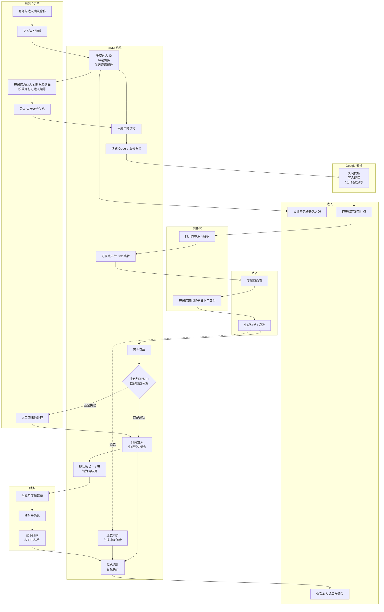
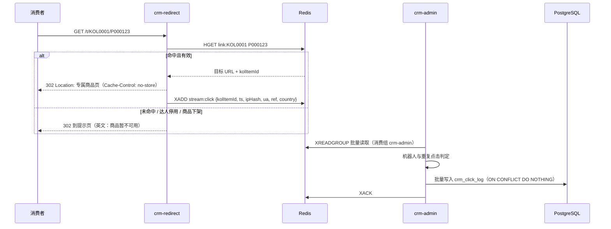
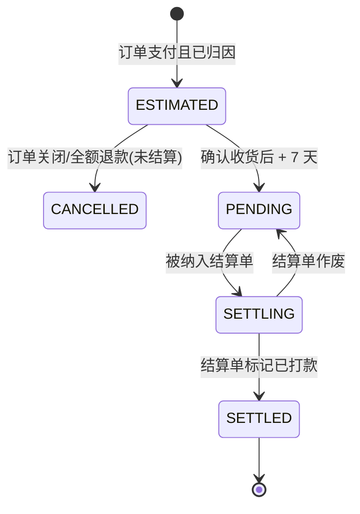
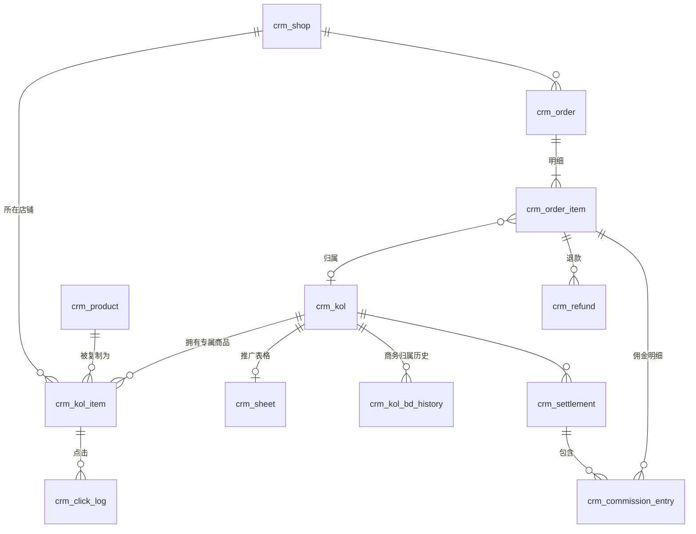

# 海外达人分销 CRM 系统 —— 详细设计说明书

> 版本：V0.1（设计初稿，M0 阶段随《需求确认书》定稿）
> 编制日期：2026-10-04
> 依据：《海外达人分销CRM系统需求说明书(界面版)》《数据看板模块需求说明书》《项目报价与排期方案-1（签约定稿）》《Google与微店API能力调研报告》
> 修订：2026-10-12 增加微店接入（§3.4、§5.2、§6.2、§7.1、§9、§12、[ADR-016](../06-架构决策/ADR-016-微店店铺授权与凭证加密.md)），项目负责人确认；2026-10-12 管理端每次登录需要图形验证码（§2.2 接口表、§3.3、[ADR-017](../06-架构决策/ADR-017-管理端每次登录需要图形验证码.md)），项目负责人确认

---

## 0. 文档说明

### 0.1 设计基线

本设计以签约定稿为准，相对原需求说明书的主要变化：

| 项目 | 原需求 | 本设计采用 |
|---|---|---|
| 达人入驻 | 达人自主注册，运营审核 | 运营/商务录入，系统生成达人 ID，邮件邀请达人设置密码 |
| 专属链接 | 系统调用微店接口生成 | 运营在微店手动复制专属商品，系统导入"专属商品 → 达人 + 原商品"对应关系 |
| 订单归因 | 五级优先级（达人 ID / 优惠码 / track_id / 时间窗口 / 人工） | 按订单商品明细的专属商品 ID 归因；不能识别的进人工匹配池。优惠码不用于归因，时间窗口匹配不做 |
| Google 表格 | 四页签（Links / Orders / Summary / Settlement） | 方案一：公开表格只放商品链接；订单、佣金、结算在达人端查看 |
| 店铺 | 未限定 | 最多 3 个贵方自有微店店铺 |
| 公司 | 未提及 | 一套系统支持客户旗下多家公司，数据完全隔离；当前 1 家（§3.4，2026-10-11 新增） |
| 界面语言 | 管理端中文、达人端英文 | 两端均支持中英文切换（§2.4，2026-10-11 新增） |

### 0.2 待决策事项（本稿按"推荐"编写）

| # | 事项 | 本稿采用（推荐） | 备选 | 影响范围 |
|---|---|---|---|---|
| D1 | 后端底座 | **纯自研**：Spring Boot 4.1 + Sa-Token + MyBatis-Plus + Flyway + Redisson（JDK 21）；管理端前端基于 pure-admin-thin | RuoYi-Vue-Plus 6.0（已放弃：优先代码完全可控） | 全局 |
| D2 | 跳转服务 | 独立进程部署 | 合并在后台应用中 | §2、§7.4 |
| D3 | 达人端前端 | 独立的轻量 Vue 3 应用 | 后台内加英文布局 | §2 |
| D4 | 定时任务 | Spring 定时任务 + Redisson 分布式锁 | 独立调度服务 | §9 |
| D5 | Excel 组件 | FastExcel 稳定版 | Apache Fesod（孵化中） | §7 |
| D6 | 计佣基数 | 商品明细实付金额（已分摊优惠，不含运费）− 退款金额 | 客户另定 | §8.3 |
| D7 | 佣金比例优先级 | 商品级比例 > 达人默认比例 | 客户另定 | §8.3 |
| D8 | 结算周期 | 按月；订单确认收货后 7 天可结算 | 客户另定 | §8.4 |
| D9 | 比例变更 | 不追溯，按下单时比例快照 | 追溯 | §8.3 |
| D10 | 统计时区 | 北京时间（UTC+8），销售按支付时间、退款按退款时间计入 | 美国时区 | §8.6 |

客户相关事项（D6～D10）以 M0《需求确认书》为准；技术事项（D1～D5）已确认（2026-10-04）。

### 0.3 术语

| 术语 | 含义 |
|---|---|
| 原商品 | 客户微店中用于推广的商品（2 万个），系统中称"商品"，编号如 P000123 |
| 专属商品 | 运营为某位达人在微店复制的原商品副本，拥有独立的微店商品 ID |
| 对应关系 | 专属商品 ID → 达人 + 原商品 的映射 |
| 中转链接 | 系统生成、写入表格的链接，形如 `https://t.域名/t/KOL0001/P000123`，点击后记录并跳转到专属商品 |
| 订单明细 | 一笔订单中的一个商品行；归因和计佣的最小单位 |
| 有效订单 | 已支付且未关闭的订单（具体状态映射见 §8.1） |
| 人工匹配池 | 无法自动归因的订单明细，等待运营处理 |

---

## 1. 系统概述

### 1.1 目标

把"达人 → 专属链接 → 点击 → 订单 → 佣金 → 看板"串成闭环：每笔订单明细能自动对应到达人，佣金按规则计算、可结算可追溯，各角色只看到自己权限内的数据。

### 1.2 规模假设

| 指标 | 数值 |
|---|---|
| 公司 | 当前 1 家；按多家设计，新增公司不改代码与表结构（§3.4） |
| 达人 | 100（设计容量 500） |
| 原商品 | 2 万 |
| 专属商品 / 中转链接 | 最多 200 万 |
| 微店店铺 | 每家公司 ≤ 3 |
| 订单 | 约 2,000 单/天（设计容量 2 万单/天） |
| 点击 | 预估 5 万次/天（设计容量 100 万次/天） |

### 1.3 角色

| 角色 | 说明 |
|---|---|
| 平台管理员 | 只管理公司：新建、改名、启停公司，为公司创建与重置超级管理员；看不到任何业务数据（§3.4） |
| 超级管理员 | 本公司全部功能与数据；本公司系统配置、接口参数 |
| 运营 | 达人、商品、对应关系、订单、人工匹配；全部达人数据 |
| 商务 | 运营角色 + 数据权限"仅本人负责的达人" |
| 财务 | 佣金、结算单、冻结/解冻、导出；全部达人数据（只读业务数据） |
| 达人 | 达人端：只看本人数据，不能导出 |

除平台管理员外，所有角色都属于且只属于一家公司，只能看到本公司的数据。

---

## 2. 总体架构

### 2.1 部署架构


| 域名 | 用途 | Cloudflare 代理 |
|---|---|---|
| `t.域名` | 中转跳转 | 开启 |
| `kol.域名` | 达人端 | 开启 |
| `admin.域名` | 管理后台 | 关闭（国内直连） |

### 2.2 应用模块

| 进程 / 工程 | 技术 | 职责 |
|---|---|---|
| `crm-admin` | 自研，Spring Boot 4.1 / JDK 21 | 管理端 API、达人端 API、订单同步、归因、计佣、看板汇总、表格任务、定时任务 |
| `crm-redirect` | Spring Boot（精简，无数据库直连写入） | 解析中转链接、302 跳转、写点击事件到 Redis Stream |
| `admin-ui` | 基于 pure-admin-thin（Vue 3 + TS + Element Plus）+ ECharts | 管理后台，中英文切换（默认中文）；菜单按角色静态配置 |
| `kol-portal` | Vue 3 + TS + Element Plus + ECharts | 达人端，中英文切换（默认英文），适配手机 |

`crm-admin` 根包 `com.tcrm.admin`，直接子包为 `shared`（响应、异常、traceId、通用 Redis 能力）、`security`（登录、令牌、当前用户上下文）、`system`（公司、管理员用户、操作日志、审计写入）及下列业务模块。模块内分为 `controller/service/mapper/model/api`；调用方向为 controller → service → mapper。跨模块只依赖对方的 `api` 包，`shared` 不依赖业务模块。当前用户上下文位于 `security.api`；`system.service.AccountStoreService` 实现 `security.api.AccountStore`，认证服务通过该接口访问账号，避免认证模块直接依赖用户实体或 mapper。业务模块当前保留占位包：

| 包 | 内容 |
|---|---|
| `kol` | 达人、商务归属、邀请 |
| `product` | 原商品、专属商品对应关系、店铺 |
| `link` | 中转链接、Redis 链接索引、点击消费 |
| `sheet` | Google 表格创建、写入、分享 |
| `order` | 订单同步、Excel 导入、归因、人工匹配 |
| `commission` | 佣金明细、结算单、冻结 |
| `stats` | 汇总表、看板查询、预警 |
| `integration` | 微店客户端、Google 客户端、邮件客户端 |
| `task` | 批量任务框架（进度、重试、错误文件） |

现有用户与审计实体为 `system.model.SysUserDO`、`SysOperLogDO`，DO 只用于 model / mapper / service；controller 使用独立请求对象与 `UserVO`、`OperLogVO`，service 使用 Command / DTO。跳转工程按 `controller/service/config` 分层，controller 经 service 查询 Redis、写入点击事件。

| 当前接口 | 声明角色 / 行为 |
|---|---|
| `POST /admin-api/auth/captchas` | 显式公开；签发一次性图形验证码（3 分钟有效），每个来源 IP 每分钟最多 30 张，超出 429 `AUTH_CAPTCHA_RATE_LIMITED`（ADR-017） |
| `POST /admin-api/auth/login` | 显式公开；请求必须带 `captchaId` + `captchaCode`，先校验验证码（错误或过期 400 `AUTH_CAPTCHA_INVALID`，不计入失败次数），再按用户名+IP、IP、用户名三层失败计数与锁定（ADR-008、ADR-017） |
| `POST /admin-api/auth/logout`、`GET /admin-api/auth/me`、`PUT /admin-api/auth/password` | `PLATFORM_ADMIN` / `SUPER_ADMIN` / `OPERATOR` / `FINANCE` 登录态。登录用户与 `/me` 增加 `tenantId`、`tenantName`（平台管理员均为空） |
| `GET/POST /admin-api/system/users`、`PUT /admin-api/system/users/{id}`、`PUT /admin-api/system/users/{id}/status`、`PUT /admin-api/system/users/{id}/password` | `SUPER_ADMIN`。创建或修改为 `PLATFORM_ADMIN` 返回 400 |
| `GET /admin-api/system/oper-logs` | `SUPER_ADMIN` |
| `GET/POST /admin-api/platform/tenants`、`PUT /admin-api/platform/tenants/{id}`、`PUT .../status`、`GET/POST .../admins`、`PUT .../admins/{userId}/password` | 仅 `PLATFORM_ADMIN`。详见 §6.2 |

后台统一响应 `{code,msg,data,errorCode,traceId}`，错误码登记在 `shared.ErrorCode`，参数校验失败返回字段级列表；分页 `{items,total,page,size}`，64 位整数（含 ID、total）和金额序列化为字符串，page / size 为整数。过滤器生成 traceId 并写入 MDC、`X-Trace-Id` 和信封，设置 `X-Content-Type-Options: nosniff`、`Referrer-Policy: strict-origin-when-cross-origin`；跨域来源仅取环境变量 `TCRM_CORS_ALLOWED_ORIGINS`，默认为空。跳转服务维持 302 / 纯文本响应。

当前系统表由 `backend/src/main/resources/db/migration/V202610041200__init_system.sql` 创建，使用 PostgreSQL 17、UTC 会话、`TIMESTAMPTZ(3)` 与正值 BIGINT 主键约束。用户逻辑删除列为 `is_deleted BOOLEAN`，Java 属性为 `deleted`；用户名采用 `lower(username)` 唯一索引及参数绑定的大小写不敏感查询。`sys_oper_log` 是只追加表，省略修改与逻辑删除字段，表与全部字段均有注释。本次初始迁移改写仅适用任务 02 的一次性授权。

后台启动时检查启用且未逻辑删除的平台管理员；不存在时必须设置 `TCRM_BOOTSTRAP_ADMIN_USERNAME` 与 `TCRM_BOOTSTRAP_ADMIN_PASSWORD`，缺少任一变量或用户名已被占用则启动失败并提示变量名，没有默认凭证。已有可用平台管理员时不要求初始化变量，也不重复创建。各公司的超级管理员由平台管理员在后台创建（§3.4）。多公司迁移 `V202610111800__add_multi_company.sql` 增加 `sys_tenant`，并为 `sys_user`、`sys_oper_log` 增加可空 `tenant_id`；操作日志另有 `idx_sys_oper_log_tenant_time (tenant_id, oper_time)`，原按时间的索引保留。管理员审计可按规范 06 保存原始 IP，180 天清理任务已实现。

### 2.3 技术栈

| 类别 | 选型 |
|---|---|
| 后端 | Java 21、Spring Boot 4.1、Sa-Token、MyBatis-Plus、Flyway、Redisson |
| 数据库 | PostgreSQL 17（UTF8；见 ADR-005） |
| 缓存/消息 | Redis 7（缓存、Stream、分布式锁、限流） |
| Excel | FastExcel |
| Google | google-api-services-sheets / drive 官方 Java 客户端，服务账号 |
| 微店 | 开放平台 HTTP 接口 + 官方加解密 jar |
| 前端 | Vue 3、TypeScript、Vite、Element Plus、ECharts |
| 测试 | JUnit 5、Testcontainers（PostgreSQL、Redis）、Mockito |
| 部署 | Docker Compose、Nginx、GitHub Actions |

不使用后台管理脚手架；不做动态菜单、动态权限、工作流。角色固定为 5 个（平台管理员、超管、运营、财务、达人），权限在代码中用注解静态声明。多公司按"共享数据库 + 公司字段"隔离（§3.4，ADR-014），不做按公司定制菜单、角色或功能。

### 2.4 国际化

管理端与达人端都支持简体中文（`zh-CN`）和英文（`en-US`）切换（[ADR-015](../06-架构决策/ADR-015-管理端与达人端支持中英文切换.md)）。任务 06d 实现；之后新增的页面与后端文字一律同时提供两种语言。

| 项目 | 设计 |
|---|---|
| 默认语言 | 管理端中文，达人端英文；登录页和页头提供切换，选择保存在浏览器本地（两端各自保存），不存服务端 |
| 前端实现 | vue-i18n（两端各新增一个依赖），Element Plus 组件语言包、ECharts 文字、日期与数字格式随语言切换；界面文字全部从语言包读取，代码中不写死 |
| 请求语言 | 前端每个请求带 `Accept-Language`（当前语言）；后端从该请求头解析，只输出 `zh-CN` 与 `en-US` 两种结果：`zh` / `zh-CN` 解析为 `zh-CN`，`en` / `en-US` 等英文变体解析为 `en-US`，带权列表取第一个能解析的条目，缺失、无法识别或其他语言一律按英文，且不受服务器默认语言影响 |
| 错误提示 | 后端 `msg` 保持英文、只用于排查；界面按 `errorCode` 从语言包取文案（规范 02） |
| 参数校验 | 字段级校验提示按请求语言生成；界面按 `field` 定位到表单项 |
| 导入模板 | 下载时表头与文件名均为当前语言（文件名如 `kol-import-template.xlsx` / `达人导入模板.xlsx`）；导入时表头整行为中文或整行为英文都能识别（与提交时的请求语言无关），中英混用、缺列、多列视为表头不符 |
| 导入错误文件 | 后台任务在提交时记下请求语言（`crm_task.locale`），错误文件的表头和每行错误原因按该语言生成 |
| 枚举与操作日志 | 接口传枚举名称（规范 03）；操作日志 `module` / `action` 存英文固定值。两者都由界面按语言包显示，已有日志不需迁移 |
| 后端文字资源 | Spring `MessageSource`（`fallbackToSystemLocale=false`），语言文件 `messages_zh_CN.properties` / `messages_en.properties`，另有与英文内容相同的 `messages.properties` 作为两种语言之外的兜底；这些文件及校验注解资源包（`ValidationMessages*.properties`）的键在两种语言间完全一致（由测试检查） |
| 不翻译 | 业务数据按录入原样显示：达人姓名、商品名称、店铺名、公司名、备注等 |
| 邮件 | 达人邀请、重置密码邮件同时包含英文和中文，写明公司名称 |
| 不随界面切换 | Google 推广表格保持英文（对外公开）；跳转服务的回退提示页保持英文 |

---

## 3. 权限与数据隔离

### 3.1 功能权限矩阵

| 功能 | 超管 | 运营 | 商务 | 财务 | 达人 |
|---|:-:|:-:|:-:|:-:|:-:|
| 达人录入/编辑/启停 | ✓ | ✓ | ✓（本人负责） | 只读 | — |
| 商品、对应关系导入 | ✓ | ✓ | — | — | — |
| 表格生成/重建 | ✓ | ✓ | — | — | 查看本人表格链接 |
| 订单查看 | ✓ | ✓ | ✓（本人负责） | ✓ | 本人 |
| 订单导入、人工匹配 | ✓ | ✓ | — | — | — |
| 佣金比例设置 | ✓ | ✓ | — | ✓ | — |
| 结算单生成/确认/标记打款 | ✓ | — | — | ✓ | 查看本人 |
| 冻结/解冻 | ✓ | — | — | ✓ | — |
| 总店看板、商品运营看板 | ✓ | ✓ | — | ✓ | — |
| 商务看板 | ✓ | ✓（全部） | ✓（本人负责） | ✓ | — |
| 达人看板 | ✓（代看） | ✓（代看） | ✓（代看本人负责） | ✓（代看） | 本人 |
| 导出 | ✓ | ✓ | ✓（本人负责） | ✓ | ✗ |
| 系统配置、接口参数、日志审计 | ✓ | — | — | — | — |

冻结/解冻、比例设置的具体角色以 M0 确认为准。上表各角色只作用于本公司数据。平台管理员不在上表中：它只能使用公司管理功能（§3.4），所有业务接口都拒绝平台管理员。

### 3.2 数据隔离规则

1. **达人端**：所有达人端接口从登录态取 `kol_id`，不接受前端传入的达人 ID；SQL 层统一追加 `kol_id = 当前达人`。达人端与管理端使用不同的 Sa-Token 账号体系（`StpKolUtil` / `StpUtil`），令牌不互通。
2. **商务**：管理员账号的 `data_scope` 为 `OWN` 时（商务 = 运营角色 + `OWN`），在达人相关查询上追加 `kol.bd_user_id = 当前用户`；订单、佣金、看板查询先取"本人负责的达人 ID 集合"再过滤。
3. **商务历史归属**：商务交接后，交接前的数据归原商务、交接后归新商务（以 `crm_kol_bd_history` 判定，规则待 M0 确认）。
4. **越权测试**：每个需要隔离的接口都有"换一个达人/商务的 ID 访问应被拒绝"的自动化测试；按 ID 访问的接口还要测"用另一家公司的资源 ID 访问应返回 404"（§3.4）。
5. **写入时再次确认范围**：商务（`OWN`）修改达人时，`UPDATE` 条件同时包含 `bd_user_id = 本人`，影响 0 行即返回 403；读取时的范围检查之后达人被转给他人，修改不会生效。

### 3.3 会话与令牌（管理端）

| 项目 | 策略 |
|---|---|
| 登录验证码 | 每次登录（含登录过期弹窗中的重新登录）都要图形验证码。验证码只能用一次：无论对错，校验即删除；3 分钟过期；不区分大小写。验证码错误或过期返回 400 `AUTH_CAPTCHA_INVALID`，不计入 ADR-008 的失败次数，也不检查锁定和密码。管理端在任何一次登录失败后都自动换一张。`crm.auth.captcha.enabled`（默认开启）仅供本机开发关闭（ADR-017） |
| 令牌 | Sa-Token 随机 UUID，只从请求头 `X-Admin-Token` 读取，不使用 Cookie |
| 绝对有效期 | 8 小时（`sa-token.timeout`） |
| 空闲超时 | 2 小时未使用即失效，每次请求续期（`sa-token.active-timeout`，OWASP ASVS 第 2 级）。该配置对 Sa-Token 的全部账号体系生效，达人端登录实现时需单独评估 |
| 多端登录 | 允许同一账号多端同时登录，每次登录签发新令牌（`is-concurrent=true`、`is-share=false`），每个账号最多 12 个令牌，超出时最早的失效（Sa-Token 1.46 默认值，负责人已接受） |
| 凭据版本 | `sys_user.credential_version` 在每次修改或重置密码时加 1；登录时写入令牌会话，每次请求比对，不一致即注销该令牌并返回 401。由此保证改密 / 重置后旧令牌全部失效，包括与重置并发签发的令牌，以及 Redis 注销失败时残留的令牌 |
| 状态与角色 | 每次请求从数据库重读账号的状态、角色与数据范围，停用、改角色立即生效；停用时同时踢下线 |
| 所属公司 | 每次请求随账号一起重读所属公司及其状态；公司停用后，该公司账号的下一次请求即返回 401（`AUTH_ACCOUNT_DISABLED`）。平台管理员没有所属公司 |
| 超级管理员 | 降级或停用超管时锁定本公司全部启用的超管并检查至少保留一个，防止两人并发互相降级后该公司没有超管。其他公司的超管不计入。平台管理员没有停用或降级接口，因此至少保留启动时创建的那一个 |
| 后台任务授权 | 批量导入等后台任务按**提交时**的身份与权限执行；任务排队或执行期间提交人被停用或降权，不中止已提交的任务（任务通常在数分钟内完成，负责人已接受） |

### 3.4 多公司

当前只有 1 家公司，数据层、登录与权限按多家公司设计（[ADR-014](../06-架构决策/ADR-014-多公司采用共享库与公司字段隔离.md)）：以后新增公司只需平台管理员在后台新建，不改代码、不改表结构。各公司同属一个客户，数据完全隔离：不共享达人、店铺、商品，不做跨公司汇总，平台管理员也看不到业务数据。

**公司与账号**

| 对象 | 规则 |
|---|---|
| 公司 `sys_tenant` | 编码（`^[a-z0-9-]{2,32}$`，创建后不可改，全表唯一）、名称（达人登录选择公司和邀请邮件中显示）、状态。只停用不删除。停用后该公司的管理员与达人不能登录，已签发的令牌在下一次请求时失效；该公司的定时同步（订单、表格）跳过；中转链接不受影响（要停链接，停用店铺或达人）。迁移脚本创建默认公司（`id = 1`，编码 `default`），现有数据全部归入该公司 |
| 平台管理员 | 角色 `PLATFORM_ADMIN`，`sys_user.tenant_id` 为空。只能使用 `/admin-api/platform/**`：公司的新建、改名、启停，查看各公司的超级管理员，为公司创建超级管理员、重置其密码。所有业务接口拒绝平台管理员。初始平台管理员由环境变量创建（§2.2） |
| 公司内管理员 | 超管、运营、财务都属于一家公司（`tenant_id` 必填）。用户名全系统唯一，登录时按用户名确定公司，管理端登录页不选公司。同一个人为多家公司工作时，在每家各开一个账号 |
| 达人账号 | 每家公司各自独立：`crm_kol` 的一行就是一个达人账号，邮箱在公司内唯一。同一邮箱可以在多家公司各有一个账号，各自的密码、状态、佣金、结算互不影响；A 公司停用或重置这个达人，不影响他在 B 公司的账号 |

**隔离机制**

1. **公司字段**：业务表都有 `tenant_id BIGINT NOT NULL`，子表也直接带，不通过关联主表判断。例外：`sys_tenant` 自身；`crm_link_index_outbox`（系统内部队列，只引用 ID，由后台跨公司处理）；`sys_user`、`sys_oper_log` 的 `tenant_id` 可空，空值只用于平台管理员及其操作。
2. **当前公司只从登录态取**：管理员取账号的 `tenant_id`（每次请求随账号一起重读），达人取其账号的 `tenant_id`；任何接口都不接受前端传入公司 ID。
3. **自动过滤**：MyBatis-Plus 多租户插件 `TenantLineInnerInterceptor`（依赖 `mybatis-plus-jsqlparser` 已在项目中）对 SELECT / UPDATE / DELETE 追加 `tenant_id = 当前公司`，INSERT 自动填入。**取不到当前公司时直接报错**，不会退化为不过滤。手写 SQL 同样经过插件；插件无法解析的语句必须改写或显式处理，不能静默跳过。
4. **跨公司处理必须显式声明**：后台维护任务（链接索引同步与重建、点击消费、点击分区维护、操作日志清理、监控）和平台管理员接口以"系统范围"执行，绕开自动过滤。这些语句只按 ID 处理或做全表维护，不把数据返回给任何公司用户。每一处绕开都要在代码中写明原因，并在 PR 中列出。
5. **以公司为单位的后台处理**先设置当前公司再执行：批量导入任务取任务行的 `tenant_id`（与 §3.3"按提交时身份执行"一致）；以后的订单同步、表格任务取店铺或达人的 `tenant_id`。
6. **保持全系统唯一的标识**：达人编号、微店店铺 ID、管理员用户名。达人编号出现在中转链接里，跳转服务按 `link:{达人编号}` 查找、不需要知道公司，因此跳转服务、Redis 链接索引与点击事件的结构都不变。代价是导入时填写其他公司已用的达人编号，会提示"已存在"；各公司同属一个客户，可以接受。
7. **改为公司内唯一**：达人邮箱、原商品编码、业务配置键。系统生成的原商品编码仍来自全局序列，不会重复；客户填写的编码只需在本公司内不重复。店铺上限 3 家按公司计算，新建店铺的互斥锁按公司区分。
8. **索引**：按公司列表、排序的索引以 `tenant_id` 开头（达人列表、原商品列表、任务、操作日志）。以达人、店铺、原商品 ID 为条件的索引（对应关系、点击日志等）不加，因为这些 ID 本身只属于一家公司。
9. **数据库行级安全（RLS）本期不启用**，理由见 ADR-014。每张表都已有 `tenant_id`，以后需要时可以直接加策略，不改表结构。

**达人端登录**（由达人登录任务实现。多公司底座只保证数据模型：达人邮箱在公司内唯一，同一邮箱可以在多家公司各有一行 `crm_kol`。）

1. 用邮箱 + 密码登录。系统找出该邮箱在所有启用公司中的启用账号，逐个比对密码；一个账号都没有时，也执行一次 BCrypt（规范 06）。
2. 密码匹配 0 个账号：返回与"密码错误"相同的失败。匹配 1 个：直接登录。匹配多个（同一个人在多家公司设置了相同密码）：返回一次性的选择凭据和这些账号所属公司的名称，达人选择后调用 `POST /kol-api/auth/login/select` 换取令牌。选择凭据存 Redis，5 分钟有效、只能使用一次，只能换取已通过密码校验的那几个账号的令牌。
3. 令牌会话绑定达人 ID 与公司 ID；切换公司需要退出后重新登录。
4. 失败计数与锁定按"邮箱 + 来源 IP"、"来源 IP"、"邮箱"三层（同 ADR-008），与公司无关。
5. 邀请按账号发送，邮件写明公司名称。找回密码时，如果该邮箱有多个账号，邮件按公司分别给出重置链接，每个链接只重置对应公司的账号。
6. 已接受的残留风险：一个邮箱有多个账号时，登录要做多次 BCrypt 比较，响应耗时会多出几倍。攻击者据此只能推断"该邮箱属于多家公司"，不能得知是哪几家，也无法据此登录。达人知道各公司之间的关系，因此接受。

**公司级配置与凭证**

- 业务配置 `crm_config` 按公司保存，`(tenant_id, config_key)` 唯一。
- 第三方凭证（微店 appkey / secret 与店铺令牌、Google 服务账号密钥）按公司保存在数据库，用 AES-256-GCM 加密。`shared.SecretCipher` 使用环境变量 `TCRM_SECRET_KEY`（Base64 编码的 32 字节）作为主密钥，格式为 `v1:` + Base64(nonce ‖ 密文 ‖ 标签)；启动时校验密钥。凭证只能写入、不能读出：管理接口只返回 appkey、是否已配置 secret 与更新时间，不返回任何明文凭证；修改记入审计。
- 微店同时支持自用型（店铺级 appkey / secret，不含 refresh token）与服务型（公司级应用、逐店铺授权）两种模式。服务型回调使用 Redis 一次性 state，并核对授权返回的 `openid` 与 CRM 店铺 ID。令牌由中心组件加密保存并集中主动 / 被动续期；主密钥不可恢复，丢失后所有已保存凭证均须重新录入或授权。
- 平台级配置仍走环境变量：数据库、Redis、主密钥、IP 哈希盐值、邮件服务、域名。不引入配置中心（ADR-014）。
- 凭证表和主密钥变量由第一个需要保存凭证的任务（Google 表格或微店同步）建立；从那时起，缺少主密钥的应用启动失败。

---

## 4. 核心业务流程

### 4.1 全链路泳道图



### 4.2 达人入驻

1. 运营/商务录入达人（单个或 Excel），必填：姓名、邮箱、国家；可选：社媒账号、粉丝数、默认佣金比例、合作备注。商务录入时 `bd_user_id` 自动为本人；运营录入时选择商务。
2. 系统生成达人编号（§8.2），创建达人登录账号（状态"待激活"），发送中英文邀请邮件（写明公司名称，含 72 小时有效的设置密码链接）。邮箱只需在本公司内不重复；同一达人与多家公司合作时，每家公司各自录入、各有一个账号（§3.4）。
3. 达人设置密码 → 账号"已激活"。邀请过期可由运营重发。
4. 达人编号生成后，运营据此在微店复制并标记专属商品（§4.3）。

### 4.3 专属商品与对应关系

**标识规则（M0 二选一定稿）**

| 方式 | 系统读取 |
|---|---|
| 商品分类：每位达人一个分类，名称 = 达人编号 | 调用微店"获取店铺商品列表"按分类拉取 |
| 商家编码：`{原商品编码}-{达人编号}` | 拉取商品列表，解析商家编码 |
| 兜底：运营导出 Excel | 导入模板：店铺、专属商品 ID、达人编号、原商品编码 |

**处理流程**

1. 运营触发"同步对应关系"（指定店铺、达人）或上传 Excel → 创建批量任务。
2. 逐条校验：达人存在且启用；原商品存在；专属商品 ID 在本店未被其他有效映射占用；同一达人同一原商品只能有一个有效映射。
3. 校验通过的写入 `crm_kol_item`（新映射生效，旧映射置失效时间，**不删除**），失败的写入错误文件供下载。
4. 映射变更后：更新 Redis 链接索引；标记该达人表格待刷新。

**原则**：专属商品 ID 一旦用于订单归因，即使映射失效也保留历史记录，历史订单的归属不受后续映射变更影响。

### 4.4 链接生成与表格分发

1. 每个当前有效的对应关系对应一条中转链接 `{TCRM_LINK_BASE_URL}/t/{达人编号}/{原商品编码}`（生产为 `https://t.域名/...`；任务 06）。链接由规则计算、不存库，同一达人同一原商品的地址永远不变；管理端在达人列表的“链接”中查看与复制。目标地址为 `https://weidian.com/item.html?itemID={专属商品 ID}`，不追加 `track_id` 或其他参数（微店链接能否带参数待 M0 确认）。
2. 创建"表格初始化"批量任务：
   - 复制 Google 母版到共享云端硬盘（文件名：`{达人编号} - {达人名称}`）；
   - 按母版配置的"链接列"分批写入中转链接（每批 ≤ 2,000 行）；
   - 设置"知道链接的任何人可查看"；
   - 回写表格 ID、URL 到 `crm_sheet`。
3. 任务受全局限流（§7.2），失败自动重试 3 次（指数退避），仍失败标记"失败"，可人工重跑。
4. 表格 URL 在管理端和达人端均可查看。

### 4.5 点击跳转



- 跳转服务只读 Redis，**不回源后台**（[ADR-012](../06-架构决策/ADR-012-跳转服务不回源后台.md)）：未命中、值无法解析或 `status` 为 0 时一律 302 到回退地址，不写点击事件。索引完整性由 `crm-admin` 负责：业务变更与一条 outbox 登记在同一事务提交，后台任务在数秒内写入 Redis；每天 04:30（UTC）及超管手动触发时仍全量重建，用于清扫遗漏与多余 key（§7.4、§9，[ADR-013](../06-架构决策/ADR-013-链接索引采用事务内登记与后台同步.md)）。
- 点击消费（任务 06）：同一时间只有一个后台实例消费（分布式锁 `link:click-consumer`，其余实例每 10 秒重试），每批最多 500 条、阻塞读取最长 2 秒，先读待处理列表（PEL）再读新消息。写库成功后才写入“上一次点击时间”并 `XACK`；处理异常的批次不 ACK，下次从 PEL 重新读取。点击 `id` = Stream 消息 ID 的毫秒时间戳 × 1,000,000 + 序号，插入时 `ON CONFLICT DO NOTHING`，重复投递不会产生重复点击。消息格式错误或 `kolItemId` 查不到对应关系时记 `WARN`、ACK 并跳过。`click_time` 取事件 `ts`；`kol_id`、`product_id` 由 `kolItemId` 批内去重查询 `crm_kol_item`（含已失效的映射）得到；`ua`、`referer`、`country` 按列长度截断。
- 机器人判定：UA 为空，或（不区分大小写）包含 `bot`、`spider`、`crawl`、`facebookexternalhit`、`facebookcatalog`、`twitterbot`、`slackbot`、`whatsapp`、`telegrambot`、`discordbot`、`linkedinbot`、`pinterest`、`tiktok`、`bytespider`、`preview`、`headless` 之一时标记 `is_bot`（关键字为代码常量，集中一处）。同一 `kol_item_id` + `ip_hash` 与上一次点击的事件时间相差小于 10 秒时标记 `is_dup`。批内按 Stream 顺序先用本批已经处理过的点击时间；本批尚未出现的键再读 Redis `click:last:{kolItemId}:{ipHash}`（TTL 60 秒，只作加速）。本批中 Redis 未命中的键，用一条查询从 `crm_click_log` 取每个键在 `[本批最早事件时间 − 10 秒, 本批最晚事件时间]` 内的最近一次 `click_time`（走索引 `idx_crm_click_log_kol_product_time (kol_id, product_id, click_time)`，再按 `kol_item_id`、`ip_hash` 过滤）。消费暂停超过该 TTL 后，仍按点击日志判为重复。两类点击保留，统计时排除。
- IP 仅存 SHA-256 哈希（加盐），不存明文。

### 4.6 订单同步与归因

```mermaid
flowchart TB
  S[每 5 分钟：按更新时间增量拉取订单<br/>窗口回溯 10 分钟] --> D[逐单获取订单详情]
  X[Excel/CSV 导入] --> N
  D --> N[标准化：订单 + 订单明细]
  N --> U{订单已存在?}
  U -->|是| UP[更新状态/金额/退款<br/>记录变更]
  U -->|否| INS[新增]
  UP --> AT
  INS --> AT[逐条明细归因]
  AT --> M{店铺+商品ID<br/>命中有效映射?}
  M -->|是| OK[归属达人<br/>attribution_type=ITEM_ID]
  M -->|否| P[进入人工匹配池<br/>attribution_type=UNMATCHED]
  P --> MAN[运营指定达人或标记"非达人订单"<br/>必填原因，记审计]
  OK --> CM[生成/更新佣金明细]
  MAN --> CM
  CM --> DIRTY[标记受影响日期待重算]
```

- **幂等**：订单唯一键 `(shop_id, weidian_order_id)`，明细唯一键 `(order_id, sub_order_id)`；接口和 Excel 重复导入只更新不重复。
- **多达人订单**：每条明细独立归因，一笔订单可以归属多位达人。
- **映射时点**：用"下单时有效"的映射归因。
- **已归因明细不自动改归属**；人工修改归属需写原因，若已结算按 §8.4 生成冲减和新增。
- **数据最小化**：不解密、不存储买家姓名、电话、地址；只存买家 ID 的哈希用于去重统计。

### 4.7 退款

1. 订单同步时读取退款状态与金额，写入 `crm_refund`（按明细），更新明细 `refund_amount`。
2. 每笔新退款生成一条负数佣金明细（类型 `REVERSAL`），金额 = −退款金额 × 原佣金比例快照。
3. 原佣金未结算：冲减明细与原明细一起进入同一结算；已结算：冲减明细进入下一期结算（即"扣回"）。
4. 退款日期计入看板的退款统计（口径见 §8.6）。

### 4.8 佣金与结算

佣金明细状态：



- 达人被冻结时，其 `PENDING` 明细不纳入结算单，解冻后下一期纳入。
- 结算单：财务按月生成（选择达人范围与截止日期）→ 汇总 `PENDING` 明细（含负数冲减）→ 上期结转余额 → 本期应付；应付为负时不打款，结转下期。
- 结算单状态：`DRAFT` → `CONFIRMED` → `PAID`（填写打款日期、方式、备注）；`DRAFT` 可作废。
- 结算单导出 Excel：汇总 + 明细。

### 4.9 商品变更

| 场景 | 运营操作 | 系统处理 |
|---|---|---|
| 新增原商品 | 导入原商品 → 在微店为各达人复制 → 导入对应关系 | 生成新链接，表格追加行 |
| 修改商品信息（名称、价格、图片） | 导入更新，或在后台编辑 | 刷新受影响达人的表格对应行 |
| 原商品下架 | 后台标记下架；微店副本由运营处理 | 中转链接跳转到"商品暂不可用"提示页；表格对应行标注下架（或按母版约定删除行，M0 确认） |
| 更换某达人的专属商品 | 导入新对应关系 | 旧映射失效、新映射生效；链接地址不变 |

### 4.10 看板数据

见 §8.6 指标口径、§5.3 汇总表、§9 汇总任务。

---

## 5. 数据设计

### 5.1 实体关系



### 5.2 业务表

通用字段（各表均有，下文省略）：`id BIGINT`（雪花 ID）、`tenant_id`（所属公司，例外见 §3.4）、`create_by`、`create_time`、`update_by`、`update_time`、`is_deleted`（仅主数据表）。字段类型以规范 04 为准：金额 `NUMERIC(14,2)`，比例 `NUMERIC(6,4)`，时间 `TIMESTAMPTZ(3)`，扩展信息 `JSONB`。

**sys_tenant 公司**（迁移 `V202610111800__add_multi_company.sql`）：`tenant_code`（`^[a-z0-9-]{2,32}$`，全表唯一，创建后不可改）、`name`（VARCHAR(64)，公司名称，达人登录选择公司和邀请邮件中显示）、`status`（1 启用 / 0 停用）、`remark`，以及通用字段（自身不带 `tenant_id`；不提供删除功能，只停用）。迁移脚本插入默认公司 `id = 1`、编码 `default`，名称由平台管理员修改。

**crm_kol 达人**（任务 04 已建，迁移 `V202610051900__create_kol.sql`）

| 字段 | 类型 | 说明 |
|---|---|---|
| kol_code | VARCHAR(16) NOT NULL | 达人编号 `KOL` + 4～8 位数字（`CHECK`），创建后不可修改；唯一索引 `uk_crm_kol_kol_code` 覆盖已逻辑删除的记录，编号永不复用 |
| name | VARCHAR(64) NOT NULL | 姓名 |
| email | VARCHAR(128) NOT NULL | 邮箱，存小写（`CHECK`）；部分唯一索引 `uk_crm_kol_email (tenant_id, lower(email)) WHERE is_deleted = FALSE`，公司内唯一 |
| country | VARCHAR(2) NOT NULL | ISO 3166-1 两位字母代码，大写（`CHECK`） |
| social_accounts | JSONB NOT NULL DEFAULT `[]` | `[{platform, handle, url, followers}]`，最多 10 个；`url` 可空，填写时为 https；`CHECK` 为数组 |
| bd_user_id | BIGINT NULL | 当前负责商务（`sys_user.id`，`OPERATOR` + `OWN`）；空表示未分配商务 |
| default_rate | NUMERIC(6,4) NULL | 默认佣金比例（0～1，15.5% 存 0.1550）；空表示未设置，回退规则待 M0 确认 |
| status | SMALLINT NOT NULL DEFAULT 1 | 1 启用 / 0 停用（`CHECK`） |
| remark | VARCHAR(500) NULL | 合作备注 |

列表索引：`idx_crm_kol_create_time (tenant_id, create_time, id)`、`idx_crm_kol_country (tenant_id, country)`、`idx_crm_kol_bd_user (bd_user_id, create_time, id)`，均为 `WHERE is_deleted = FALSE` 的部分索引。按商务筛选的索引不以 `tenant_id` 开头，因为商务用户 ID 本身只属于一家公司（§3.4 第 8 条）。

后续任务再加的列（任务 04 不建、不预留）：`account_status`、`password_hash`（达人端登录与邀请）；`settle_frozen`、`frozen_reason`（佣金结算冻结）。

**crm_kol_code_seq 达人编号序列**：`1..99999999`，见 §8.2。

**crm_kol_bd_history 商务归属历史**（任务 04 已建）：`kol_id`、`bd_user_id`（可空，空表示该时段未分配）、`start_time`、`end_time`（当前记录为空，`CHECK end_time >= start_time`）及通用字段。部分唯一索引 `uk_crm_kol_bd_history_current (kol_id) WHERE end_time IS NULL` 保证每个达人最多一条当前记录；`idx_crm_kol_bd_history_kol (kol_id, start_time)` 供详情页查询。首次分配商务、更换商务（含从空到有、从有到空）时，在同一事务内锁定达人行、关闭当前记录并新增一条；新建时未分配商务不写历史。

**crm_shop 店铺**（每家公司 ≤ 3；任务 05 已建，迁移 `V202610052300__create_shop_and_product.sql`）：`shop_name`、`weidian_shop_id` UK（全表唯一）、`status`（0 停用 / 1 启用）、`remark`。微店凭证与授权状态单独保存在 `crm_weidian_app` / `crm_weidian_shop_auth`，见本节后文。产品表同脚本；对应关系见 `V202610052301__create_kol_item.sql`；任务类型扩充见 `V202610052302__extend_task_type_product_mapping.sql`。

**crm_weidian_app 服务型应用**（迁移 `V202610121800__create_weidian_integration.sql`）：每家公司最多一行，`app_key` 明文保存，`app_secret_cipher` 使用 `SecretCipher v1` 加密。

**crm_weidian_shop_auth 微店店铺授权**（同迁移）：每个 CRM 店铺最多一行；保存 `auth_mode`、自用型 appkey / secret 密文、服务型 `openid`、访问 / 刷新令牌密文、过期时间、授权者、续期与连通检查状态。凭证密文与错误摘要不向 API 明文返回；状态为 `UNAUTHORIZED`、`AUTHORIZED`、`EXPIRED` 或 `FAILED`。两表均含 `tenant_id`、雪花 ID、通用审计字段和列注释，不设置外键。

**crm_product 原商品**（任务 05 已建）

| 字段 | 类型 | 说明 |
|---|---|---|
| product_code | VARCHAR(16) | `^[A-Z0-9_-]{1,16}$`，存大写；不填则 `P` + 至少 6 位顺序号（`crm_product_code_seq`），永不复用；唯一索引 `uk_crm_product_product_code (tenant_id, product_code)`，公司内唯一且含已删除 |
| shop_id | BIGINT | 原商品所在店铺 |
| weidian_item_id | VARCHAR(32) | 原商品微店 ID；与 shop_id 在未删除记录中唯一 |
| name / category / image_url | | 商品信息；image_url 须为 https |
| price | NUMERIC(14,2) | 展示价，≥ 0 |
| rate | NUMERIC(6,4) NULL | 商品级佣金比例，空则用达人默认比例 |
| status | SMALLINT | 1 在售 / 0 下架；导入不修改状态，新增默认为在售 |

列表索引：`idx_crm_product_status (tenant_id, status, product_code)`、`idx_crm_product_category (tenant_id, category, product_code)`，均为 `WHERE is_deleted = FALSE`。`idx_crm_product_shop` 仍按店铺，不加 `tenant_id`。

表格行序 `sheet_row` 留待任务 07，本任务不建。

**crm_kol_item 专属商品对应关系（最多 200 万行；任务 05 已建）**

| 字段 | 类型 | 说明 |
|---|---|---|
| kol_id | BIGINT | |
| product_id | BIGINT | 原商品 |
| shop_id | BIGINT | 专属商品所在店铺 |
| weidian_item_id | VARCHAR(32) | 专属商品微店 ID |
| valid_from / valid_to | TIMESTAMPTZ(3) | 生效区间，valid_to 为空表示当前有效 |

无 `is_deleted`：对应关系只会被置失效，永不删除。任务 06 决定不建 `target_url` / `track_id`：目标地址由专属商品 ID 按规则计算（§4.4、§7.4），`track_id` 暂不实现（微店链接能否带参数待 M0 确认）；`source` 留待任务 09。

索引（单表 5 个，不含主键）：部分唯一 `uk_crm_kol_item_shop_item (shop_id, weidian_item_id) WHERE valid_to IS NULL`；部分唯一 `uk_crm_kol_item_kol_product (kol_id, product_id) WHERE valid_to IS NULL`；`idx_crm_kol_item_item_shop_from (weidian_item_id, shop_id, valid_from)`（按专属商品 ID 查询；店铺 + 专属商品 ID；按下单时间查历史映射）；`idx_crm_kol_item_kol (kol_id, valid_from DESC, id DESC)`；`idx_crm_kol_item_product (product_id, valid_from DESC, id DESC)`。已删除不再使用的 `idx_crm_kol_item_current`（对应关系查询改为必须带精确条件后无查询再用；1,000 万行时约占 397MB）。

**crm_link_index_outbox 链接索引同步登记**（任务 06b 已建，迁移 `V202610071400__create_link_index_outbox.sql`）

| 字段 | 类型 | 说明 |
|---|---|---|
| id | BIGINT | 正数雪花主键 |
| scope | VARCHAR(16) NOT NULL | `KOL` / `PRODUCT` / `SHOP` / `MAPPING`（`CHECK`） |
| scope_id | BIGINT NOT NULL | `KOL` 与 `MAPPING` 为达人 id，`PRODUCT` 为原商品 id，`SHOP` 为店铺 id |
| product_id | BIGINT NULL | 仅 `MAPPING` 有值，其余必须为空（`CHECK`） |
| attempts | INTEGER NOT NULL DEFAULT 0 | 已失败次数，从 0 起；成功后整行删除 |
| next_attempt_at | TIMESTAMPTZ(3) NOT NULL | 下次可处理时间；新行等于 `create_time` |
| last_error | VARCHAR(500) NULL | 最近一次失败摘要（英文）；尚未失败时为空 |
| create_time | TIMESTAMPTZ(3) NOT NULL | 登记时间（UTC）；等待时间从这里起算 |

与业务变更同一事务插入，同步成功后删除。失败时只更新 `attempts`、`next_attempt_at`、`last_error`，不丢弃。只追加再删除：省略 `update_by`、`update_time`、`is_deleted`。索引：`idx_crm_link_index_outbox_due (next_attempt_at, id)`（按到期顺序领取，每批最多 200 行）；`idx_crm_link_index_outbox_create_time (create_time)`（最早未处理行，供等待告警）；部分索引 `idx_crm_link_index_outbox_attempts (id) WHERE attempts >= 5`（反复失败告警）。

**crm_sheet 达人表格**：`kol_id` UK、`spreadsheet_id`、`url`、`template_version`、`status`（0 未创建 / 1 正常 / 2 待刷新 / 9 失败）、`last_sync_time`、`last_error`。

**crm_click_log 点击日志（按月分区）**

| 字段 | 类型 | 说明 |
|---|---|---|
| id | BIGINT | Stream 消息 ID 的毫秒时间戳 × 1,000,000 + 序号；重复投递时相同 |
| click_time | TIMESTAMPTZ(3) | 点击时间（事件 `ts`，UTC）；分区键 |
| kol_id / product_id / kol_item_id | BIGINT | `kol_id`、`product_id` 由 `kol_item_id` 查得（含已关闭的对应关系），标识链接（达人 + 原商品），点击数按它们统计；`kol_item_id` 记录点击时的对应关系（当时的专属商品），供排查 |
| ip_hash | CHAR(64) | 加盐 SHA-256，不存明文 IP |
| ua | VARCHAR(512) | 空串表示未带 |
| referer | VARCHAR(512) | 空串表示未带 |
| country | VARCHAR(8) | Cloudflare 头 `CF-IPCountry`；空串表示未知 |
| is_bot / is_dup | BOOLEAN | 统计时排除 |
| create_by / create_time | BIGINT / TIMESTAMPTZ(3) | 规范 04 公共字段；由消费写入，`create_by` 恒为空 |

只追加：省略修改类字段与逻辑删除（表注释写明）。按 `click_time` 声明式分区（`PARTITION BY RANGE`，每月一个分区，分区名 `crm_click_log_yyyymm`，按 UTC 月份）；主键 `(id, click_time)`；索引 `idx_crm_click_log_kol_product_time (kol_id, product_id, click_time)` 建在父表上（链接列表按 `kol_id = ? AND product_id IN (当前页的原商品) AND click_time >= ?` 统计点击数；更换专属商品会新建对应关系，链接不变，点击数也不变）。迁移创建当月与下月分区，之后由每日分区维护任务保证当月及之后两个月的分区存在；上界早于或等于“当天 − 13 个月”的分区先 `DETACH` 再 `DROP`（§9）。

**crm_order 订单**

| 字段 | 类型 | 说明 |
|---|---|---|
| shop_id | BIGINT | |
| weidian_order_id | VARCHAR(32) | UK(shop_id, weidian_order_id) |
| order_status | VARCHAR(16) | 标准化状态（§8.1） |
| raw_status | VARCHAR(32) | 微店原始状态 |
| buyer_hash | CHAR(64) | 买家 ID 哈希 |
| order_time / pay_time / receive_time / close_time | TIMESTAMPTZ(3) | |
| total_amount / pay_amount / freight / discount | NUMERIC(14,2) | |
| source | TINYINT | 1 接口 / 2 导入 |
| import_batch_id | BIGINT NULL | |
| last_sync_time | TIMESTAMPTZ(3) | |

**crm_order_item 订单明细**

| 字段 | 类型 | 说明 |
|---|---|---|
| order_id | BIGINT | |
| sub_order_id | VARCHAR(32) | UK(order_id, sub_order_id) |
| weidian_item_id / sku_id | VARCHAR | |
| item_name / sku_name | VARCHAR | |
| quantity | INT | |
| pay_amount | NUMERIC(14,2) | 分摊优惠后的实付 |
| refund_amount | NUMERIC(14,2) | 累计退款 |
| kol_id / product_id / kol_item_id | BIGINT NULL | 归因结果 |
| attribution_type | TINYINT | 0 未匹配 / 1 商品 ID / 2 人工 / 3 非达人订单 |
| attribution_time | TIMESTAMPTZ(3) | |
| manual_reason | VARCHAR(255) | 人工归因原因 |

索引：`idx_kol_pay (kol_id, order_id)`、`idx_crm_order_item_attribution_type (attribution_type)`。

**crm_refund 退款**：`order_item_id`、`weidian_refund_id` UK、`amount`、`status`、`refund_time`。

**crm_commission_entry 佣金明细（台账，只追加）**

| 字段 | 类型 | 说明 |
|---|---|---|
| kol_id | BIGINT | |
| order_item_id | BIGINT | |
| entry_type | TINYINT | 1 计佣 EARN / 2 退款冲减 REVERSAL / 3 归属调整 ADJUST |
| base_amount | NUMERIC(14,2) | 计佣基数（冲减为负） |
| rate | NUMERIC(6,4) | 比例快照 |
| amount | NUMERIC(14,2) | 佣金金额（可为负） |
| currency | CHAR(3) | 订单币种（CNY） |
| status | TINYINT | ESTIMATED / PENDING / SETTLING / SETTLED / CANCELLED |
| eligible_time | TIMESTAMPTZ(3) | 可结算时间 |
| settlement_id | BIGINT NULL | |
| ref_entry_id | BIGINT NULL | 冲减对应的原明细 |

**crm_settlement 结算单**：`settle_no` UK、`kol_id`、`period_end`、`entry_amount`（明细合计）、`carry_in`（上期结转）、`payable`、`carry_out`、`pay_currency`、`fx_rate`、`pay_amount_fx`、`status`（DRAFT / CONFIRMED / PAID / VOID）、`confirm_by/time`、`paid_by/time`、`pay_method`、`remark`。

**crm_task 批量任务**（任务 04 已建，迁移 `V202610051901__create_task.sql`）：`task_type`（`CHECK` 只列已实现的类型，当前为 `KOL_IMPORT`；PRODUCT_IMPORT、MAPPING_SYNC、MAPPING_IMPORT、SHEET_INIT、SHEET_REFRESH、ORDER_IMPORT、LINK_INDEX_REBUILD 等由后续任务加迁移扩展）、`status`（WAITING / RUNNING / SUCCESS / PARTIAL / FAILED）、`total`（数据行数）、`done`（已处理行数，含失败行）、`failed`、`message`（整体失败原因，英文）、`locale`（提交时的请求语言 `zh-CN` / `en-US`，`CHECK` 约束，无默认值，错误文件按它生成，§2.4）、`started_at`、`finished_at` 及通用字段（含 `is_deleted` 逻辑删除）。部分索引 `idx_crm_task_status (status) WHERE status IN ('WAITING','RUNNING')` 供启动时清理遗留任务。任务按提交时的身份与权限执行（§3.3"后台任务授权"）。`params`、`retry_count` 用到时再加。

**crm_task_file 任务文件**（任务 04 已建）：`task_id`、`kind`（INPUT 上传原文件 / ERROR 错误文件）、`file_name`、`content_type`、`content BYTEA`、`create_by`、`create_time`；只追加，唯一索引 `uk_crm_task_file_task_kind (task_id, kind)`。文件存数据库，不使用对象存储或本地磁盘，不存 URL（替代原 `error_file_url`）；清理策略待定。

**crm_notification 站内消息**：`user_id`、`type`（HIGH_REFUND / SYNC_FAILED / SHEET_FAILED …）、`title`、`content`、`biz_ref`、`read_flag`。

**crm_biz_audit 业务审计**：`biz_type`、`biz_id`、`action`、`before_json`、`after_json`、`reason`、`operator_id`、`operator_type`（管理员/达人/系统）。`sys_oper_log`（`@AuditLog` 注解写入）记录接口级操作，本表记录业务数据变更（人工归因、比例变更、冻结、结算、映射变更、账号变更）。

**crm_config 业务配置**：按公司保存，`(tenant_id, config_key)` 唯一；佣金结算等待天数、高退预警阈值、统计时区、表格母版 ID、链接列号等。第三方凭证不放在这里，按 §3.4 加密保存在单独的表中。

### 5.3 汇总表

| 表 | 粒度 | 主要字段 | 用途 |
|---|---|---|---|
| agg_kol_daily | 日 × 达人 | orders、sales、refund_amount、refund_orders、net_sales、commission、clicks、valid_clicks | 达人看板、商务看板 |
| agg_product_daily | 日 × 原商品 | orders、sales、refund_orders、refund_amount、net_sales | 商品看板 |
| agg_product_kol_daily | 日 × 原商品 × 达人 | orders、net_sales | 带货达人数、商品下钻达人排行 |
| agg_shop_daily | 日 × 店铺 | order_count、order_users、order_amount、uv、pv、uv_source（接口/导入/推广） | 总店看板 |

跨日期区间的"去重"指标（下单人数、带货达人数、活跃达人数）不能把每日去重数相加：

- 带货达人数、活跃达人数：从 `agg_product_kol_daily` / `agg_kol_daily` 对区间内 `COUNT(DISTINCT kol_id)`；
- 下单人数：从 `crm_order` 按区间 `COUNT(DISTINCT buyer_hash)`（有索引，90 天区间可控）。

---

## 6. 接口设计

### 6.1 约定

- 管理端：`/admin-api/**`，Sa-Token 管理员令牌；达人端：`/kol-api/**`，达人令牌；跳转：`/t/**`（无鉴权）；内部：`/internal/**`（仅容器内网，共享密钥）。
- 返回格式 `R<T>`（`code`、`msg`、`data`）；分页 `PageResult<T>`（`rows`、`total`）；`Long` 型 ID 以字符串返回。
- 金额以字符串返回（避免浮点误差），时间返回 ISO 8601 带时区。
- 导出类接口异步：提交 → 返回任务 ID → 轮询 → 下载。
- 前端每个请求带 `Accept-Language`，后端据此生成校验提示、导入模板与错误文件的文字（§2.4）。
- 当前公司只从登录态取，接口不接受公司 ID 参数；平台管理接口除外，它们以路径中的公司 ID 指定要管理的公司（§3.4）。

### 6.2 管理端主要接口

| 模块 | 方法 | 路径 | 说明 |
|---|---|---|---|
| 达人 | GET | /admin-api/kol/kols | 列表：`keyword`（编号/姓名/邮箱）、`country`、`status`、`bdUserId`（商务本人忽略）、分页；按数据范围过滤 |
| | GET | /admin-api/kol/kols/{id} | 详情，含商务归属历史 |
| | POST | /admin-api/kol/kols | 新增（生成编号；商务新建时归属本人） |
| | PUT | /admin-api/kol/kols/{id} | 编辑（编号、商务不在此修改） |
| | PUT | /admin-api/kol/kols/{id}/status | 启用/停用 |
| | PUT | /admin-api/kol/kols/{id}/bd-user | 更换负责商务（可置空，记历史；仅超管与运营 + 全部数据） |
| | GET | /admin-api/kol/kol-imports/template | 下载导入模板（后台按列定义生成） |
| | POST | /admin-api/kol/kol-imports | Excel 批量导入（multipart `file`），返回 202 + `{taskId}` |
| | POST | /admin-api/kol/kols/{id}/invite | 重发邀请（达人端登录任务实现） |
| | PUT | /admin-api/kol/kols/{id}/freeze | 冻结/解冻结算（佣金结算任务实现） |
| 商务 | GET | /admin-api/system/bd-users | 可选商务列表（启用的运营 + 仅本人数据），供下拉选择 |
| 店铺 | GET | /admin-api/product/shops | 店铺列表（不分页，本公司最多 3 个） |
| | POST | /admin-api/product/shops | 新增店铺（SUPER_ADMIN） |
| | PUT | /admin-api/product/shops/{id} | 编辑名称、备注（微店店铺 ID 不可改） |
| | PUT | /admin-api/product/shops/{id}/status | 启用 / 停用 |
| 原商品 | GET | /admin-api/product/products | 列表（keyword / shopId / status / category / 分页） |
| | GET | /admin-api/product/products/{id} | 详情 |
| | PUT | /admin-api/product/products/{id} | 编辑名称、分类、图片、价格、商品级比例（可清空） |
| | PUT | /admin-api/product/products/{id}/status | 在售 / 下架 |
| | GET | /admin-api/product/product-imports/template | 原商品导入模板 |
| | POST | /admin-api/product/product-imports | 原商品 Excel 导入（202 + taskId） |
| 对应关系 | GET | /admin-api/product/kol-items | 查询（至少提供 kolCode / productCode / weidianItemId 之一；shopId、current 仅作组合条件；current 默认 true） |
| | GET | /admin-api/product/kol-item-imports/template | 对应关系导入模板 |
| | POST | /admin-api/product/kol-item-imports | 对应关系 Excel 导入（202 + taskId） |
| 中转链接 | GET | /admin-api/link/links | 某达人的中转链接列表：`kolCode` 必填（缺失 400）、`productCode`（精确匹配）、分页，按原商品编码升序；每行含原商品编码与名称、专属商品 ID、中转链接、目标地址、可用状态与不可用原因（达人停用 / 商品下架 / 店铺停用）、近 30 天点击数（全部 / 有效；按链接即达人 + 原商品统计，更换专属商品后不清零，`GROUP BY product_id` 后按原商品对回当前页各行）。超管、运营、财务可查看，商务（运营 + 仅本人数据）只能查看本人负责的达人（越权 403，达人不存在 404） |
| | POST | /admin-api/link/index-rebuilds | 手动触发链接索引全量重建（仅超管），202；已有重建在执行时 409 `LINK_REBUILD_RUNNING` |
| | POST | /admin-api/mapping/sync | 按规则从微店同步（店铺、达人范围；任务 09） |
| 表格 | POST | /admin-api/sheet/init | 为达人创建表格（批量） |
| | POST | /admin-api/sheet/{kolId}/refresh | 刷新 |
| | POST | /admin-api/sheet/{kolId}/rebuild | 重建（新地址） |
| 订单 | GET | /admin-api/order/list | 订单及明细 |
| | POST | /admin-api/order/import | Excel/CSV 导入 |
| | POST | /admin-api/order/sync | 手动触发同步 |
| | GET | /admin-api/order/unmatched | 人工匹配池 |
| | PUT | /admin-api/order/item/{id}/attribution | 人工指定归属（必填原因） |
| 佣金 | GET | /admin-api/commission/entries | 佣金明细 |
| | POST | /admin-api/settlement/generate | 生成结算单草稿 |
| | PUT | /admin-api/settlement/{id}/confirm | 确认 |
| | PUT | /admin-api/settlement/{id}/paid | 标记已打款 |
| | PUT | /admin-api/settlement/{id}/void | 作废草稿 |
| | GET | /admin-api/settlement/{id}/export | 导出 |
| 看板 | GET | /admin-api/dashboard/shop | 总店看板（range、shopId） |
| | GET | /admin-api/dashboard/team | 商务看板汇总与达人排行 |
| | GET | /admin-api/dashboard/product | 商品排行（筛选、排序、分页） |
| | GET | /admin-api/dashboard/product/{id} | 商品下钻 |
| | GET | /admin-api/dashboard/kol/{kolId} | 代看达人看板 |
| 任务 | GET | /admin-api/task/tasks/{id} | 批量任务进度（仅提交人或超管） |
| | GET | /admin-api/task/tasks/{id}/error-file | 下载错误文件（附件，仅提交人或超管） |
| 消息 | GET/PUT | /admin-api/notification/** | 站内消息 |
| 微店接入 | GET/PUT | /admin-api/integration/weidian/app | 读取服务型应用状态（不回传 secret）/ 保存服务型应用（SUPER_ADMIN） |
| | GET | /admin-api/integration/weidian/shops | 本公司店铺接入状态（SUPER_ADMIN、OPERATOR、FINANCE） |
| | PUT/POST | /admin-api/integration/weidian/shops/{shopId}/self-use、/authorizations | 配置自用型凭证 / 发起服务型授权（SUPER_ADMIN） |
| | GET | /admin-api/integration/weidian/oauth/callback | 公开 OAuth 回调；state 一次性消费，校验 openid 后相对路径跳转 |
| | POST | /admin-api/integration/weidian/shops/{shopId}/checks | 店铺连通性检查（SUPER_ADMIN） |
| 平台 | GET | /admin-api/platform/tenants | 公司列表（仅平台管理员，下同；按创建时间、ID 升序，不分页） |
| | POST | /admin-api/platform/tenants | 新建公司（编码、名称） |
| | PUT | /admin-api/platform/tenants/{id} | 修改名称、备注（编码不可改） |
| | PUT | /admin-api/platform/tenants/{id}/status | 启用 / 停用 |
| | GET | /admin-api/platform/tenants/{id}/admins | 该公司的超级管理员列表 |
| | POST | /admin-api/platform/tenants/{id}/admins | 为该公司创建超级管理员 |
| | PUT | /admin-api/platform/tenants/{id}/admins/{userId}/password | 重置该公司超级管理员的密码（只能重置超管） |

### 6.3 达人端接口

| 方法 | 路径 | 说明 |
|---|---|---|
| POST | /kol-api/auth/activate | 用邀请令牌设置密码 |
| POST | /kol-api/auth/login | 邮箱 + 密码登录；匹配多家公司的账号时返回选择凭据与公司名称（§3.4） |
| POST | /kol-api/auth/login/select | 用选择凭据和公司 ID 换取令牌 |
| POST | /kol-api/auth/forgot、/reset | 找回密码 |
| GET | /kol-api/me | 本人资料、表格链接 |
| GET | /kol-api/dashboard | 指标卡、趋势（range） |
| GET | /kol-api/daily | 每日明细 |
| GET | /kol-api/orders | 本人订单明细（只读，脱敏） |
| GET | /kol-api/settlements | 本人结算单 |

达人端没有任何导出接口。

### 6.4 跳转服务

| 方法 | 路径 | 说明 |
|---|---|---|
| GET | /t/{kolCode}/{productCode} | 302 跳转 |
| GET | /healthz | 健康检查 |

---

## 7. 外部集成

### 7.1 微店

| 用途 | 接口 | 频率 |
|---|---|---|
| 订单列表 | vdian.order.list.get | 每 5 分钟，按更新时间增量 |
| 订单详情 | vdian.order.get（2.0 加密版） | 列表中新增/变更的订单 |
| 退款 | open.SellerQueryRefundList / open.sellerQueryRefundDetail | 随订单同步 |
| 商品列表 | vdian.item.list.get、weidian.cate.get.list | 对应关系同步时 |

- **接入与令牌**：自用型应用仅对注册店铺用 appkey / secret 取令牌；服务型由每个店铺授权，令牌有效期按响应处理。令牌中心每小时检查并在 3 小时内到期时续期；API 遇 access token 无效时在店铺锁内被动刷新一次，同店铺 10 分钟最多一次。10021 / 10026 标记 `EXPIRED`，刷新令牌 10023 标记 `EXPIRED`，应用错误标记 `FAILED`。
- **加密字段**：只需要的字段（买家 ID）做哈希；收货人信息不解密、不落库。
- **限流**：单店并发 2，遇到频率限制错误退避重试；具体配额 M0 实测后写入配置。
- **兜底**：接口不可用时运营导入 Excel/CSV，模板与接口字段映射一致；看板显示"数据更新于 xx"。
- **协议与限流**：POST `https://api.vdian.com/api`，`public` 与 `param` 均为 URL 编码的 JSON form fields；HTTP 200 且 `status.status_code=0` 表示成功。API 按 appkey 通过 Redisson 限流，默认 5 QPS；10000～10002、10004、10005 与网络 / 5xx 最多退避重试 3 次（1、2、4 秒）。无权限错误不重试。买家信息保持原始 JSON，不解密、不写日志。
- **按公司**：每家公司的店铺单独选择两种授权模式之一；appkey / secret 与店铺令牌按公司加密保存在数据库（§3.4），不再放在环境变量中。同步任务按店铺所属公司执行。

### 7.2 Google

- 认证：服务账号 + Workspace 共享云端硬盘（服务账号为成员）。
- 写入：`spreadsheets.values.batchUpdate`，每批 ≤ 2,000 行、≤ 2MB。
- 限流：全局令牌桶，**写请求 ≤ 50 次/分钟**（官方单用户 60 次/分钟留余量）；429 指数退避（1s、2s、4s…最长 64s）。
- 母版：配置 `template_spreadsheet_id`、`link_column`、`first_data_row`；母版变更时版本号 +1，可批量刷新。
- 100 张表初始化预计 20～40 分钟（以真实母版实测为准）。
- **按公司**：服务账号密钥、共享云端硬盘 ID、母版配置按公司保存（密钥加密，§3.4）。各公司共用还是各自开 Google 账号由客户决定，系统两种都支持。

### 7.3 邮件

- Resend（免费额度：3,000 封/月、100 封/天），发件域名配置 SPF / DKIM / DMARC。
- 模板：达人邀请、重置密码；每封邮件同时包含英文和中文，写明公司名称（§2.4）。
- 邮件服务为平台级配置，各公司共用同一个发件域名。

### 7.4 跳转服务与 Redis 链接索引

- 结构：`HASH link:{kolCode}`，field = productCode，value 为 JSON：`{"kolItemId":"123","targetUrl":"https://…","status":1}`（`status=1` 为有效；`kolItemId` 为正整数的字符串或数字）。写入方（`link` 模块）只写 JSON，跳转服务对非 JSON 值按未命中处理。
- `targetUrl` = `https://weidian.com/item.html?itemID={专属商品 ID}`（代码常量，不存库、不追加参数）。`status` 规则：达人启用、原商品在售、店铺（专属商品所在店铺）启用时为 1，否则为 0；停用或下架时写 0、不删除 field。对应关系失效且没有新的有效映射时删除 field。
- 容量（负责人实测，Redis 7.4.5，上述 value 格式，每位达人一个 hash）：200 万个 field 占 328MB，1,000 万个 field 占 1.60GB，约每 100 万个 165MB；任务 06 在 Redis 7.4.5 上复核 200 万个 field 为 327MiB。生产模板 `maxmemory 1280mb`（`noeviction`）可容纳约 700 万个 field（约 350 位达人）；合同规模 100 位达人（200 万个 field）远低于上限，超过约 350 位达人时需把 Redis 上限调到 2GB 以上并相应增加服务器内存。已评估并放弃：去掉 `targetUrl`（1,000 万约 1.3GB）、每位达人拆成小 hash 使用 listpack 编码（约 1.18GB），两者都不能把设计容量降到上限以内，还会改变跳转服务的读取规则。
- 增量更新（`link` 模块，任务 06b，[ADR-013](../06-架构决策/ADR-013-链接索引采用事务内登记与后台同步.md)）：对应关系新增 / 更换 / 失效、原商品上下架、店铺启停、达人启停不在请求线程写 Redis。变更在提交前向 `crm_link_index_outbox` 插入一行，与业务变更同一事务，回滚则没有这一行。事件仍定义在发布方的 `api` 包（`product.api.KolItemChangedEvent`、`ProductStatusChangedEvent`、`ShopStatusChangedEvent`，`kol.api.KolStatusChangedEvent`），由监听器在事务提交前登记。后台工人空闲时每 2 秒运行（分布式锁 `link:index-sync`，不等待、看门狗续期）；有到期行时在同一把锁内按每批最多 200 行排空，直到没有到期行为止。每一行先归到受影响的达人：`KOL` 为该达人，`MAPPING` 为该达人的这一条原商品，`PRODUCT` / `SHOP` 为该原商品 / 店铺下有当前映射的全部达人（按页查询，每页 200）。每个达人取得锁 `link:index:kol:{kolId}`（等待最多 120 秒）后，在锁内重新读取数据库再写 Redis：`MAPPING` 只刷新对应 field，其余重写该达人的全部 field。成功后删除登记行。失败则 `attempts` 加 1、写入英文 `last_error`（最多 500 字符），`next_attempt_at` 按 10 秒、30 秒、1 分钟、5 分钟、10 分钟退避，之后固定 10 分钟；行不丢弃，并记 `ERROR`。因此索引在业务提交后数秒内更新，而不是与请求同时完成。监控（锁 `link:index-outbox-monitor`，每分钟）以最早一条的 `create_time` 计算等待：严格超过 1 分钟记 `WARN`，严格超过 10 分钟记 `ERROR`（等于阈值仍算较低一档）；任一行 `attempts >= 5` 记 `ERROR`（附 scope 与 id）。
- 全量重建：按达人逐个取得与增量相同的锁 `link:index:kol:{kolId}`，在锁内读取该达人的最新映射，写入临时 key `link-rebuild:{kolCode}` 后 `RENAME` 原子替换 `link:{kolCode}`，再释放锁；没有有效映射的达人删除其 key，数据库中不存在的 `link:*` key 一并删除；每天 04:30（UTC）执行，超管可手动触发；分布式锁 `link:index-rebuild` 保证同一时间只有一个重建；应用启动后不自动重建。200 万个 field 本地实测约 7～12 秒。
- 跳转服务未命中时不回源后台（[ADR-012](../06-架构决策/ADR-012-跳转服务不回源后台.md)）。
- Redis 内存监控：后台每分钟读取 `INFO memory`，`used_memory` 超过 `maxmemory` 的 70% 记 `WARN`、85% 记 `ERROR`；`maxmemory` 为 0（未设置上限）时跳过。
- 点击事件 `STREAM stream:click` 由跳转服务以近似 `MAXLEN ~ N` 写入（`TCRM_CLICK_STREAM_MAXLEN`，默认 1,000,000，约等于设计容量 100 万次/天）；消费端落后超过该长度时最旧的点击会被丢弃，因此消费端必须监控积压长度并在接近上限时告警：后台每分钟读取消费组 `crm-admin` 的 `lag`（`XINFO GROUPS`；Redis 无法计算时返回空，按 `XLEN` 与待处理数的较大值保守估算），超过 `TCRM_CLICK_STREAM_MAXLEN` 的 50% 记 `WARN`、80% 记 `ERROR`（站内消息由后续任务接入）。

---

## 8. 关键规则

### 8.1 订单状态标准化

| 标准状态 | 含义 | 是否有效订单 |
|---|---|---|
| UNPAID | 待支付 | 否 |
| PAID | 已支付待发货 | 是 |
| SHIPPED | 已发货 | 是 |
| RECEIVED | 已确认收货 | 是 |
| COMPLETED | 交易完成 | 是 |
| CLOSED | 关闭/取消 | 否 |

微店原始状态到标准状态的映射在 M0 用真实订单确定。

### 8.2 编号生成

- **达人编号**：`KOL` + 至少 4 位数字（`^KOL\d{4,8}$`，与跳转服务一致），如 `KOL0001`、`KOL12345`。新建时从 PostgreSQL 序列 `crm_kol_code_seq` 取号、按 4 位补零（超过 9999 自动扩位）；若该编号已被占用（导入时填写的已有编号、已删除达人），继续取下一个号；插入时由唯一索引兜底，并发冲突时换号重试。Excel 导入允许填写客户已有编号（须符合格式且未被占用），不填则由系统生成。编号创建后不可修改，唯一约束覆盖已逻辑删除的记录，永不复用。
- **原商品编码**：`^[A-Z0-9_-]{1,16}$`，存大写。导入时填写则沿用（须未被占用），不填则系统生成 `P` + 至少 6 位顺序号（序列 `crm_product_code_seq`，超过 999999 自动扩位，跳过已占用编号）；创建后不可修改，公司内唯一、永不复用（含已删除）。客户填写的编码只需在本公司内不重复，系统生成的编码来自全局序列，仍不会重复（§3.4）。
- **track_id**：`crm_kol_item.id` 的 Base62 编码（8～10 位），全局唯一；作为参数附加在目标 URL 上（不影响微店，仅便于排查）。**暂不实现**：微店链接能否带参数待 M0 确认（任务 06 §4.2）。

### 8.3 计佣

```
佣金比例 = 商品级比例（若设置） 否则 达人默认比例         [D7]
计佣基数 = 明细实付金额（已分摊优惠，不含运费）           [D6]
计佣金额 = round_half_up(计佣基数 × 比例, 2)
退款冲减 = −round_half_up(本次退款金额 × 原比例快照, 2)
```

- 比例在生成计佣明细时快照，之后修改比例不影响已生成明细 [D9]。
- 人工修改归属：原达人生成 `ADJUST` 负数明细，新达人生成 `ADJUST` 正数明细；原明细已结算时，负数明细进入原达人下一期。
- 不重复计佣：`(order_item_id, entry_type=EARN)` 唯一。

### 8.4 结算

- 可结算条件：订单状态 RECEIVED/COMPLETED，且距确认收货 ≥ 7 天 [D8]；无确认收货时间的，按发货后 15 天自动视为收货（M0 确认）。
- 结算单金额 = Σ 本期纳入的明细金额 + 上期结转；结果为负则 payable = 0，负数结转下期。
- 币种：佣金按订单币种（CNY）计算；打款币种与汇率在结算单上由财务填写，系统只做记录。

### 8.5 人工匹配池

| 来源 | 处理选项 |
|---|---|
| 购买了原商品（非专属商品） | 指定达人 / 标记"非达人订单" |
| 专属商品 ID 未登记 | 补导入对应关系后"重新归因"，或直接指定 |
| 映射在下单时已失效 | 指定达人 |

批量操作：按商品 ID 批量重新归因。所有人工操作记录 `crm_biz_audit`。

### 8.6 看板指标口径（初稿，M0 定稿）

| 指标 | 口径 |
|---|---|
| 统计日期 | 北京时间自然日 [D10] |
| 订单数（达人/商品） | 区间内支付的有效订单，按 `order_id` 去重；一笔订单含多位达人商品时，每位达人各计 1 单 |
| 销售额 | 区间内支付的有效明细实付金额之和（退款前） |
| 退款金额 / 退款订单数 | 按退款时间计入区间 |
| 净销售额 | 销售额 − 退款金额 |
| 客单价（达人/商品） | 净销售额 ÷ 订单数 |
| 佣金（看板） | 区间内支付订单产生的佣金明细合计（含冲减） |
| 团队订单数 | 团队范围内按 `order_id` 全局去重（不等于各达人订单数之和） |
| 下单人数（总店） | 按 `buyer_hash` 去重；代购下单时标注"按下单账号统计" |
| 推广链接 UV / PV | 有效点击（排除机器人、重复）；UV 按 ip_hash + UA 日去重 |
| 退款率 | 退款订单数 ÷ 订单数；订单数 < 5 时标注"样本较少" |
| 环比 | 与上一个等长周期比较；上期为 0 时显示"—" |
| 高退预警 | 商品退款率 ≥ 30% 且订单数 ≥ 5（阈值可配置） |

### 8.7 汇总与重算

- 当天：每 5 分钟增量汇总"有变化的达人/商品"。
- 历史：凌晨 02:00 重算前一天；订单退款、人工归属调整、映射修正产生的"脏日期"写入 `crm_agg_dirty`，由汇总任务重算对应日期。

---

## 9. 定时任务

| 任务 | 频率 | 说明 |
|---|---|---|
| 订单增量同步 | 每 5 分钟 | 每店一个锁，防重入 |
| 点击事件消费 | 常驻 | Redis Stream 消费组 `crm-admin`，单实例消费（分布式锁，其余实例每 10 秒重试），批量 500 条/次写库，阻塞读取最长 2 秒（§4.5） |
| 点击积压与 Redis 内存检查 | 每分钟 | 积压超过 `TCRM_CLICK_STREAM_MAXLEN` 的 50% / 80% 记 WARN / ERROR；Redis 内存超过上限 70% / 85% 记 WARN / ERROR（§7.4） |
| 链接索引全量重建 | 每日 04:30（UTC） | 按达人持锁重读后，临时 key + `RENAME` 替换，删除多余 key；超管可手动触发（§7.4） |
| 链接索引同步 | 空闲每 2 秒；有积压则在同一把锁内按 200 行排空 | 消费 `crm_link_index_outbox`，按达人锁重读数据库后写 Redis；失败退避且不丢弃（§7.4） |
| 操作日志清理 | 每日 03:45（UTC） | 删除 `oper_time` 早于 180 天的 `sys_oper_log`，每批最多 10,000 行、每批独立事务，直到删完；删除总数记 INFO |
| 当日汇总 | 每 5 分钟 | 订单同步后触发 |
| 脏日期重算 | 每 10 分钟 | |
| 昨日全量重算 | 每日 02:00 | |
| 佣金状态推进 | 每小时 | ESTIMATED → PENDING |
| 高退预警 | 每日 08:00 | 生成站内消息 |
| 微店令牌续期 | 每小时（UTC） | 系统范围遍历启用公司，在公司范围内跳过已停用店铺；每店锁内续期，失败互相隔离，详见 §7.1 |
| 表格失败重试 | 每 30 分钟 | |
| 点击日志分区维护 | 每日 00:10（UTC），幂等 | 保证当月及之后两个月的分区存在；上界早于或等于“当天 − 13 个月”的分区先 DETACH 再 DROP |
| 数据库备份 | 每日 03:00 | pg_dump（自定义格式）压缩上传 R2，保留 7 日 + 4 周 |

所有任务使用 Redis 分布式锁（为将来双机预留），执行记录写日志并在失败时发站内消息。

公司范围（§3.4）：链接索引、点击消费、分区维护、日志清理、监控以"系统范围"跨公司执行；订单同步、表格任务、汇总、佣金推进、预警按公司执行，并跳过已停用的公司。

---

## 10. 非功能设计

| 类别 | 设计 |
|---|---|
| 性能 | 跳转服务端处理 P95 < 50ms；管理端普通接口 < 500ms；看板查询 < 3 秒（90 天区间，走汇总表）；数据库单次查询 < 100ms（慢查询日志阈值 100ms） |
| 安全 | 全站 HTTPS；管理端登录失败锁定、Cloudflare 频率限制；接口参数校验（JSR-380）；MyBatis 参数绑定防注入；前端输出转义防 XSS；公司间数据按 `tenant_id` 自动过滤，取不到公司时报错（§3.4）；第三方凭证按公司 AES-256-GCM 加密入库，平台级配置走环境变量，不进代码仓库 |
| 隐私 | 不存储买家姓名、电话、地址；IP 只存哈希；达人端无导出 |
| 审计 | 接口操作日志 + 业务审计表；人工归因、比例、冻结、结算、映射、账号变更必记 |
| 可用性 | 跳转服务独立进程；健康检查 + UptimeRobot 外部监控；Docker 自动重启 |
| 备份 | 每日全量备份到 R2；上线前完成一次恢复演练 |
| 可观测性 | 结构化日志（JSON）、日志轮转；关键任务失败发站内消息 |
| 内存规划（4 核 8G） | PostgreSQL 2G（shared_buffers 512M）、Redis 1.5G、crm-admin 2G、crm-redirect 512M、Nginx 及系统余量 |

---

## 11. 测试设计

| 层级 | 重点 |
|---|---|
| 单元测试 | 归因规则、计佣与冲减、结算单金额与结转、状态映射、编号生成、指标计算 |
| 集成测试（Testcontainers） | 订单同步幂等、多达人订单、部分/跨月退款、人工改归属后的佣金、汇总重算、数据权限过滤 |
| 接口测试 | 越权访问（达人互查、商务互查、跨公司访问）全部拒绝 |
| 公司隔离 | 集成测试建两家公司：每个模块的列表、详情、修改、导入都验证查不到也改不了另一家公司的数据；检查除 §3.4 所列例外外，每张业务表都有 `tenant_id NOT NULL` |
| 国际化 | 前后端两种语言的文案键一致（缺键测试失败）；导入模板中英文表头都能识别 |
| 外部集成 | 微店、Google 使用模拟服务器测试异常与限流；M0 用真实账号冒烟 |
| 性能测试 | 跳转服务 200 并发、200 万映射下 P95；看板 90 天区间查询 |
| 验收映射 | 报价方案"验收场景"每条对应至少一个自动化或手工用例 |

---

## 12. 部署与配置

- **Compose 服务**：nginx、crm-admin、crm-redirect、postgres、redis。
- **环境**：`dev`（本地）、`test`（测试环境，与生产同机不同端口或独立小机）、`prod`。
- **配置项**（环境变量，平台级）：数据库与 Redis 连接、凭证主密钥 `TCRM_SECRET_KEY`（必填，Base64 编码 32 字节；丢失后已加密凭证须重新录入）、`TCRM_ADMIN_BASE_URL`（必填，无末尾斜杠的 HTTPS 后台域名并登记为微店 OAuth 回调域名）、邮件 API Key、IP 哈希盐值、域名、初始平台管理员。微店 API / OAuth 网关使用官方默认地址；应用凭证按公司保存在数据库中（§3.4）。
- **发布**：GitHub Actions 构建镜像 → 推送 → 服务器拉取 → 发布前自动备份数据库 → 滚动重启。
- **数据库迁移**：Flyway 管理脚本版本。

---

## 13. 与需求的对应

| 需求章节 | 本设计 |
|---|---|
| 需求说明书 §二 业务流程 | §4.1～§4.9 |
| §三 链接结构 | §4.4、§4.5、§7.4 |
| §四 归因规则 | §4.6、§8.5（按定稿调整） |
| §五 Google 表格 | §4.4、§7.2（方案一） |
| §六 功能模块 | §2.2、§6 |
| §七 第三方接口 | §7 |
| §八 业务规则 | §3.2、§8 |
| 看板需求 §三～§六 | §5.3、§6.2、§8.6、§8.7 |
| 看板需求 §九 数据表 | §5.3（增加 agg_product_kol_daily 解决跨区间去重） |
