# 任务 11c 执行报告：达人档案与链接模板（管理端）

- 分支：`task/11c-kol-profile-admin-ui`（基于 `main` @ `b661ec6`）
- 日期：2026-10-16
- 范围：只修改 `admin-ui/` 与本报告（含截图）。未改 `backend/`、`kol-portal/`、`redirect/`、`deploy/`，未改 4.6 的接口约定。
- 未新增依赖。

## 1. 页面与权限对照

| 界面 | 位置 | 谁能看见 | 调用 |
|---|---|---|---|
| 达人列表新列 | `/kol/kols` | `kol:view` | `GET /kol/kols` |
| 联系与推广（表单） | 新建 / 编辑对话框 | `kol:edit` | `POST` / `PUT /kol/kols`；打开时 `GET /link/templates` |
| 达人详情 | 详情抽屉 | `kol:view` | `GET /kol/kols/{id}` |
| 发送邀请 | 列表操作、详情 | `kol:edit`，且 `accountStatus === 0`、`registerSource === 1` | `POST /kol/kols/{id}/invite` |
| 我的注册链接 | 达人页工具栏 | `kol:register-link` | `GET` / `POST /kol/register-code`，只展示响应里的 `url` |
| 中转链接 | 达人行「链接」抽屉 | `product:view` | `GET /link/links` |
| 代购平台模板 | `/system/link-templates`，`meta.superAdmin: true` | 仅超级管理员 | 读 `GET /link/templates`（后端要 `kol:edit`，超管具备）；写 `POST`、`PUT`、`PUT /{id}/status`（`SUPER_ADMIN`） |

菜单「代购平台模板」插在「用户管理」和「操作日志」之间，是侧栏里的平级项，没有新的菜单分组。

表单校验与后端一致：先 trim 再校验。国家留空提交 `null`，非空则去空格并转成两位大写字母。WhatsApp、邀请码、表格地址、模板编码、模板地址、排序的规则与任务 11 报告 2.1 / 2.2 相同。代购平台下拉只列 `status === 1`；当前值已停用时仍显示「名称（已停用）」，保存仍停用的 id 会得到 `LINK_TEMPLATE_INVALID`。主阵地同一时间最多一行，可以都不选。

预览与 `LinkUrls.targetUrl` 同一规则：邀请码按 Java `URLEncoder`（空格变成 `+`）；模板含 `{INVITE_CODE}` 而示例邀请码为空时，地址回到 `https://weidian.com/item.html?itemID=` 加示例商品 ID，并显示「该达人未设置邀请码时，链接会回退为微店商品页。」编辑模板不提交 `templateCode`。

`accountStatus` 缺失时列表和详情显示 `-`，发送邀请按钮不出现。

## 2. 测试清单

在 `admin-ui/` 执行，全部通过：

```text
pnpm install --frozen-lockfile
pnpm lint && pnpm typecheck && pnpm test && pnpm build && pnpm notices:check
```

`pnpm test`：56 个文件、289 个测试通过。`notices:check` 与已提交的 `THIRD-PARTY-NOTICES` 一致。未降低覆盖率门槛，未跳过测试。

| 文件 | 覆盖 |
|---|---|
| `utils/__tests__/kol-validation.spec.ts` | 国家可空、WhatsApp / 邀请码 / 表格地址边界、主阵地只能一行 |
| `utils/__tests__/link-template.spec.ts` | Java URL 编码、商品 ID 原样代入、空邀请码回退微店、模板不含邀请码占位符时不回退、地址校验文案含 `{PRODUCT_ID}` |
| `utils/__tests__/permission.spec.ts` | 菜单顺序、超管可见模板页、仅 `kol:register-link` 的商务只看到注册链接 |
| `router/__tests__/guard.spec.ts`、`component-names.spec.ts` | `/system/link-templates` 非超管 403，组件名 `SystemLinkTemplatePage` |
| `views/kol/__tests__/kol-form-dialog.spec.ts` | 非法 WhatsApp 不能提交；提交 trim 与空字段 `null`、国家 `US`、一个主阵地；已停用的当前模板显示「（已停用）」 |
| `views/kol/__tests__/kol-detail-drawer.spec.ts` | 新字段、表格外链 `rel` / `target`、主阵地标签、邀请按钮条件、成功提示、409 文案并再次加载 |
| `views/kol/__tests__/kol-page.spec.ts` | 表格外链、列设置隐藏代购平台、邀请可见性、成功与 409 后刷新、注册链接按钮与作废确认后展示接口返回的 `url` |
| `views/kol/__tests__/kol-links-drawer.spec.ts` | 列表展示目标地址 |
| `views/system/link-template/__tests__/link-template-page.spec.ts` | 不分页、新建可填编码、预览编码与回退文案、编辑不改编码、停用确认文案 |

邀请成功、409，以及注册链接的作废，单元测试里用 mock。浏览器里 12c 尚未提供这两个接口，见第 3 节。

## 3. 浏览器验证与截图

本地用与当前 `main` 相同的后端（本工作树未改 `backend/`）连到临时 Postgres 17 和 Redis。验证码只在这次进程环境里关掉（`CRM_AUTH_CAPTCHA_ENABLED=false`），没有改代码，也没有把口令写进仓库。验证结束后已停掉后台和这两个容器。

超管在页面上新建模板 `agent-one` / `AgentOne`，再给达人 KOL0001 选上该模板和邀请码 `ABC123`。链接列表在保存前、保存后各打开一次。该接口在读取时计算目标地址：

| 时机 | 目标地址 |
|---|---|
| 设置模板之前 | `https://weidian.com/item.html?itemID=9900112233` |
| 设置模板和邀请码之后 | `https://agent.example/item/9900112233?code=ABC123` |

抽屉列较多，截图里长地址被裁切，上面两行是页面自己请求 `/admin-api/link/links` 得到的完整值。

商务账号（数据范围「本人」，名下就是这位达人）打开了编辑表单和详情，能看到 WhatsApp、代购平台、邀请码、表格地址和主阵地。真实详情里账号是 `-`，没有「发送邀请」，因为 `KolVO` 还没有 `accountStatus`。

注册链接和账号状态按提示词用模拟响应截图：列表和详情把 `accountStatus` 补成 `0`；`GET` / `POST /kol/register-code` 返回约定的 `{ code, url, status }`。作废前地址是 `https://kol.example.com/register?c=DEMO11C`，确认后变成 `https://kol.example.com/register?c=NEW11C`。这两张图和账号状态图都不是真实接口。

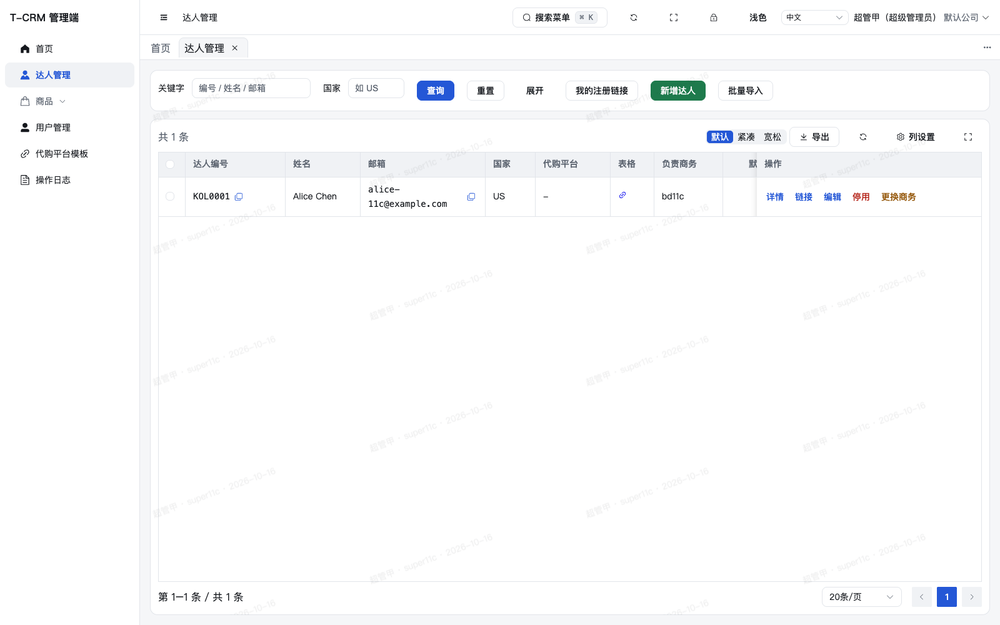

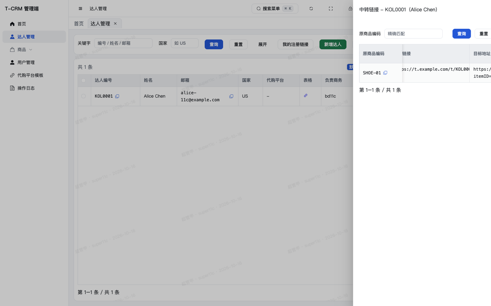

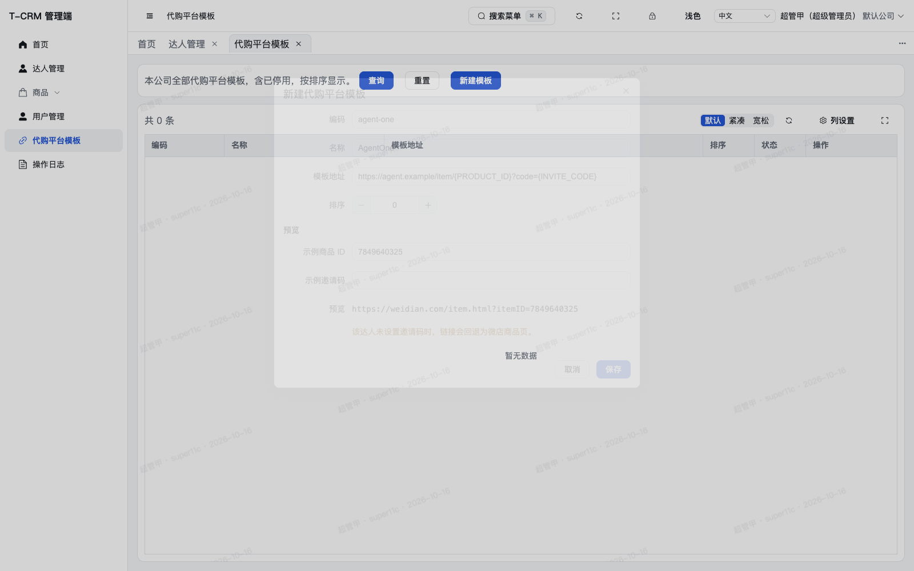

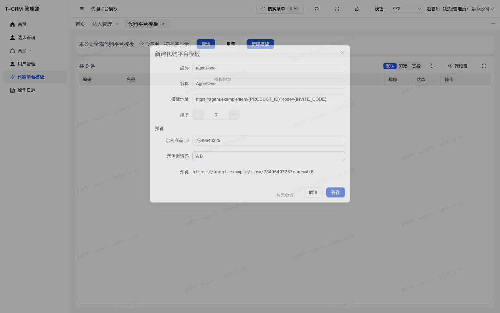

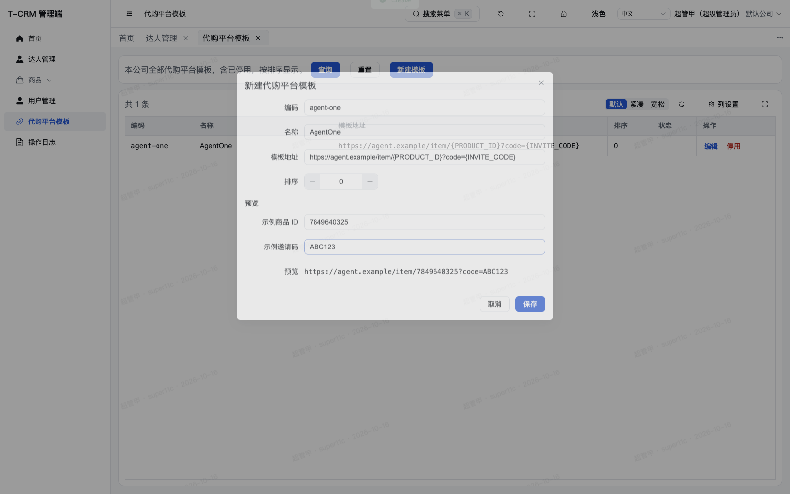

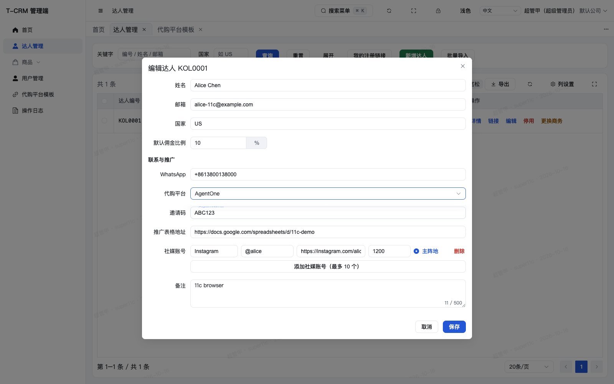

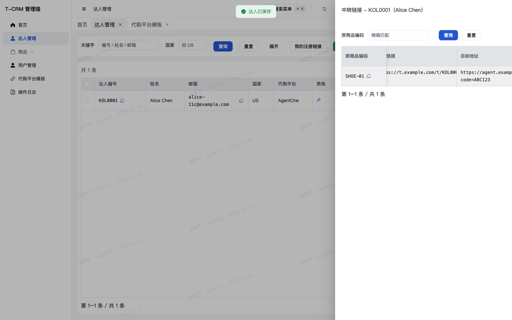

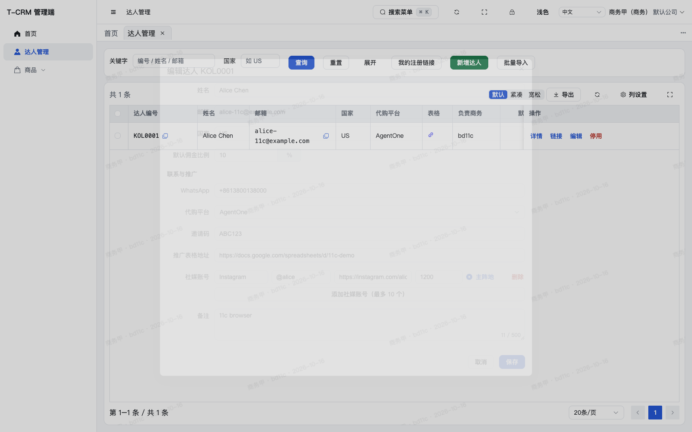

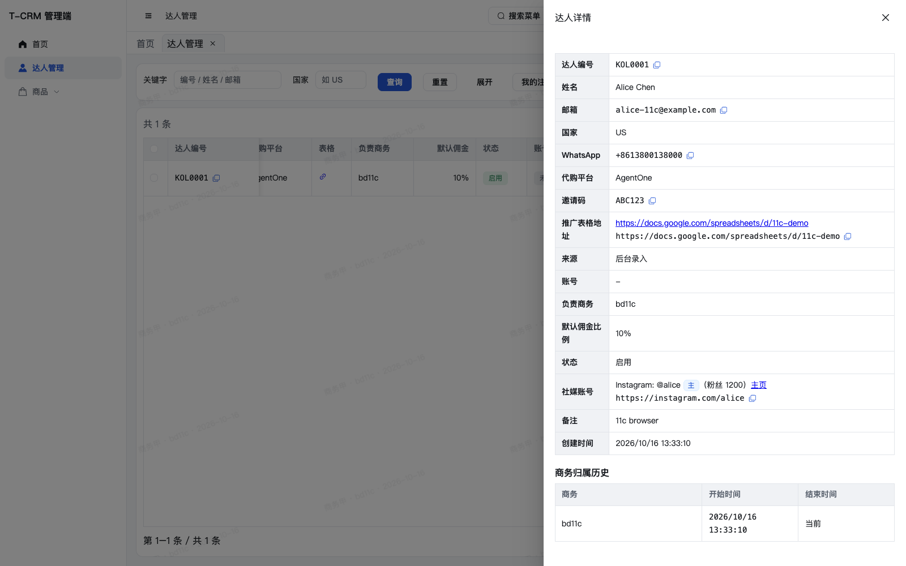

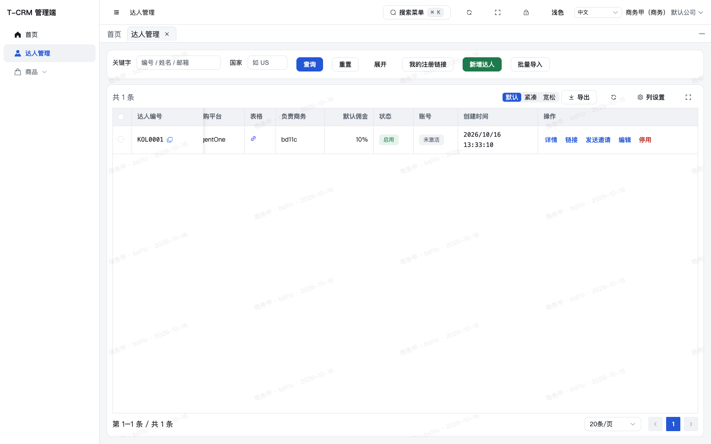

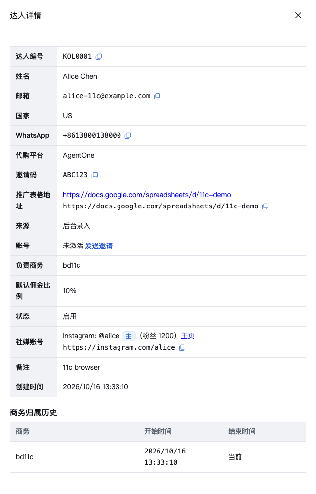


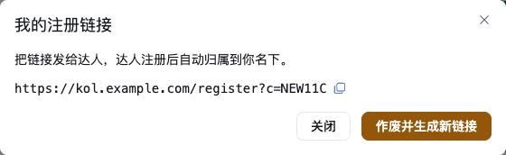

## 4. 偏离与遗留

- `KolVO` 仍没有 `accountStatus`。`GET` / `POST /admin-api/kol/register-code` 在当前 `main` 上不存在。前端按提示词 4.6 消费这两个约定；单测 mock，浏览器里注册链接和账号状态用模拟数据。12c 合并后这两处会变成真实数据，邀请按钮才会在真实列表上出现。
- 链接抽屉补了一列「目标地址」。设计 §6.2 的链接列表本来就返回该字段，06e 的抽屉没有画出来。不补这列，就无法在链接列表里看到模板生效。复制方式与中转链接相同。
- 任务 11 报告 2.2 记录的是 10a 之前的角色注解。当前控制器已经按该报告末节改成：读取 `kol:edit`，写入 `SUPER_ADMIN`。模板管理页仍只放给超管；达人表单因为调用方本来就有 `kol:edit`，打开时再拉模板。
- 国家只检查「空或两位字母」，没有套用后端那份 ISO 已分配代码表。非法但形如两位字母的值由后端拒绝。
- `{PRODUCT_ID}` 在 vue-i18n 里会被当成占位符吃掉。语言包里的字面花括号写成 `{'{'}PRODUCT_ID{'}'}`。
- 预览对占位符用 `replaceAll`。后端 `LinkUrls.targetUrl` 只用 `replace`，各替换第一次。模板里两种占位符各出现一次时结果相同。
- `LINK_TEMPLATE_CODE_EXISTS`、`LINK_TEMPLATE_NOT_FOUND`、`LINK_TEMPLATE_INVALID`、`KOL_MULTIPLE_PRIMARY`、`KOL_ALREADY_ACTIVATED` 的文案原来就在语言包里，这次没有改它们。
- 本次浏览器会话把登录验证码关在进程环境里，只为走通页面。生产配置没有改。
