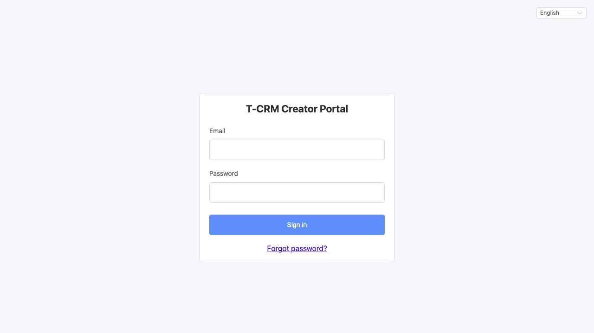
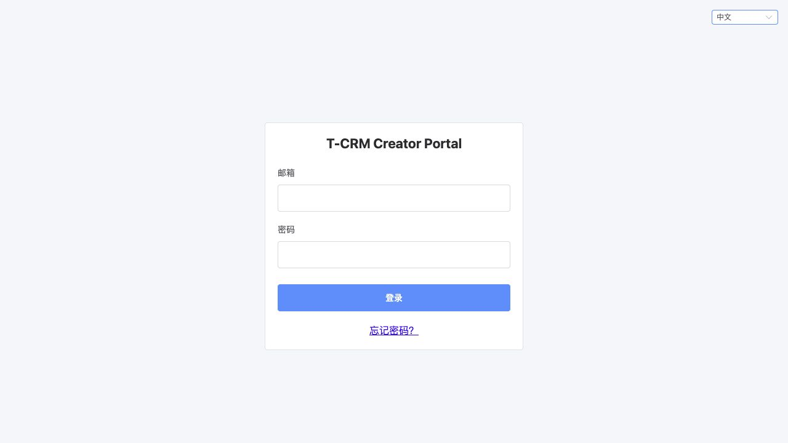
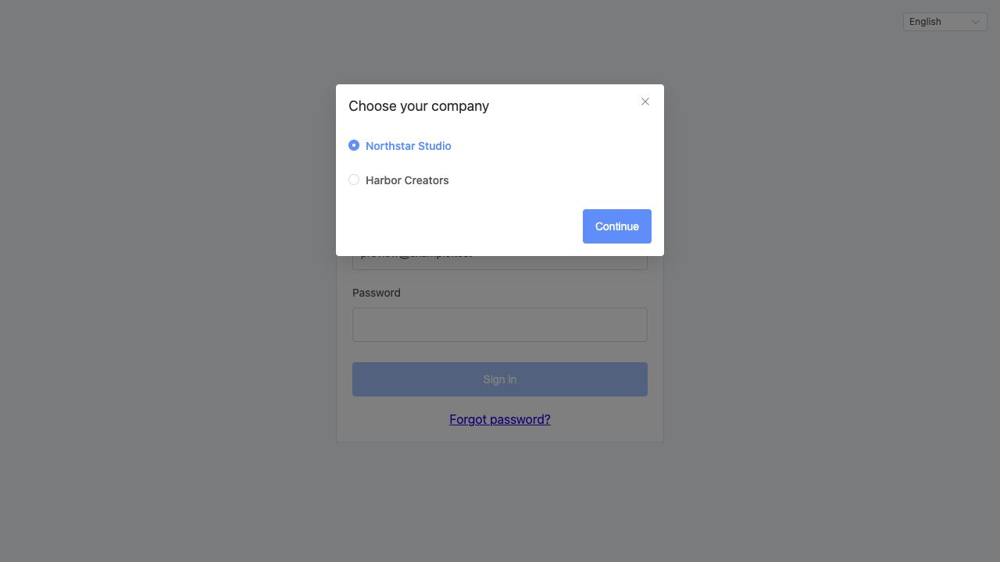
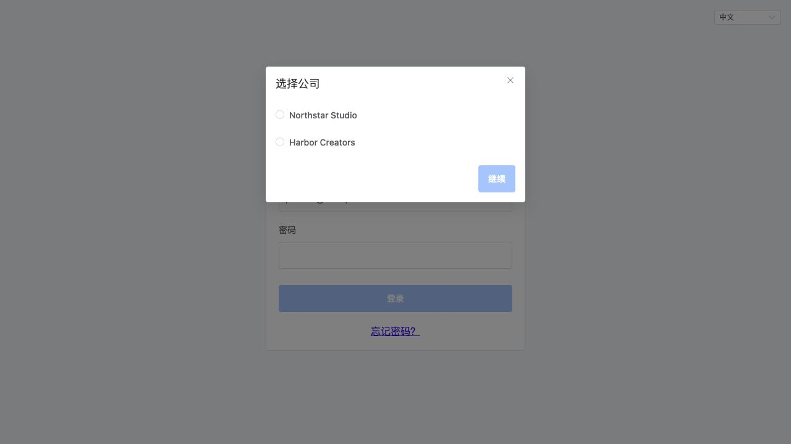
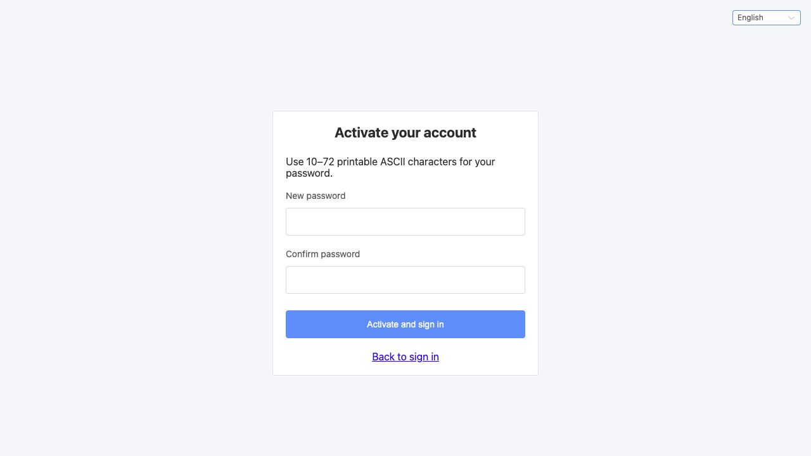
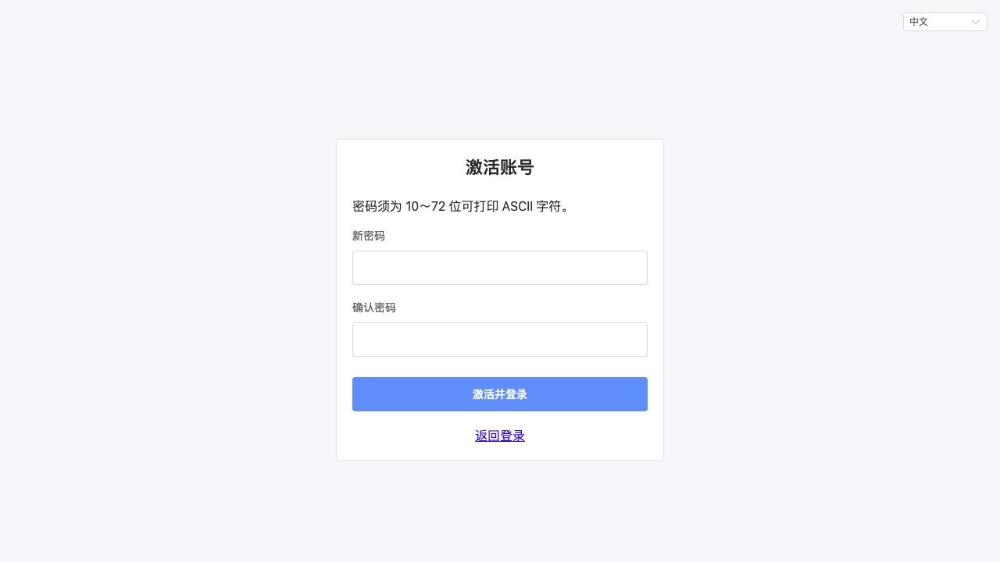
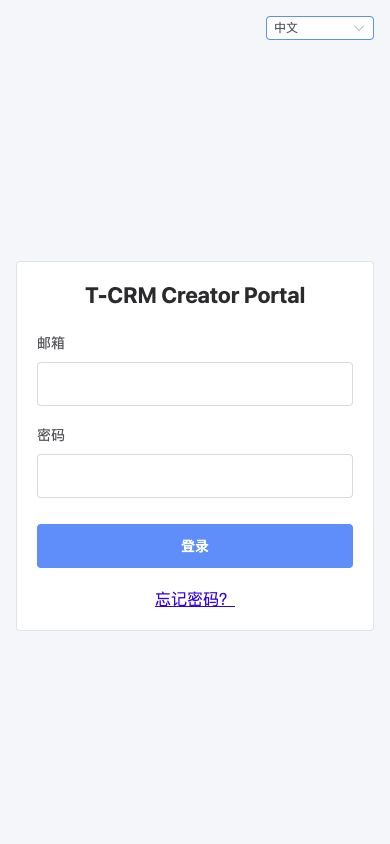

# 任务 12b（达人端）执行报告：登录、选择公司、激活、找回与修改密码

## 1. 结论与环境

- 日期：2026-10-16。
- 工作树：`/Users/hh-mini/Public/dev/t-crm/.worktrees/12b-kol-login-portal`。
- 分支：`task/12b-kol-login-portal`，基线 `c9f9eb0`。
- 环境：Node.js 22.23.1、pnpm 10.33.4（工程固定版本）。
- 前端按提示词 §4.4 完成，所有本地工程检查通过；没有新增依赖、修改锁文件或后端代码。
- **尚不能完整验收**：12a 分支尚无后端实现提交，本机后端不可用，真实邀请邮件、激活、登录、改密、找回与重置链路未完成。按提示词 §8 以 `[WIP]` Draft PR 交付，待后端就绪后联调；不合并。
- PR：[WIP Draft #43](https://github.com/ksws00684315/t-crm/pull/43)，保持未合并。

## 2. 页面与路由

| 路由 | 访问 | 实现 |
|---|---|---|
| `/login` | 公开 | 邮箱、密码、忘记密码、语言切换；单公司直接登录，多公司在同页弹窗单选 |
| `/activate?token=` | 公开 | 两次密码校验，激活成功保存会话进入首页；缺少/无效令牌显示联系商务重发提示 |
| `/forgot` | 公开 | 校验邮箱；成功响应一律显示相同提示，隐藏表单，避免重复发送 |
| `/reset?token=` | 公开 | 两次密码校验；成功清理旧会话，返回 `/login?reset=success` 显示成功提示 |
| `/account` | 登录 | 通过 `/me` 刷新本人资料，只读展示编号、名称、邮箱、国家、公司；安全表格外链；修改密码 |
| `/` | 登录 | 保留首页现有内容；页头展示名称与公司，用户菜单提供我的账号和退出 |

- 激活与重置复用 `views/password-link/index.vue`，公开页面共用 `AuthShell.vue`，没有引入新模块或依赖。
- 邮箱先去除首尾空白后校验；密码严格为 10～72 位可打印 ASCII，不裁剪密码；设置新密码时校验两次输入相同。
- 提交按钮显示 loading、禁止重复点击；输入框在提交期间禁用。
- 手机宽度下表单占满卡片宽度；按钮和输入框至少 44px 高，公司单选项至少 44px 高。
- 所有新界面文案来自中英文语言包，默认英文，已有错误反馈也会随切换即时翻译。

## 3. 接口与会话

`src/api/auth.ts` 为提示词 §4.4 的全部 8 个接口提供类型和请求函数，页面不直接调用 axios。公司选择 ID 保持字符串，只在选择接口提交 `tenantId`；本人资料与改密接口不提交达人或公司 ID。

- 登录、激活、选公司、改密成功均由 store 的 `acceptSession` 统一保存令牌、`Date.now() + expiresIn * 1000` 与 `kol`，沿用 `tcrm-kol-session` 持久化键。
- 请求使用 `X-Kol-Token` 和当前语言 `Accept-Language`；请求和路由守卫每次读取当前时间校验到期，避免页面长期打开后使用缓存的认证判断。
- 延续已有 401 全局处理：清理本地会话，跳转 `/login?redirect=<当前 fullPath>` 并提示过期；登录页上的 401 保留给页面显示，不弹出重新登录对话框。
- 登录成功通过 `safeRedirect` 校验目标，仅接受站内绝对路径；拒绝完整外站 URL、`//`、反斜杠、编码分隔符与控制字符，以及再次指向认证页的路径。
- `KOL_LOGIN_SELECTION_INVALID` 关闭选择框，清除选择凭据并显示重新登录提示；选择凭据与密码不持久化。
- 修改密码成功用响应的新令牌和资料替换会话，保持登录；退出调用服务端接口，即使失败仍清理会话并返回登录。
- 表格外链仅接受 HTTP(S)，新窗口使用 `noopener noreferrer`。

## 4. 错误码文案

`api/error-codes.ts` 沿用从语言包提取已知错误码的机制，不显示后端 `msg`。以下码均有中英文文案：

| 错误码 | 中文文案含义 |
|---|---|
| `AUTH_INVALID_CREDENTIALS` | 邮箱或密码错误 |
| `AUTH_ACCOUNT_LOCKED` | 登录失败次数过多，稍后重试 |
| `AUTH_ACCOUNT_DISABLED` | 账号被停用或不可用 |
| `AUTH_UNAUTHORIZED` | 登录失效，重新登录 |
| `KOL_AUTH_TOKEN_INVALID` | 链接已失效，请联系商务重新发送 |
| `AUTH_OLD_PASSWORD_INCORRECT` | 当前密码错误 |
| `KOL_LOGIN_SELECTION_INVALID` | 公司选择凭据失效，重新登录 |

网络错误、未知错误码、内部错误与 traceId 处理沿用现有机制。

## 5. 自动化验证

在本工作树的 `kol-portal/` 执行：

| 检查 | 结果 |
|---|---|
| `pnpm install --frozen-lockfile` | 通过，锁文件未变化 |
| `pnpm lint` | 通过，ESLint 与 Prettier 无告警 |
| `pnpm typecheck` | 通过 |
| `pnpm test` | 15 个文件、118 项测试全部通过；无失败、跳过或删除 |
| `pnpm build` | 通过 |
| `pnpm notices:check` | 通过，许可声明未变化 |
| `pnpm audit --audit-level high` | 通过，无已知漏洞 |
| `git diff --check` | 通过 |

测试位置与行为：

| 测试文件 | 主要覆盖 |
|---|---|
| `api/__tests__/auth.spec.ts` | 全部方法、路径、请求体；大于安全整数的公司 ID 保持字符串；新令牌与语言请求头；打开页面后到期的令牌不再发送 |
| `api/__tests__/setup.spec.ts` | 401 清除会话及资料、保留完整 redirect；登录 401 页面内处理；原有存储用例保留 |
| `router/__tests__/guard.spec.ts` | 新公开路由可访问，账号页需要登录；原有守卫与标题测试保留 |
| `stores/__tests__/session.spec.ts` | 刷新恢复资料及令牌、过期时间检查、退出清理 |
| `utils/__tests__/auth.spec.ts` | 密码长度/ASCII/控制字符边界、邮箱校验、redirect 与表格外链安全边界 |
| `views/__tests__/auth.spec.ts` | 单/多公司登录、选择凭据失效、三类登录错误、redirect、重复提交；激活校验/失效/成功；找回相同提示；重置跳转和提示；账号只读资料；改密 422 和新会话；退出成功与失败 |
| `views/login/__tests__/index.spec.ts` | 既有默认英文、中文切换、语言控件测试保留；占位页断言更新为可交互表单及忘记密码入口 |
| 既有语言包、请求层、布局、App 测试 | 全部保留并通过；两份语言包键一致且路由标题有翻译 |

会话到期用例先复现失败，再将请求与守卫改为逐次读取时间，未删除或弱化测试。

## 6. 浏览器验证与截图

使用真实浏览器打开本工作树启动的 Vite 服务。验证中英文文字、页面标题、语言切换、表单可操作、公司弹窗单选与确认按钮状态。

- 登录页与激活页截图来自 `http://127.0.0.1:8849`；激活 URL 使用明确的预览占位令牌，没有提交激活。
- 公司选择截图来自 `http://127.0.0.1:18849`，连接独立的本地临时模拟响应服务 `18890`，仅用于按 §4.4 展示公司列表；公司名称、邮箱和凭据均为虚构测试数据。**这些截图不是 12a 后端联调证据**。模拟服务和脚本不进入提交。
- 手机视口 **390 × 844**：实测 `innerWidth = scrollWidth = 390`，无横向溢出，登录按钮高度 **44px**；验证结束恢复默认视口。
- 公司选择预览控制台检查没有 warning/error。

| 页面 | 英文 | 中文 |
|---|---|---|
| 登录 |  |  |
| 公司选择（模拟响应） |  |  |
| 激活（预览） |  |  |

### 真实后端联调阻塞

本轮多次检查：

1. `git log -1 task/12a-kol-account-backend` 仍为基线 `c9f9eb0`，与本任务基线无差异；`gh pr list --head task/12a-kol-account-backend` 返回空列表。
2. `http://localhost:8080/actuator/health` 和 `/kol-api/me` 都返回 HTTP 502。
3. 当前没有可用于创建达人、生成邀请/重置链接的 12a 后端实例。未改动或启动其他工作树，也没有访问其他工作树的文件。

因此不能从真实日志获取 `crm.mail.log-links=true` 生成的激活链接，不能完成提示词要求的真实「后台新建达人 → 激活 → 退出 → 登录 → 修改密码 → 找回 → 重置」浏览器链路。没有自行实现后端、变更接口或将模拟验证记为真实联调。

## 7. 偏离、遗留与交付

- 变更范围仅 `kol-portal/`（含截图）和本执行报告；没有修改主工作树、后端、规范、设计或迁移脚本。
- 不新增依赖；没有新增预发布传递依赖；数据库无变化。
- 唯一验收缺口为 12a 真实后端与邮件链路联调。后续需核对实际响应与 §4.4 一致，并用真实测试账号补跑全流程；如有契约不一致，按任务停止条件报告，不自行改约定。
- 按停止条件创建 `[WIP]` Draft PR，提交与推送任务分支，等待 CI；不推送 main、不合并 PR。
- 详细设计与工程规范没有修改。`kol-portal/README.md` 已同步当前页面、会话与请求约定。

## 8. CI 与最终检查记录

功能提交 `2888ef3` 已推送；通过 `gh pr checks 43 --watch` 等待两项检查全部成功：

| 检查 | 结果 | 证据 |
|---|---|---|
| KOL Portal verify | 通过，1m16s | [CI 运行](https://github.com/ksws00684315/t-crm/actions/runs/38777358128) |
| Vulnerabilities and licenses | 通过，1m18s | [CI 运行](https://github.com/ksws00684315/t-crm/actions/runs/38777358411) |

随后仅补充本报告的 PR 链接与 CI 证据，并继续确认 PR 最新提交的检查。浏览器临时 Vite 与模拟服务均已停止，未留下运行进程。最终验收仍以 PR 最新 CI、12a 联调和负责人审查为准。
