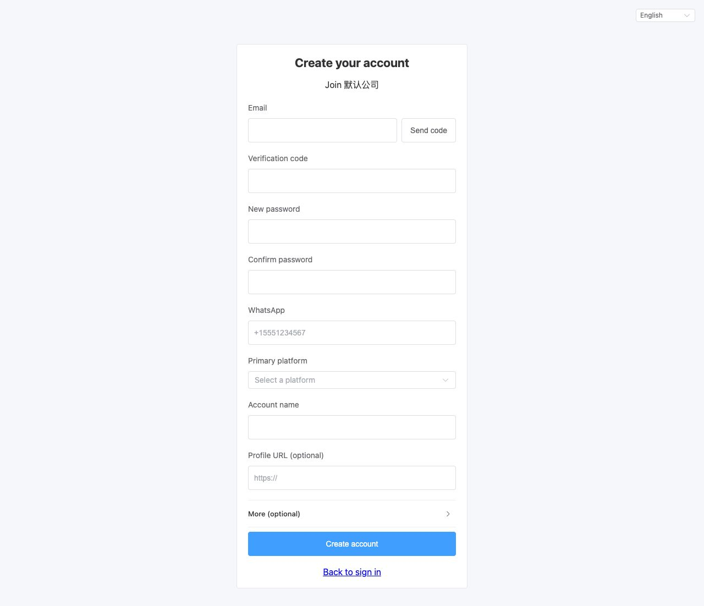
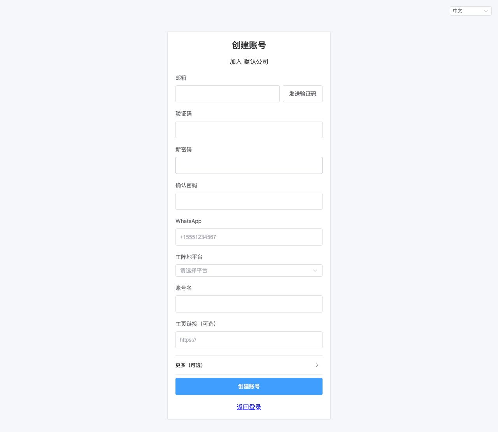
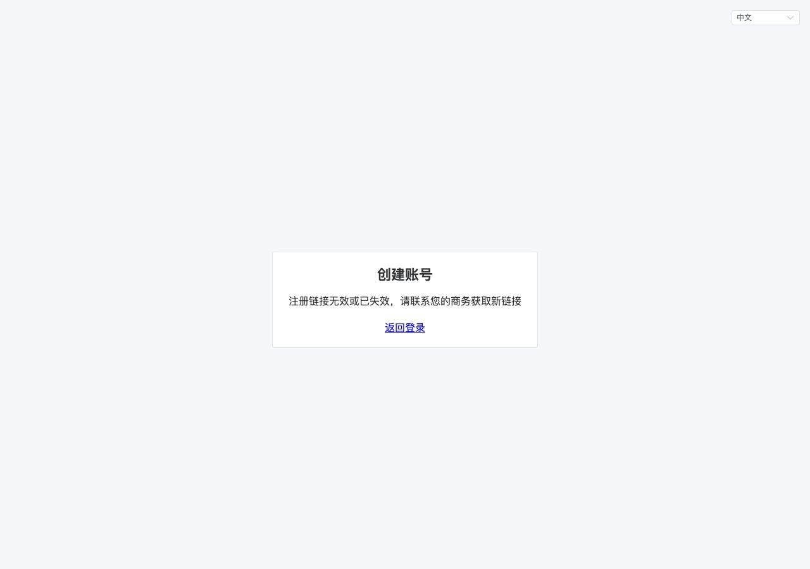
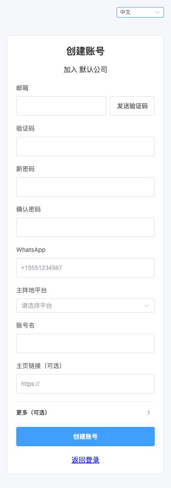
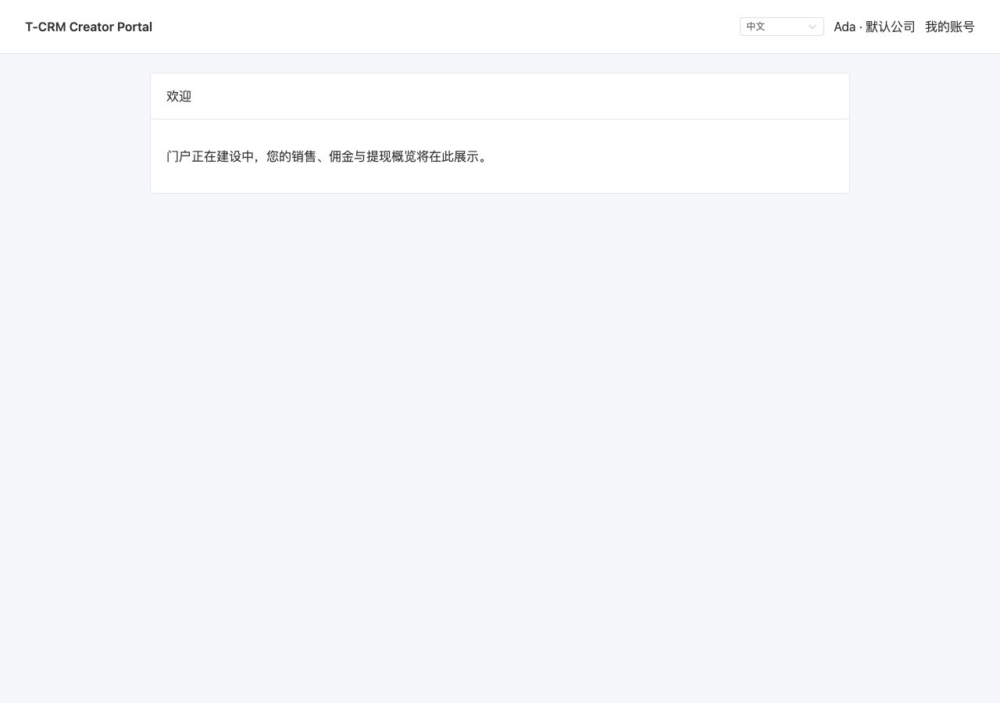
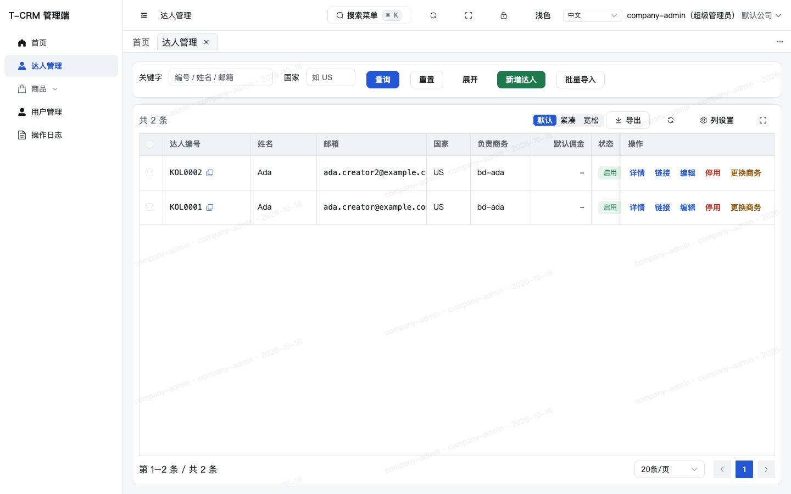

# 任务 12c（后端 + 达人端）执行报告：达人通过商务的注册链接自助注册

- 日期：2026-10-16。
- 工作树：`/Users/hh-mini/Public/dev/t-crm/.worktrees/12c-kol-self-register`。
- 分支：`task/12c-kol-self-register`，基线 `b661ec6`。
- 环境：JDK 21（`/opt/homebrew/opt/openjdk@21`）、Node.js 22.23.1、pnpm 10.33.4。
- 没有新增依赖，没有新的环境变量，没有修改已合并的迁移、`redirect/`、`deploy/`，也没有改 `admin-ui/` 里语言包以外的文件。
- 管理端「我的注册链接」和「账号状态」界面属于任务 11c，本任务不做。

## 1. 迁移

`backend/src/main/resources/db/migration/V202610171500__kol_register_code.sql` 新建 `crm_kol_register_code`。无外键，不使用逻辑删除；作废只把 `status` 改为 0。

| 字段 | 约束 |
|---|---|
| `id` | 雪花主键，`CHECK (id > 0)` |
| `tenant_id` | `NOT NULL`，`CHECK (tenant_id > 0)` |
| `bd_user_id` | `NOT NULL`，`CHECK (bd_user_id > 0)` |
| `code` | `VARCHAR(32)`，`CHECK (code ~ '^[0-9A-Za-z]{32}$')`，全表唯一 |
| `status` | `SMALLINT`，`CHECK (status IN (0, 1))`，1 有效 / 0 已作废 |
| `create_by` / `create_time` / `update_by` / `update_time` | 通用审计字段 |

索引（3 个，加主键共 4 个，未超过 6 个）：

- `uk_crm_kol_register_code_code (code)`
- `uk_crm_kol_register_code_active_bd (bd_user_id) WHERE status = 1`
- `idx_crm_kol_register_code_bd (tenant_id, bd_user_id)`

注册码明文保存。它只决定公司和归属商务，不是登录凭证，商务需要随时复制。

锁表风险：新表，不影响已有表。Docker 集成测试里 Flyway 应用到 `202610171500 - kol register code`。

## 2. 接口与示例响应

统一信封 `{code,msg,data,errorCode,traceId}`。下面的示例来自本机一次性库，令牌已略去。`expiresIn` 与登录接口一样是长整型，按现有 Jackson 配置序列化为字符串。`accountStatus` 是 `Integer`，保持 JSON 数字。

### 2.1 管理端注册链接

权限 `kol:register-link`。两条都有 `@AuditLog`（module `KOL`，action `Get register link` / `Rotate register link`）。审计切面记的是请求参数，响应里的注册码不会因此再写一遍。

只有可作为商务的账号能取到链接：本公司、启用、子账号、数据范围仅本人、并且有 `kol:edit`。超管能通过权限注解（有效权限包含该码），但可用商务校验失败，返回 422 `KOL_INVALID_BD_USER`。数据范围为全部的子账号、以及有 `kol:register-link` 但没有 `kol:edit` 的子账号同样 422。没有该权限的子账号是 403 `AUTH_FORBIDDEN`。

`GET /admin-api/kol/register-code`：没有有效码时自动生成。`POST` 同一路径：同一事务里把旧码 `status` 改为 0 再插入新码。唯一索引冲突在事务外捕获后整段重试，最多 3 次，仍失败则 `COMMON_CONFLICT`。

```json
{
  "code": 0,
  "msg": "Success",
  "data": {
    "code": "EmL23flXiB4I5wHn28kfPOsz4QXIcnof",
    "url": "https://kol.example.com/register?c=EmL23flXiB4I5wHn28kfPOsz4QXIcnof",
    "status": 1
  },
  "errorCode": null,
  "traceId": "…"
}
```

`url` 由 `KolPortalUrls.registerUrl` 拼出：`{TCRM_KOL_PORTAL_BASE_URL}/register?c={code}`。基址必须是 https，且不能以斜杠结尾。注册码 32 位 Base62，字母表 `0-9A-Za-z`，`SecureRandom.nextInt(62)`，不复用 `SecureTokens.generate()`。

### 2.2 达人端公开接口

`/kol-api/register` 与 `/kol-api/register/**` 加入 `KolApiInterceptor.PUBLIC_PATHS`，第二个 `SaInterceptor` 使用同一份列表。三个方法都标 `@PublicEndpoint`。公开接口自己打开数据范围。

`GET /kol-api/register/{code}` 不限流。路径只要求非空，格式在服务里用 `[0-9A-Za-z]{32}` 判断。码存在、状态为 1、所属商务仍可作为商务、公司启用时返回公司名；否则一律 404 `KOL_REGISTER_CODE_INVALID`，不区分原因。

```json
{"code":0,"msg":"Success","data":{"tenantName":"默认公司"},"errorCode":null,"traceId":"…"}
```

`POST /kol-api/register/email-codes`，体 `{code, email}`。顺序：IP 限流 → 解析注册码（无效 404）→ 本公司邮箱已存在则 409 `KOL_EMAIL_EXISTS`，不发信、不开始冷却 → `SET NX EX 60` 冷却，失败则 429 `KOL_EMAIL_CODE_TOO_FREQUENT` → 写入验证码摘要再发信。

`POST /kol-api/register`。顺序：IP 限流 → 邮箱限流 → 解析注册码 → 邮箱已存在则 409，此时还不消费验证码 → 消费验证码 → `KolWriter.insert(kol, null, null)` → `ExternalAuditApi.recordKolOperation` → `KolAuthService.loginEstablished`。成功响应与 `POST /kol-api/auth/login` 相同：

```json
{
  "code": 0,
  "msg": "Success",
  "data": {
    "tokenName": "X-Kol-Token",
    "token": "…",
    "expiresIn": "604800",
    "kol": {
      "kolCode": "KOL0002",
      "name": "Ada",
      "email": "ada.creator2@example.com",
      "country": "US",
      "tenantName": "默认公司",
      "whatsapp": "+15551234567",
      "sheetUrl": null
    }
  },
  "errorCode": null,
  "traceId": "…"
}
```

插入前设置：`registerSource=2`、`accountStatus=1`、`status=1`、`passwordHash` 为 BCrypt、`bdUserId` 为注册码上的商务、`credentialVersion=0`、一条主阵地 `{platform, handle, url, primary:true, followers:null}`。名称为空时取 `primaryHandle.strip()`。不调用 `KolAccountStoreService.activate`。`tenantId` 留给公司范围里的租户插件填写。PostgreSQL jsonb 文本带空格，例如 `"primary": true`。

同一邮箱再次提交时，邮箱已存在的检查在读验证码之前，所以返回 409 `KOL_EMAIL_EXISTS`，而不是 400。一次性由 Redis 键在成功后删除来保证；换一个未注册邮箱再拿已删除的验证码，仍是 400。唯一索引冲突（并发双写）由 `KolWriter` 转成 409。

请求字段：`code`、`email`、`emailCode`、`password`、`whatsapp`、`primaryPlatform`、`primaryHandle` 必填；`primaryUrl`、`name`、`country` 可空。平台只允许 TikTok、Instagram、YouTube、X、Facebook、Other。WhatsApp 为 `\+[0-9]{8,15}`。国家为 ISO alpha-2，空值有效。主页必须是 `https://`，空串按未填处理。密码 10～72 位可打印 ASCII。邮箱沿用 `KolRules.EMAIL_PATTERN`，最长 128。`primaryHandle` 最长 64，因为空名称会把它写入 `VARCHAR(64)` 的 `name`。

列表和详情的 `KolVO` / `KolDTO` 在 `registerSource` 之后增加 `accountStatus`（0 未激活 / 1 已激活）。`KolService.toDto` 把 null 收成 0。字段名不改，留给 11c。

### 2.3 新错误码

| 错误码 | HTTP | 达人端中文 |
|---|---|---|
| `KOL_REGISTER_CODE_INVALID` | 404 | 注册链接无效或已失效，请联系您的商务获取新链接 |
| `KOL_EMAIL_CODE_TOO_FREQUENT` | 429 | 验证码发送过于频繁，请稍后再试 |
| `KOL_EMAIL_CODE_INVALID` | 400 | 验证码错误、已过期或已使用 |
| `KOL_REGISTER_TOO_FREQUENT` | 429 | 注册尝试过于频繁，请稍后再试 |
| `KOL_EMAIL_EXISTS` | 409 | 该邮箱已注册，请直接登录（已有码，达人端补了注册场景文案） |

四个新码同时写进 `admin-ui/src/locales/{zh-CN,en-US}.ts`。`KOL_INVALID_BD_USER` 是既有码。

成功注册的审计：module `KolRegister`，action `Self register`，username 存达人邮箱（与 12a 一致），uri `/kol-api/register`，method 固定 `POST`，params 只有 `{"kolId":"…"}`。公开注册不使用 `@AuditLog`。注册服务不打 info 日志。

## 3. 限流与验证码

常量在 `KolEmailCodes`。计数器在 `increment` 返回 null 时按失败关闭（当作已超出）。

| 规则 | 值 |
|---|---|
| 验证码 | 6 位数字，TTL 10 分钟，最多错 5 次 |
| 同一公司同一邮箱发送间隔 | 60 秒 |
| 发送验证码 | 每 IP 每小时 20 次 |
| 注册 | 每 IP 每小时 20 次，每邮箱每小时 10 次（邮箱维度不按公司拆） |
| 预览链接 | 不限流 |

Redis：

- 验证码 `kol:register:email-code:{tenantId}:{邮箱 SHA-256}`，值 `{64 位十六进制摘要}:{剩余次数}`，摘要里没有冒号。正确则删除；错误则 `KEEPTTL` 减一次，到 0 删除。Lua `DefaultRedisScript<Long>` 返回 1 / 0 / -1。
- 冷却 `kol:register:email-cooldown:{tenantId}:{摘要}`，`SET NX EX 60`。
- 限流键 `kol:register:rate:send-ip:`、`kol:register:rate:reg-ip:`、`kol:register:rate:reg-email:`，后缀是 `SecureTokens.hash`（SHA-256 十六进制）。超出返回 429 `KOL_REGISTER_TOO_FREQUENT`（发码的 IP 超出同样用这个码；冷却用 `KOL_EMAIL_CODE_TOO_FREQUENT`）。

解析注册码在 `TenantScope.callSystem` 里进行，再用 `TenantScope.callCompany` 读取该商务。商务不可用或公司停用 / 不存在都是 404。

## 4. 邮件模板全文

模板 id `kol-register-code`。公司名和验证码在 HTML 里走已有的 `escape()`。主题：

`[{公司名}] Your verification code / 您的验证码`

纯文本正文：

```
Hello,

Your verification code for joining {公司名} on T-CRM is:

{6 位数字}

The code is valid for 10 minutes and can be used once.

If you were not expecting this email, you can ignore it.

----
您好，

您加入 {公司名}（T-CRM）的验证码是：

{6 位数字}

验证码 10 分钟内有效，仅可使用一次。

如果您没有预期收到这封邮件，请忽略它。
```

`KolMails.send` 把收件人打成 `a***@domain`。`LoggingMailSender` 在 `crm.mail.log-links=false`（默认，`application.yml` 只更新了注释）时只记 `[mail:{模板}] subject {主题}`，不再记收件人；为 `true` 时才记收件人、主题和正文。没有新环境变量。本机浏览器取码时用启动参数 `--crm.mail.log-links=true`。邮件 `@Async` 跨 bean 发送，失败只 `WARN`，不回滚注册以外的发码请求，也不回滚已经成功的注册。

## 5. 达人端页面

公开路由 `/register?c={code}` 放在兜底路由之前，`meta.public = true`。已登录访问 `/register` 不会被守卫送走（守卫只处理 `/login`）。登录页不增加注册入口；从 `route.query.email` 为字符串时预填邮箱。

无效或缺失的码显示「注册链接无效或已失效，请联系您的商务获取新链接」和返回登录。有效码标题「创建账号」/ “Create your account”，副标题「加入 {公司}」/ “Join {company}”。表单含邮箱、发送验证码、验证码、新密码、确认密码、WhatsApp、主阵地平台、账号名、可选主页；「更多（可选）」里是名称和国家。

发送成功后按钮文案变为「{秒} 秒后可重发」/ “Resend in {seconds}s”，按钮仍可点击，再次点击会打到接口并显示接口文案。失败不开始倒计时。409 不开始冷却倒计时，页内提示「该邮箱已注册，请直接登录」，并给出到 `/login?email=` 的链接（邮箱不百分号编码）。成功后 `session.acceptSession` 再 `router.replace("/")`。

## 6. 测试

### 6.1 后台

JDK 21 下在本工作树执行。`mvn verify -Pdocker-it` 含格式、Checkstyle、单元测试、架构测试、覆盖率和 Docker 集成测试。

| 检查 | 结果 |
|---|---|
| Spotless、Checkstyle | 通过。断言修正后 `spotless:apply` 未再改文件 |
| 单元测试（surefire） | 115 个类、874 项，失败 0、错误 0、跳过 0 |
| JaCoCo（单元测试数据） | 行覆盖 92.41%（5272/5705），分支覆盖 81.91%（1757/2145），原有门槛未降低 |
| Docker 集成测试（failsafe 报告汇总） | 15 个类、120 项，失败 0 |

第一次完整的 `mvn verify -Pdocker-it` 里 surefire、Spotless、Checkstyle、JaCoCo 已通过，failsafe 有 3 个失败，都是断言与实现约定不一致，生产代码未改：

1. jsonb 文本是 `"primary": true`（带空格）。
2. 同一邮箱用已消费的验证码再注册，先命中「邮箱已存在」，返回 409 `KOL_EMAIL_EXISTS`。集成测试同时断言 Redis 验证码键已被删除。
3. `SystemIT` 的业务表清单补上 `crm_kol_register_code:NO`。

修正后重跑 `KolRegisterIT`（13）和 `SystemIT`（24），37 项通过。其余集成测试类的报告仍是第一次运行的通过结果。没有第二次完整的 `mvn verify -Pdocker-it`；CI 会再跑全量。

`KolRegisterIT` 覆盖：表结构与无逻辑删除、首次生成与轮换、超管 / 全部数据范围 / 无 `kol:edit` 的 422、无权限 403、跨公司注册归属、商务或公司失效后 404、验证码冷却 / 过期 / 五次错误 / 一次性、已注册邮箱不发信、激活字段与登录结果、空名称取账号名、列表 `accountStatus=1`、并发只成功一次、IP 与邮箱限流。

单元测试：`KolRegisterCodeServiceTest`（6）、`KolRegisterCodeGeneratorTest`（1）、`KolEmailCodesTest`（6）、`KolSelfRegisterServiceTest`（6）、`KolRegisterCodeControllerTest`（4）、`KolRegisterControllerTest`（3）、`LoggingMailSenderTest`（2）、`KolMailsTest`（2）、`KolMailTemplatesTest`（5，含新模板）、`KolControllerTest` 增加 `accountStatus` 为 0 的断言。

### 6.2 达人端与管理端语言包

在 `kol-portal/`：

| 检查 | 结果 |
|---|---|
| `pnpm install --frozen-lockfile` | 通过，锁文件未变 |
| `pnpm lint` | 通过（含 Prettier） |
| `pnpm typecheck` | 通过 |
| `pnpm test` | 16 个文件、127 项通过。`ElSelect` 的 `update:model-value` 警告与既有 `LocaleSwitch` 相同，不是失败 |
| `pnpm build` | 通过 |
| `pnpm notices:check` | 通过 |

注册页测试：无效码、公司名、倒计时按钮仍可点、提交前校验、成功后进入首页、409 的去登录链接。守卫与登录页预填各有对应用例。

`admin-ui` 只改了两份语言包。`pnpm exec vitest run src/api/__tests__/error-codes.spec.ts`：3 项通过。

## 7. 浏览器验证与截图

本机一次性 PostgreSQL 17 与 Redis，后台 `crm-admin-0.1.0.jar`（`--crm.mail.log-links=true`），达人端 Vite `http://127.0.0.1:8849`，管理端 Vite `http://127.0.0.1:8848`。接口返回的注册链接主机是配置值 `https://kol.example.com`。浏览器打开的是同一路径的本机页面 `http://127.0.0.1:8849/register?c={code}`，因为门户基址必须是 https，而本机 Vite 是 http。验证结束后这些进程和容器已删除，口令不写入本报告。

用商务子账号 `bd-ada`（岗位模板 BD，含 `kol:register-link` 与 `kol:edit`）调用 `GET /admin-api/kol/register-code` 取得链接。预览返回 `tenantName=默认公司`。验证码从当时的邮件日志里读取（只取点击发送之后新增的日志，避免用到上一封）。`POST /kol-api/register` 返回 200，浏览器进入 `http://127.0.0.1:8849/`，页头为「Ada · 默认公司」，正文有「欢迎」和「门户正在建设中」。首页标题是卡片标题，不是 `h1`。

库中该达人：`register_source=2`、`account_status=1`、`credential_version=0`、`status=1`、国家 US、归属该商务、密码哈希已写入、主阵地为 TikTok。同一次验证里还有早先一次成功的 KOL0001；列表里两位都在。

管理端达人列表能看到这两行：姓名 Ada，国家 US，负责商务 `bd-ada`（接口 `bdUserName` 是用户名；昵称只出现在筛选下拉里），状态列是合作状态「启用」。当前列表列是编号、姓名、邮箱、国家、负责商务、默认佣金、状态、操作，还没有「自助注册」和「已激活」列，那是 11c。列表接口已经返回 `accountStatus=1`、`registerSource=2`。

手机视口 390×844：实测 `innerWidth = scrollWidth = 390`，无横向溢出。语言菜单在截图前已收起。

| 页面 | 截图 |
|---|---|
| 英文注册页 |  |
| 中文注册页 |  |
| 无效链接 |  |
| 390px |  |
| 注册成功后的首页 |  |
| 管理端达人列表 |  |

## 8. 设计说明书

按提示词 §4.8 改了 `docs/03-设计/系统详细设计说明书.md`，没有改无关段落：

- §4.2 自助注册第 1、2、5 条：32 位 Base62、谁可以取链接、主阵地只填一个且账号名最长 64、限流和错误码。
- §5.2：空名称取账号名的句子，以及 `crm_kol_register_code` 的字段表和三个索引名。
- §6.2：列表 / 详情的 `accountStatus`，注册链接响应。
- §6.3：三个注册接口和错误码段落。

复制令牌那一行原有的「128 位」没有改。

## 9. 偏离与遗留

- 部分唯一索引名是 `uk_crm_kol_register_code_active_bd`。提示词草稿里曾出现 `uk_crm_kol_register_code_bd_active`，语义相同，设计说明书已按实际索引名写。
- `primaryHandle` 最长 64，与 `name` 列一致。提示词允许这个收紧，并要求写进报告。
- 自助注册审计的 `username` 存邮箱，沿用 12a，不另造用户名。
- `GET /kol-api/register/{code}` 不限流。提示词把限流放在发码和注册上。
- 倒计时期间按钮保持可点，重复点击显示接口返回的文案。不在失败或 409 时开始倒计时。
- `LoggingMailSender` 在 `log-links=false` 时不再记录收件人，只留模板名和主题，避免关闭开关时仍出现完整邮箱。`log-links=true` 仍记录收件人、主题和正文，仅供本机取码。
- 同一邮箱在验证码已经用掉之后再次注册，返回 409，因为「邮箱已存在」先于读验证码。换邮箱则仍是 400。
- 管理端列表还不能显示「自助注册 / 已激活」。接口已经返回这两个字段。界面留给 11c。
- 任务 16 的工作树在检查时仍停在基线，没有与本任务重叠的 `kol` 改动。
- 不在本任务：管理端注册链接页、账号状态列、注册后的资料补全、达人看板和资金。
