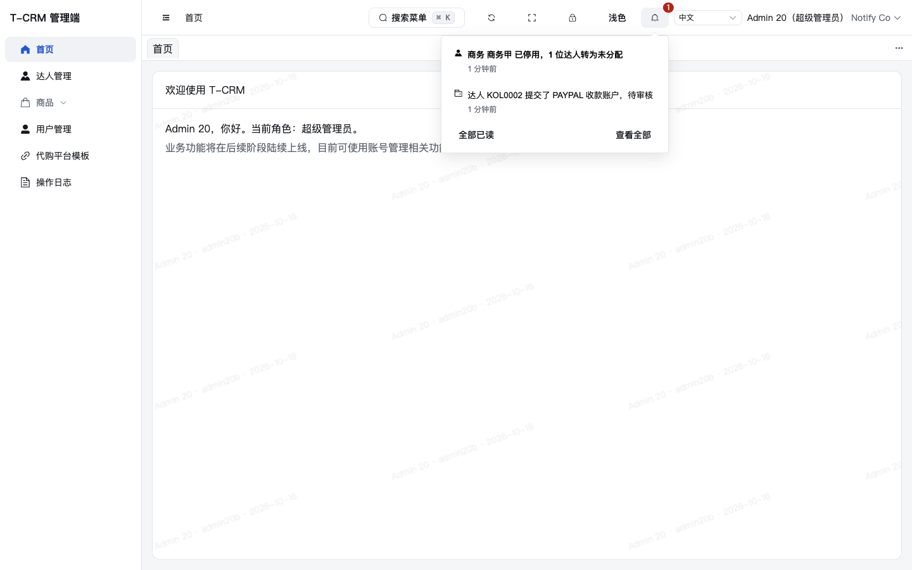
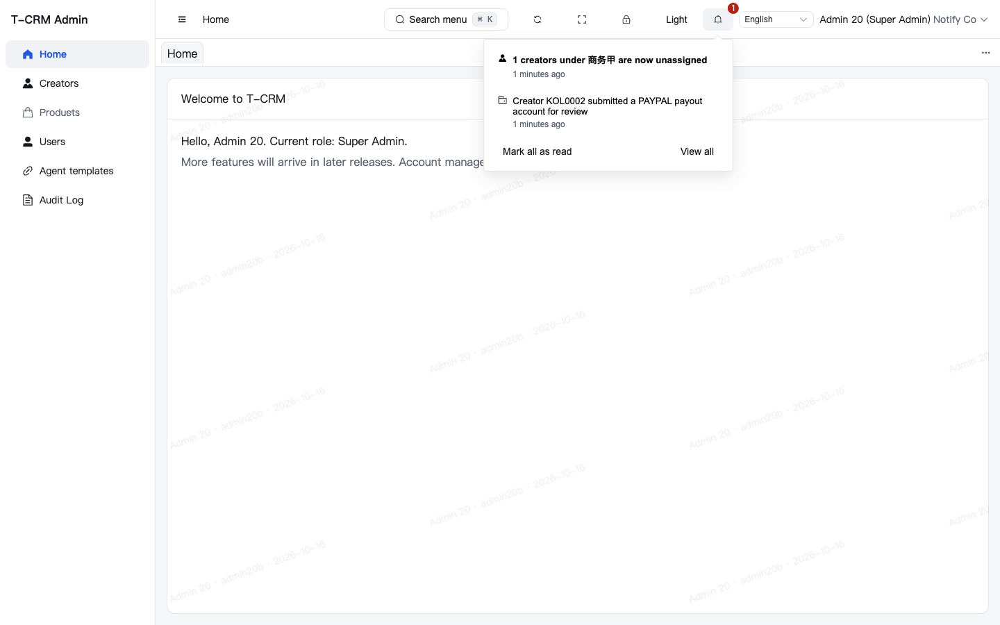
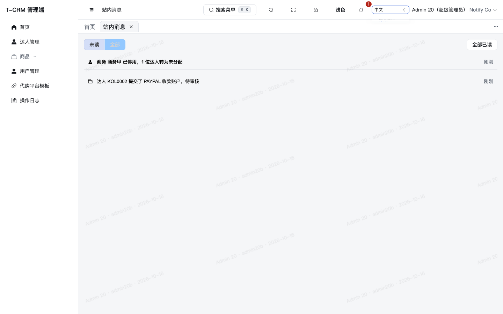
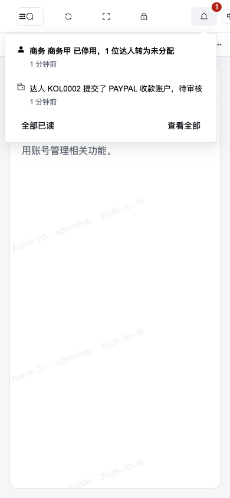
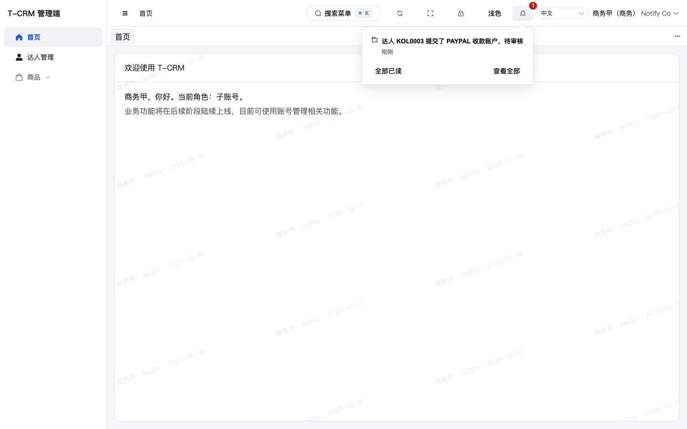
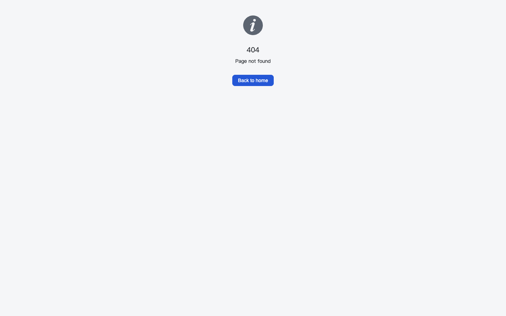

# 任务 20：站内消息执行报告

## 1. 结论

已在 `task/20-notifications` 完成站内消息基础能力，并接入目前已有的四类事件。消息只存类型和参数，管理端按当前语言渲染。页头铃铛只对公司账号显示。达人端不做站内消息。

本地 `mvn verify -Pdocker-it` 与管理端完整检查已通过。浏览器验证了收款账户提交、商务停用后的未分配消息、中英文切换、消息页，以及 15b 未合并时点击跳转到现有 404。CI 最终结果以 PR 检查页为准，交负责人审查，不自行合并。

## 2. 版本与环境

- 日期：2026-10-16（Asia/Shanghai）。
- 工作树：`/Users/hh-mini/Public/dev/t-crm/.worktrees/20-notifications`。
- 分支：`task/20-notifications`。实现起点为 `7ed6691`；提交前以 `--ff-only` 快进到 `origin/main` 的 `572c824`（其间只有任务索引和 21a/21b 提示词，与本任务文件不重叠）。
- JDK：`JAVA_HOME` 指向 Homebrew OpenJDK 21.0.12.1。本机默认 `java` 是 25，Spotless 3.10.4 不能在该 JVM 上跑格式化。
- Docker 集成测试使用 Testcontainers PostgreSQL 17.11 / Redis 7.4.5。
- 浏览器验证使用启动说明第 20 行：后端 `18201`，管理端 Vite `8801`，PostgreSQL `55401`，Redis `46401`，Compose 项目 `tcrm-20`。未占用负责人的 18081 / 8848 / 8849 / 55432 / 46391。
- 管理端使用仓库锁定的 pnpm 与冻结锁文件。`pnpm install --frozen-lockfile` 已通过，锁文件无变更。
- 验证结束后已停止本任务的后端与 Vite 进程，并执行 `docker compose -p tcrm-20 -f deploy/docker-compose.dev.yml down -v`。

## 3. 迁移

新增 `backend/src/main/resources/db/migration/V202610172000__create_notification.sql`，没有修改已合并脚本。

表 `crm_notification` 只追加：正值雪花主键、`tenant_id NOT NULL`、`user_id`、`type`（四种类型的 CHECK）、`params JSONB NOT NULL`、可空的 `biz_type` / `biz_id`、可空的 `read_time`、`create_time`。没有逻辑删除，没有更新人/更新时间。表和字段都有中文注释。

索引：

- `idx_crm_notification_inbox (user_id, read_time, create_time DESC)`：未读数与收件列表。
- `idx_crm_notification_tenant_time (tenant_id, create_time)`：以后按公司与时间清理。本任务不实现清理。

新表创建不改既有大表，没有加列或重建索引的锁表风险。`SystemIT` 的业务表 `tenant_id` 清单增加了期望行 `crm_notification:NO`（有 `tenant_id`，且非空）。表不在租户插件的忽略名单里。

## 4. 模块与事件

新建业务模块 `com.tcrm.admin.notification`，已加入 `TcrmAdminApplication` 的 `@MapperScan`。其他模块不引用 `notification` 的 service、mapper 或 model。它们只在自己的 `api` 包发布事件，业务事务里仍走 `TransactionalEvents.publish`。

| 事件 | 定义位置 |
|---|---|
| `PayoutAccountSubmittedEvent` | `commission.api` |
| `OrderSyncFailedEvent` | `order.api` |
| `BdTransferCancelledEvent` | `kol.api` |
| `KolsUnassignedEvent` | `kol.api` |

`NotificationListener` 四个方法都是 `@TransactionalEventListener(phase = AFTER_COMMIT)`。写入失败只记 WARN（类型、公司 ID、异常类名），不回滚已经提交的业务。

监听器里用事件携带的 `tenantId` 打开公司范围，再在 `PROPAGATION_REQUIRES_NEW` 的事务中插入。`afterCommit` 阶段外层事务尚未清理，加入原事务不能形成独立提交；新事务让写入失败只回滚消息本身。没有修改 `shared.TransactionalEvents` 或租户拦截器。

「全部启用的超级管理员」来自新增的 `system.api.EnabledSuperAdminApi.listEnabledIds()`（角色 `SUPER_ADMIN`、状态启用，按 ID 排序）。「达人当前商务」来自已有的 `KolApi.listByIds`。接收人为空时不插入。

规范 01 要求新模块先登记。因此在 `docs/05-工程规范/01-架构与工程结构.md` 的模块表增加了 `notification | 站内消息 | 业务模块`。这是规范要求的登记，超出提示词第 4.8 节的文档清单，在第 9 节单独说明。

## 5. 触发规则与接收人

| 类型 | 时机 | 接收人 | 入库参数 | `biz_type` / `biz_id` | 跳转 |
|---|---|---|---|---|---|
| `PAYOUT_ACCOUNT_SUBMITTED` | 达人新建账户，或修改 PENDING / REJECTED 账户并回到 PENDING | 当前商务（未分配则不发）+ 全部启用超管 | `kolCode`、`accountType`（枚举名，如 `PAYPAL`） | `PAYOUT_ACCOUNT` / 账户 ID | `/fund/payout-accounts?id={accountId}` |
| `ORDER_SYNC_FAILED` | 店铺上次成功、本次失败 | 全部启用超管 | `shopName` | `SHOP` / 店铺 ID | `/order/orders` |
| `BD_TRANSFER_CANCELLED` | 到期执行时因归属变化或目标商务不可用而取消 | 全部启用超管 | `kolCode`、`reason` 代码 | `BD_TRANSFER` / 转移 ID | `/kol/bd-transfers?kolCode={kolCode}` |
| `KOLS_UNASSIGNED` | 商务停用后，实际改为未分配的人数大于 0 | 全部启用超管 | `bdName`、`count` | `STAFF` / 被停用用户 ID | `/kol/kols` |

补充约定：

- 收款账户：发布点在原有事务回调末尾，位于插入或条件更新成功之后。达人编号缺失时记 WARN 并跳过，不让保存失败。设默认、停用、审核不发。账户邮箱、户名、钱包地址不进入事件。
- 订单同步：`lastError == null` 且已有 `lastSuccessAt` 才发。连续失败不重复。成功会清空 `lastError`，之后再失败会再发。从未成功过的首次失败不发。失败状态仍在事务中保存；店铺名查询失败时参数用空字符串，不丢掉失败状态。没有公司范围时记 WARN 并跳过。
- 转移取消：库里的 `cancel_reason` 仍是原来的中文句子。消息参数改存稳定代码 `OWNERSHIP_CHANGED`、`TARGET_UNAVAILABLE`，两种语言都能渲染。手动取消、被立即转移取代、目标商务已停用（停用兜底里取消预约）不发这类消息。公司 ID 缺失时记 WARN 并跳过。
- 停用兜底：`bdName` 取昵称，昵称为空则取用户名，不包含邮箱。人数为 0 不发。停用审计 JSON 仍是 `disabledUserId` 与 `kolCount`。
- 同一用户只收一条。商务同时是超管的情况按提示词不存在；写入时仍用集合去重，避免将来重复插入。

JSONB 只写入该类型自己的字段。本地库中 KOL0003 的两行（商务与超管）均为 `{"kolCode": "KOL0003", "accountType": "PAYPAL"}`，不含 `@`。

## 6. 接口

四个接口都在 `/admin-api/notification/notifications`，角色注解为 `SUPER_ADMIN`、`STAFF`、`PLATFORM_ADMIN`（或关系）。平台管理员或没有公司的登录态在服务内返回 403 `AUTH_FORBIDDEN`。不写操作日志。没有新增错误码。

| 方法与路径 | 行为 |
|---|---|
| `GET /admin-api/notification/notifications` | `page` 默认 1，`size` 默认 20、最大 100；`unread=true` 只看未读；按创建时间、ID 倒序；只返回本人 |
| `GET /admin-api/notification/notifications/unread-count` | `{count}`，本人未读条数 |
| `PUT /admin-api/notification/notifications/{id}/read` | 本人未读改为已读；已读再标仍是 200；别人的或没有的消息 404 `COMMON_NOT_FOUND` |
| `PUT /admin-api/notification/notifications/read-all` | 本人全部未读标为已读 |

ID、金额、未读 `count` 和分页 `total` 沿用现有 Jackson 配置，序列化为字符串。分页响应示例（字段已省略空的已读时间）：

```json
{
  "code": 0,
  "data": {
    "items": [
      {
        "id": "2111122984106827777",
        "type": "PAYOUT_ACCOUNT_SUBMITTED",
        "params": {
          "kolCode": "KOL0003",
          "accountType": "PAYPAL",
          "shopName": null,
          "reason": null,
          "bdName": null,
          "count": null
        },
        "bizType": "PAYOUT_ACCOUNT",
        "bizId": "2111122984106827777",
        "readTime": null,
        "createTime": "2026-10-16T15:40:00Z"
      }
    ],
    "total": "1",
    "page": 1,
    "size": 20
  }
}
```

未读数示例：`{"code":0,"data":{"count":"1"}}`。

接口响应用同一个参数对象，未使用的字段会是 JSON `null`。这是现有全局 Jackson 的默认行为，没有改全局配置。库里的 JSONB 仍然只有该类型的字段。管理端对空字段做了空值合并。

本仓库没有 springdoc，也没有单独的 OpenAPI 文件。接口约定写在设计说明书 §6.2 和本报告，与现有接口的做法一致。

## 7. 管理端

- 页头铃铛在语言切换左侧，`v-if` 排除平台管理员。未读大于 99 显示 `99+`，0 不显示徽标。登录后立即取一次，之后每 60 秒刷新；标签页不可见时暂停，回到前台立即刷新。
- 点击铃铛加载最近 10 条（不是只看未读）。下拉挂到 `body`，避免被主区域 `overflow: hidden` 裁切。未读加粗。底部有「全部已读」和「查看全部」。
- 点击一条：先标记已读。没有目标页权限时提示「你没有查看该页面的权限」/ `You do not have permission to view that page.`，不跳转。有权限则按第 4.3 节路由跳转。
- 收款账户跳转权限：`payout-account:review` 或 `commission:view`。订单：`order:view`。转移取消：超级管理员。未分配：`kol:view`。
- 消息页路由 `/notifications`，`hideInMenu: true`，`companyAccount: true`。公司账号都能打开，平台管理员不能。不进侧边菜单，菜单路径快照不变。
- 文案只在 `zh-CN.ts` / `en-US.ts`。相对时间模板按提示词原文，没有做单复数，因此英文会显示 `1 creators`、`1 minutes ago`。`accountType` 保持枚举名。

## 8. 测试与验证

新增或扩展的测试：

- `PayoutAccountServiceTest`：新建与重新提交各发布一次；编号缺失不发布；保存失败不发布。
- `OrderSyncNotificationTest`：成功变失败发一次；连续失败不重复；恢复后再失败再发；从未成功不发；无公司范围不发布。
- `BdTransferServiceTest`：两种执行时取消发消息；手动取消不发；停用人数大于 0 发，人数为 0 不发。原停用测试放进事务，因为 `TransactionalEvents.publish` 要求已有事务。
- `NotificationServiceTest`：商务加超管、未分配只发超管、去重、空接收人不插入、系统作用域写入事件中的公司、分页与未读、平台管理员 403、别人的消息 404、已读不重复更新。收款参数断言为紧凑 JSON 且不含 `@`。
- `NotificationListenerTest`：写入异常被吞掉；四个监听都是 `AFTER_COMMIT`。
- `NotificationControllerTest`：未读数是 JSON 字符串；别人的消息 404；平台管理员 403；分页条目；无 `@AuditLog`。
- `EnabledSuperAdminServiceTest`：查询条件包含超级管理员角色和启用状态。
- `NotificationIT`（`@Tag("docker")`，5 项）：提交后写入商务与超管两行且参数无邮箱；业务回滚后条数为 0；其他公司看不到、平台管理员 403；员工不能标记超管的消息，本人标记幂等，未读数从 `"1"` 到 `"0"`；系统作用域写入事件中的公司。
- `SystemIT`：业务表清单增加 `crm_notification:NO`。
- 管理端：`notification.spec.ts`、`notification-bell.spec.ts`（99+、不可见时暂停轮询、无权限只标记已读、超管跳转收款账户）。语言包键一致与残留中文测试通过。

| 命令 | 结果 |
|---|---|
| `mvn spotless:apply` | 通过（JDK 21） |
| `mvn verify -Pdocker-it` | 通过。Surefire 1085 项，Failsafe 153 项，失败/错误/跳过均为 0。五次覆盖率检查均为 All coverage checks have been met。Spotless check 通过。总时间 10 分 48 秒 |
| `pnpm install --frozen-lockfile` | 通过 |
| `pnpm lint && pnpm typecheck && pnpm test && pnpm build && pnpm notices:check` | 通过。58 个测试文件、298 项测试。构建成功。jsdom 仍有既有的 canvas `getContext` 提示，未为此加依赖 |

`mvn verify -Pdocker-it` 已包含普通 `mvn verify` 的格式、静态检查、单元测试、架构测试和覆盖率，并额外跑了 Docker 集成测试。覆盖率门槛没有降低。

## 9. 浏览器验证

本地 Compose `tcrm-20` 起 PostgreSQL 与 Redis，后端以 `backend/target/crm-admin-0.1.0.jar` 监听 `127.0.0.1:18201`，管理端 `pnpm dev --host 127.0.0.1 --port 8801`，`VITE_ADMIN_API_TARGET=http://127.0.0.1:18201`。浏览器为系统 Chrome（Playwright，装在 `/tmp`，没有写入项目依赖）。

流程：创建公司与启用的超级管理员、商务；创建达人并激活；达人 `POST /kol-api/payout-accounts` 提交 PayPal 账户。超管与商务的未读数都是字符串 `"1"`。库中两行参数只有 `kolCode` 与 `accountType`。再停用该商务，超管收到「达人转为未分配」。页头切换语言后，同一条已存储消息改为英文，没有重新向服务器取文案。

点击收款账户消息进入 `/fund/payout-accounts?id=...`。15b、16b、19a 尚未合并，现有顶层 404 页显示 `404` / `Page not found`。这是提示词 §4.6 预期的结果。

截图里的公司并不相同：中文铃铛、英文铃铛、消息页和窄屏是同一家公司（KOL0002，商务已停用，未读是未分配那一条）；商务铃铛是另一家仍启用的商务（KOL0003）；404 是更早一次点击的英文页。



超管 Admin 20。徽标 1。未读为「商务 商务甲 已停用，1 位达人转为未分配」，已读为「达人 KOL0002 提交了 PAYPAL 收款账户，待审核」。



同一收件箱切到英文：`1 creators under 商务甲 are now unassigned`，`Creator KOL0002 submitted a PAYPAL payout account for review`。单复数按语言包原文保留。



`/notifications`：未读/全部、未读加粗、全部已读。不在侧边菜单中。



390×844。下拉完整可见，含两条消息和底部操作。页头在这个宽度上语言切换被裁成「中」，用户菜单在屏外。该挤占来自原有页头（图标按钮加语言切换），本任务没有改页头布局。



启用中的商务「商务甲」。徽标 1，只有「达人 KOL0003 提交了 PAYPAL 收款账户，待审核」。没有未分配消息。



点击收款账户消息后的现有 404（15b 未合并）。

## 10. 设计同步与偏离

已改设计说明书：

- §2.2 增加 `notification` 模块。
- §4.11 第 2 条改为提交后发 `PAYOUT_ACCOUNT_SUBMITTED`；待审核列表与数量接口保留。
- §5.2 按实际字段改写 `crm_notification`（不存标题和正文）。
- §6.2 增加四个消息接口。
- §9 订单增量同步补上「成功变为失败才发、连续失败不重复、恢复后再失败再发、从未成功不发」。段末说明目前只有这一处定时任务发站内消息。高退预警一行的「生成站内消息」仍是后续设计，本任务不实现。

偏离与遗留：

- §10 可观测性仍写「关键任务失败发站内消息」。该句不在提示词第 4.8 节，没有改。与 §9 的实际规则以 §9 为准。
- 规范 01 模块表已登记 `notification`，见第 4 节。
- `SystemIT` 增加 `crm_notification:NO`，保留原来的精确清单断言。
- 取消原因在转移表里仍是中文；消息参数是 `OWNERSHIP_CHANGED` / `TARGET_UNAVAILABLE`。
- 接口参数对象的空字段在响应里为 `null`，库内 JSONB 是紧凑对象。
- 没有新增依赖，没有新增错误码，没有 springdoc OpenAPI 文件。README 与 `.env.example` 不需要改。
- 达人端消息、邮件/短信、提现、预付、高退预警、复制任务失败、消息清理都不在本任务。
- 窄屏页头拥挤保持原样。英文单复数保持提示词模板。
- 未推送 `main`，未合并 PR，未强推、硬重置或改写已推送历史。
