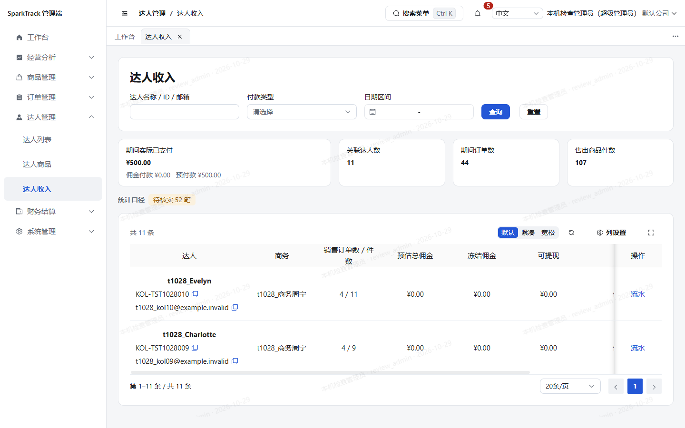
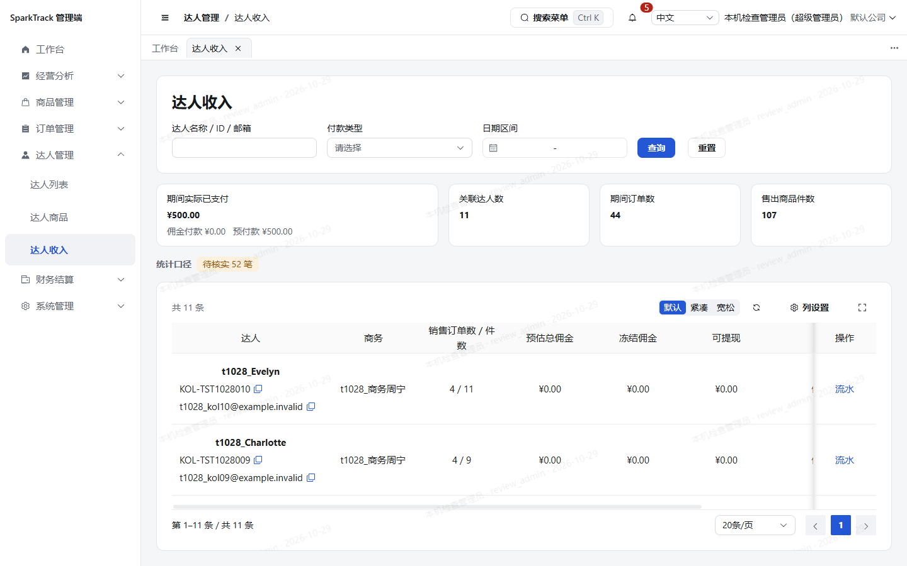

# 分页明细卡片铺满（2026-10-29）执行报告

## 需求与版本

负责人要求：达人收入、达人提现、达人预付的明细卡片占满剩余可用高度，分页固定在底部，明细内部滚动，字号和行高不变；参照订单列表排查其他版块一并调整，并写入规范。

从启动时最新main36c5a05创建独立工作树paged-list-height-1029，合并PR154分支保留刚移除的人工匹配池和订单退款导入入口。本PR依赖154，所有前端调整继续合在同一5190预览，不新增版本入口。过程中main新增任务79后端测试，本任务不改其源码或规范05。

## 排查清单与实施

before使用真实公司超管账号，1440×900可用内容底876px；下列主表均paged=true、plain=false，除订单已有实现外，14个存在按内容或完整行回收高度的问题。数据不足一页或为空也可复现。

| 页面 | admin-ui/src/views/下文件 | table-id | before底部差值px | after1440底部差值px | 实施 |
| --- | --- | --- | --- | --- | --- |
| 达人收入 | `kol/income/index.vue` | `commission-income` | 23 | 0 | 显式启用fill-available-height |
| 达人提现／财务结算任务 | `fund/withdrawal/index.vue` | `commission-withdrawals` | 28 | 0 | 显式启用fill-available-height |
| 达人预付 | `fund/prepay/index.vue` | `prepay-tasks` | 66 | 0 | 显式启用fill-available-height |
| 退款查询 | `order/refund/index.vue` | `order-refunds` | 66 | 0 | 显式启用fill-available-height |
| 结算明细 | `fund/settlement-details/index.vue` | `commission-settlements` | 26 | 0 | 显式启用fill-available-height |
| 达人列表 | `kol/index.vue` | `kol` | 12 | 0 | 显式启用fill-available-height |
| 达人商品 | `product/kol-item/index.vue` | `kol-items` | 65 | 0 | 显式启用fill-available-height |
| 店铺管理 | `product/shop/index.vue` | `shops` | 50 | 0 | 显式启用fill-available-height |
| 复制令牌 | `product/copy-token/index.vue` | `copy-tokens` | 236 | 0 | 显式启用fill-available-height |
| 商品任务 | `product/copy-job/index.vue` | `copy-jobs` | 324 | 0 | 显式启用fill-available-height |
| 账号管理 | `system/user/index.vue` | `users` | 61 | 0 | 显式启用fill-available-height |
| 上传任务 | `system/import-task/index.vue` | `import-tasks` | 178 | 0 | 显式启用fill-available-height |
| 操作日志 | `system/oper-log/index.vue` | `oper-log` | 20 | 0 | 显式启用fill-available-height |
| 收款账户审核 | `fund/payout-account/index.vue` | `payout-accounts` | 270 | 0 | 显式启用fill-available-height |

通知中心卡片已撑满，但原来消息和分页同在整卡滚动区；改为标题／操作、独立滚动消息区、底部分页。保持原有分页显示条件、点击及已读逻辑不变。

组件默认值、字体令牌、文字字号／行高、数据行内边距和分页参数均未修改。复用DataTable既有fill逻辑；最低明细按普通首条或订单首组保底，保留既有160px基线。提现页手机旧自然高度覆盖仅保留给非fill表格。

排除：公司管理、平台配置、跳转模板及结算配置为非分页配置小表；plain详情、弹窗抽屉、关联小表、表单、看板和达人端移动卡片不自动套用。已移除路由的人工匹配池、旧商品列表和推广表来源不恢复或修改。独立任务80的提现类型拆分不在本轮处理。

## 规范与独立复核

规范13新增第3.16节，并修正第3.11、3.13及第6章的高度范围；同步规范10第3节、规范11第3节和目录。新增ADR-036扩展主列表高度决定，已接受ADR-035原样保留。

只读复核已通过：14个新增开关与清单精确匹配，原订单保持；配置表、plain及移除路由未误改；字体、行高、业务及后端／接口／达人端无任务差异；高度链保持现有纵向flex/min-height；通知分区与提现手机覆盖范围符合要求。当前为静态复核结论，实际高度以after证据为准。

## 笔记本视口保底修正

首次after发现1280×800收入页卡片比剩余空间多27.47px：两条普通行均113px，原为订单信息带和首商品设计的两行保底合计226px，导致卡片最低389px高于可用361.53px。它可通过外层滚动到达，但属于普通表不必要的外滚。新增普通长行回归先红：目标文件21项中20过、1失败，期望最低288px实际354px；随后普通列表改为首条保底，订单spanMethod分组仍保前两行。字体、行高、密度、160px基线、plain排除和默认模式不改。目标21项复跑全部通过，lint、typecheck、build再次通过。最终候选6d57777实测收入1280卡底784=可用底，卡高360px／最低323px，明细197px，行高仍113px；外层scrollHeight=clientHeight672，不再产生额外27px外滚。

## 自动检查与浏览器证据

检查代理使用固定pnpm10.33.4、CI=true。frozen安装、lint、类型检查、最终生产构建与许可检查均已通过；NOTICE100880字节逐字节一致，无依赖／锁文件或源声明修改。DataTable先红21项中1失败，修复后21/21通过。最终代码冻结后单worker全量Vitest通过：105个文件、792项、657.88秒；不改pool、隔离、超时或门槛。最终生产构建18.46秒，包清单、锁文件与源NOTICE未变。

浏览器由独立子代理使用真实公司超管账号，只读验收：初轮61条、最终候选缩小复验29条、补拍4条；异常、警告、HTTP失败、业务写入均0。公开8图已人工目检，无密码/token或真实联系方式，全部加载遮罩消失后拍摄，验收浏览器已正常关闭。

- 14主列表1440×900卡底差值全部0；初轮覆盖三重点页中英文1440/1280/2560；最终候选按缩小矩阵复验14页1440及三重点页1280中文，均0，不重复英文全矩阵。正文15px、文字行高24px，全部有真实数据的主表行高与before逐项一致；收入113px、提现81px、预付85px未改变。
- 短／空结果同样铺满，商品任务空列表及收款账户空列表已实测。收入、退款、结算、达人、达人商品、店铺和日志有真实内部滚动，最后一行及分页可达。
- 375／390及1440×420时普通明细保留160px基线；必要的外层纵滚可达，提现手机finance-content滚动至末端实测115／147px，分页和最后一行可达。订单分组仍保首组，手机明细193px、低屏160px，PR154移除的入口未恢复。
- 低屏通知卡底396=可用底，消息区194px、内容328px，内部实际滚动134px，标题32px固定在卡内；375／390无横溢。现有仅7条通知，未达20条分页显示条件，未伪造多页样本；分页条件和卡内位置经源码复核，**未声称真实多页通知翻页已验收**。
- 跳转模板、结算配置及plain权限表保持原高度规则，未误拉；抽屉详情和达人端未改，没有重做全功能或跨浏览器验收。

原始before、首轮after与修复后recheck证据分开保存，本树私有deploy/local-backups/paged-list-height-1029/browser-before及browser-after含测量、脚本和完整报告。没有制造数据、模拟接口、执行审批／支付／同步／保存。

## 公开示例

| 达人收入 before | 最终 after |
| --- | --- |
|  |  |

- [提现before](assets/paged-list-height-1029/withdrawals-1440-zh-before.png)／[最终after](assets/paged-list-height-1029/withdrawals-1440-zh-after.png)
- [预付before](assets/paged-list-height-1029/prepays-1440-zh-before.png)／[最终after](assets/paged-list-height-1029/prepays-1440-zh-after.png)
- [空商品任务](assets/paged-list-height-1029/copy-tasks-empty-1440-zh.png)
- [通知低屏内部滚动](assets/paged-list-height-1029/notifications-1440x420-zh.png)

## 交付与遗留

无新增依赖、权限码、API、后端或数据库变更。只更新现有5190静态产物，保留前一轮改动，保留旧构建以便回退；不重启／删除共享数据库与Redis，不执行全局清理。[PR #156](https://github.com/ksws00684315/t-crm/pull/156)已用ksws00684315提交。开发阶段验证见前节；本次负责人另行明确要求合入main，后续合并审查见下节。

## 后续合并审查（负责人新指令，2026-10-29）

负责人明确要求154及156合入main。154已Squash为 `720bc0a`，156目标分支已切到main并同步该主线。过程中主线已合任务80／PR155（达人提现仅显示佣金提现），本次自动合并保留其 `type=COMMISSION`、状态字典及去除类型列／筛选，同时保留fill开关和手机规则。相对新main仅高度、规范、报告及截图差异，无154重复、锁重复或后端变化。

独立只读复核通过：14主表、订单分组保底、通知及排除项保持，未回退主线业务；`git diff --check`通过。开发阶段105文件792项结果不冒充新基线验证：合并阶段在同步后代码执行frozen安装、lint、类型检查、DataTable／提现财务页／合并页签三文件回归、构建、依赖审计及NOTICE比对，并只读浏览器核对订单入口、三财务卡片及提现佣金类型过滤；最终全量与安全门槛以[PR156实际GitHub检查](https://github.com/ksws00684315/t-crm/pull/156/checks)为准，所有检查成功后执行Squash。相关原始日志与截图存任务私有deploy/local-backups/merge-154-156-1029。

继承154审计修复：仅原有开发工具的两个传递依赖补丁，直接依赖及业务源码不因此改变，四工程NOTICE刷新后均字节不变。没有关闭CI、降低门槛或带红灯合并。最终main及PR合并提交由GitHub记录为准，预览仍统一5190。
