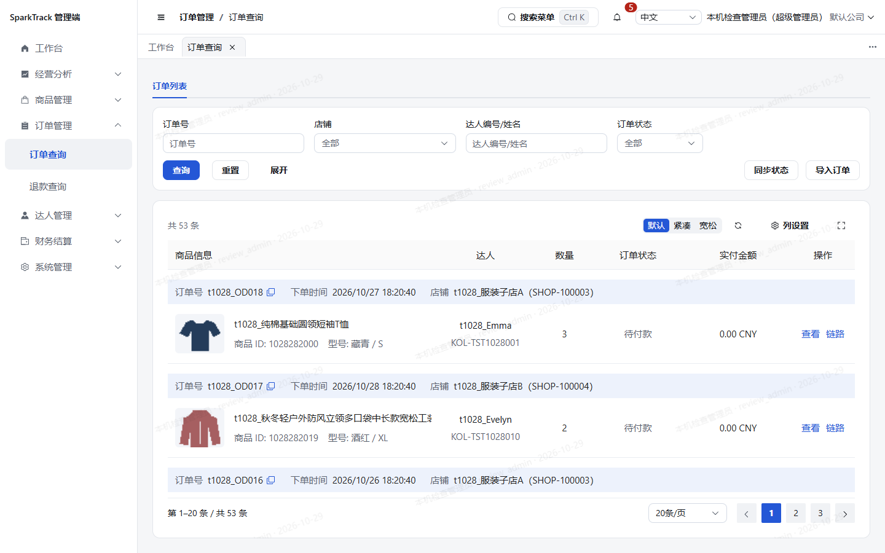

# 订单查询入口精简（2026-10-29）执行报告

## 变更

按负责人原文“订单查询-人工匹配池 删掉；订单列表 导入退款 删掉”，移除人工匹配池页签及订单列表的退款导入按钮、状态和弹窗。保留订单列表页签、同步状态、导入订单、筛选与列表铺满高度，以及退款查询。旧 `/order/unmatched` 地址仍重定向订单列表。

基线为最新 `origin/main 2480b96`，独立工作树 `order-query-cleanup-1029`，分支 `task/order-query-cleanup-1029`。首次代码提交 `ab9ae65`。不修改公共导入类型、权限码、API、后端或数据库；不删除或改写业务数据。

规范13第3.13节记录此次负责人决定，替代此前双页签/退款导入入口的要求；既有合并页签用例更新为仅订单列表。

## 独立只读复核

| 需求原文／边界 | 实现位置 | 是否满足 | 差异或说明 |
| --- | --- | --- | --- |
| 删除人工匹配池 | `order/order-query/index.vue` | 满足 | 移除组件引用与页签，只保留订单列表 |
| 删除订单列表导入退款 | `order/index.vue` | 满足 | 移除按钮、开关状态、REFUND_IMPORT绑定和弹窗 |
| 同步状态、导入订单、筛选和铺满布局保留 | `order/index.vue` | 满足 | 相关模板及fillAvailableHeight未变 |
| 退款查询及旧匹配池地址 | `router/routes.ts` | 满足 | 路由未改，旧地址继续重定向订单列表 |
| 公共类型、权限、API和后端保持 | PR差异 | 满足 | 公共REFUND_IMPORT仍供其他现有入口使用，无后端变更 |
| 规范及既有测试同步 | 规范13、`merged-pages.spec.ts` | 满足 | 新增负责人要求，单页签断言已更新 |

复核由只读子代理执行，未发现阻断项，未修改源码。

## 自动检查

检查代理使用固定pnpm10.33.4、CI=true；`install --frozen-lockfile`、lint及typecheck已通过。`pnpm exec vitest run --maxWorkers=2` 全量105文件、792项通过，耗时884.56秒，未降低测试超时、跳过用例或修改门槛。环境创建105次耗761.97秒，是主要时间成本；既有jsdom Canvas提示未导致测试失败。`pnpm build`（含vue-tsc）退出0，Vite构建34.98秒；Windows等价许可生成后与源声明逐字节比对，100880字节一致、退出0。package.json、锁文件及源NOTICE均无差异，未自动修复。原始日志位于本工作树私有 `deploy/local-backups/order-query-cleanup-1029/checks/`。

资源说明：曾尝试并行构建以减少等待，但确认16GB内存只余1.6GB、CPU负载85%后，仅停止该新构建尝试并保持测试继续；测试完成后重新完整构建成功，不把中止尝试记为通过。

## 浏览器验证与预览

按仓库browser-acceptance skill，由浏览器子代理执行。沿用现有5190入口、当前后台和数据库；不新增预览版本或端口，达人端不改。仅打开导入订单和同步状态弹窗，不提交或触发同步。部署后共9条场景记录通过：中英文1440/1280/2560和390抽查中，只剩订单列表页签，导入退款入口数量为0；订单接口200/code0、总53条、每页20条；表格15px，桌面卡底876/784/1176px分别等于可用底。同步状态及导入订单弹窗可打开后取消，未触发提交；退款查询200/code0、总10条；旧匹配池地址重定向正确。0页面异常、0警告、0HTTP失败、0业务写入或拦阻；所有截图加载遮罩数量为0。实际公司超管账号验收，未伪造角色或业务数据；达人端未修改，未重测。

## 遗留与交付

无新增依赖、数据库或接口变更。公共后台退款导入及匹配能力仍保留；此次是前端入口精简。

[PR #154](https://github.com/ksws00684315/t-crm/pull/154)，由ksws00684315账号提交；全部检查完成后转为可审核，待负责人审查合并。

## 公开截图

截图使用已有t1028测试订单，未包含凭据或个人联系方式；全部在数据稳定且加载遮罩消失后拍摄。

- [1280英文](assets/order-query-cleanup-1029/orders-1280-en-US.png)
- [2560中文](assets/order-query-cleanup-1029/orders-2560-zh-CN.png)
- [390中文](assets/order-query-cleanup-1029/orders-390-zh-CN.png)
- [导入订单弹窗保留](assets/order-query-cleanup-1029/import-orders-open-1440-zh.png)

## 收尾

管理端产物已原位发布至5190当前Docker nginx静态目录，文件哈希逐一一致；仅更新静态文件，未重启或修改nginx、后台、Redis、Postgres及达人端。旧管理端构建备份在本树私有deploy/local-backups/order-query-cleanup-1029/previous-admin，无任务容器或中间件需要删除，未使用全局清理命令。没有新增M0或外部接口验证事项；业务源码检查后未再变更。

## 后续合并审查（负责人新指令，2026-10-29）

负责人明确要求将PR154和156合入main，替代本任务开发阶段“不合并”的限制。PR154已在最终head `c98a310` 的Admin UI、KOL Portal、漏洞与许可证CI三项全部成功后，通过Squash合并为 `720bc0a`。

合并前发现此前实际GitHub CI仅依赖审计失败。两端原有开发工具传递依赖锁从zod4.6.5更新到4.6.7、ip-address10.7.3更新到10.7.5，均为既有范围内的稳定补丁；没有新增直接依赖、overrides或业务源码变更。依据官方公告[Zod修复范围](https://github.com/advisories/GHSA-mrhx-c7xc-m3w5)、[ip-address修复范围](https://github.com/advisories/GHSA-rxp7-6hxx-x8q5)。

两端frozen安装、许可声明刷新、moderate级依赖审计均退出0、无已知漏洞；按refresh-notices.sh的四工程步骤在Windows等价执行，Java部分使用Docker的Maven21/Python，四份源NOTICE均字节一致。独立只读复核确认补丁仅两份锁各8行替换，最终CI全绿，无审查阻断。没有降低扫描规则或跳过失败。
