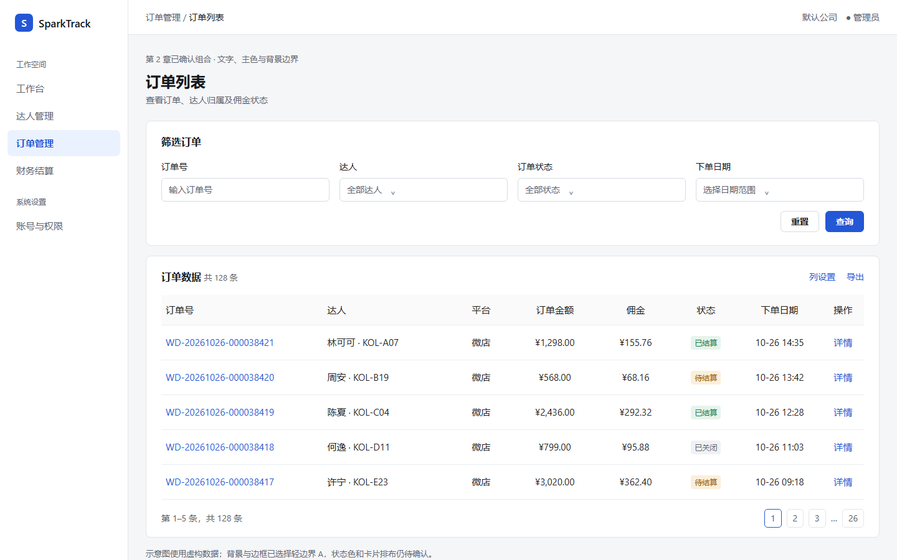
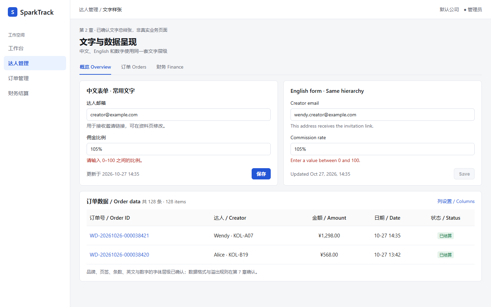
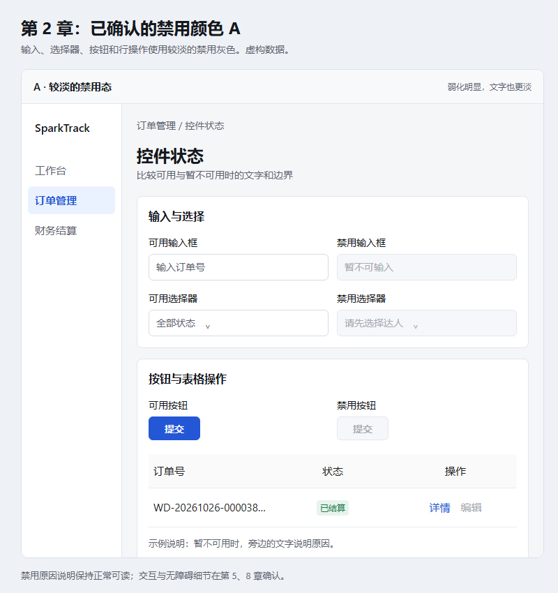
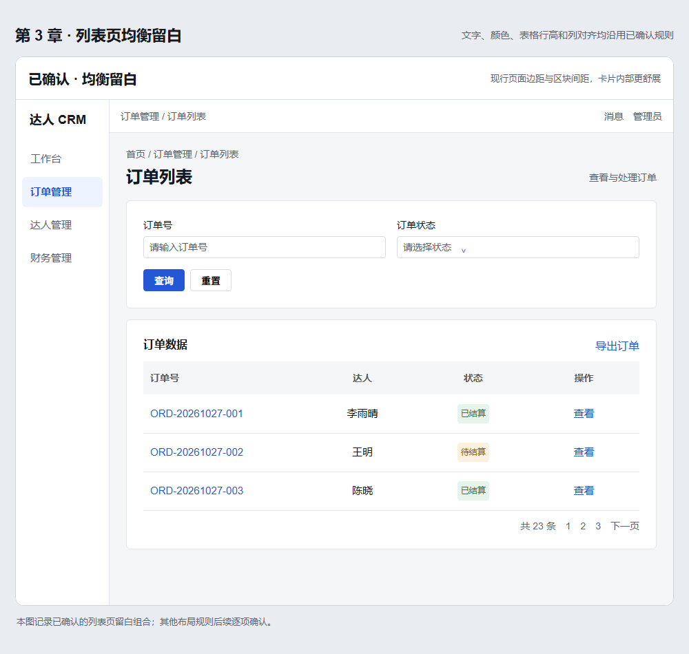
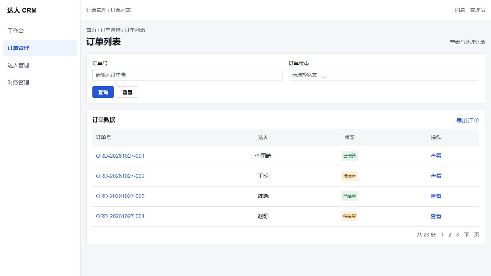
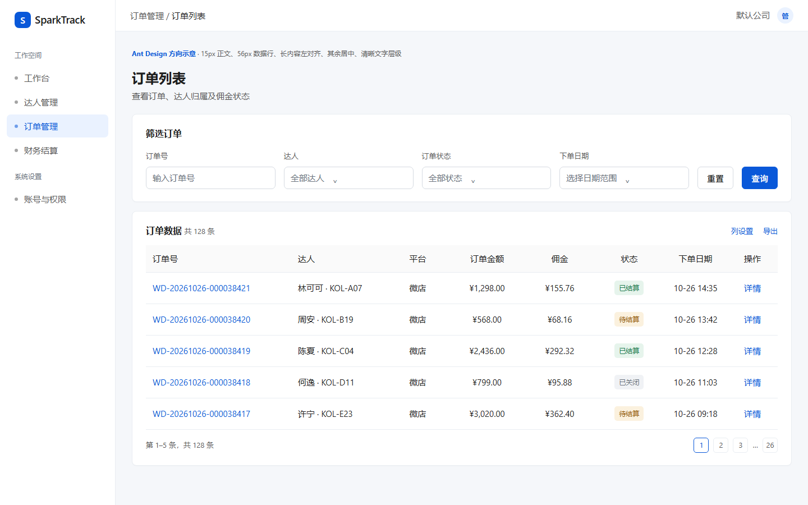

# 13 前端视觉与交互规范（曼曼版）

> 状态：结构草案。第 2 章文字与颜色、附录 A 表格方案 A，以及第 3 章桌面列表页的均衡留白方向已于 2026-10-27 确认；笔记本适配的具体阈值与其他事项仍待逐项确认。**第 13 份文件定稿后，再以它为依据实施前端视觉调整。**

本规范面向 `admin-ui` 管理端与 `kol-portal` 达人端。八个主章节是全站视觉与交互规则的待完善框架；未标为“已确认”的条目不是实施指令。已确认的文字与颜色规则见第 2 章、桌面列表页留白组合见第 3 章、表格规则见附录 A（ADR-034）；其他事项待逐项确认。组件结构、接口、权限和代码写法遵循规范 11，需求与验收流程遵循规范 12。本文件仍是草案，已确认的视觉规则也要等整份文件定稿后统一落地。

| 章节 | 当前状态 | 下一步要确认的重点 |
| --- | --- | --- |
| 1. 适用范围与版本优先级 | 已补齐 | 按第 1.4 节的条件完成整份文件定稿 |
| 2. 文字与颜色 | 已确认（2026-10-27） | 整份文件定稿后连同其他章节统一实施与验收 |
| 3. 页面布局 | 列表页留白方向已确认，其余待确认 | 笔记本阈值、页头、侧栏、详情、表单、看板及弹层的布局 |
| 4. 组件外观 | 表格已确认 | 常用控件的尺寸、外观和组合方式 |
| 5. 交互状态 | 表格部分确认 | 悬停、聚焦、禁用、加载、空态、错误等状态 |
| 6. 响应式 | 仅有现行原则 | 桌面、窄屏和手机的具体排布 |
| 7. 内容与国际化 | 表格长值部分确认 | 中英文长度、格式、文案和溢出规则 |
| 8. 无障碍与验收 | 表格部分确认 | 可访问性、基准截图和逐页验收 |

## 1. 适用范围与版本优先级

### 1.1 适用页面

本规范覆盖管理端与达人端的登录、首页／看板、列表、详情、表单，以及弹窗、抽屉和两端复用的前端组件；每类页面都要考虑中文与英文、常规桌面、窄屏和手机。两端业务结构可不同，但相同组件和文字角色应使用同一视觉语言。桌面表格方案 A 的适用边界见附录 A；手机端的具体排布由第 6 章逐项确认。

本规范只决定界面的视觉与交互呈现。业务范围、字段、权限、接口和账务行为仍以需求与相应工程规范为准，不因视觉示意图而改变。

### 1.2 规则优先级

1. **已确认的规范 13 内容**：页面文字、主色、背景边界、状态色及禁用色见第 2 章，桌面列表页留白组合见第 3 章，表格方案 A 见附录 A；未来逐章确认的规则也将明确标注确认时间和适用范围。相同视觉事项与规范 10 不一致时，以已确认的规范 13 规则作为定稿后的实施依据。
2. **规范 13 的待确认内容**：仅记录需讨论的项目，不构成页面修改指令；定稿前，相关位置继续沿用规范 10 的现行视觉规则。
3. **工程与验收**：组件结构、代码、权限、接口和国际化实现仍遵循规范 11；需求依据及验收流程遵循规范 12。视觉图只展示效果，不能替代字段、功能与权限要求。

### 1.3 例外与变更记录

业务页面确需偏离已确认规则时，在对应任务或 PR 中写明页面、组件、原因和影响范围，由负责人确认后更新本规范或登记架构决策；不能只在页面 CSS 中留下例外。每次新增已确认的视觉规则，记录确认日期、适用范围和可查看的示例，并同步检查管理端与达人端。

### 1.4 定稿与实施

八章分别补齐并确认后，本文件才标为“定稿”。定稿检查包括：已确认规则不互相矛盾；关键页面和组件有可查看的视觉示例；管理端与达人端、中英文、桌面与手机的适用边界清楚；尚未实现的页面有明确标记；相关的规范 10～12 与 ADR 引用同步。负责人确认定稿后，再安排独立的前端落地与浏览器验收任务；草案阶段不依据待确认章节批量修改页面。

## 2. 文字与颜色

**已确认（2026-10-27）**：本章文字角色、主色、背景边界、状态色及禁用色适用于管理端和达人端的对应位置。示意图使用虚构数据，展示已确认的文字与颜色；卡片排布仍是示意，不表示已确认。

| 位置 | 字号／行高 | 字重 | 颜色与角色 |
| --- | --- | --- | --- |
| 系统名称 | 20／28px | 600 | 主要文字 `#15181d`；两端品牌标识使用同一层级 |
| 页面主标题 | 24／32px | 600 | 主要文字 `#15181d`；每页最多一个 |
| 区块标题 | 16／24px | 600 | 主要文字 `#15181d`，保持现行层级 |
| 左侧菜单 | 15／24px | 常态 400，选中 600 | 常态次要文字 `#5c6470`；选中项 `#2457d6` |
| 页签 | 14／22px | 常态 400，选中 600 | 常态次要文字 `#5c6470`；选中项 `#2457d6` |
| 筛选项与表单标签 | 14／22px | 400 | 深色主要文字 `#15181d`，包括“订单号”“订单状态”；不使用占位文字的灰色 |
| 输入、选择器及下拉值 | 14／22px | 400 | 输入值沿用主要文字；占位提示沿用现行次要文字 `#5c6470` |
| 面包屑、标题下说明 | 14／22px | 常态 400，当前位置可用 500 | 层级与次要说明用 `#5c6470`；当前位置用主要文字 `#15181d` |
| 普通正文 | 14／22px | 400 | 主要文字 `#15181d` |
| 按钮文字 | 14／22px | 600 | 主按钮白字配 `#2457d6`；次按钮沿用现行深色文字与边框 |
| 输入框下的帮助说明／校验提示 | 14／22px | 400 | 帮助说明用次要文字 `#5c6470`；错误提示用危险色 `#b42318`，文案明确说明问题 |
| 条数、分页、普通工具栏 | 14／22px | 400 | 非表格次要文字 `#5c6470`；表格内的次要文字 `#595959`；可点击项用 `#2457d6` |

全站可点击文字、主按钮和选中菜单统一使用现行主色 `#2457d6`，包括普通链接、表格订单号、行操作与表格工具栏链接。悬停、聚焦及禁用状态的交互反馈留待第 5 章确认；不能只以颜色表示交互状态。表格字体、行高、列对齐和表格内主要／次要文字角色继续按附录 A 执行；本章统一的是可点击文字的蓝色。

**已确认（2026-10-27，中英文及数字字体）**：中英文沿用两端相同的 `--tcrm-font-sans` 系统无衬线字体栈和上表的角色层级；英文不单设更小字号，中文、英文和数字也不因语言切换而改变字重。ID、邮箱、日期与所在位置的普通文字使用同一字体，不使用等宽字体；金额等需要纵向比较的数字使用 `font-variant-numeric: tabular-nums`，货币符号与数值保持一组。数据的日期、币种格式和长内容省略在第 7 章确认，组件专属尺寸与交互状态在第 4、5 章确认。

**已确认（2026-10-27，辅助说明与校验提示选择 B）**：输入框下方的帮助说明和错误提示采用上表较清楚的文字层级。字段标签、输入值和按钮仍按已确认的 14／22px 规则；错误提示使用文字说明原因，具体校验时机和布局由第 4、5 章确认。

**已确认（2026-10-27，背景与边界选择 A）**：页面底色采用现行的浅灰 `#f5f6f8`，侧栏与卡片使用白色 `#ffffff`。卡片及区域分隔线使用轻边框 `#e2e5ea`；普通输入框和选择器使用稍清楚的细边框 `#d5dbe5`。卡片常态不加阴影，通过底色和边框区分层次。两端相同界面位置保持一致；表格的表头、行底色与水平分隔线仍执行附录 A.1。这里确认的是颜色和边界强度，卡片间距、圆角与排布留待第 3、4 章。

**已确认（2026-10-27，状态色选择 A）**：状态文字配柔和浅底色，沿用两端现行的语义色。具体状态归类由业务含义决定，颜色不能代替可见的状态文案。

| 状态含义 | 文字色 | 浅底色 | 示意文案 |
| --- | --- | --- | --- |
| 成功／完成 | `#1e7a4c` | `#e6f4ec` | 已结算 |
| 等待／处理中 | `#94570a` | `#fbf1de` | 待结算 |
| 失败／拒绝／异常 | `#b42318` | `#fdecea` | 已驳回、已退款 |
| 中性／关闭／信息 | `#5c6470` | `#f0f2f5` | 已关闭 |

状态标签的字号、内边距、圆角及其悬停等交互细节留待第 4、5 章；本轮只确认语义颜色及浅底色。

**已确认（2026-10-27，禁用色选择 A）**：禁用输入、选择器、按钮和行操作使用较淡的灰色：文字 `#a8abb2`，控件底色 `#f5f7fa`，控件边框 `#e4e7ed`；禁用行操作仅改变文字色，不添加底色。表单标签及说明禁用原因的文字继续使用正常文字颜色，不随控件一起变淡。这里确认颜色，不改变业务上的可用条件；禁用后的点击、提示及键盘行为在第 5、8 章确认。

**本章已确认**：未单列的文字按最接近的已确认角色使用同一字体、字重与颜色；新组件若需要新增文字角色，应在第 4 章记录。数据格式与溢出规则在第 7 章确认，对比度与真实页面验收在第 8 章确认。第 13 份文件仍须等其余章节补齐后统一定稿和实施。

## 3. 页面布局

### 3.1 桌面列表页留白

**已确认（2026-10-27，A 与 B 之间的均衡留白方向）**：管理端与达人端桌面常规列表，空间充足时内容区外边距与筛选卡、列表卡内边距均为 24px；两卡间距仍为 16px。笔记本等可用空间较少的视口收紧留白，保持字号与表格行高不变。仅这一类卡片采用此方向；详情、表单、看板及弹层卡片仍待各自确认。数值使用规范 10 已有的间距档位，不新增令牌。

**待第 6 章结合真实页面确认的试排阈值**：根据浏览器实际可用的 CSS 视口尺寸，而非电脑标称分辨率，宽度不小于 1440px **且**高度不小于 900px 时用 24px 的内容区外边距与列表卡内边距。宽度 1280～1439px 时内容区外边距收为 16px；宽度不小于 1440px 但高度小于 900px 时，内容区外边距仍为 24px。任一方向空间紧张时，筛选卡与列表卡内边距回到 16px，两卡间距保持 16px。宽度 768～1279px 的外边距继续使用规范 10 的 16px，小于 768px 使用 12px。第 6 章以中英文真实页面、笔记本和大屏视口检验，再决定这些阈值与窄屏排布。

可用空间不足时，优先减少外边距、卡片内边距、分栏数量与非必要空白；表格列不够宽时在表格容器内横向滚动。**不得通过缩小第 2 章文字字号、附录 A 表格字号或表格行高，以及页面整体缩放来塞入内容。**笔记本及浏览器缩放后的视口应按同一规则处理。

示意图使用虚构订单，展示空间充足时的内容区外边距、列表卡内边距及两卡间距组合；它不是笔记本尺寸截图。字段、筛选数量、页头、侧栏、面包屑、卡片圆角、卡内控件间距和分页排布尚未由本图确认。文字与颜色按第 2 章，表格行高、列对齐和行底色按附录 A。规范 13 整份定稿前，现有页面继续按规范 10 的 16px 默认卡片内边距实施。

笔记本示意用 1366×768 CSS 视口渲染。负责人已确认这种“收紧留白、保持文字大小”的呈现方向：图中列表卡与内容区外边距均为 16px，文字与表格行高不随视口缩小。具体切换阈值仍待第 6 章结合真实页面确认；图中数据量只用于展示版式，不表示分页、滚动与固定区域的最终行为。

### 3.2 其余布局待确认

页头与侧栏、面包屑、筛选区与工具栏排布、页签、详情区、表单、看板、弹窗与抽屉的排布和间距，以及内容少、内容多和超宽屏时的处理，仍需逐项确认。每类页面至少留一张可对照的标准示例。未确认事项沿用规范 10；表格自身的留白与行底色见附录 A.1。

## 4. 组件外观

**已确认**：桌面表格、表头、状态标签及行操作的已选方向见附录 A；工程契约见附录 A.4。

**待补齐**：按钮、输入框、选择器、日期控件、页签、分页、标签、提示、弹窗、抽屉、上传、空态和图表容器的外观；同一组件在管理端与达人端的共用规则。每个组件需包含常态、状态变化和长内容示例。

## 5. 交互状态

**已确认**：表格操作全部直接显示；长内容可查看全文；已确认的表格悬停和聚焦原则见附录 A。

**待补齐**：可点击、悬停、选中、键盘聚焦、禁用、加载、成功、失败、无数据、无权限和确认操作的视觉反馈；排序、筛选、批量选择与分页的状态。区分“没有数据”和“加载失败”，避免只有颜色不同而没有文字说明。

## 6. 响应式

**已确认**：桌面表格遵循附录 A；达人端手机宽度沿用现有卡片布局，不强行套用桌面列居中规则。

**待补齐**：桌面、窄屏、手机的页面和组件排布、换行与横向滚动、弹层尺寸、触控目标和长内容展示；明确管理端与达人端的差异。结合规范 10 已有验收视口，按真实页面逐项确认。

## 7. 内容与国际化

**已确认**：表格长值、金额与空值的展示见附录 A.2；界面文案和数据格式的工程要求仍执行规范 11。

**待补齐**：中英文文案长度、日期时间和币种的呈现、数字精度、名称加编码、过长文字的省略／换行与完整提示、错误说明及按钮措辞；明确各类信息的最小展示内容。

## 8. 无障碍与验收

**已确认**：表格专项测试与真实浏览器验收见附录 A.5；通用需求验收流程见规范 12。

**待补齐**：文字和控件对比度、键盘顺序与可见焦点、图标文字说明、缩放与窄屏可读性；标准页面截图、状态清单、两端及中英文验收矩阵。每项确认的视觉规则都要对应一处可复核的页面或组件示例。

## 附录 A：已确认的表格方案 A（ADR-034）

适用于两端桌面常规列表、看板中的 `DataTable`、弹窗与抽屉中的 `plain` 表格。以下规则已确认；示意图使用虚构数据，主要展示表格方案 A。图中的非表格标题、标签和链接以第 2 章的已确认组合图为准；筛选区排布与卡片外观尚未确认。

### A.1 字体、留白与行底色

| 位置 | 字号／行高 | 字重 | 尺寸与背景 |
| --- | --- | --- | --- |
| 表头 | 15／24px | 500 | 约 48px 高，浅灰背景 `#fafafa` |
| 数据与行操作 | 15／24px | 400 | 默认行约 56px，高度可随多行内容增加 |
| 条数、分页与表格工具栏 | 14／22px | 400 | 与普通数据形成清楚的层级 |

- 紧凑、默认、宽松密度的单元格纵向内边距分别为 8、16、20px；密度只改变留白，不缩小文字。实际行高以浏览器渲染为准，默认行在 100% 缩放下应接近 56px。
- 数据行使用白色背景和浅色水平分隔线（参考 `#e9edf2`），不使用隔行底色或密集竖向边框。悬停背景应可辨认，不遮住状态标签、链接或焦点提示。
- 行内操作保持同一行；按钮组间距 8px，链接按钮盒子与表格文字行高一致。列宽不够时先调整列宽并允许表格容器横向滚动，不通过缩小字号解决。

### A.2 列对齐

**长内容左对齐，其余信息居中。**按整列的内容特点选择方向，同一列不因某一行较短、为空或显示「-」而改变对齐。

| 列内容 | 对齐 | 示例 |
| --- | --- | --- |
| 需要从开头阅读的长内容 | 左对齐 | 订单号、退款单号、达人／店铺／商品名称、各类 ID、邮箱、账号、链接、标题、地址、备注 |
| 便于逐列扫视的短信息 | 居中 | 金额、佣金、比例、数量、日期时间、平台、渠道、状态标签、布尔值、序号、操作 |
| 选择框 | 居中 | 表头全选框、数据行选择框 |

- 表头与数据单元格同向对齐，排序和筛选标记不得使文字看起来偏向另一边；不能出现表头居中而内容左对齐的列。
- 自定义插槽里的 `CopyText`、状态标签、金额文本和 `RowActions` 的**实际可见内容**跟随列方向。操作列的多个按钮作为一组居中，仍按 ADR-029 全部直接显示。
- 订单号等长内容从左侧开始显示，空间不足时末尾省略，并提供可访问的完整内容提示。金额把货币符号、正负号和数值作为整体居中，保留 `font-variant-numeric: tabular-nums`，不使用等宽字体；`amount` 标记不代表右对齐。
- 未列出的字段按“需连续阅读的长文本左对齐，短信息居中”归类，并在列定义中明确。手机宽度改为卡片布局时采用卡片的标签和值排布，不强行套用桌面表格的列居中规则。

### A.3 表格文字颜色

| 位置 | 参考色 | 使用要求 |
| --- | --- | --- |
| 表头、普通数据 | `#1f1f1f` | 表头靠字重与背景区分；关键数据保持清楚 |
| 条数、分页、次要说明 | `#595959` | 弱于普通数据，仍可读 |
| 可点击订单号与行操作 | `#2457d6` | 与第 2 章全站主色一致；悬停、键盘聚焦时有可见反馈 |
| 表格占位或不适用的数据值 | `#6b737d` | 不用于金额、状态等关键数据；禁用行操作按第 2 章的禁用文字色 |

状态标签使用第 2 章已确认的成功、警告、危险和中性语义色。颜色通过两端一致的 `tokens.css` 语义变量实现，不在单个页面写固定色值；正常大小的关键文字与背景保持可读对比度。非表格文字与主色见第 2 章，组件状态的视觉反馈按第 5 章后续确认。

### A.4 工程实现契约

- 两端 `DataTable` 的 `DataColumn` 提供 `align?: "left" | "center"`，未设置时默认居中；长内容列显式设 `align: "left"`。同一个值控制单元格与表头；页面不得用相反的 `header-align` 或局部 CSS 覆盖。
- `amount` 仅负责数字排版等金额展示，不隐式设置对齐；已有 `.tcrm-amount` 等样式不能把金额列改回右对齐。长内容列同时启用 `tooltip`，省略时仍可查看全文。
- `CopyText`、`RowActions` 与页面自定义插槽对齐的是其实际内容，不只设置外层单元格的 `text-align`。空值占位沿用本列方向；选择列的表头与复选框居中。
- 表格字号、行高、表头高度、背景色和文字颜色使用独立的表格语义变量，不通过全站正文变量放大菜单、表单等尚未确认的位置。管理端与达人端的视觉令牌保持一致。
- 看板中的列表、弹窗／抽屉中的 `plain` 表格执行同一规则；非表格形式的消息列表不套用表格列对齐。

### A.5 验收

- 在两端真实浏览器中，以同一组数据核对：长内容左对齐，金额等短内容居中，表头与内容同向，自定义插槽和操作组跟随列方向，空值与选择列稳定。
- 核对默认密度约 48px 表头、约 56px 数据行、15／24px 表格文字、浅灰表头、白色数据行与水平分隔线；切换紧凑／宽松密度时字号不变。
- 覆盖中英文、长值省略与完整提示、金额正负号及货币符号、状态标签、横向滚动、固定列、看板列表、弹窗表格和达人端手机卡片。
- 组件测试覆盖 `DataColumn` 默认居中、长内容左对齐、金额居中且数字宽度稳定、表头同向、自定义插槽、选择列与操作组；两端令牌契约测试保持一致。示意图仅供视觉比较，最终以本文规则和浏览器实测为准。
