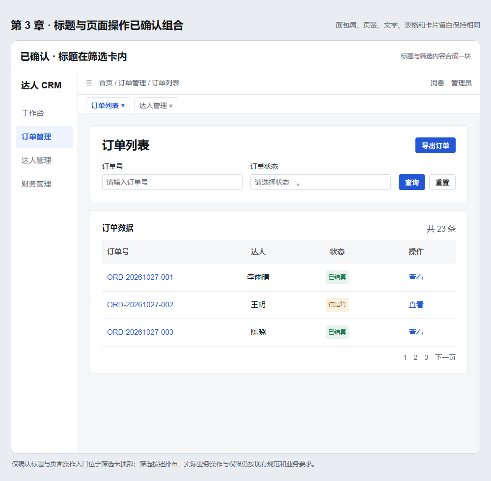
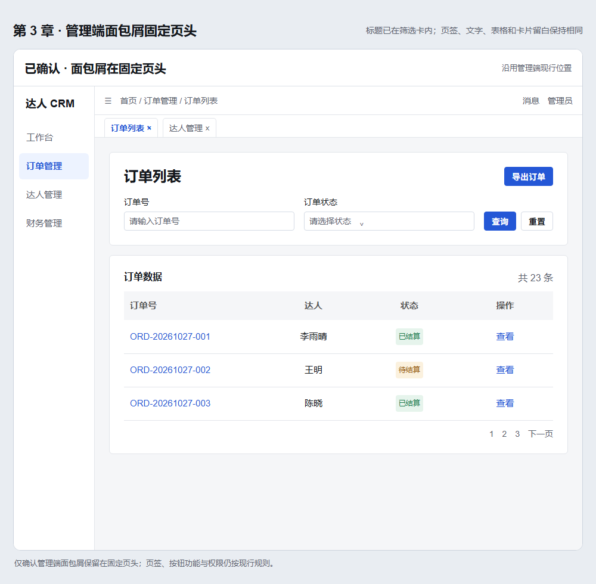
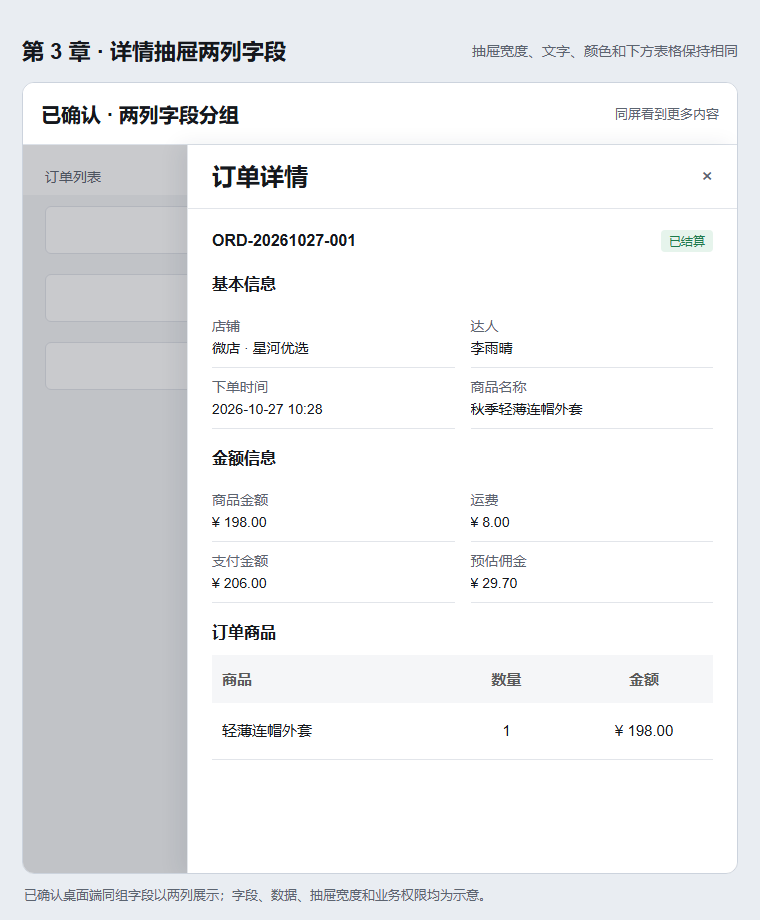
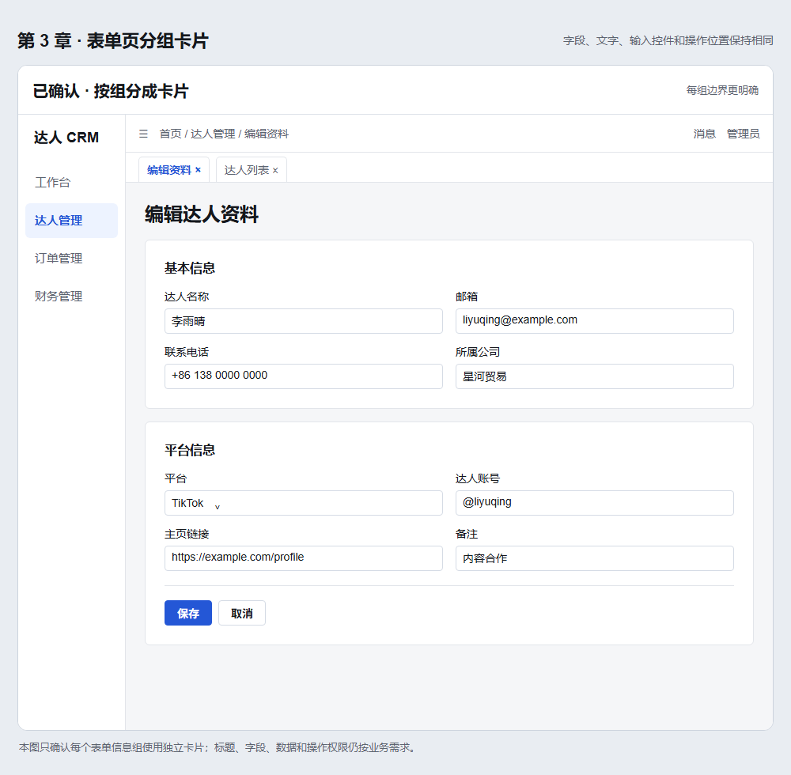
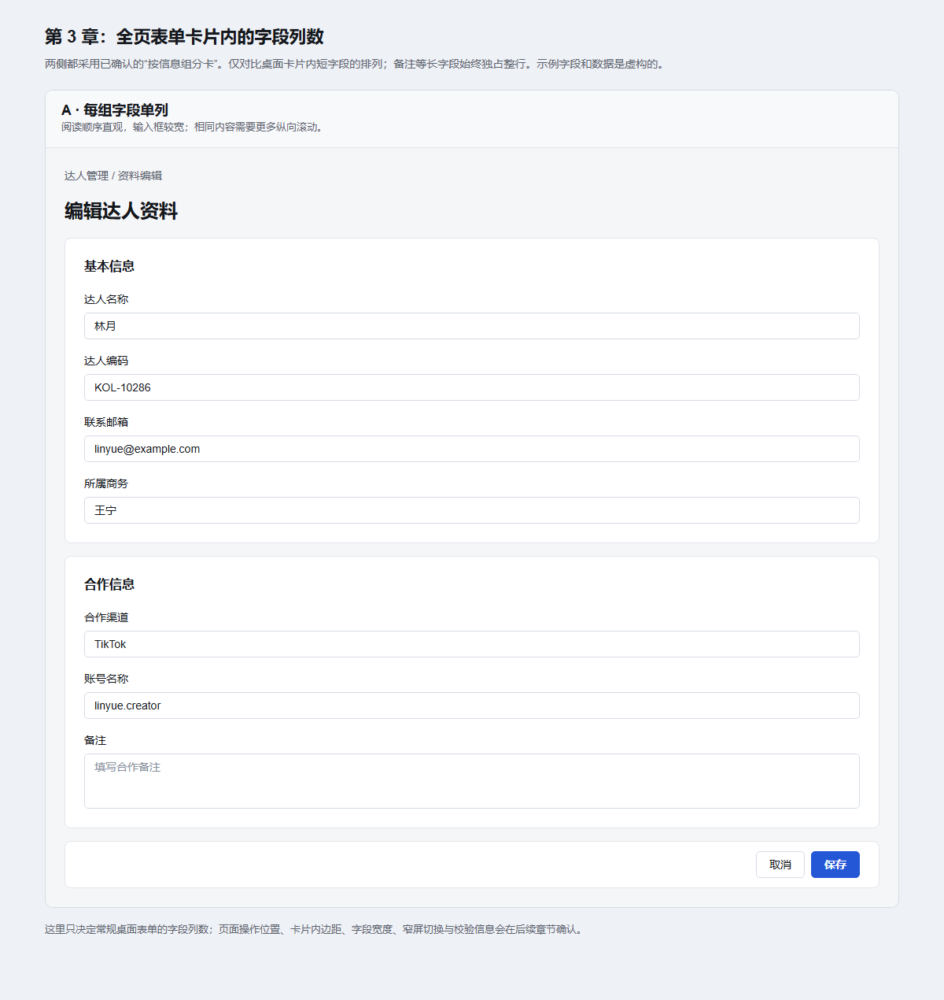
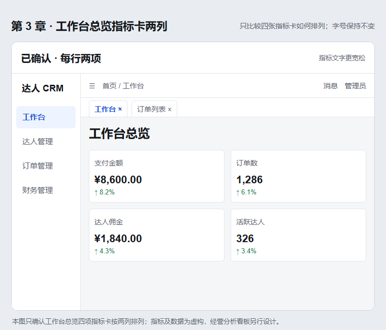
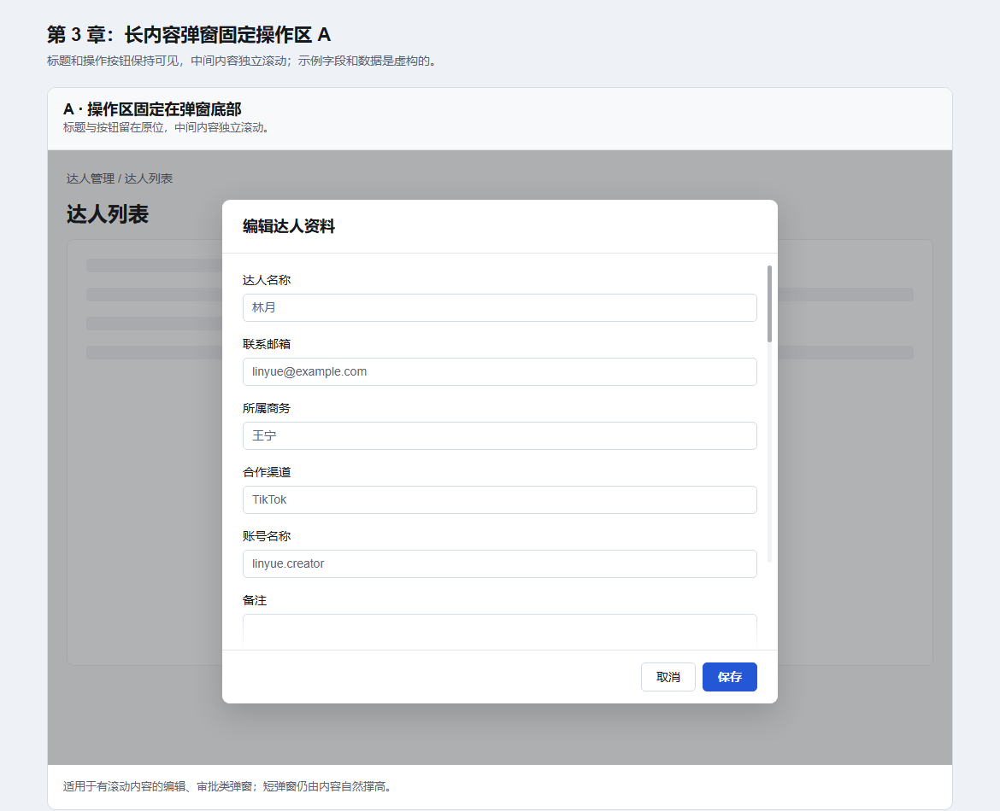
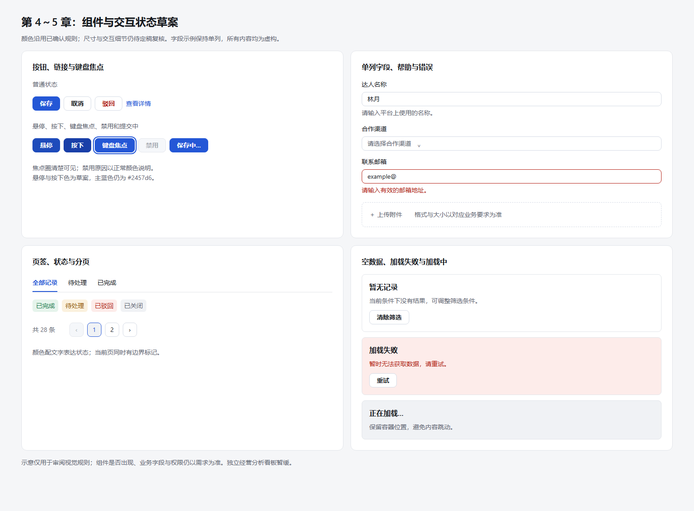
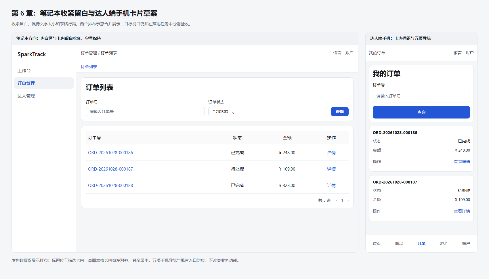

# 13 前端视觉与交互规范（曼曼版）

> 状态：**非看板部分已定稿（2026-10-28）**；第 2 章、附录 A 和第 3.1～3.8 节已选布局此前确认，负责人已确认第 3.9～3.11 节及第 4～8 章。本规范作为前端视觉与交互实施依据。独立经营分析看板布局按第 3.12 节暂缓。

本规范面向 `admin-ui` 管理端与 `kol-portal` 达人端。除第 3.12 节暂缓的独立经营分析看板布局外，八章及附录 A 均为已确认的实施依据。组件结构、接口、权限和代码写法遵循规范 11，需求与验收流程遵循规范 12。现有页面差异由独立前端任务逐项落地，并以真实浏览器验收。

| 章节 | 当前状态 | 下一步要确认的重点 |
| --- | --- | --- |
| 1. 适用范围与版本优先级 | 已定稿 | 实施与验收按第 1.4 节执行 |
| 2. 文字与颜色 | 已确认（2026-10-27） | 按第 2 章实施，保留输入边框已知例外 |
| 3. 页面布局 | 非看板部分已定稿（2026-10-28） | 第 3.12 节独立经营分析看板布局暂缓 |
| 4. 组件外观 | 已定稿（2026-10-28） | 按附录 A 和第 4 章实施与验收 |
| 5. 交互状态 | 已定稿（2026-10-28） | 对照第 5 章验收交互反馈 |
| 6. 响应式 | 已定稿（2026-10-28） | 落地时以真实浏览器验证阈值 |
| 7. 内容与国际化 | 已定稿（2026-10-28） | 验收中英文、数据格式与溢出 |
| 8. 无障碍与验收 | 已定稿（2026-10-28） | 验收键盘、对比度与浏览器矩阵 |

## 1. 适用范围与版本优先级

### 1.1 适用页面

本规范覆盖管理端与达人端的登录、首页／看板、列表、详情、表单，以及弹窗、抽屉和两端复用的前端组件；每类页面都要考虑中文与英文、常规桌面、窄屏和手机。两端业务结构可不同，但相同组件和文字角色应使用同一视觉语言。桌面表格方案 A 的适用边界见附录 A；手机端的具体排布执行第 6 章。

本规范只决定界面的视觉与交互呈现。业务范围、字段、权限、接口和账务行为仍以需求与相应工程规范为准，不因视觉示意图而改变。

### 1.2 规则优先级

1. **视觉与交互**：非看板部分以已定稿的规范 13 为依据；与规范 10 同一事项不一致时，以规范 13 为准。第 3.12 节独立经营分析看板布局暂缓。
2. **现有代码差异**：旧页面与本规范存在差异时，在独立前端任务中实施并验收；不能把文档定稿误认为已有代码已完成。
3. **工程与验收**：组件结构、代码、权限、接口和国际化实现仍遵循规范 11；需求依据及验收流程遵循规范 12。视觉图只展示效果，不能替代字段、功能与权限要求。

### 1.3 例外与变更记录

业务页面确需偏离已确认规则时，在对应任务或 PR 中写明页面、组件、原因和影响范围，由负责人确认后更新本规范或登记架构决策；不能只在页面 CSS 中留下例外。每次新增已确认的视觉规则，记录确认日期、适用范围和可查看的示例，并同步检查管理端与达人端。

### 1.4 定稿与实施

负责人已确认非看板范围，规范 13 作为该范围的实施依据。落地任务应逐项核对条款、相关规范与 ADR，覆盖管理端和达人端、中英文、桌面与手机，并在真实浏览器验收。独立经营分析看板布局继续暂缓，待另行确认后补充。

## 2. 文字与颜色

**已确认（2026-10-27）**：本章文字角色、主色、背景边界、状态色及禁用色适用于管理端和达人端的对应位置。示意图使用虚构数据，展示已确认的文字与颜色；卡片排布仍是示意，不表示已确认。

| 位置 | 字号／行高 | 字重 | 颜色与角色 |
| --- | --- | --- | --- |
| 系统名称 | 20／28px | 600 | 主要文字 `#15181d`；两端品牌标识使用同一层级 |
| 页面主标题 | 24／32px | 600 | 主要文字 `#15181d`；每页最多一个 |
| 区块标题 | 16／24px | 600 | 主要文字 `#15181d`，保持现行层级 |
| 左侧菜单 | 15／24px | 常态 400，选中 600 | 常态次要文字 `#5c6470`；选中项 `#2457d6` |
| 页签 | 14／22px | 常态 400，选中 600 | 常态次要文字 `#5c6470`；选中项 `#2457d6` |
| 筛选项与表单标签 | 14／22px | 400 | 深色主要文字 `#15181d`，包括“订单号”“订单状态”；不使用占位文字的灰色 |
| 输入、选择器及下拉值 | 14／22px | 400 | 输入值沿用主要文字；占位提示沿用现行次要文字 `#5c6470` |
| 面包屑、标题下说明 | 14／22px | 常态 400，当前位置可用 500 | 层级与次要说明用 `#5c6470`；当前位置用主要文字 `#15181d` |
| 普通正文 | 14／22px | 400 | 主要文字 `#15181d` |
| 按钮文字 | 14／22px | 600 | 主按钮白字配 `#2457d6`；次按钮沿用现行深色文字与边框 |
| 输入框下的帮助说明／校验提示 | 14／22px | 400 | 帮助说明用次要文字 `#5c6470`；错误提示用危险色 `#b42318`，文案明确说明问题 |
| 条数、分页、普通工具栏 | 14／22px | 400 | 非表格次要文字 `#5c6470`；表格内的次要文字 `#595959`；可点击项用 `#2457d6` |

全站可点击文字、主按钮和选中菜单统一使用现行主色 `#2457d6`，包括普通链接、表格订单号、行操作与表格工具栏链接。悬停、聚焦及禁用状态的规则见第 5 章；不能只以颜色表示交互状态。表格字体、行高、列对齐和表格内主要／次要文字角色继续按附录 A 执行；本章统一的是可点击文字的蓝色。

**已确认（2026-10-27，中英文及数字字体）**：中英文沿用两端相同的 `--tcrm-font-sans` 系统无衬线字体栈和上表的角色层级；英文不单设更小字号，中文、英文和数字也不因语言切换而改变字重。ID、邮箱、日期与所在位置的普通文字使用同一字体，不使用等宽字体；金额等需要纵向比较的数字使用 `font-variant-numeric: tabular-nums`，货币符号与数值保持一组。数据的日期、币种格式和长内容省略在第 7 章确认，组件专属尺寸与交互状态在第 4、5 章确认。

**已确认（2026-10-27，辅助说明与校验提示选择 B）**：输入框下方的帮助说明和错误提示采用上表较清楚的文字层级。字段标签、输入值和按钮仍按已确认的 14／22px 规则；错误提示使用文字说明原因，具体校验时机和布局由第 4、5 章确认。

**已确认（2026-10-27，背景与边界选择 A）**：页面底色采用现行的浅灰 `#f5f6f8`，侧栏与卡片使用白色 `#ffffff`。卡片及区域分隔线使用轻边框 `#e2e5ea`；普通输入框和选择器使用稍清楚的细边框 `#d5dbe5`。卡片常态不加阴影，通过底色和边框区分层次。两端相同界面位置保持一致；表格的表头、行底色与水平分隔线仍执行附录 A.1。这里确认的是颜色和边界强度，卡片间距、圆角与排布留待第 3、4 章。

**2026-10-28 再确认**：核对非文字对比度时，负责人看过 `#d5dbe5` 与较深的 3:1 备选边框对照，仍选择保留本条的柔和 A。该默认输入边框在白底上约为 1.39:1；可访问性影响和已知例外见第 8.1 节，不得将它误记为满足 3:1。禁用颜色和明确的蓝色键盘焦点不因本次复核改变。

**已确认（2026-10-27，状态色选择 A）**：状态文字配柔和浅底色，沿用两端现行的语义色。具体状态归类由业务含义决定，颜色不能代替可见的状态文案。

| 状态含义 | 文字色 | 浅底色 | 示意文案 |
| --- | --- | --- | --- |
| 成功／完成 | `#1e7a4c` | `#e6f4ec` | 已结算 |
| 等待／处理中 | `#94570a` | `#fbf1de` | 待结算 |
| 失败／拒绝／异常 | `#b42318` | `#fdecea` | 已驳回、已退款 |
| 中性／关闭／信息 | `#5c6470` | `#f0f2f5` | 已关闭 |

状态标签的字号、内边距、圆角及其悬停等交互细节已于 2026-10-28 在第 4、5 章确认；本节定义语义颜色及浅底色。

**已确认（2026-10-27，禁用色选择 A）**：禁用输入、选择器、按钮和行操作使用较淡的灰色：文字 `#a8abb2`，控件底色 `#f5f7fa`，控件边框 `#e4e7ed`；禁用行操作仅改变文字色，不添加底色。表单标签及说明禁用原因的文字继续使用正常文字颜色，不随控件一起变淡。这里确认颜色，不改变业务上的可用条件；禁用后的点击、提示及键盘行为在第 5、8 章确认。

**本章已确认**：未单列的文字按最接近的已确认角色使用同一字体、字重与颜色；新组件若需要新增文字角色，应在第 4 章记录。数据格式、溢出、对比度和真实页面验收按已确认的第 7、8 章执行。

## 3. 页面布局

### 3.1 桌面列表页留白

**已确认（2026-10-27，A 与 B 之间的均衡留白方向）**：管理端与达人端桌面常规列表，空间充足时内容区外边距与筛选卡、列表卡内边距均为 24px；两卡间距仍为 16px。笔记本等可用空间较少的视口收紧留白，保持字号与表格行高不变。此处只确认列表卡片；详情、表单与弹层的规则见第 3.10～3.11、4 章，独立经营分析看板暂缓。数值使用规范 10 已有的间距档位，不新增令牌。

**已确认的响应式阈值（2026-10-28）**：根据浏览器实际可用的 CSS 视口尺寸，而非电脑标称分辨率，宽度不小于 1440px **且**高度不小于 900px 时用 24px 的内容区外边距与列表卡内边距。宽度 1280～1439px 时内容区外边距收为 16px；宽度不小于 1440px 但高度小于 900px 时，内容区外边距仍为 24px。任一方向空间紧张时，筛选卡与列表卡内边距回到 16px，两卡间距保持 16px。宽度 768～1279px 的外边距继续使用规范 10 的 16px，小于 768px 使用 12px。实施时以中英文真实页面、笔记本和大屏视口检验这些阈值与窄屏排布。

可用空间不足时，优先减少外边距、卡片内边距、分栏数量与非必要空白；表格列不够宽时在表格容器内横向滚动。**不得通过缩小第 2 章文字字号、附录 A 表格字号或表格行高，以及页面整体缩放来塞入内容。**笔记本及浏览器缩放后的视口应按同一规则处理。

示意图使用虚构订单，展示空间充足时的内容区外边距、列表卡内边距及两卡间距组合；它不是笔记本尺寸截图。字段、筛选数量和业务操作以业务需求为准；页头、侧栏、卡片圆角和间距按第 3、4 章执行。文字与颜色按第 2 章，表格行高、列对齐和行底色按附录 A。

笔记本示意用 1366×768 CSS 视口渲染。负责人已确认这种“收紧留白、保持文字大小”的呈现方向：图中列表卡与内容区外边距均为 16px，文字与表格行高不随视口缩小。第 6 章已经给出切换阈值候选，仍须结合真实页面复核；图中数据量只用于展示版式，不表示分页、滚动与固定区域的最终行为。

### 3.2 列表页标题与页面操作

**已确认（2026-10-27，选择 B）**：管理端与达人端凡使用筛选卡的常规列表页，将唯一的页面主标题放在筛选卡顶部左侧，页面级操作放在同一行右侧；筛选项位于其下方。不在卡片外再重复页面主标题。页面主标题的 24／32px、600 字重和颜色按第 2 章；是否显示某个页面级操作、操作文案和权限仍由业务需求决定，无权限时不留空按钮。查询、重置等筛选动作仍按规范 10 的现行表单排布，不因页面级操作的位置改变。

图中虚构的“导出订单”只用于表示页面级操作位置，不增设业务入口。管理端面包屑位置见第 3.3 节；达人端页头、页签、侧栏及卡片边界的规则见第 3.9、4 章。空间不足时标题与操作不得相互遮挡或靠缩小文字适配；具体换行与窄屏规则见第 6 章。没有筛选卡的列表页、详情页与表单页的标题分别见第 3.8、3.10 节。

### 3.3 管理端面包屑位置

**已确认（2026-10-27，选择 A）**：管理端面包屑沿用现行的固定页头位置，位于页签上方；切换页面和滚动内容时，保留现有页头与页签结构。列表页不在内容区重复面包屑，以保留更多可用高度。该决定只确定管理端面包屑的位置，不改变面包屑层级、导航目标、可见权限或页签行为；长路径省略及小屏展示规则见第 6、7 章。达人端现有页头结构不同，其规则见第 3.9 节。

示意图使用虚构订单，只展示已确认的面包屑、列表标题与页面操作的位置关系；筛选字段、导出按钮和数据不代表业务功能或权限。

### 3.4 详情抽屉字段排布

**已确认（2026-10-27，选择 B）**：管理端与达人端的桌面详情抽屉，在可用宽度足够时，同一信息组的常规短字段以两列排布，按从左到右、从上到下的阅读顺序展示；组标题与后续明细表各自占满抽屉内容宽度。订单号、长名称、备注、地址等需要连续阅读的长值应跨两列或独占一行，确保可读，不通过缩小第 2 章字号塞入一格。字段标签和值的文字角色按第 2 章，明细表按附录 A；具体字段、分组顺序、金额和权限以业务需求为准。

示意图使用虚构订单，只确认字段组的桌面两列方向，不确认抽屉宽度、边框、内边距或业务内容。可用空间不足时改为单列的阈值及抽屉滚动行为已有第 3.11、6 章规则；全页详情和编辑表单分别见第 3.10、3.5 节。

### 3.5 表单页信息分组

**已确认（2026-10-27，分组选择 B）**：管理端与达人端的全页创建、编辑、配置表单，存在两个及以上逻辑信息组时，每组使用独立卡片，组标题位于卡片顶部，按业务顺序自上而下排列；相邻卡片之间沿用规范 10 的 16px 间距。单一信息组不为凑布局拆卡，也不改变既有的业务分组或字段顺序。卡片白底、边界和标题文字沿用第 2 章，表单标签与输入文字也按第 2 章执行。

**已确认（2026-10-27，卡内字段选择 A）**：上述全页表单的每张卡片内，桌面端所有字段按一列自上而下排列；长字段同样独占一行。不得为减少滚动而自行改为两列，字段顺序仍由业务定义。单列字段不意味着输入控件必须铺满卡片，具体字段宽度和卡片内边距规则见第 3.10、4.1 节。此决定不适用于第 3.4 节已确认的详情抽屉两列短字段；弹窗、抽屉中的编辑表单规则见第 3.11 节。

两张示意均使用虚构达人数据，分别展示信息组分卡与卡内字段单列；页面标题位置、卡片内边距、输入宽度、校验反馈或保存／取消的位置已分别在第 3.10、4、5 章确认。实际字段、可编辑状态和操作权限仍由业务需求决定。

### 3.6 工作台总览指标卡

**已确认（2026-10-27，选择 B）**：管理端工作台总览在与示意图相近的常规桌面内容宽度下，指标卡每行两项，按业务定义的顺序从左到右、从上到下排列；指标数量多于四项时继续依序换行。卡片中的数值字号不因列数缩小。超宽视口和窄屏列数规则见第 6 章，须实测复核；具体指标、口径、权限和不可用状态按业务需求与规范 11 执行。

**范围说明**：当前工作台首页仍为欢迎页；[任务 42](../04-开发任务/42-看板数据底座-Codex提示词.md)计划在工作台放总览指标卡，本示意仅为该计划确定卡片排布。先前 A/B 对照图误在“经营总览”指标卡下画了“趋势概览”，已从确认示意中删除；任务 42 没有要求在工作台总览下增加趋势图。独立的经营分析看板在[数据看板需求](../00-需求/海外达人分销CRM系统-数据看板需求.docx)中有趋势图规划，属于后续任务 48～51，与工作台总览分别处理；其图表及列表布局按第 3.12 节暂缓。图中的指标名称和数值均为虚构，不代表已实现功能或数据口径。

### 3.7 长内容弹窗操作区

**已确认（2026-10-27，选择 A）**：管理端与达人端的桌面编辑、审批类弹窗，内容超过弹窗可见高度时，弹窗标题和底部操作区保持可见，只有中间内容区域独立纵向滚动。用户阅读、填写和查看校验信息时，保存、取消或审批动作仍在弹窗底部可见；操作按钮的具体文案、数量、权限和启用条件由业务需求决定。内容较短时弹窗随内容自然撑高，不为固定操作区留下大块空白。禁止通过缩小字号或遮挡字段来避免滚动。

示意使用虚构达人资料，只确认长内容弹窗的滚动区域和操作区位置。弹窗宽高上限、控件间距、校验反馈、键盘行为和窄屏展示已有第 4～6、8 章规则；无底部操作的只读详情弹窗不强行增加空操作区。带操作抽屉的底部操作区规则见第 3.11 节。

### 3.8 无筛选卡的列表页标题与操作

**已确认（2026-10-27，选择 B）**：管理端与达人端没有筛选卡、但以一张列表卡呈现数据或消息的页面，将唯一的页面主标题放在列表卡顶部左侧，页面级操作或切换控件放在同一行右侧；列表内容与分页位于标题行下方。没有权限或不需要页面操作时，不保留空按钮或空工具栏。页面主标题的文字规格沿用第 2 章；实际操作、切换条件和权限由业务需求决定。该规则与第 3.2 节带筛选卡列表的方向保持一致，但不得为无筛选页面虚构一个筛选卡。

示意借用现有站内消息页的结构，消息文案为虚构，只确认标题与操作的位置。列表为空、内容较多、工具区换行和手机宽度的处理在第 5、6 章确认；管理端面包屑仍执行第 3.3 节。

### 3.9 页面框架与导航（已确认，2026-10-28）

- 管理端保留现有「左侧菜单—固定页头—页签—内容区」结构：常规侧栏 224px、折叠侧栏 64px、页头 56px、页签区 40px。第 3.3 节已确认的面包屑在固定页头，不在内容区复制。侧栏仅菜单区域自身滚动，页头与页签不随内容滚动；菜单选中态使用第 2 章主蓝色，文字不得被图标、箭头或未读数遮盖。
- 达人端保留「侧栏—固定页头—内容区」结构，页头显示当前页面位置，不增设管理端式多页签。页头的页面位置与管理端面包屑使用同一文字层级；页面内容中的主标题仍按第 3.2、3.8 节所在页面类型安排，不把页头位置文字当作重复的主标题。桌面两端侧栏、卡片和菜单选中态共享第 2 章的颜色与文字角色。
- 页签用于已经存在的多页面导航，选中项的蓝色文字与可见指示按第 2、4 章；页签过多时在页签区内部滚动或使用现有溢出菜单，不压缩文字、不让整页横向滚动。窄屏侧栏转换见第 6 章。
- 登录及既有找回密码等认证页沿用两端相同的页面底色、白色表单卡、品牌文字和单列字段；普通视口居中，低高度或虚拟键盘出现时允许纵向滚动，手机卡片宽度随视口收缩。语言切换和已有辅助入口保持可达；是否存在验证码、找回密码或其他入口以业务需求为准，示意不新增认证功能。
- 已有无权限、页面不存在及会话失效状态使用相同的文字和按钮体系，清楚说明当前状态并提供合法的返回／重新登录入口。页面切换的加载状态保留导航位置，接口失败按第 5 章恢复，不留下无法解释的空白页。

### 3.10 全页详情与表单余项（已确认，2026-10-28）

- 有独立全页详情时，主标题和页面级操作置于首张概览卡顶部，详情信息按业务信息组分卡并沿页面纵向排列；短的只读字段可按第 3.4 节两列阅读，订单号、名称、备注等长值独占整行，明细列表占满卡片宽度。该规则只处理已存在或已由需求明确要求的全页详情，不因本规范新增详情路由。
- 第 3.5 节已确认全页表单的卡内字段单列。输入控件按内容需要取宽，不要求填满超宽卡片；普通短字段建议最大 640px，长文本、附件或需要上下文的字段可占卡片可用宽度。主标题位于第一张卡顶部，页面级操作按业务权限置于同一标题行右侧；提交／取消放在最后一张信息卡之后的操作区，长表单应能滚动到底部并定位到首个错误字段，不将操作区遮住字段。
- 筛选卡顶部为标题与页面操作，其下是筛选区。空间足够时，查询／重置与筛选输入框底部对齐，按第 3.2 节及规范 10 执行；空间不足才顺序换行，不固定增加独立按钮行。已生效条件仅在页面已有相应功能时显示。导出、新建等页面级操作属于标题行。列表卡内部按「已有工具栏—表格／消息—条数与分页」排列；没有对应功能时省略该层。

### 3.11 浮层、稀疏内容与超宽内容（已确认，2026-10-28）

- 弹窗承载单一决定或编辑流程；抽屉承载不离开列表的查看或多组信息。两者的标题在顶部、内容在中间、已有操作在底部。第 3.7 节的长内容弹窗固定操作区同样作为**带操作抽屉**的默认规则：只有内容区滚动，标题与操作区保留在可见位置；无操作的详情抽屉不显示空底栏。浮层宽度以内容可读为准，并受视口宽度限制；含表格时表格容器自身横滚，不扩大整个浮层到视口外。
- 编辑弹窗与编辑抽屉的表单字段按单列排列，避免在有限浮层宽度内挤压标签和错误说明；只读详情抽屉的两列短字段继续执行第 3.4 节。短输入不必撑满浮层，错误说明紧跟所属字段。
- 数据少时列表卡贴合内容，空态处于卡片中，不把卡片拉伸到页面底部；数据多时按规范 10 的完整行滚动和可见分页规则。全页详情、表单及抽屉内容多时允许在各自内容区纵向滚动，能到达最后一个字段和操作。
- 2560px 及更宽视口上的列表卡和表格铺满内容区，列按下限与剩余空间分配，不在右侧留空白带。表单与只读详情的长字段可设可读宽度上限，卡片本身按内容区排布；不把一列输入框拉成跨屏长条。图表类独立经营分析看板不在本条范围内。

### 3.12 独立经营分析看板暂缓

**负责人于 2026-10-27 指示独立经营分析看板的布局先不做。**此前仅做过 A／B 对照，未选择方案；该图不收入本规范，也不据此新增或修改页面。第 3.6 节已经确认的工作台总览指标卡继续有效；独立看板的图表、筛选与明细布局待恢复讨论时依据实际业务需求决定。第 3.9～3.11 节已于 2026-10-28 确认。

### 3.13 店铺、订单与退款页面补充（负责人逐页确认，2026-10-28）

本节记录负责人对统一预览的最新逐页要求。同一页面与先前截图、布局例外冲突时，按本节执行；其余文字、间距、状态与响应式仍执行本规范。负责人已确认信息栏使用更明显且柔和的淡蓝色、抽屉按内容限制宽度，以及本节订单列表／订单详情／订单链路／退款详情金额统一采用“50.00 CNY”格式。

- **店铺列表**：微店店铺标识就是微店店铺 ID；将其并入店铺名称列，表头为“店铺名称/店铺ID”，名称在上、ID 在下，主次两行；原独立微店店铺标识列移除，内部店铺编码不作为微店 ID 替代。商品容量列紧跟自动复制池。更多与拉订单、拉退款、编辑同行同级显示，采用主蓝色、普通 400 字重，不加粗；仍保留其下拉功能。
- **订单列表**：保留订单信息栏和每商品一行的分组结构，信息栏使用主蓝色与白色混合的柔和淡蓝底（8% 主色／92% 白底），用语义变量统一表达。达人列姓名在上、业务 ID 在下，表头与两行实际内容均居中，作为附录 A.2 的该页特例。实付金额列整体居中，调整列间距，不贴右侧；金额按“50.00 CNY”展示，数值和币种不拆行。订单状态筛选直接展示在主筛选区，不隐藏在更多筛选中，仍调用现有真实查询契约，不只过滤当前页。表格文字、字号及行操作按附录 A，不再沿用旧订单页右对齐金额的例外。
- **订单详情**：由居中弹窗改为右侧抽屉，上部字段按两组一行排列，下部商品列合并图片、名称、商品 ID 和规格；其余表头为达人、数量、单价、实付、状态。字段内容与顺序参考负责人最新的右侧订单详情图；商品表达人保持姓名、ID 主次两行且表头和内容居中。字段保留完整值，不用缩小字号适配。
- **订单链路**：订单信息下展示“商品创建任务 → 达人商品链接 → 订单 → 退款 → 账务流水 → 提现占用”的全过程链，按负责人提供的横向节点参考图显示圆形图标、连接箭头、状态、业务编号、笔数及金额，替换单纯文字加竖线的摘要。所有状态、编号与金额取真实数据，未知不显示成零。订单信息带移除达人身份和订单状态；商品行仍保留对应信息。商品明细表头依次为商品名、状态、所属达人、支付金额、佣金比例、达人佣金、店铺获利、提现占用；图片、名称和规格归入商品名列。
- **退款详情**：右侧抽屉收窄；上方依次按“退款单号/订单号、渠道/店铺、达人/商户号、退款类型/退款状态、退款金额/申请时间”两组一行排列，最后显示成功时间。下方仅保留商品、达人、数量、退款金额四列，图片、名称、商品 ID、规格合并进商品列。上方达人字段内的两行身份内容与其余字段值左侧对齐；下方商品表的达人列姓名、ID 两行同轴居中，表头同向。窄屏依第 6 章改为单列。

**实现与验收**：本节为页面呈现规则，不授权修改后端、查询契约、金额口径或数据库；旧预览后台缺少姓名、财务字段或忽略新筛选时须如实记录，不伪造数据。新要求及规范补充在同一轮前端任务中实施，统一在 5190 管理端预览验收，并同步执行报告和相关 PR。

**本轮尺寸与金额映射**：订单详情抽屉以880px为桌面宽度上限，退款详情以800px为上限，均受视口两侧12px安全留白约束；大屏不继续拉宽，内容不足560px时详情字段改为单列。两种详情均从右侧打开，表格只在自身容器横滚。订单列表、两种详情及订单链路全部金额采用“数值＋空格＋币种代码”，优先保留后端已有精度，不使用浮点重算金额；本期这些人民币字段为CNY。其他页面不因本条自动改币种格式。全过程链使用仓库现有图标，依参考图采用创建／链接／订单绿色、退款／提现中性灰色、账务流水紫色的节点类型提示，业务状态另用第2章的语义色和文字，不能把图标颜色当作真实状态。

**全过程链金额口径（负责人在举例说明后确认）**：退款金额仅为已成功退款合计，同一退款关联多个商品行时按退款业务ID去重；申请中金额不计入。提现占用合计各商品行后端给出的当前占用金额，按订单商品行去重，不再叠加历史提现申请金额；占用记录数沿用既有后端口径，待审核、待支付及已付款的已分配记录计入，驳回／撤回已释放的记录不计入，历史明细仍保留真实状态。账务流水只显示真实条数，不把不同类型、方向的金额混加；无可靠的后端合计时，金额显示“待核实”。未知状态、缺失字段或无权查看的值不能用零替代；前端合计用精确十进制方式，不做浮点运算，也不改变任何后端记账。

### 3.14 达人商品链接详情（原系统参考图补充）

- 按负责人提供的达人管理原系统参考图，商品链接详情作为单列只读详情的页面特例；每行一组标签与值，不与订单／退款的两组字段排布混用。右侧抽屉最大720px，小屏保留24px外侧区域，内容自行纵向滚动；字体、字重、颜色沿用第2章。
- 字段依次为链接编码、达人、目标店铺、目标渠道、新商品ID、新商品链接、商品名称、商品主图、来源渠道、来源商品ID、来源链接、当前佣金比例、访问次数、销量、累计支付金额，状态、清理状态、清理时间、清理原因、清理失败原因、创建时间。负责人已确认按参考图删除详情中的累计退款，仅移除此处展示，不改后台数据或其他页面。
- 达人使用“姓名（业务ID）”同行左对齐，与其他字段值起点一致；窄屏可自然换行，不套用表格达人列的居中规则。
- 商品名称和主图分行，主图120×120px范围内等比完整展示，无图用占位，不制造图片。新商品链接和来源链接仅显示“打开”及复制入口，完整URL保留给复制和可访问内容，不铺开网址；缺失显示“-”。
- 状态使用第2章既有柔和语义标签：启用成功、停用中性；清理失败危险、清理完成成功，其余中性。数据、权限、统计口径及接口沿用已有实现，不将本次订单模块的币种规则扩展到此页。

## 4. 组件外观

本章已于 2026-10-28 确认。第 2 章颜色与文字、第 3 章已确认的排布、附录 A 表格方案 A 优先；下列尺寸与组件组合优先沿用规范 10 和两端现有令牌，新增尺寸及尚无令牌的角色按第 4.5 节在落地任务中统一映射，不能被理解为已修改运行代码。相同用途的组件在管理端与达人端共用视觉令牌；实际字段和权限由业务需求决定。

上图制作于草案阶段，图中方案已于 2026-10-28 确认；使用虚构字段与数据，不代表新增业务入口。表单示例字段按单列展示，与第 3.5 节保持一致。示意中的焦点圈、错误提示、空态与加载态仍需第 8 章真实浏览器验收。

### 4.1 尺寸、圆角与间距

| 组件 | 桌面规则 | 手机规则 | 边界与文字 |
| --- | --- | --- | --- |
| 普通按钮、单行输入、选择器、日期输入 | 高 32px | 可点击区域至少 44px | 圆角 8px；文字按第 2 章 14／22px |
| 图标按钮、分页按钮、复选框的可点击包装 | 至少 32×32px | 至少 44×44px | 图标与文案对齐；单独图标有可访问名称 |
| 表格外状态标签 | 单行最小高 28px，横向内边距 8px | 保持至少 28px，可随文案换行 | 圆角 6px；14／22px 文字及第 2 章语义色；表格内标签见下文例外 |
| 页面卡片 | 常规内边距 16px；列表页按第 3.1 节切换 16／24px | 内边距 12px | 圆角 12px、白底、细边框、常态无阴影 |
| 控件之间／表单字段之间／普通卡片之间 | 8px／16px／16px | 8px／16px／12px | 全页分组表单各信息卡之间两端均保留第 3.5 节已确认的 16px；只用规范 10 间距档位 |

表格使用附录 A 的专用规格：桌面行操作链接盒子与正文 24px 行高一致，表格内单行状态标签采用 15／24px、外高 24px、不另加纵向内边距的紧凑盒；不得套用普通 32px 按钮或表格外 28px 标签撑高默认行。多行内容自然增高；手机可点击区域仍遵守第 6 章至少 44px，不通过缩小文字满足目标。

### 4.2 按钮、输入与表单反馈

- 同一区域以一个主按钮表示主要提交动作；次要动作使用白底、细边框和深色文字，链接动作使用 `#2457d6`，危险动作使用第 2 章危险色并配明确动词。两个同等级动作按业务顺序排列，间隔 8px；表格行操作仍按附录 A 和 ADR-029 全部直接显示。
- 输入框、选择器、日期控件使用第 2 章的白底、`#d5dbe5` 边框和 14／22px 输入文字；占位文字使用次要色。表单标签置于控件上方，帮助说明、错误提示在控件下方，顺序固定；错误出现时保留字段间可读间距，不遮挡下一字段。必填用文字或标记说明，不能只凭颜色识别。
- 下拉菜单、日期面板和自动完成浮层使用白底、轻边框与现有浮层阴影；选中项的文字和背景须同时可辨。长选项允许换行或末尾省略并提供全文，不缩小字号。上传区显示文件名、类型或大小限制、上传状态及失败原因；文件名很长时保留扩展名并可查看全文。

### 4.3 导航、分页、标签与提示

- 侧栏菜单按第 2、3 章，常规项高 40px；当前项用主蓝色文字、600 字重和浅色背景，不能只改颜色而没有当前位置语义。页签保持 14／22px，选中项为蓝色 600 字重并有可见底部指示；页签关闭、溢出与键盘行为见第 5、8 章。
- 分页、每页条数与总条数使用第 2 章次要文字。当前页有边界或底色标记，禁用的上一页／下一页执行第 2 章淡灰禁用色；无分页数据时只显示与业务有用的总数，不保留空白分页条。
- 状态标签只表示业务状态，不当作可点击按钮。成功、等待、失败和中性按第 2 章颜色表；状态文字应是业务完整文案。页面级提醒可用带图标和文字的消息条，错误包含恢复方式；浮层提示不遮盖当前操作或长内容全文。
- 空态位于所属卡片或表格容器内：先显示明确的空态文案，再按业务需要显示引导操作。加载失败、没有权限与真的没有数据使用不同文案和恢复入口；图标仅辅助，不能代替文字。

### 4.4 弹窗、抽屉与工作台指标卡

- 编辑与审批弹窗、详情抽屉沿用第 3.4、3.7、3.11 节。浮层标题 16／24px、600 字重；标题、内容和底部操作区之间用轻边界区分。只读内容按信息组排列；长字段不塞入两列短字段格。含表格的浮层使用 `DataTable plain` 和附录 A，不在浮层中另造表格样式。
- 工作台总览 `MetricCard` 遵守第 3.6 节两列排布方向：标题 14／22px 次要色，关键值采用清楚的标题级层次，单位紧邻数值，辅助说明和不可用状态有文字。数值位数变多时可换行或调整卡内排列，不能缩小第 2 章文字。独立经营分析看板的 `ChartPanel` 外观随第 3.12 节暂缓，不在本章锁定。
- 桌面表格、表头、状态标签及行操作的已选方向见附录 A，工程契约见附录 A.4。组件的悬停、聚焦、加载和错误变化按第 5 章，窄屏尺寸按第 6 章。

### 4.5 其他控件与公共样式入口

- 单选、多选、开关和数字输入沿用 Element Plus 的语义与键盘操作，标签使用第 2 章正文角色；显示选中／未选、部分选、禁用、焦点和错误状态，不用状态标签冒充选择控件。开关是否即时保存由业务决定，保存失败时恢复并给出文字提示。
- 多行输入允许随内容增高，帮助说明、字数及长度限制仅在业务规定时显示；只读值优先按正文展示并允许复制，若使用只读控件，不套用淡灰禁用色。占位提示不能代替字段标签；密码显示切换、清空及日期选择图标均有可访问名称。
- 图标统一采用仓库已有 Element Plus 图标体系，普通行内图标为 16px，展开箭头保持规范 10 的 14px，均垂直居中；成功、警告、失败图标同时配文字。图标不承担业务字段的唯一含义。
- 常规边界为 1px；卡片无阴影，菜单、弹窗和抽屉沿用现有 `--tcrm-shadow-overlay`，遮罩沿用现有 `--el-mask-color`。优先复用公共组件的层级，不在页面随意增加 `z-index`，下拉层必须能显示在所属弹层之上。
- 文字、颜色、间距、控件尺寸与圆角统一映射到两端 `src/style/tokens.css` 的语义变量。尚无变量的表格角色、输入边框和交互色在落地任务中统一补入；本规范列出的数值不表示已有全部实现。定稿后的任务应列出“规范角色—变量—公共组件”对应表，保持两端令牌逐字节一致。

## 5. 交互状态

本章已于 2026-10-28 确认。表格操作全部直接显示、长内容可查看全文、表格悬停和聚焦原则已经在附录 A 确认。以下规则适用于按钮、链接、菜单、页签、筛选、表格、表单和浮层；实际状态流转仍由业务需求决定。

| 状态 | 视觉与行为 |
| --- | --- |
| 可点击／悬停 | 指针和可见文字或背景反馈同时出现；主按钮悬停色 `#1e4bbb`，文字链接同时显示下划线；次按钮悬停可加强边界。不得只靠颜色深浅区分可点击内容 |
| 按下 | 主按钮按下色 `#193fa8`；边框或底色变化不改变组件尺寸，释放后回到相应的悬停或常态，不触发两次操作 |
| 选中／当前 | 菜单、页签、筛选快捷项、当前页码同时具有文字／边界／底色中的至少两种提示；切换后焦点和所显示内容一致 |
| 键盘聚焦 | `:focus-visible` 使用与主色一致的清晰 2px 外轮廓，轮廓不被容器裁掉；鼠标点击不强制显示键盘焦点圈 |
| 禁用 | 控件使用第 2 章已选淡灰色；仍显示字段标签和禁用原因，禁止点击、提交与键盘激活；不能以禁用代替权限说明 |
| 加载／提交中 | 保留容器尺寸并显示加载提示，提交按钮显示进行中且阻止重复提交；已有内容刷新时不闪成“暂无数据”，长请求有可读文字 |
| 成功／失败 | 成功提示说明完成的动作；失败提示说明原因或下一步，字段错误贴近字段；错误提示不能自动消失到无法阅读，允许重试的地方显示重试入口 |
| 无数据／无权限／开发中 | 分别使用明确文案；没有数据可以给清除筛选或新增入口，无权限不露出受限数据，开发中按规范 11 显示占位，不伪装为零条记录 |

悬停与按下色应进入两端一致的 `tokens.css`，页面不得直接写这些色值；第 2 章已确认的主蓝色 `#2457d6` 保持不变。

- **筛选和排序**：查询后显示真正生效的条件，移除单个条件或重置后回到第一页；请求期间当前条件与结果说明保持对应。可排序表头同时显示排序方向和可访问名称，切换排序时返回第一页并保留其他筛选。不能用“蓝色文字”单独表示排序。
- **选择与批量操作**：复选框显示未选、部分选和全选三态；批量操作显示选中条数，只对当前有权限且满足条件的数据启用。翻页后的选择保留或清空按业务契约明示，不能静默丢失。危险批量操作先展示对象和影响范围的确认说明。
- **分页与刷新**：分页切换时保留表头、工具栏和已生效条件；滚动表格回到能看到新数据的位置。加载失败时保留可恢复的错误状态，不把旧结果冒充新页。条数与页码要和接口返回一致。
- **弹窗与抽屉**：打开时焦点进入标题或第一个可操作控件，关闭后回到触发位置；表单校验失败时定位首个错误字段。模态浮层中 Tab／Shift+Tab 在其可操作内容之间循环，背景不可操作；非模态抽屉不强制锁住页面焦点。带未保存内容的关闭动作按业务要求确认，确认文案写清影响；遮罩、Esc 和关闭按钮不绕过必须完成的业务确认。滚动内容不带动后面的页面。
- **长内容与复制**：省略只发生在空间不足的位置；悬停、键盘聚焦或明确的查看方式能读到全文。复制成功与失败均有文字反馈，复制控件不改变列对齐，也不让单元格因反馈跳动。
- **表单校验**：初次打开不对未操作的空字段立即报错；文本类基础校验默认在失焦及提交时触发，选择类在选值变化及提交时触发，存在错误的字段在有效修改后及时清除旧错误。提交前校验全部必填和业务约束，定位首个错误；后端字段错误通过规范 11 的 `serverFieldErrors()` 关联到字段，并按 `notifyError()` 统一提示。失败后保留已填值，重开时依规范 11 重置数据及错误；具体模块已有明确校验时机时以业务契约为准。
- **安全提交与恢复**：不可逆或影响范围大的动作依规范 11 二次确认，说明对象、范围及结果；确认后仍按实际权限执行。请求结果不明确时按接口幂等和查询契约处理，不能只凭前端按钮恢复可点就认定失败并再次付款等。会话过期统一进入既有登录流程，不重复弹出同一错误；成功后按业务契约刷新受影响区域。
- **提示与动效**：普通成功消息允许短暂显示，字段错误及需要用户处理的失败说明持续可读；显示时长与撤销能力沿用现有公共组件，不能把关键确认放进自动消失的提示。过渡沿用组件现有短时效果，减少动态效果偏好下关闭非必要动画，状态反馈不能依赖动画完成。

## 6. 响应式

本章已于 2026-10-28 确认。第 3.1 节的“笔记本收紧留白、不缩小文字或表格行高”与达人端手机卡片布局方向已获确认；下表阈值为已确认的实施基线，落地时须按第 8 章真实浏览器矩阵验证。所有判断使用浏览器 **CSS 视口**，包括浏览器缩放后的可用尺寸，不按设备名称或物理屏幕分辨率判断。

示意制作于草案阶段，图中方案已于 2026-10-28 确认；虚构订单和排布压缩在同一张对照画布中，不是两个目标视口的真实产品截图。右侧底部导航按 `kol-portal/src/layout/nav.ts` 展示首页、商品、订单、资金和账户五项，字段以业务需求为准；筛选标题在筛选卡内。阈值验收须按第 8.3 节分别在浏览器中进行。

| CSS 视口 | 页面与导航 | 卡片和内容 |
| --- | --- | --- |
| 宽 ≥1440px 且高 ≥900px | 管理端保留侧栏、页头和页签；达人端保留侧栏与页头 | 常规列表内容区外边距、筛选卡和列表卡内边距 24px；两卡间距 16px |
| 宽 ≥1440px 且高 <900px | 导航结构不变，减少纵向空白 | 内容区外边距 24px，列表卡内边距 16px；字号与表格行高不变 |
| 宽 992～1439px | 管理端侧栏可由用户折叠；达人端保留可用导航 | 内容区外边距 16px，列表卡内边距 16px；筛选项按可用宽度换行 |
| 宽 768～991px | 管理端侧栏改为抽屉，页头保留菜单入口；达人端导航不得盖住内容 | 内容区外边距 16px，字段、卡片按容器宽度重排；表格仅容器内横滚 |
| 宽 ≤767px | 管理端用抽屉导航；达人端沿用现有底部导航和手机卡片列表 | 内容区外边距 12px，卡片内边距 12px；可点击区域至少 44px；安全区留白 |

- **表格与列表**：管理端数据列在表格容器内横向滚动，固定列投影与滚动条可见；页面本身不因此横向滚动。达人端宽 ≤767px 时使用现有卡片列表，标签和值成组呈现，长内容允许换行，不强行套用桌面列居中规则。数据少时卡片贴合内容，数据多时分页仍可见；缩小视口不裁掉操作列或最后一行。
- **标题、工具与筛选**：第 3.2、3.8 节的标题和页面级操作空间不足时分成上下两行，标题仍先于操作；查询、重置和筛选字段按阅读顺序换行。页头次要身份信息先省略、提供全文，再缩减非关键装饰；不缩小第 2 章字号。管理端长面包屑保留当前位置并可查看完整路径，达人端当前页位置不与操作按钮重叠。
- **详情、表单与指标卡**：详情抽屉两列短字段只在两列均实际可读时保留，内容宽度不足 560px 时改为单列；全页表单始终单列。工作台指标卡在可容纳两个至少 320px 宽卡片并留出 16px 间距时为两列，否则单列；更宽时仍保持两列，不擅自增加第三、第四列。长金额或长英文标签可换行，不改变字号。
- **弹窗与抽屉**：浮层宽度不超过视口减去两侧 12px 安全留白；桌面单字段编辑弹窗以可读宽度为上限，含明细表的浮层可更宽，表格在内部横滚。高度不超过可用视口，按第 3.7 节让中间内容独立滚动并保留已有操作；手机宽度下优先占满可用宽度，按钮可换行但不相互遮挡。输入聚焦后的虚拟键盘不得盖住当前字段、错误文字或主要操作。
- **超宽与缩放**：2560px 及更宽时列表表格撑满卡片，表单控件仍保持可读宽度。浏览器 200% 缩放与约 320px CSS 宽度时，除数据表格自身可横滚外，页面及弹窗不产生水平滚动，功能仍可到达；按 [W3C 的重排说明](https://www.w3.org/WAI/WCAG22/Understanding/reflow.html)另测 1280px 起始宽度下 400% 缩放对应的 320px CSS 视口。任何视口不得通过 `zoom`、`transform: scale()` 或改小文字与表格行高来塞入内容。

## 7. 内容与国际化

本章已于 2026-10-28 确认。界面文案、日期和金额格式化的工程入口仍执行规范 11；本章规定用户实际看到的信息。两端都要在中文和英文下检查，不能以英文端默认语言为由省略中文验收。

| 内容 | 展示规则 |
| --- | --- |
| 页面、按钮与状态文案 | 从语言包读取完整语义；动作按钮用动词加对象或明确动作，如“保存”“驳回”；状态用业务完整名称，不只用颜色或图标 |
| 日期时间 | 使用规范 11 的 `formatInstant` 等函数，按浏览器时区显示；时间有业务意义时显示到分钟，日期与时间的顺序随语言习惯；统计口径若固定北京时间，应在结果说明中显式写出时区 |
| 金额、比例与数量 | 按业务币种显示符号或代码并与数值成组，精度由业务口径和已有格式化函数决定；比例显示百分号，千分位用于长数值；不能用浮点计算或视觉四舍五入掩盖后端记账精度 |
| 零、空值、不适用 | `0` 是真实的零，`-` 代表无值或不适用；未知、接口失败、开发中分别用明确文字说明，不能都显示为 `0` 或空白 |
| 名称与编码 | 按规范 11 的 `NameCode` 或 `common.nameWithCode` 展示；名称优先可读，编码可复制且有完整提示，不因省略而无法区分同名记录 |
| 长名称、订单号、ID、邮箱与链接 | 桌面表格按附录 A 的左对齐和末尾省略，仍可通过悬停与键盘操作查看全文；详情和表单优先换行，链接保留可辨目标；手机卡片允许换行 |
| 错误、帮助与空态 | 字段帮助与错误按第 2 章 14／22px；说明“发生什么、如何继续”，不暴露接口内部字段、堆栈或难懂的错误码；空态说明当前范围，必要时提供清除筛选／重试 |

- 英文内容比中文更长时，先让按钮、页签、菜单和表头容器适度伸缩或换行；表格表头优先完整，列宽可按语言单独设置下限，仍保持附录 A 对齐规则。禁止通过英文单独缩小字号或任意截断关键状态词适配。
- 省略号只用于可在同一位置查看全文的非关键展示；金额、业务状态、主要操作、错误原因和当前页标题不得无提示截断。长文案应检查 1 行、2 行和极长内容三种情况，卡片与行高允许自然增高。
- 日期、币种、百分比、负号和金额单位不得在换行时拆成容易误读的两部分；表格金额整体居中、`tabular-nums`，详见附录 A.2。预付等业务的记账币种与线下备注按对应需求，视觉规范不添加新的支付金额字段。

## 8. 无障碍与验收

本章已于 2026-10-28 确认；规范 12 的需求与浏览器验收流程、附录 A.5 的表格专项测试继续适用。视觉示意图只表达布局和文字角色，最终以真实页面、真实语言和计算后样式检查。

### 8.1 可访问性基线

- 普通正文、表格数据、帮助文字和状态文字与背景的对比度目标至少 4.5:1；大字可按至少 3:1 核对。焦点轮廓及表示状态的非文字图形与相邻背景目标至少 3:1。第 2 章淡灰禁用态不作为可用信息的唯一载体；禁用原因保持正常文字对比度。
- **已知例外（负责人 2026-10-28 选择保留 A）**：普通可用输入框与选择器的默认 `#d5dbe5` 边框对白底约 1.39:1，低于 [W3C WCAG 2.2 非文字对比度 3:1 要求](https://www.w3.org/WAI/WCAG22/Understanding/non-text-contrast)中“识别控件所必需视觉信息”的目标。本规范不声称该默认边框通过这一项；真实页面验收须单独标记此例外，并逐个核查其他仅靠浅边框识别的可用控件，同时确保字段标签可读、控件焦点轮廓达到 3:1、错误状态有文字。若交付范围要求该项达到 WCAG 2.2 AA，须另请负责人批准增强默认边界。

- 键盘可按可见顺序到达菜单、页签、筛选、表格操作、分页和浮层按钮；焦点轮廓明显且不被固定页头、滚动容器或弹窗裁切。浮层关闭后焦点返回触发点，加载和校验提示通过文字及适当语义通知辅助技术。
- 只有图标的按钮、未读点、排序箭头、上传状态和图表提示均提供可访问名称或等效文字；颜色和位置不能单独传达成功、失败、选中或必填。可点击文本与普通文本在悬停、聚焦或形状上可区分。
- 浏览器 200% 缩放、1280px 起始宽度下 400% 缩放所得约 320px CSS 视口、系统大字体及 `prefers-reduced-motion` 下，重要内容不丢失，滚动可达所有操作；非必要动效在减少动态效果偏好下关闭。

### 8.2 视觉样张与状态清单

| 样张 | 至少检查 |
| --- | --- |
| 管理端带筛选列表与无筛选消息列表 | 第 2 章文字色、卡内标题、筛选与操作、方案 A 表格、短／长数据、空态、分页 |
| 管理端详情抽屉、编辑弹窗与全页表单 | 两列只读短字段、长字段整行、分组卡片、单列编辑字段；长弹窗及带操作抽屉固定操作区，全页表单按第 3.10 节在末卡之后提交；校验失败与长内容滚动 |
| 两端登录及已有状态页 | 单列表单、低高度滚动、手机软键盘、语言切换、会话失效和无权限／不存在状态；不增设需求外入口 |
| 管理端工作台总览 | 两列指标卡、不可用文案、长数值与窄屏单列；不添加独立经营分析看板趋势图 |
| 达人端列表、账号／资金页与手机卡片 | 共用文字与色彩、本人数据、手机导航、长名称、金额和可点击区域 |
| 组件状态样张 | 普通、悬停、焦点、选中、禁用、加载、成功、失败、无数据、无权限、开发中及上传结果 |

### 8.3 浏览器验收矩阵与证据

- 视口至少覆盖 1440×900、1366×768、1280×800、390×844、375×812，以及 2560px 宽；增加宽 1440px 但高小于 900px 的短视口、200% 缩放和 1280px 起始宽度下 400% 缩放约 320px CSS 视口，以确认第 6 章阈值与重排。中英文都检查标题、菜单、筛选、列表、分页、弹窗、抽屉、空态、错误与长内容。
- 管理端检查平台管理员、公司超级管理员、运营、商务等任务涉及角色，达人端检查本人账号；无权限状态不能看到受限数据。数据准备至少有正常、空、长、负数／零、加载、接口失败、校验失败；不会出现的业务状态不为截图伪造功能。
- 截图文件按规范 12 第 5 节放入具体实现任务的资产目录，并注明页面、语言、CSS 视口、角色与数据状态；同时记录计算后的字号、行高、颜色、表格行高、控件尺寸、横滚与焦点结果。视觉草案示意图不能代替实现任务的真实浏览器截图。
- 对照第 2～7 章逐项标记“符合／不符合／暂不适用”，不符合项附截图和定位；第 3.12 节暂缓的独立经营分析看板标明“暂缓”，不能误报通过。两端前端落地、运行检查与真实浏览器验收由独立任务完成。

### 8.4 浏览器范围与定稿检查

- 兼容范围：管理端以 Windows 的 Chrome、Edge 为主要验收环境，补充 macOS Safari；达人端增加 iOS Safari 与 Android Chrome。范围为验收时最新稳定版及上一主要版本，记录浏览器完整版本、操作系统和实机／模拟器条件；模拟手机视口不能代替手机浏览器的键盘、安全区与触摸验证。当前规范定稿不代表实际跨浏览器验收已通过。
- 规范确认与代码落地验收分开记录：本规范已确认；实施任务检查计算后样式、键盘、语言、数据状态和浏览器矩阵，不能把视觉示意当成真实页面验收。
- 实施任务对照已确认的第 3.9～3.11 节及第 4～8 章逐项验证，并记录规范角色、令牌与组件的对应关系；第 3.12 节独立经营分析看板布局暂缓。

## 附录 A：已确认的表格方案 A（ADR-034）

适用于两端桌面常规列表、看板中的 `DataTable`、弹窗与抽屉中的 `plain` 表格。以下规则已确认；示意图使用虚构数据，主要展示表格方案 A。图中的非表格标题、标签和链接以第 2 章的已确认组合图为准；筛选区排布与卡片外观的规则见第 3、4 章。

### A.1 字体、留白与行底色

| 位置 | 字号／行高 | 字重 | 尺寸与背景 |
| --- | --- | --- | --- |
| 表头 | 15／24px | 500 | 约 48px 高，浅灰背景 `#fafafa` |
| 数据与行操作 | 15／24px | 400 | 默认行约 56px，高度可随多行内容增加 |
| 条数、分页与表格工具栏 | 14／22px | 400 | 与普通数据形成清楚的层级 |

- 紧凑、默认、宽松密度的单元格纵向内边距分别为 8、16、20px；密度只改变留白，不缩小文字。实际行高以浏览器渲染为准，默认行在 100% 缩放下应接近 56px。
- 数据行使用白色背景和浅色水平分隔线（参考 `#e9edf2`），不使用隔行底色或密集竖向边框。悬停背景应可辨认，不遮住状态标签、链接或焦点提示。
- 行内操作保持同一行；按钮组间距 8px，链接按钮盒子与表格文字行高一致。列宽不够时先调整列宽并允许表格容器横向滚动，不通过缩小字号解决。

### A.2 列对齐

**长内容左对齐，其余信息居中。**按整列的内容特点选择方向，同一列不因某一行较短、为空或显示「-」而改变对齐。

| 列内容 | 对齐 | 示例 |
| --- | --- | --- |
| 需要从开头阅读的长内容 | 左对齐 | 订单号、退款单号、达人／店铺／商品名称、各类 ID、邮箱、账号、链接、标题、地址、备注 |
| 便于逐列扫视的短信息 | 居中 | 金额、佣金、比例、数量、日期时间、平台、渠道、状态标签、布尔值、序号、操作 |
| 选择框 | 居中 | 表头全选框、数据行选择框 |

- 表头与数据单元格同向对齐，排序和筛选标记不得使文字看起来偏向另一边；不能出现表头居中而内容左对齐的列。
- 第3.13节已由负责人明确的订单列表、订单详情商品表和退款详情商品表的达人列作为页面特例：姓名、业务ID主次两行同轴居中，表头居中；其他页面的长名称列仍按本表左对齐。退款详情上方字段值内的身份组合则与其他字段值左侧对齐。
- 自定义插槽里的 `CopyText`、状态标签、金额文本和 `RowActions` 的**实际可见内容**跟随列方向。操作列的多个按钮作为一组居中，仍按 ADR-029 全部直接显示。
- 订单号等长内容从左侧开始显示，空间不足时末尾省略，并提供可访问的完整内容提示。金额把货币符号、正负号和数值作为整体居中，保留 `font-variant-numeric: tabular-nums`，不使用等宽字体；`amount` 标记不代表右对齐。
- 未列出的字段按“需连续阅读的长文本左对齐，短信息居中”归类，并在列定义中明确。手机宽度改为卡片布局时采用卡片的标签和值排布，不强行套用桌面表格的列居中规则。

### A.3 表格文字颜色

| 位置 | 参考色 | 使用要求 |
| --- | --- | --- |
| 表头、普通数据 | `#1f1f1f` | 表头靠字重与背景区分；关键数据保持清楚 |
| 条数、分页、次要说明 | `#595959` | 弱于普通数据，仍可读 |
| 可点击订单号与行操作 | `#2457d6` | 与第 2 章全站主色一致；悬停、键盘聚焦时有可见反馈 |
| 表格占位或不适用的数据值 | `#6b737d` | 不用于金额、状态等关键数据；禁用行操作按第 2 章的禁用文字色 |

状态标签使用第 2 章已确认的成功、警告、危险和中性语义色。颜色通过两端一致的 `tokens.css` 语义变量实现，不在单个页面写固定色值；正常大小的关键文字与背景保持可读对比度。非表格文字与主色见第 2 章，组件状态的视觉反馈见第 5 章。

### A.4 工程实现契约

- 两端 `DataTable` 的 `DataColumn` 提供 `align?: "left" | "center"`，未设置时默认居中；长内容列显式设 `align: "left"`。同一个值控制单元格与表头；页面不得用相反的 `header-align` 或局部 CSS 覆盖。
- `amount` 仅负责数字排版等金额展示，不隐式设置对齐；已有 `.tcrm-amount` 等样式不能把金额列改回右对齐。长内容列同时启用 `tooltip`，省略时仍可查看全文。
- `CopyText`、`RowActions` 与页面自定义插槽对齐的是其实际内容，不只设置外层单元格的 `text-align`。空值占位沿用本列方向；选择列的表头与复选框居中。
- 表格字号、行高、表头高度、背景色和文字颜色使用独立的表格语义变量，不通过全站正文变量放大菜单、表单等位置。管理端与达人端的视觉令牌保持一致。
- 看板中的列表、弹窗／抽屉中的 `plain` 表格执行同一规则；非表格形式的消息列表不套用表格列对齐。

### A.5 验收

- 在两端真实浏览器中，以同一组数据核对：长内容左对齐，金额等短内容居中，表头与内容同向，自定义插槽和操作组跟随列方向，空值与选择列稳定。
- 核对默认密度约 48px 表头、约 56px 数据行、15／24px 表格文字、浅灰表头、白色数据行与水平分隔线；切换紧凑／宽松密度时字号不变。
- 覆盖中英文、长值省略与完整提示、金额正负号及货币符号、状态标签、横向滚动、固定列、看板列表、弹窗表格和达人端手机卡片。
- 组件测试覆盖 `DataColumn` 默认居中、长内容左对齐、金额居中且数字宽度稳定、表头同向、自定义插槽、选择列与操作组；两端令牌契约测试保持一致。示意图仅供视觉比较，最终以本文规则和浏览器实测为准。
