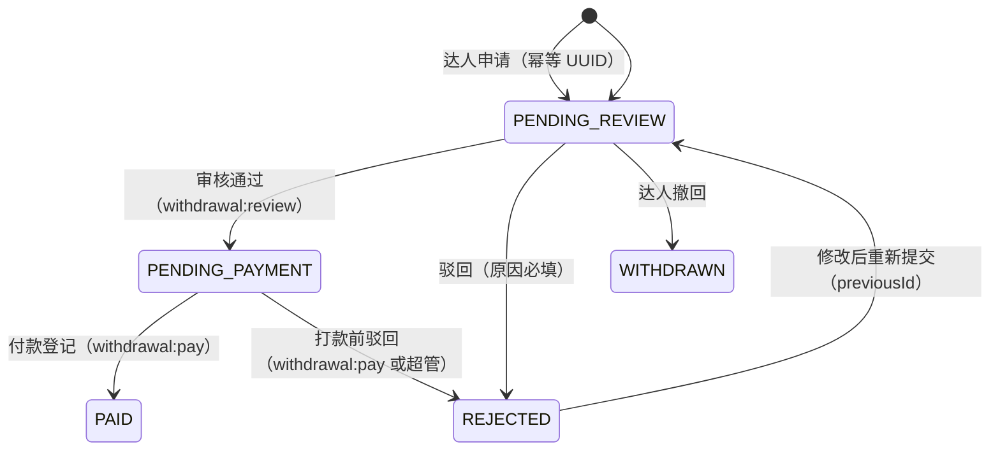

# ADR-032：佣金结算与提现模型

- 状态：已接受
- 日期：2026-10-24
- 覆盖：任务 61（接口契约）。设计说明书 §4.8、§5、§6.2、§6.3、§8、§9 与本 ADR 同批修订，冲突时以本 ADR 为准。
- 参考输入：PR #116（`origin/task/60-kol-portal`，佣金结算引擎与达人端）、PR #112（`origin/task/commission-finance-integration`，管理端财务页面与只读详情接口）、main 已合并的预付与钱包（PR #104、#105）。

## 背景

佣金这条线原由产品方并行开发：#116 建了一套结算引擎（9 张表 + 4 个控制器）和达人端页面，#112 建了管理端财务页面并自建了两个只读接口，两边各有一套提现表。负责人 2026-10-24 确定：**一份后端，两个前端**——管理端与达人端是给不同的人看的两个页面，用同一套数据；#116 的后端改由本侧任务 61～64 实现，#116 只保留达人端页面、#112 只保留管理端页面，两者都改为调用本侧接口；前端 PR 不新建表、不写迁移。本任务先定契约，两个前端与任务 62～64 都照此开发。

余额方面，main 已有预付任务建立的唯一余额权威：`crm_commission_wallet`（钱包）与 `crm_commission_ledger`（不可变台账），并有 `crm_commission_recovery` 持久化正向佣金对预付扣减的先进先出冲抵。任何新表不得成为第二套余额。

## 决定

### 1. 余额只有一个来源

- 钱包 `crm_commission_wallet` 与台账 `crm_commission_ledger` 是唯一余额权威。计佣快照、占用、提现工作流表只保存来源、分配与流程数据，**不保存任何余额列**；达人五层金额全部由它们推导：
  - **预估总佣金** = Σ 已核实商品行 `accrued_commission_cny`（含未释放部分）；
  - **冻结中** = Σ 已核实商品行（`accrued − released`），即已计提未释放；
  - **申请占用** = Σ 活跃申请（`PENDING_REVIEW` / `PENDING_PAYMENT`）的 `amount_cny`；
  - **已付** = −Σ 台账 `COMMISSION_WITHDRAWAL`（提现已付）与预付 `PAID` 实付合计，两者分列再加总；
  - **可提现** = 钱包 `balance_cny` − 申请占用（钱包余额已含预付冲抵，可为负；为负时不可提现）。
- 台账 `entry_type` 由现有两种扩展为四种（任务 62 以新迁移放宽 `ck_crm_commission_ledger_type`，不修改已合并脚本）：

| entry_type | 金额 | 写入时机 | 记账入口 |
|---|---|---|---|
| `COMMISSION_CREDIT` | > 0 | 冻结释放入账、归属修正后的正向差额 | `CommissionWalletService.postCommissionCredit`，自动按 #105 的 FIFO 冲抵未结清预付 |
| `COMMISSION_ADJUSTMENT` | < 0 | 已释放金额因退款成功、归属修正产生的负向差额 | 钱包服务新增负向记账方法，同一事务更新钱包，余额可为负 |
| `PREPAY_DEDUCT` | < 0 | 预付抵扣（已有，不变） | `postPrepayDeduct` |
| `COMMISSION_WITHDRAWAL` | < 0 | 提现付款登记核销 | 付款登记事务内写入 |

- `source_key` 约定（公司内唯一，幂等键）：释放与差额 `COMMISSION_ITEM:{item_state_id}:{source_version}`（`source_version` 带修订序号，2026-10-31 修订）；付款 `WITHDRAWAL:{withdrawal_id}`。
- 正向入账一律走 `postCommissionCredit`，这是预付冲抵与 #105 衔接的关键：释放到钱包的钱会立刻按发生时间、台账 ID 先进先出冲抵未结清预付扣减（`crm_commission_recovery`），`pendingDeduction`（未冲抵预付）随之收敛。#116 分支用带符号 `COMMISSION_ADJUSTMENT` 过账、绕过了冲抵，契约不采用。

### 2. 商品行级计佣来源快照；未核实不计提、不释放（11.01）

- 新表 `crm_commission_item_state`（每公司每订单商品行一行）保存计佣来源快照：来源键、来源版本、计提基数（`basis_cny`，2026-10-29 起付款后为订单实付按商品行分摊，结算确认后以「货款收入」为准）、成功退款、外部结算状态与结算时间、交易完成时间、归属达人、比例与规则版本、累计净计佣、已释放、释放依据与释放时间。
- 每次来源指纹与最新修订不同时追加一条 `crm_commission_item_revision`（只追加，2026-10-31 修订），保存本次基数、比例快照与钱包差额 `delta_cny`，满足 13.05「明细可追溯」与审计要求。
- 订单/退款同步在 `order` 模块内通过 `commission` 模块 `api` 登记来源快照；订单行导入时先落「未核实」行；付款后才按订单实付分摊计提（2026-10-29 修订）。
- **未核实不计提、不释放**：满足以下全部条件才算核实——订单已付款、归属为达人（归因类型 1 商品 ID / 2 人工）、支付时刻存在生效比例、基数可按商品行分摊。任一不满足则 `verified = FALSE`、累计计佣为 0、释放依据 `UNVERIFIED`。2026-10-29 起已付款即核实并计提（释放依据 `UNSETTLED`，冻结中），结算确认后才为 `CONFIRMED`。
- 计佣公式（§8.3 同步修订）：`计佣金额 = round_half_up(有效金额 × 比例, 2)`；计提基数 = 付款后订单实付的商品行分摊（2026-10-29 修订；成功退款由引擎扣减，`basisIncludesRefund = FALSE`）。结算前订单关闭按来源数据使有效金额归零，差额入账，不单独维护 CANCELLED 状态。
- 结算前全额退款不再有独立状态：来源修订把计提基数降为 0，冻结中部分差额为 0，已释放部分产生负向 `COMMISSION_ADJUSTMENT`。

### 3. 佣金比例沿用推广配置，不建比例版本表

- 比例取**支付时刻生效的推广配置**（任务 29 / ADR-025 已有版本）：`crm_kol_promotion_record` 中 `change_type='CONFIG'` 且 `effective_time ≤ pay_time` 的最新一条，取 `after_json->>'defaultRate'`，版本号即 `version_no`。**每位达人统一一个比例，不设商品级覆盖**（2026-10-25 修订）：原「商品级比例（`crm_product.rate`）优先于达人比例」的规则（§8.3 旧 [D7]）废止，`crm_product.rate` 列与商品编辑接口的 `rate` 字段不再参与计佣，保留兼容现有调用并标记废弃。
- **不建** #116 提出的 `crm_kol_commission_rate_version` 达人比例版本表：推广配置已有版本号与生效时间，另建一套会产生两个比例事实来源。比例展示用 `config_version`（推广配置版本号）。
- 上线基线：为已设置 `default_rate` 但没有任何 CONFIG 记录的达人补一条「上线基线」记录（`effective_time` = 佣金上线时间，备注注明来源），只对上线之后支付的订单生效；上线前支付且无版本比例的订单行保持未核实，由人工核实处理（M0 后再定）。商务补设比例不追溯（沿用 §8.3 规则）。

### 4. 结算配置版本表（11.03）

- 新表 `crm_commission_rule_version`（只追加，公司级）：`currency`（固定 CNY）、`minimum_withdrawal_cny`（默认 200.00）、`channel_rules`（JSONB，渠道冻结规则，如 `{"WEIDIAN":{"days":7}}`）、`version_no`（公司内递增）、修改人。
- 版本化的原因：每笔订单的释放时间取决于**支付时刻**生效的冻结天数，规则修改不能影响已计提订单的释放预期，所以要按订单快照规则版本，而不是只存当前值。`crm_config` 尚无按公司生效且带版本的实现，不满足 11.03「保留冻结依据及冻结天数配置」。
- 读取权限 `commission:view`（与提现权限 OR），修改仅超管；保存带 `expectedVersion` 乐观锁（不匹配 409），并写业务审计。
- 冻结依据 `basis` 枚举：`SETTLE_TIME`（按微店结算时间，微店 T+7）、`COMPLETED_PLUS_DAYS`（交易完成后 N 天兜底）；`days` 取 0～365，默认 7。

### 5. 冻结与释放规则（11.03 渠道冻结天数）

释放依据 `release_basis` 与释放时间 `release_at`：

| release_basis | 条件 | release_at |
|---|---|---|
| `CONFIRMED` | 微店结算时间有值 | 结算时间 |
| `FALLBACK` | 无结算时间，交易完成时间有值 | 交易完成时间 + 支付时规则版本的渠道冻结天数 |
| `UNSETTLED` | 未结算且未完成 | 空，不释放 |
| `AFTER_SALES` | 该行存在未核实完结的退款（`PROCESSING` / `SUCCESS` / `UNKNOWN`） | 空，阻断释放与新申请占用 |
| `UNVERIFIED` | 未核实（见第 2 条） | 空，不计提不释放 |

- 释放 = 把 `release_at ≤ 当前时间` 的已核实行的（累计净计佣 − 已释放）差额经 `postCommissionCredit` 写入钱包（`COMMISSION_CREDIT`），并更新行上 `released_commission_cny`；由定时任务批量执行（§9），申请提现前也会先释放到期行。
- 释放后来源修订使净计佣下降（退款、归属修正）时，下降差额以 `COMMISSION_ADJUSTMENT` 负向入账；余额因此为负的，由后续佣金入账按 FIFO 补足。
- 退款阻断联动：来源或退款状态变化重算 `after_sales`，凡占用该行的 `PENDING_REVIEW` / `PENDING_PAYMENT` 申请被置 `paused`（写 `PAUSED` 历史），恢复时置回并写 `RESUMED`；`paused` 的申请不能付款。

### 6. 提现占用与先进先出分配（13.04）

- 申请时把申请金额按商品行分配：候选行为已核实、非售后阻断、释放依据 `CONFIRMED` 且 `release_at ≤ 当前时间` 的行；行剩余 = `released_commission_cny − Σ 占用中（含 `PAID`）`；按 `release_at, order_item_id` 升序先进先出取满为止，剩余不足整单失败。
- 两级校验防止超额：钱包层 `金额 ≤ balance − 活跃占用`；行层分配成功。并发申请先锁钱包行、再锁行状态，重复幂等键由唯一约束兜底。
- 分配在**申请时**固化两组快照，之后不随数据变化改写：
  - 行级 `crm_commission_withdrawal_allocation`：`occupied_cny` + 行级 `remaining_snapshot_cny`（分配后该行剩余）；
  - 订单级 `crm_commission_withdrawal_order`：每张涉及订单一行，`occupied_cny` + 订单级 `remaining_snapshot_cny`。订单级剩余是**申请时刻持久化的历史值**，不得以当前钱包或行级快照求和代替（#112 明确要求，缺失返回 null 由前端显示待核实）。
- `PAID` 申请的占用计入行级已消耗（钱包已同额扣减），不计入钱包层活跃占用，两处不重复扣。
- 撤回（`WITHDRAWN`）与驳回（`REJECTED`）的申请占用自动失效（状态过滤），无需回滚脚本。

### 7. 提现状态机（13.02）

- 状态枚举：`PENDING_REVIEW` 待审核、`PENDING_PAYMENT` 待支付、`PAID` 已支付、`REJECTED` 已驳回、`WITHDRAWN` 已撤回。**不设** #112 类型里的 `PENDING_FINANCE_REVIEW`——提现只有一级审核（12.02），两级审核是预付的流程。
- 重新提交生成**新申请**并在 `previous_id` 关联原驳回单（校验为本人 `REJECTED` 单），原单保留作为历史，满足 12.02「达人可修改后重新提交」与 13.02「详情关联原审批单」。
- 达人被 `commission:freeze` 冻结（`crm_kol.settle_frozen`）时不能新建申请，已提交的不受影响（沿用 §4.8）。

### 8. 收款信息（12.01）

- 每次申请**必须提供**收款信息，二选一：引用本人已审核收款账户（`payout_account_id`，校验归属与 `APPROVED` 状态），或手填（PayPal：邮箱、收款人姓名、币种；USDT：地址、网络、二维码文件 ID、收款人姓名）。收款信息以密文快照保存在申请行上（复用 `SecretCipher` `v1:`），之后账户变化不影响本单；手填内容不写入达人长期账户档案（与预付 MANUAL 同思路）。
- 列表与普通详情只返回脱敏账号；完整快照仅 `withdrawal:pay`（付款登记）需要时解密返回，读取写审计；手填 USDT 的收款二维码沿用 `crm_file` 的 `PAYOUT_QR` 类型（任务 15a），由接口校验归属后回填业务归属。

### 9. 付款登记幂等（13.01）

- 请求带 `idempotencyKey`（UUID）+ 内容指纹（SHA-256）：同键同指纹重放返回原结果；同键不同指纹 409；同一申请已有付款事实再登记 409（**同一任务不得重复登记成功支付**）。
- 登记内容：实际支付金额、币种、支付时间、付款方式、财务备注、必填支付凭证（文件先传后登记）。`amount_cny` 必须等于申请金额；实际币种为 CNY 时实付金额必须相等，非 CNY 时必须填写换算说明。金额与币种只做留档核对，系统不折汇（沿用预付口径）。
- 登记成功在同一事务内：写 `crm_commission_withdrawal_payment`、写台账 `COMMISSION_WITHDRAWAL`（−申请金额）、更新钱包、状态置 `PAID`、写历史与通知。已付金额与占用状态随之更新（第 1、6 条口径）。

### 10. 退款与归属修正后的差额（10.02），不覆盖已付记录

- 修正以修订追加：商品行归属变化、退款成功、来源版本更新都生成新修订并计算差额；差额入台账（正向 `COMMISSION_CREDIT`、负向 `COMMISSION_ADJUSTMENT`），正向差额参与预付 FIFO 冲抵。
- **已付记录永不改写**：`crm_commission_withdrawal_payment` 与已 `PAID` 申请不可修改、不可回冲；修正使已付金额“多付”的，体现为钱包负余额由后续佣金补足，而不是改历史。订单/商务/商品统计的同步更新由 `order` 模块既有机制负责（10.02 前半段，任务 40 已实现部分），佣金侧只负责差额。
- 期间已打款（佣金 + 预付）与当前余额分开展示（11.02），差额不会让历史已付数字变化。

### 11. 商务转交时待办移交（07.05）

- 未完成待办（`PENDING_REVIEW` 提现申请、收款账户审核）**按达人当前所属商务实时计算**（与 §4.13 第 7 条一致）：转移生效后待办自动出现在新商务的列表中，未分配期间由超管处理；列表与审核接口的数据范围都按当前归属判断，不保存“待办归属”副本。
- 已完成审批保留原记录：历史表保存操作人姓名快照与时间，转移后不改写；详情里达人的商务显示名取当前归属并注明口径。
- 预付待办不变（预付保留原申请人，§4.13 第 7 条）。

### 12. 权限、编号、通知与错误码

- 权限：新增 `withdrawal:pay`（FUNDS 组，财务岗位模板默认携带），付款登记与打款前驳回、完整收款快照读取要求它；审核用既有 `withdrawal:review`；导出 `data:export` 与列表权限同时校验（AND）；冻结达人复用 `commission:freeze`；不引入 #116 引用但未登记的 `commission:config`。所有接口按 ADR-018 声明权限；商务 `OWN` 只能看名下达人。
- 编号：`W` + 北京时间 `yyyyMMdd` + 6 位当日序号，公司内唯一（§8.2 既有规则，Redis 自增 + 唯一索引兜底）；不用 #116 的 `CW+日期+ID`。
- 通知（复用 notification `api`，沿用预付 outbox 方式）：新增类型 `WITHDRAWAL_SUBMITTED`（通知当前商务与超管）、`WITHDRAWAL_APPROVED` / `WITHDRAWAL_REJECTED`（通知达人商务）、`WITHDRAWAL_PAID`（通知达人商务）；任务 63 以新迁移扩展 `crm_notification` 类型约束。
- 错误码（登记 `shared.ErrorCode`，任务 62/63 落地）：`WITHDRAWAL_BELOW_MINIMUM` 422、`WITHDRAWAL_INSUFFICIENT_AVAILABLE` 422、`WITHDRAWAL_STATE_CONFLICT` 409、`WITHDRAWAL_REQUEST_CONFLICT` 409（幂等键重放内容不同）、`WITHDRAWAL_NOT_RESUBMITTABLE` 422（previousId 不是本人已驳回单，触发于重新提交与申请两个入口）、`WITHDRAWAL_PAUSED` 409（阻断未解除）、`WITHDRAWAL_PAYMENT_CONFLICT` 409（重复付款）、`COMMISSION_CONFIG_VERSION_CONFLICT` 409（结算配置乐观锁）；其余复用 `COMMON_*` / `AUTH_*`。

### 13. 表清单（§5.2 同步）

沿用 #116 命名并调整，共 8 张新表；**不建** `crm_kol_commission_rate_version`（第 3 条），**新增**订单级占用快照表（第 6 条）：

| 表 | 用途 | 与 #116 差异 |
|---|---|---|
| `crm_commission_item_state` | 商品行计佣来源快照与释放状态 | 增加 `config_version`（推广配置版本号）替代 `rate_version_id` |
| `crm_commission_item_revision` | 商品行计佣修订（只追加） | 同上 |
| `crm_commission_rule_version` | 公司结算配置版本 | 基本沿用 |
| `crm_commission_withdrawal` | 佣金提现申请与收款快照 | 编号规则、状态、备注字段微调 |
| `crm_commission_withdrawal_order` | 订单级占用与剩余快照（申请时固化） | #116 无此表，为 #112 要求新增 |
| `crm_commission_withdrawal_allocation` | 商品行级占用与剩余快照 | 沿用 |
| `crm_commission_withdrawal_payment` | 付款事实（幂等） | 权限口径改为 `withdrawal:pay` |
| `crm_commission_withdrawal_history` | 状态与阻断历史 | 沿用 |

原 §5.2 草案的 `crm_commission_entry`（FROZEN/AVAILABLE 状态机明细）与 `crm_withdrawal`（余额制草案提现表）由本契约取代，不再建设。

### 14. 对两个前端的契约地位

- 契约文本以设计说明书 §6.2 / §6.3 接口表为准；本文附录 A、B 是 #112 `finance-types.ts` 与 #116 `creator.ts` 的逐字段对照，前端 PR 照此改字段名与类型，不新建表、不写迁移。
- 达人端门户支撑接口（`/kol-api/analytics/overview`、`/kol-api/me` 修改、订单与商品查询的基础扩展）由任务 64 按 #116 实现对齐，本 ADR 只覆盖资金相关字段（附录 B 标注）。

## 考虑过的方案

- **保留 #116 的达人比例版本表**：查询简单，但与推广配置版本形成两个比例事实来源，违反「比例沿用推广配置」的负责人决定，否决。
- **释放差额统一用带符号 `COMMISSION_ADJUSTMENT`（#116 做法）**：省一个入口，但绕过 `postCommissionCredit` 的预付 FIFO 冲抵，`pendingDeduction` 与余额口径分裂，与 #105 衔接失败，否决。
- **不建订单级快照表，由行级求和得出订单剩余**：#112 已明确禁止以求和代替订单级历史快照（商品行快照求和 ≠ 申请时刻订单剩余的独立证据），且订单级行同时是关联订单分页的稳定分页单位，建表成本小于口径风险。
- **提现金额申请即从钱包扣减（预扣）**：可少一层占用合计，但驳回/撤回频繁时钱包反复抖动，且台账要为「未付先扣」造假账目；占用只在付款时落台账更符合“已入账/已支付分离”（13.05）。
- **提现两级审核（对齐 #112 的 `PENDING_FINANCE_REVIEW`）**：12.02 原文只有商务/运营一级审核，预付才需要两级，不加。

## 修订记录

- 2026-10-27（任务 73，#133 第 5 条，负责人已确认）：附录 B `FundSummary.totalCommissionCny` 的合成口径由`cumulativePaid + occupied + frozen` 修正为 `commissionPaid + occupied + frozen`——达人端 `creator.ts` 实际按 `commissionPaid`（佣金提现口径）合成，原附录文字为笔误；后续对接按本行执行。
- 2026-10-26（任务 69，接口逐字段复核）：附录 A `SettlementQuery` 的店铺筛选参数由 `shop` 改为 `shopId`——设计说明书 §6.2 与后端实现均为店铺 ID（`orderNo`/`channel`/`shopId`），#112 前端已按 `shopId` 实现，原附录文字笔误。响应字段 `Settlement.shop`（店铺名称）不变。其余任务 63 接口按本附录与设计说明书 §6.2/§6.3 对齐：`finance-tasks` 行字段 `applicationNo`/`type`/`amount`、提现行 `amount`（非 `amountCny`）、`Allocation.id`、`history.{action,at,actor,note}`（不返回 `actorId`）、付款对象 `voucher`、收款快照含 `id`/`qrFileId`、达人端 `amount` 与 `account.id`、提现条件 `version`/`unverifiedCount` 为 JSON 数字。
- 2026-10-25（任务 68，负责人确认《1024前端调整内容》D12、D14）：① **每位达人统一一个佣金比例，不设单商品覆盖**——废止第 3 条与 §8.3 旧 [D7] 的「商品级比例（`crm_product.rate`）优先」规则，比例只取支付时刻生效的推广配置（`defaultRate` 与 `version_no`）；已保存的商品行比例快照不变；共享库尚无商品设置 `crm_product.rate`，不涉及历史数据；`crm_product.rate` 列与商品编辑接口的 `rate` 字段保留兼容但标记废弃、不参与计佣。② **店铺获利口径改为「微店结算净额 − 净达人佣金」，不扣商品成本**——取代原「支付 − 退款 − 佣金」；「微店结算净额」是微店侧结算字段，待 M0 核实（Q-1017-1/2）前 `Settlement.retained` 一律返回 null 待核实，不得用买家实付减佣金代替。附录 A `Settlement.retained` 说明同步修订。
- 2026-10-24（任务 63 实施时，经负责人预审认可）：达人提现冻结不采用本 ADR §7 所写 `crm_kol.settle_frozen` 字段（main 中不存在该字段，且冻结历史有审计价值），改为独立表 `crm_commission_withdrawal_freeze`（部分唯一索引保证一个生效冻结；冻结/恢复接口 `POST /admin-api/commission/withdrawal-freezes`、`PUT .../{kolId}/resume`，均 `commission:freeze`）。冻结期间不能新建申请，已提交申请不受影响。`crm_commission_withdrawal_sequence`（含 `tenant_id`，公司+北京日期唯一）分配 `W`+日期+六位序号，与 §8.2「公司内唯一」一致，实现采用序列表而非 Redis 自增（与预付 `PP` 编号同方案）。
- 2026-10-28（任务 75，微店结算字段只读实测；实测依据见 [`75-微店结算字段-实测结果.md`](../04-开发任务/75-微店结算字段-实测结果.md)）：
  - **计佣口径（负责人 2026-10-28 确认）**：按 R15 计算——佣金 = 微店回传的**可提现金额** × 达人佣金比例。数据统计口径第 16 行与 DR-14 中「以微店回传为准」理解为：**计佣基数取自微店**，不是由微店直接给出佣金金额、系统只做转发；微店不回传达人佣金，比例仍由本系统按支付时刻的推广配置套用。
  - **字段来源表**（每行注明实测状态）：

    | 快照字段 | 来源 | 实测状态（2026-10-28，店铺尚无已结算订单） |
    |---|---|---|
    | 可提现金额（`basis_cny`） | 同一订单在 `shop.order.trade.detail` 中所有流水的合计 | 接口已证实可调用（本店服务型应用不带 `ctx` 成功，无需申请权限）；但近 12 个月无结算样本，`tradeType`/`tradeSubType`/`orderId`/`amount` 单位全部待复测 |
    | 结算时间（`settled_time`） | 「货款收入」那一笔的 `tradeTime` | 待复测（无结算样本；`tradeTime` 的具体时点未证实） |
    | 结算前预估 | `vdian.order.get` 的 `last_income` | 已证实不可作计佣基数：全额退款关闭的订单 `last_income` 仍为原值（不扣退款），只能作预估展示 |
    | 交易完成时间 | 订单详情中没有该字段 | 已证实：`vdian.order.get` 无结算、收货、完成时间字段 |

  - 实测补充：整 3 个日历月的时间跨度被 `shop.order.trade.detail` 拒绝（错误码 -1「查询时间跨度不能超过3个月」），拉取窗口须 ≤ 约 89 天。
  - **留给后续开发任务（D2 接入）决定、本任务不定**：① 订单级可提现金额如何拆分到商品行；② 可提现金额中包含运费，是否照样计佣（需负责人确认）；③ 拿不到完成时间时，`COMPLETED_PLUS_DAYS` 兜底如何取时间；④ 结算明细的拉取频率和窗口。第 2 条正文不变。
- 2026-10-28（任务 76，D2 接入；负责人确认口径见任务 76 提示词 §2）：上一条「留给 D2 决定」的四点按负责人 2026-10-28 确认落地：
  - **运费照样计佣**，不从可提现金额中扣除（可提现金额即该订单 `shop.order.trade.detail`（`INCOME_DETAIL`）全部流水带符号合计）。
  - **单达人订单按商品行实付比例记账**：可提现金额只给整单一个数，系统按「商品行实付 ÷ 订单各商品行实付之和」分摊到各商品行，尾差（四舍五入到分）计入实付最大的行（相同时取商品行 ID 最小）；一单出现多个达人时整单不核实（`MULTIPLE_KOLS`，记 WARN 只含订单 ID）。
  - **不设 `COMPLETED_PLUS_DAYS` 兜底**，只按结算时间释放：结算时间 =「货款收入」一笔的 `tradeTime`，同时写入 `crm_order.settled_time`；没有结算流水的订单保持 `UNSETTLED` 不释放。结算前全额退款（`PRE_SETTLE_REFUND`）基数为 0.00、视为已核实。
  - **拉取频率进平台系统配置**：`weidian.settlement.sync-interval-minutes`（默认 60，15～1440，每次增量拉最近 3 天）与 `weidian.settlement.backfill-hour`（默认 3，0～23，北京时间，每日回扫最近 89 天）；固定每 5 分钟调度检查、改配置不用重启。结算流水表 `crm_order_settlement_flow`（按指纹幂等去重，订单号只做完全匹配）落在 `order` 模块。
  - **金额单位常量 + 校验**：结算明细 `amount` 单位默认按**分**（任务 75 审查注判断，未证实），常量旁注明待 M0 第 11 步确认；核实条件要求「恰好一笔货款收入且换算后等于订单实付 `pay_amount`」，单位或字段理解错误落入 `INCOME_MISMATCH`，整单保持未核实。未核实原因代码（`NO_SETTLEMENT` / `UNKNOWN_FLOW_TYPE` / `INCOME_MISMATCH` / `MULTIPLE_KOLS` / `ALLOCATION_FAILED`）持久化在 `crm_order.commission_basis_reason` 可查。

- 2026-10-29（任务 81，负责人 2026-10-29 决定，偏离进度表 11.01；取代上一条任务 76 的「微店流水合计」计佣口径）：
  - **计提基数 = 订单实付 `pay_amount`（含运费）**，按商品行实付比例分摊（沿用任务 76 的分摊与尾差规则，分摊对象改为订单实付）；**付款即计提**，佣金状态为「冻结中」并显示金额。结算确认后基数改为「货款收入」金额，数值与实付相同。模拟订单（实付 65.00，A 40.00 + B 20.00）按 10% 计提 4.33 + 2.17 = 6.50。
  - **结算只作确认**：`INCOME_DETAIL` 中恰好一笔「货款收入」、带 `tradeTime`、金额等于实付，才设结算时间并释放；未满足保持冻结并记 `NO_SETTLEMENT` / `INCOME_MISMATCH`。手续费、分润（平台服务费）、退款与其他子类型只入库、只展示，不参与计算、不阻断确认。`UNKNOWN_FLOW_TYPE` 原因代码取消。
  - **依据**：手续费与分润与佣金无关，任务 76 把它们计入基数，使模拟订单（[全流程模拟记录](../04-开发任务/全流程模拟-20261029-记录.md)）结算前佣金为 0、结算后为 6.47（64.70 基数）。负责人确认：佣金按订单实付计，只有结算确认后才可提现。
  - **结算明细**（L-024）：「净增减」改为「微店可提现金额」（该单 `INCOME_DETAIL` 流水合计，只展示，无结算流水为 null）；「店铺获利」删除；`payment` 改为订单实付（含运费）；行状态为 `UNVERIFIED` / `FROZEN` / `POSTED` 三种。订单链路资金卡与商品行删除「店铺获利」。
  - **偏离 11.01**：进度表原文「有效金额为微店后台显示订单可提现金额」改为订单实付，设计说明书 §4.8、§8.3、§8.4 同步修订，执行报告逐条复核。
  - **不改**：比例来源、释放任务、提现分配、预付冲抵、钱包台账与结算流水拉取；不新增迁移，不做已有订单批量重算（负责人确认现在没有真实订单）。附录 A 的 `Settlement.retained` 已删除；§5 表中 `FALLBACK` 依据已于任务 76 取消，本次修订记录仅作注明，表格历史行不改。
- 2026-10-30（任务 81，PR #158 架构师审查回复，取代上一条「结算流水退款不参与计算」）：
  - **退款三信号**：订单关闭、CRM 退款记录（`crm_refund`）、结算流水「退款」行（`tradeSubType = 退款`）。同一笔退款只计一次。
  - **付款后关闭**（`CLOSED` 且有 `pay_time`）：整单基数为 0，不依赖退款是否已同步。
  - **部分退款**：C = CRM 成功退款合计，F = 结算流水退款绝对值合计。F ≤ C 以 CRM 为准；F > C 时差额按实付比例补扣到各行（计入成功退款），记 WARN（只写订单 ID）。
  - **阻断释放**：只有 `PROCESSING` / `UNKNOWN` 阻断（`AFTER_SALES`）；`SUCCESS` 已从基数扣除，不再阻断。阻断期间该行显示冻结。
  - **结算确认**：货款收入等于实付，或等于实付减 CRM 成功退款，均确认；基数仍按实付分摊。
  - **结算后全额退款**：基数降为 0，已释放部分走负向调整 `COMMISSION_ADJUSTMENT`，可为负。
  - **未付款不计入待核实**（负责人 2026-10-30）：`unverified_count` 只统计已付款订单的未核实行，未付款订单不阻塞提现、不进入达人端提示。实现：未付款订单的行结算状态写为 `UNPAID`（迁移 `V202610301000`，存量行一并回填），计数条件为 `NOT verified AND settlement_state != 'UNPAID'`，不再在计数 SQL 中读取 `crm_order`（架构师 M2，跨模块读表）。
- 2026-10-30（任务 81，架构师 M1 审查）：已核实且计提为零的行（如全额退款）达人端状态为 `NO_COMMISSION`「无佣金」，不再显示为待核实；`INVALID` 只表示未核实。`FROZEN` 的售后分支要求计提大于零。未付款订单的订单级与行级状态为空（前端「—」）。
- 2026-10-31（任务 83，遗留 L-037，须在 M0 补齐 `RefundDictionary` 之前完成）：来源指纹会回到历史值，原来只和最新版本比较，修订表唯一索引 `uk_crm_commission_item_revision_version` 冲突，事务回滚：结算重算失败时该店检查点不前进，订单和退款同步停止更新这笔订单。触发路径有确认后变成金额不符、退款撤销或被拒，以及任务 83 复现时发现的金额精度差异（订单写入是 `0`，结算重算读库是 `0.00`，每次订单同步后再重算都会回到历史指纹）。决定：
  - **来源版本带修订序号**：`source_version` 写为 `{指纹}#{修订序号}`，序号按商品行从 1 递增。跳过判断只比较指纹部分：与最新修订相同则跳过，不同就追加。存量行是不带序号的指纹，按序号 0 处理，下一条修订从 1 开始，不回填。
  - **钱包幂等键随之变化**：`COMMISSION_ITEM:{item_state_id}:{source_version}` 与归属回冲的 `:K{原达人ID}` 不改格式、不改代码。回退后每次真实变动都有新键，不会被当作已入账跳过；释放也不再撞上第一次入账的键（原来「源键冲突」分支会把补回的释放吞掉）。重复同步在比较指纹时就跳过，不重复入账。同一修订内差额和释放不会同时发生：差额入账后已释放等于计提，没有可释放金额。
  - **指纹里的金额统一两位小数**：基数和成功退款先按两位小数规范，同一金额只有一个指纹。存量行中用 `0` 算出的指纹，下次同步最多多一条修订，钱包差额为 0。
  - **不改**：唯一索引、台账与释放代码、`RefundDictionary`。迁移 `V202610311000` 只更新两列注释。
  - 不新增 `revision_no` 列：那样要加两列、回填并替换唯一索引，换来的只是不用解析版本串。

## 影响

- 任务 62（计佣、冻结释放、结算配置、收入与结算明细）、63（提现全流程、财务任务列表、待办移交）、64（门户支撑）按本 ADR 与设计说明书实现；实现中发现契约需要调整时先停下报告。
- 前端 #116、#112 按附录 A、B 调整字段与类型；`PENDING_FINANCE_REVIEW`（提现）、`CW` 编号、`estimatedTotal/availableTotal` 等被契约否决的字段由前端下线。
- 微店有效金额、结算时间、退款状态等来源字段的实际取值仍待 M0 / Q-1017-1/2 核实；核实前全部计佣行保持未核实，不影响流程开发。
- 数据库迁移由任务 62（`V202610251000`～`V202610251019`）与任务 63（`V202610251100`～`V202610251119`）以新脚本实现，含放宽 `crm_commission_ledger` 类型约束与 `crm_notification` 类型约束；已合并迁移不改。

## 附录 A：#112 `finance-types.ts` 字段对照

| 前端字段（finance-types.ts） | 契约字段 | 说明 |
|---|---|---|
| `Page<T>.total: string` | `total: number` | 分页 total 全站为数字，前端类型改为 number |
| `IncomeQuery.{keyword,paymentType,start,end,page,size}` | `GET /admin-api/commission/incomes` 同名参数 | `paymentType` 取 `COMMISSION` / `PREPAY` |
| `Metrics.estimated / frozen / available / occupied / cumulativePaid / deducted / pendingDeduction / paid / commissionPaid / prepayPaid / unverified` | 同名（收入行与汇总） | 金额字符串；`unverified` 为数字 |
| `Income.{id,name,code,email,bdId,bd,orderCount,quantity,lastPaidAt}` | 同名 | `bdId` 可空（未分配商务） |
| `IncomeResult.summary.{paid,commissionPaid,prepayPaid,creators,orders,quantity,unverified}` | 同名 | 11.02 汇总行 |
| `CommissionLine.{id,orderNo,itemId,product,sku,base,rate,rateVersion,ruleVersion,commission,adjustment,releaseBasis,businessAt,direction,kol}` | 同名 | `rateVersion` = 推广配置 `version_no`；`releaseBasis` 枚举见第 5 条 |
| `CommissionLine.image` | `image` | 契约新增：商品主图 URL（取不到为 null） |
| `CommissionLine.subject` | `subject` | 契约新增：金额主体（`KOL` 达人 / `COMPANY` 公司 / `SYSTEM` 系统） |
| `Payment.{id,sourceNo,type,kolId,amountCny,paidAt,deduct,deducted,pending,actualAmount,actualCurrency,voucher,withdrawalId}` | 同名 | `sourceNo` 为提现/预付申请编号；`voucher` 为凭证文件 ID |
| `IncomeDetail.{income,lines,payments}` | `GET /admin-api/commission/incomes/{id}` 响应 | 11.02 详情 |
| `Allocation.{id,orderNo,image,product,sku,occupied,remainingSnapshot}` | 详情 `allocations[]` 同名 | `image` 契约新增 |
| `Allocation.orderRemainingSnapshot?` | 不返回 | 订单级剩余只在 `GET .../orders` 返回，前端从该接口取 |
| `WithdrawalOrder.{id,orderNo,products[],occupied,remainingSnapshot}` | `GET /admin-api/commission/withdrawals/{id}/orders` | 每单一行；`remainingSnapshot` 缺失为 null |
| `AccountSnapshot.{id?,qrFileId?,type,account,currency,network,holder}` | 详情 `account` | 脱敏账号；完整账号仅 `withdrawal:pay` 读取（独立接口并记审计） |
| `Withdrawal.{id,applicationNo,kolId,kolName,kolCode,type,amount,currency,status,createdAt,paused,pauseReason,note,reviewNote,financeNote,history,payment,previousId}` | `GET /admin-api/commission/withdrawals/{id}` 同名 | `status` 无 `PENDING_FINANCE_REVIEW` |
| `Withdrawal.bdId / bdName` | `bdId` / `bdName` | 达人当前所属商务（未分配为 null）；07.05 移交后随当前归属 |
| `Withdrawal.operationsNote` | 不返回 | 前端改用 `reviewNote`（运营审核备注同一来源） |
| `Withdrawal.estimatedTotal / availableTotal` | 不返回 | 前端下线或显示「—」；总览数据用 `/commission/incomes` |
| `Withdrawal.history.{action,at,actor,note}` | 同名 | `actorId` 不返回；`note` 对本人与持 `withdrawal:review` 者可见 |
| `WithdrawalQuery.{applicationNo,kolId,bdName,status,page,size}` | 同名，`bdName` → `bdUserId` | 商务筛选用 ID 下拉；另有 `kolKeyword`（编号/名称模糊） |
| `PaymentRegistration.*` | `PUT .../withdrawals/{id}/payment` 请求体同名 | 另加 `idempotencyKey`；`amountCny` 必须等于申请金额 |
| `WithdrawalRequest.{payoutAccountId,amount,account,note,previousId,idempotencyKey}` | 达人端 `POST /kol-api/withdrawals` | 管理端不代达人申请 |
| `Settlement.{id,orderNo,channel,shop,kolNames[],payment,refund,weidianWithdrawable,commission,rates[],status,businessAt,lines[]}` | `GET /admin-api/commission/settlement-details` 同名 | `payment` = 订单实付 `pay_amount`（含运费，2026-10-29）；`weidianWithdrawable` = 该单微店结算流水合计，仅展示，无结算流水为 null（前端显示「-」）；`status` = `UNVERIFIED`（存在未核实行）/ `FROZEN`（已计提未释放）/ `POSTED`（全部已释放）；`retained`（店铺获利）已于 2026-10-29（L-024）删除；`scopeLimited` 由前端按自身数据范围推 |
| `SettlementQuery.{orderNo,channel,shopId,page,size}` | 同名 | 13.05；`shopId` 为店铺 ID（2026-10-26 任务 69 修订，原 `shop` 与设计说明书 §6.2 及实现不一致） |
| `SettlementConfig.{currency,minimum,version,channels[]}` | `GET/PUT /admin-api/commission/settlement-configs/current` | 读取响应含 `channels[]`（`basis` 枚举 `SETTLE_TIME` / `COMPLETED_PLUS_DAYS`）；保存请求为 `{version, minimum, days}`（当前仅微店一个渠道，前端把 `channels` 折叠为 `days` 提交），`version` 为读取响应原样带回的乐观锁版本，不匹配 409 `COMMISSION_CONFIG_VERSION_CONFLICT` |
| `uploadWithdrawalVoucher` | `POST /admin-api/files`（multipart `file` + `bizType=WITHDRAWAL_VOUCHER`） | 返回 `{fileId}`，权限 `withdrawal:pay` |
| `downloadWithdrawalVoucher` | `GET /admin-api/files/{id}` | 按文件所属业务鉴权 |
| `exportWithdrawals` | `GET /admin-api/commission/withdrawals/export` | `data:export` AND 列表权限；CSV 流式下载 |
| `WithdrawalStatus.PENDING_FINANCE_REVIEW` | 删除 | 提现单级审核；该值只出现在预付类型行 |

## 附录 B：#116 `creator.ts` 字段对照

| 前端字段（creator.ts） | 契约字段 | 说明 |
|---|---|---|
| `getFundSummary` ← `{income}` | `GET /kol-api/commissions/overview` → `{income, asOf}` | `income` 含 `estimated / available / occupied / cumulativePaid / frozen / deducted / pendingDeduction / prepayPaid / paid / commissionPaid` |
| `FundSummary.totalIncomeCny` | `income.paid` | 已付合计 = 佣金 + 预付 |
| `FundSummary.commissionIncomeCny` | `income.commissionPaid` | |
| `FundSummary.estimatedCommissionCny` | `income.estimated` | 预估总佣金（11.02） |
| `FundSummary.totalCommissionCny` | 前端合成 | `commissionPaid + occupied + frozen`，契约不提供 |
| `FundSummary.withdrawnCny` | `income.cumulativePaid` | |
| `FundSummary.withdrawingCny` | `income.occupied` | |
| `FundSummary.frozenCny` | `income.frozen` | |
| `FundSummary.receivedPrepayCny` | `income.prepayPaid` | |
| `FundSummary.availableCny` | `income.available` | 钱包余额 − 申请占用（11.03 口径） |
| `FundSummary.prepayDeductionCny` | `income.deducted` | 已冲抵预付 |
| `FundSummary.prepayOutstandingCny` | `income.pendingDeduction` | 未冲抵预付 |
| `FundSummary.asOf` | `asOf` | 契约新增 |
| `FundRecord.{id,type,appliedAt,applicationNo,amount,currency,maskedRecipient,receivedAt,publicStatus,sourceId}` | `GET /kol-api/fund-records` 同名 | 佣金与预付付款流水统一；`sourceId` 跳详情 |
| `getWithdrawalConditions` ← `{currency,minimum}` | `GET /kol-api/withdrawals/conditions` → `{currency,minimum,version,available,occupied,frozen,estimated,withdrawalFrozen,canApply,unverifiedCount}` | 契约多出的字段供提现条件页展示（11.03）；`canApply` 为服务端综合判定 |
| `WithdrawalAccountOption.{id,accountType,account,holderName,currency,network}` | `GET /kol-api/withdrawals/recipient-options` 返回 `{id,type,account,holder,currency,network}` | 字段名差异已由前端映射函数处理，保持现状 |
| `WithdrawalRecord.{id,applicationNo,amount,currency,status,createdAt,account}` | `GET /kol-api/withdrawals` 行 | `account.type` 同上；账号一律脱敏 |
| `submitWithdrawal({amount,payoutAccountId?,account?,note,idempotencyKey})` | `POST /kol-api/withdrawals` 同名 + `previousId?` | 驳回后重提传 `previousId` |
| `withdrawWithdrawal(id)` | `PUT /kol-api/withdrawals/{id}/withdraw` | 仅本人 `PENDING_REVIEW` |
| `getCreatorOrders` ← 行 `settlementStatus`、行内 `rateSnapshot` / `commissionAmount` / `settlementStatus`，筛选 `orderNo / productName / settlementStatus` | `GET /kol-api/orders` 扩展 | 行级结算状态映射：`WITHDRAWN` 已付核销 / `WITHDRAWING` 被活跃申请占用 / `WITHDRAWABLE` 已释放未占用 / `FROZEN` 冻结中 / `INVALID` 未核实 / `NO_COMMISSION` 已核实且计提为零；订单级取最活跃行（`WITHDRAWING` > `WITHDRAWABLE` > `FROZEN` > `WITHDRAWN` > `INVALID` > `NO_COMMISSION`），未付款订单为空 |
| `getCreatorAnalytics` → `/analytics/overview` | 不在本契约 | 门户支撑接口，任务 64 对齐 #116 实现 |
| `getWithdrawals / getWithdrawalAccounts` 其余字段 | 同名或已有接口 | 收款账户维护沿用 `/kol-api/payout-accounts`（任务 15a） |

> 命名提醒：`SettlementStatus.WITHDRAWN`（达人订单行：佣金已付核销）与提现申请状态 `WITHDRAWN`（达人撤回申请）同名异义，沿袭 #116 词表；前端展示文案需分别取「已提现」与「已撤回」。§4.8.2 状态图中的 `FROZEN` / `RELEASABLE` 为概念态，落库字段以 `verified` / `release_basis` / `release_at` 为准。
